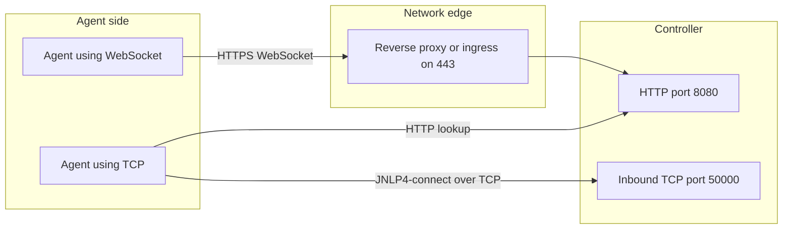
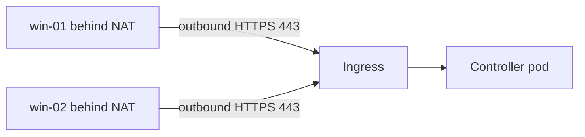

# Inbound (JNLP) Agents

## Introduction

With an [SSH agent](./1-jenkins-ssh-agents.mdx), the controller reaches out to the agent. An **inbound agent** works the other way round: the agent starts `agent.jar` itself and **connects to the controller**. The controller never needs network access to the agent.

That makes inbound agents the natural choice when:

- the agent sits behind NAT, a home router or a corporate firewall,
- the agent is a Windows machine where SSH is awkward,
- the agent is a container or pod that starts itself (the Kubernetes plugin uses inbound agents under the hood),
- your security team allows outbound HTTPS from build machines but no inbound connections to them.

Think of a delivery driver who phones the dispatch office at the start of the shift: "I'm here, what have you got?" The office never needs the driver's home address. It only needs to answer the phone.

### About the name "JNLP"

These agents were long called **JNLP agents**, because they were originally launched through Java Web Start, which used `.jnlp` files. Java Web Start is gone, and the Jenkins remoting documentation now calls the old name "erroneous and confusing". The UI calls the launch method **Launch agent by connecting it to the controller**. You still see "JNLP" in a few places, such as the `jnlp` container name in Kubernetes pods and the protocol name `JNLP4-connect`.

## Two Transport Options: WebSocket or TCP

An inbound agent can reach the controller in two ways.



| Transport | Ports needed | Pros | Cons |
| --- | --- | --- | --- |
| **WebSocket** (`-webSocket`) | Only the normal HTTP(S) port | One port, passes through reverse proxies and ingress, simple firewall rules | Proxy must allow WebSocket upgrades; a little more proxy load |
| **TCP** (`JNLP4-connect`) | HTTP(S) for discovery plus a TCP port, usually 50000 | Long-standing default, efficient | Extra port to open and route; awkward behind load balancers |

WebSocket support arrived in Jenkins 2.217 and is now the simplest choice for most new setups, especially when the controller sits behind a reverse proxy or a Kubernetes ingress.

### The TCP agent port

If you use TCP, set the port in **Manage Jenkins → Security → Agents → TCP port for inbound agents**. The options are **Fixed** (pick a port, usually `50000`), **Random** (avoid it, firewalls cannot follow it) and **Disable**. If all your inbound agents use WebSocket, you can disable the TCP port, which removes one listening port from the controller.

In the official Docker image, the TCP port is 50000, which is why the install pages publish `-p 50000:50000`.

## Step 1: Create the Node

**Manage Jenkins → Nodes → New Node**, name `win-build-01`, **Permanent Agent**:

| Field | Value |
| --- | --- |
| Number of executors | `1` |
| Remote root directory | `C:\jenkins` (Windows) or `/home/jenkins/agent` (Linux) |
| Labels | `windows msbuild` |
| Usage | Only build jobs with label expressions matching this node |
| Launch method | Launch agent by connecting it to the controller |
| Use WebSocket | Ticked |
| Availability | Keep this agent online as much as possible |

After saving, open the node. Jenkins shows the exact command to run, including a **secret**. The secret is an HMAC tied to this node name. Anyone with it can connect as this agent, so treat it like a password.

## Step 2: Run agent.jar

Download `agent.jar` from your own controller so the version always matches:

```bash
curl -sO https://jenkins.example.com/jnlpJars/agent.jar
```

Save the secret in a file readable only by the agent user, then start the agent:

```bash
echo "3f2c9a...your-secret..." > /home/jenkins/agent-secret
chmod 600 /home/jenkins/agent-secret

java -jar agent.jar \
  -url https://jenkins.example.com/ \
  -name linux-remote-01 \
  -secret @/home/jenkins/agent-secret \
  -webSocket \
  -workDir /home/jenkins/agent
```

The `@` prefix tells `agent.jar` to read the value from a file. That keeps the secret out of `ps` output and shell history.

Example output:

```text
INFO: Using /home/jenkins/agent/remoting as a remoting work directory
INFO: Both error and output logs will be printed to /home/jenkins/agent/remoting
INFO: Jenkins agent is running in headless mode.
INFO: Agent discovery successful
  Agent address: jenkins.example.com
  Identity: 4a:9c:...:e1
INFO: WebSocket connection open
INFO: Connected
```

Without `-webSocket`, the agent first calls the controller over HTTP to discover the TCP port, then opens the TCP connection. You will see `Agent discovery successful` followed by `Remote identity confirmed` and `Connected`.

### Other useful options

| Option | Purpose |
| --- | --- |
| `-workDir` | Enables the remoting work directory for logs and the JAR cache. Always set it. |
| `-direct HOST:PORT` | Connect straight to the TCP port, skipping HTTP discovery. Useful when HTTP is behind SSO but the TCP port is reachable. Needs `-instanceIdentity`. |
| `-tunnel HOST:PORT` | Route the TCP connection through a different host and port, such as a TCP load balancer |
| `-noCertificateCheck` | Skips TLS validation. Only for labs with self-signed certs. Prefer adding your CA to the Java trust store. |

Run `java -jar agent.jar -help` to see all options for your version.

## Step 3: Keep It Running

A command in a terminal dies when you log out. Run the agent as a service.

### Linux: systemd

```text
# /etc/systemd/system/jenkins-agent.service
[Unit]
Description=Jenkins inbound agent
After=network-online.target
Wants=network-online.target

[Service]
User=jenkins
WorkingDirectory=/home/jenkins
ExecStart=/usr/bin/java -jar /home/jenkins/agent.jar \
  -url https://jenkins.example.com/ \
  -name linux-remote-01 \
  -secret @/home/jenkins/agent-secret \
  -webSocket \
  -workDir /home/jenkins/agent
Restart=always
RestartSec=10

[Install]
WantedBy=multi-user.target
```

```bash
sudo systemctl daemon-reload
sudo systemctl enable --now jenkins-agent
systemctl status jenkins-agent --no-pager
```

Example output:

```text
● jenkins-agent.service - Jenkins inbound agent
     Loaded: loaded (/etc/systemd/system/jenkins-agent.service; enabled)
     Active: active (running) since Sun 2026-10-11 09:30:12 UTC; 4s ago
   Main PID: 2741 (java)
```

`Restart=always` brings the agent back after crashes, controller restarts and network blips.

:::note agent.jar updates
Unlike SSH agents, a self-started inbound agent keeps the `agent.jar` you downloaded. After major Jenkins upgrades, download a fresh copy from `/jnlpJars/agent.jar` and restart the service. A small `ExecStartPre=` line that runs `curl` before each start automates this.
:::

### Windows

On Windows, run the same `java -jar agent.jar ...` command as a Windows service. The old GUI-based service installer has been removed. Common options today are a service wrapper such as WinSW, or Task Scheduler with "run at startup". Use a dedicated local or domain account with only the rights the builds need. See the [Managing Nodes](https://www.jenkins.io/doc/book/managing/nodes/) documentation for current Windows guidance.

## Inbound Agents in Docker

The official `jenkins/inbound-agent` image contains Java and `agent.jar`, and runs it as its entrypoint. Tags include `jdk21`, `jdk25`, `alpine-jdk21`, Windows Server Core variants and versioned tags; see [Docker Hub](https://hub.docker.com/r/jenkins/inbound-agent/tags).

```yaml
# compose.yaml
services:
  agent:
    image: jenkins/inbound-agent:jdk21
    init: true
    restart: unless-stopped
    environment:
      JENKINS_URL: "https://jenkins.example.com/"
      JENKINS_AGENT_NAME: "docker-inbound-01"
      JENKINS_SECRET: "${AGENT_SECRET}"
      JENKINS_WEB_SOCKET: "true"
      JENKINS_AGENT_WORKDIR: "/home/jenkins/agent"
    volumes:
      - agent-work:/home/jenkins/agent

volumes:
  agent-work:
```

```bash
AGENT_SECRET=3f2c9a...your-secret... docker compose up -d
docker compose logs agent | tail -3
```

Example output:

```text
agent-1  | INFO: Agent discovery successful
agent-1  | INFO: WebSocket connection open
agent-1  | INFO: Connected
```

`init: true` (or `--init` with `docker run`) adds a tiny init process that reaps zombie processes, which the image README recommends.

:::info Environment variables vs arguments
The image README marks the individual variables (`JENKINS_URL`, `JENKINS_SECRET` and so on) as deprecated in favor of passing options directly, or through `REMOTING_OPTS`. They still work at the time of writing. If you prefer the future-proof form, pass the same flags as command arguments: `-url ... -secret ... -name ... -webSocket`.
:::

To add build tools, extend the image:

```dockerfile
FROM jenkins/inbound-agent:jdk21
USER root
RUN apt-get update \
 && apt-get install -y --no-install-recommends git make python3 \
 && rm -rf /var/lib/apt/lists/*
USER jenkins
```

## Define Inbound Nodes as Code

With [JCasC](../12-jenkins-administration/0-jenkins-configuration-as-code.mdx), based on the official `build_agents` demo:

```yaml
jenkins:
  nodes:
    - permanent:
        name: "win-build-01"
        labelString: "windows msbuild"
        mode: EXCLUSIVE
        numExecutors: 1
        remoteFS: "C:\\jenkins"
        launcher:
          inbound:
            webSocket: true
            workDirSettings:
              disabled: false
              failIfWorkDirIsMissing: false
              internalDir: "remoting"
    - permanent:
        name: "linux-remote-01"
        labelString: "linux remote-office"
        mode: EXCLUSIVE
        numExecutors: 2
        remoteFS: "/home/jenkins/agent"
        launcher:
          inbound:
            webSocket: true
```

The secret is derived by the controller from the node name and the controller's secret key, so you do not set it in YAML. Read it from the node page. For automation, an administrator can print it from the script console:

```groovy
println jenkins.model.Jenkins.get().getComputer('linux-remote-01').getJnlpMac()
```

Example output:

```text
3f2c9a7e4b1d...e81
```

Older guides fetch the secret from `/computer/NAME/jenkins-agent.jnlp`. Recent Jenkins versions mark that endpoint as deprecated, so do not build new automation on it. Whatever you use, run it with a dedicated service account and API token, never an admin's personal password, and store the result in a secret manager.

## Troubleshooting Inbound Agents

Inbound agents log to the console (or the service log) and to the remoting work directory (`-workDir`, under `remoting/logs`). Start there:

```bash
journalctl -u jenkins-agent -n 30 --no-pager
ls /home/jenkins/agent/remoting/logs
```

Example output with a wrong secret:

```text
INFO: Agent discovery successful
INFO: Handshaking
SEVERE: The server rejected the connection: None of the protocols were accepted
```

| Symptom | Likely cause | Fix |
| --- | --- | --- |
| `Failed to connect to https://.../tcpSlaveAgentListener/` | Wrong `-url`, or the TCP port is disabled while the agent uses TCP | Fix the URL, or add `-webSocket` |
| `None of the protocols were accepted` or `rejected` | Wrong secret or wrong agent name | Copy the command again from the node page; names are case-sensitive |
| `PKIX path building failed` | Controller uses a certificate the agent's Java does not trust | Import your CA into the agent JVM's trust store |
| Connects, then drops every few minutes | Proxy or load balancer idle timeout | Raise the proxy timeout for the Jenkins route; WebSocket pings help |
| `is already connected to this controller` | Two processes use the same agent name | Stop the duplicate; each node name gets one process |
| Works by hand, fails as a service | Different user, `PATH` or environment | Set `User=`, full paths and `Environment=` in the unit file |

The controller side helps too: the node page under **Manage Jenkins → Nodes** shows the last connection log and why the agent is offline.

### Checking the connection from a Pipeline

Once the agent is online, a small diagnostic pipeline confirms that builds actually run there and with which Java:

```groovy
pipeline {
    agent { label 'remote-office' }
    stages {
        stage('Diagnose') {
            steps {
                sh '''
                  echo "Node: $NODE_NAME"
                  echo "Executor: $EXECUTOR_NUMBER"
                  java -version 2>&1 | head -1
                  df -h "$WORKSPACE" | tail -1
                '''
            }
        }
    }
}
```

Example output:

```text
Running on linux-remote-01 in /home/jenkins/agent/workspace/diagnose
+ echo Node: linux-remote-01
Node: linux-remote-01
+ echo Executor: 0
Executor: 0
openjdk version "21.0.8" 2025-07-15
/dev/sda1        98G   21G   72G  23% /
```

## Real-World Scenario

Your company builds a .NET desktop app. The Windows build machines sit in a branch office behind NAT. The Jenkins controller runs in a cloud Kubernetes cluster behind an HTTPS ingress. The network team will not open any inbound ports into the office.

**The solution:**

1. Define three nodes `win-01..03` in JCasC with label `windows msbuild` and `webSocket: true`.
2. On each Windows machine, install a supported Java runtime and the .NET SDK, create a `jenkins` service account, and run `agent.jar -webSocket -secret @C:\jenkins\secret` as a Windows service.
3. Outbound HTTPS to `jenkins.example.com:443` is the only network rule needed.
4. Pipelines use `agent { label 'windows && msbuild' }` with `bat` or `powershell` steps.



**Why this approach:** the controller cannot reach the office machines, so SSH is not an option. WebSocket reuses the existing ingress, so no TCP port 50000 needs to be exposed to the internet.

**When to use inbound agents:** agents behind NAT or firewalls, Windows machines, self-starting containers, or networks that only allow outbound traffic.

**When not to:** if the controller can reach the agents over SSH, [SSH agents](./1-jenkins-ssh-agents.mdx) are easier to manage, because the controller restarts them and updates `agent.jar` for you.

**Alternatives and trade-offs:**

| Approach | Pros | Cons | Best for |
| --- | --- | --- | --- |
| Inbound over WebSocket | One HTTPS port, works through proxies and NAT | Agent process and `agent.jar` updates are your job | Remote, NAT'd or Windows agents |
| Inbound over TCP 50000 | Classic, efficient | Extra port through firewalls and load balancers | Agents on the same network as the controller |
| SSH agent | Controller manages lifecycle | Controller must reach the agent | Linux machines on a reachable network |
| VPN + SSH | Uniform SSH setup everywhere | VPN to maintain, more moving parts | Organizations that already run site-to-site VPNs |

## Common Mistakes

- **Putting the secret on the command line in shared scripts.** Use `-secret @file` with tight file permissions, or an environment variable from a secret store.
- **Leaving the TCP port on Random.** Firewalls cannot keep up. Use Fixed 50000, or Disable it when everything uses WebSocket.
- **Forgetting the reverse proxy's WebSocket settings.** Some proxies need explicit `Upgrade` and `Connection` header forwarding. The agent log then shows HTTP errors during the handshake.
- **Running the agent as an administrator.** A build can do anything that user can. Use a restricted service account.
- **Not running the agent as a service.** The agent disappears at logout or reboot, and builds queue forever.
- **Stale `agent.jar`.** After big Jenkins upgrades, old agent JARs may fail to connect. Refresh them from `/jnlpJars/agent.jar`.

## Summary

- Inbound agents connect **to** the controller. The controller never connects to them.
- The UI name is **Launch agent by connecting it to the controller**. "JNLP" is a historical name.
- Prefer **WebSocket** (`-webSocket`): one HTTPS port, works through proxies. TCP needs port 50000 open.
- Pass the secret with `-secret @file`, and run the agent as a systemd or Windows service.
- The `jenkins/inbound-agent` image packages all of this for Docker and is also the default `jnlp` container in Kubernetes pods.

## Exercises

1. Create a node with **Use WebSocket**, then run `jenkins/inbound-agent:jdk21` against it locally. Check the agent log for `WebSocket connection open`.
2. Restart the controller while the agent runs. How long does the agent take to reconnect?
3. Write a systemd unit for an inbound agent that downloads a fresh `agent.jar` in `ExecStartPre=` before each start.
4. Disable the TCP agent port under **Manage Jenkins → Security** and confirm that WebSocket agents still connect while a TCP-only agent does not.

Related pages:

- [Controller and Agents](./0-jenkins-controller-and-agents.mdx)
- [Kubernetes Pod Agents](./4-jenkins-kubernetes-agents.mdx), which use inbound agents in each pod
- [Securing Agents and the Controller](../11-jenkins-security/6-jenkins-securing-agents.mdx)
- Official docs: the [remoting inbound agent guide](https://github.com/jenkinsci/remoting/blob/master/docs/inbound-agent.md) and the [docker-agent repository](https://github.com/jenkinsci/docker-agent)
