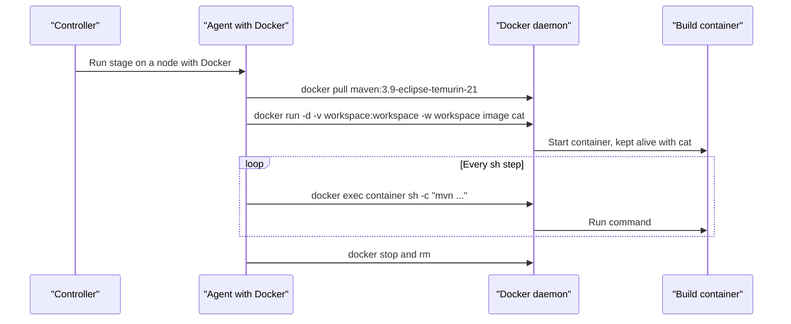

# Docker Agents

## Introduction

Agent machines tend to collect tools: three JDKs, two Node.js versions, a Python that someone upgraded last year, and a Go toolchain nobody remembers installing. Builds then depend on whichever agent they land on. Docker fixes that by putting the toolchain in an **image**. Each build, or each stage, runs in a fresh container that has exactly the tools it needs and nothing else.

In Jenkins, "Docker agent" can mean two different things:

1. **A Pipeline stage that runs inside a container** on an existing agent, using the **Docker Pipeline** plugin (plugin ID `docker-workflow`). You write `agent { docker { image 'maven:3.9-eclipse-temurin-21' } }`. This is what most people mean, and it is the main topic of this page.
2. **A whole agent that is a container**, created on demand by the **Docker** cloud plugin (plugin ID `docker-plugin`). Jenkins asks a Docker host to start a container, connects to it as an agent and removes it after the build. This is covered near the end.

An analogy: option 1 is a workshop (the agent) where each job comes with its own toolbox (the image). Option 2 is a pop-up workshop that appears for one job and is folded away afterwards.

## How `agent { docker }` Works



Important details:

- The agent itself needs the **Docker CLI** and access to a **Docker daemon**. The controller does not need Docker.
- The workspace is **bind-mounted** into the container at the same path, so files created in the container are visible to later steps and stages.
- Jenkins starts the container with the agent's user ID (`-u uid:gid`), so files in the workspace are not owned by root.
- Each `sh` step runs through `docker exec`. The `jenkins` agent process stays outside the container.
- This works on **Linux** Docker hosts. Windows containers are not a good fit for this plugin; use dedicated Windows agents instead.

## Step 1: An Agent That Can Run Docker

Give a Linux agent the Docker engine and let the agent user use it:

```bash
# On the agent machine (Ubuntu), after installing Docker Engine from docs.docker.com
sudo usermod -aG docker jenkins
sudo systemctl restart docker
sudo -u jenkins docker version --format '{{.Server.Version}}'
```

Example output:

```text
28.4.0
```

Label the node `docker`, for example `linux docker`. If you run the controller in Docker and need Docker builds locally, the [Installing Jenkins with Docker](../1-jenkins-installation/0-jenkins-install-docker.mdx) page shows a Docker-in-Docker setup.

:::warning The docker group is root-equivalent
Anyone who can talk to the Docker daemon can start a privileged container and mount the host filesystem. A build on that agent can therefore become root on the agent. Keep Docker agents separate from the controller, do not store long-lived secrets on them, and see [Securing Agents and the Controller](../11-jenkins-security/6-jenkins-securing-agents.mdx). Rootless Docker or Kubernetes pod agents reduce this risk.
:::

## Step 2: Run a Pipeline in a Container

Install the **Docker Pipeline** plugin (`docker-workflow`), then:

```groovy
pipeline {
    agent {
        docker {
            image 'maven:3.9-eclipse-temurin-21'
            label 'docker'
        }
    }
    stages {
        stage('Build') {
            steps {
                sh 'mvn -v'
                sh 'mvn -B -ntp package'
            }
        }
    }
}
```

Example output:

```text
[Pipeline] node
Running on linux-01 in /home/jenkins/agent/workspace/maven-demo
[Pipeline] withDockerContainer
linux-01 does not seem to be running inside a container
$ docker run -t -d -u 1000:1000 -w /home/jenkins/agent/workspace/maven-demo -v /home/jenkins/agent/workspace/maven-demo:/home/jenkins/agent/workspace/maven-demo:rw,z ... maven:3.9-eclipse-temurin-21 cat
[Pipeline] sh
+ mvn -v
Apache Maven 3.9.11
Java version: 21.0.8, vendor: Eclipse Adoptium
...
[INFO] BUILD SUCCESS
$ docker stop --time=1 5e2b...
$ docker rm -f --volumes 5e2b...
```

`label 'docker'` restricts the build to nodes that have Docker. Without it, Jenkins may pick a node without Docker and fail with `docker: not found`.

### Pin your images

`maven:3.9-eclipse-temurin-21` moves when a new 3.9.x patch is released. For reproducible builds, pin an exact tag (`maven:3.9.11-eclipse-temurin-21`) or a digest (`maven@sha256:...`), and update it on purpose, for example with Renovate or Dependabot.

## Different Containers per Stage

The real power shows when each stage uses its own toolchain. Put `agent none` at the top and an `agent { docker ... }` on each stage:

```groovy
pipeline {
    agent none
    stages {
        stage('Backend') {
            agent {
                docker {
                    image 'maven:3.9-eclipse-temurin-21'
                    label 'docker'
                }
            }
            steps {
                sh 'mvn -B -ntp -f backend/pom.xml package'
                stash name: 'jar', includes: 'backend/target/*.jar'
            }
        }
        stage('Frontend') {
            agent {
                docker {
                    image 'node:22-alpine'
                    label 'docker'
                }
            }
            steps {
                dir('frontend') {
                    sh 'npm ci'
                    sh 'npm run build'
                }
            }
        }
        stage('Lint Python scripts') {
            agent {
                docker {
                    image 'python:3.13-slim'
                    label 'docker'
                }
            }
            steps {
                sh 'pip install --quiet ruff && ruff check scripts/'
            }
        }
    }
}
```

Each stage may land on a different agent with its own workspace, so the stages check out the code again. Use `stash` and `unstash` to pass build outputs between stages, as the [Stash, Unstash and Artifacts](../4-jenkins-pipeline-advanced/4-jenkins-stash-and-artifacts.mdx) page explains.

### Reusing one node with `reuseNode`

If you want a single checkout and one workspace, give the pipeline a top-level agent and add `reuseNode true` to the stage containers:

```groovy
pipeline {
    agent { label 'docker' }
    stages {
        stage('Backend') {
            agent {
                docker {
                    image 'maven:3.9-eclipse-temurin-21'
                    reuseNode true
                }
            }
            steps {
                sh 'mvn -B -ntp -f backend/pom.xml package'
            }
        }
        stage('Frontend') {
            agent {
                docker {
                    image 'node:22-alpine'
                    reuseNode true
                }
            }
            steps {
                sh 'cd frontend && npm ci && npm run build'
            }
        }
        stage('Archive') {
            steps {
                archiveArtifacts artifacts: 'backend/target/*.jar, frontend/dist/**'
            }
        }
    }
}
```

`reuseNode true` means "run this container on the node and workspace the pipeline already holds". It only has an effect on stage-level agents. The trade-off: one checkout and shared files, but all stages compete for that one node.

## Caching Dependencies

A fresh container has an empty `~/.m2` or `~/.npm`, so every build downloads the internet. Mount a cache from the agent with `args`:

```groovy
agent {
    docker {
        image 'maven:3.9-eclipse-temurin-21'
        label 'docker'
        args '-v /home/jenkins/.m2:/cache/m2'
    }
}
```

and in the steps:

```groovy
sh 'mvn -B -ntp -Dmaven.repo.local=/cache/m2/repository package'
```

`/home/jenkins/.m2` is a directory on the agent host owned by the agent user. Because the container runs with the same user ID, it can write there, and the downloaded dependencies survive between builds. Notes:

- The cache is **per agent**. A build on another agent starts cold.
- Two builds writing the same cache at once can conflict. Maven's local repository mostly tolerates this, but some tools do not.
- Mounting caches weakens isolation: a malicious build could poison the cache for later builds. Do not share caches between trusted (main branch) and untrusted (fork PR) builds.

[Build Caching and Speed](../9-jenkins-build-and-test/8-jenkins-build-caching.mdx) covers remote caches and other options.

## Building the Agent Image from the Repository

If your project needs a custom toolchain, keep a Dockerfile in the repository and use the `dockerfile` agent. Jenkins builds the image, then runs the stage in it.

```dockerfile
# ci/Dockerfile.build
FROM eclipse-temurin:21-jdk
RUN apt-get update \
 && apt-get install -y --no-install-recommends git make protobuf-compiler \
 && rm -rf /var/lib/apt/lists/*
```

```groovy
pipeline {
    agent {
        dockerfile {
            filename 'Dockerfile.build'
            dir 'ci'
            label 'docker'
            additionalBuildArgs '--pull'
        }
    }
    stages {
        stage('Generate and build') {
            steps {
                sh 'protoc --version'
                sh 'make all'
            }
        }
    }
}
```

The toolchain is now versioned with the code: a branch that needs a newer compiler changes `ci/Dockerfile.build` in the same commit. The `dockerfile` agent requires a Pipeline loaded from SCM (a Jenkinsfile in the repository), because Jenkins needs the Dockerfile from the checkout. The cost is an image build at the start of every run. Docker's layer cache makes repeat builds fast on the same agent, but a new agent rebuilds from scratch. Many teams instead build and push a CI image once and reference it with `docker { image ... }`.

## Sidecar Services for Integration Tests

Integration tests often need a database. With Scripted syntax inside a `script` block, the Docker Pipeline plugin can start a service container with `withRun` and a build container with `inside`:

```groovy
pipeline {
    agent { label 'docker' }
    stages {
        stage('Integration tests') {
            steps {
                script {
                    docker.image('postgres:17').withRun('-e POSTGRES_PASSWORD=test -e POSTGRES_DB=app') { db ->
                        docker.image('postgres:17').inside("--link ${db.id}:db") {
                            sh 'until pg_isready -h db -U postgres; do sleep 1; done'
                        }
                        docker.image('maven:3.9-eclipse-temurin-21').inside("--link ${db.id}:db") {
                            sh 'mvn -B -ntp verify -Ddb.url=jdbc:postgresql://db:5432/app'
                        }
                    }
                }
            }
        }
    }
}
```

Example output:

```text
$ docker run -d -e POSTGRES_PASSWORD=test -e POSTGRES_DB=app postgres:17
[Pipeline] withDockerContainer
+ pg_isready -h db -U postgres
db:5432 - no response
+ sleep 1
+ pg_isready -h db -U postgres
db:5432 - accepting connections
[Pipeline] withDockerContainer
[INFO] Tests run: 42, Failures: 0, Errors: 0, Skipped: 0
[INFO] BUILD SUCCESS
$ docker stop 9a1f... && docker rm -f 9a1f...
```

The database container is always stopped and removed when the block ends, even if tests fail. `--link` is a legacy Docker feature but still the simplest way to give the sidecar a hostname here. For more complex setups, a `docker compose up` in an `sh` step with a matching `docker compose down` in `post { always { ... } }` is often clearer.

## Private Registries

Pull from a private registry with a **Username with password** credential:

```groovy
agent {
    docker {
        image 'registry.example.com/ci/java-build:21-2026.10'
        registryUrl 'https://registry.example.com'
        registryCredentialsId 'registry-ci-pull'
        label 'docker'
    }
}
```

In Scripted code, use `docker.withRegistry('https://registry.example.com', 'registry-ci-pull') { ... }`. Building and **pushing** images is a separate topic, covered in [Building and Pushing Docker Images](../9-jenkins-build-and-test/7-jenkins-docker-image-builds.mdx).

## Global Docker Settings as Code

If every Docker stage should run on nodes labeled `docker` and pull from one registry, set it once in [JCasC](../12-jenkins-administration/0-jenkins-configuration-as-code.mdx) instead of repeating it in every Jenkinsfile:

```yaml
unclassified:
  pipeline-model-docker:
    dockerLabel: "docker"
    registry:
      url: "https://registry.example.com"
      credentialsId: "registry-ci-pull"
```

## Containers as Whole Agents: the Docker Cloud Plugin

The **Docker** plugin (`docker-plugin`) works differently. You register a Docker host as a **cloud**. When a build needs a label such as `docker-agent`, the plugin starts a container from a template image, connects it as an agent, runs the build and removes the container. The job itself does not need to know Docker is involved.

A JCasC example, adapted from the official configuration-as-code demo:

```yaml
jenkins:
  clouds:
    - docker:
        name: "docker"
        dockerApi:
          dockerHost:
            uri: "tcp://docker-host.internal:2376"
        templates:
          - labelString: "docker-agent"
            dockerTemplateBase:
              image: "jenkins/agent:jdk21"
            remoteFs: "/home/jenkins/agent"
            connector:
              attach:
                user: "jenkins"
            instanceCapStr: "10"
            retentionStrategy:
              idleMinutes: 1
```

The connector can be **attach** (simplest; Jenkins attaches to the container's console), **SSH** or **JNLP** (inbound). Use TLS on the Docker API endpoint; a plain TCP Docker API is a remote root shell for anyone who can reach it.

```groovy
pipeline {
    agent { label 'docker-agent' }
    stages {
        stage('Hello') {
            steps { sh 'echo "Ephemeral agent $NODE_NAME"' }
        }
    }
}
```

Example output:

```text
Running on docker-0001a2b3c4d5 on docker in /home/jenkins/agent/workspace/hello
+ echo Ephemeral agent docker-0001a2b3c4d5
Ephemeral agent docker-0001a2b3c4d5
```

If you already run Kubernetes, the [Kubernetes plugin](./4-jenkins-kubernetes-agents.mdx) gives the same "one container agent per build" model with scheduling across many hosts.

## Real-World Scenario

Your team maintains a product with a Java backend, a React frontend and some Python tooling. Two static Linux agents run all builds. Last month a teammate upgraded Node.js on one agent, and frontend builds started failing only on that machine.

**The solution:**

1. Install Docker on both agents and add the `docker` label.
2. Rewrite the Jenkinsfile with `agent none` and one `docker` agent per stage: Maven/JDK 21 for the backend, `node:22` for the frontend, `python:3.13-slim` for tooling, all pinned to exact tags.
3. Mount a host cache directory per agent for the Maven and npm caches on main branch builds only.
4. Configure `dockerLabel: docker` globally in JCasC.

**Why this approach:** the toolchain moves out of the agents and into versioned images. Upgrading Node.js becomes a one-line pull request that is reviewed and tested like any other change. The agents only need Docker.

**When to use Docker agents:** several toolchains or versions on shared agents, reproducible builds without a Kubernetes cluster, and teams that already use Docker.

**When not to:** Windows or macOS builds; builds that need special hardware access; or environments where giving builds Docker daemon access is not acceptable. If you have Kubernetes, pod agents give the same benefits with better isolation and scheduling.

**Alternatives and trade-offs:**

| Approach | Pros | Cons | Best for |
| --- | --- | --- | --- |
| Tools installed on agents | Fast, warm caches, simple | Drift, version conflicts, snowflakes | Few projects, one toolchain |
| `agent { docker }` per stage | Reproducible, per-stage toolchains, no cluster | Docker daemon access is root-equivalent; caches per agent | Mixed toolchains on VM agents |
| `dockerfile` agent | Toolchain versioned with code | Image build time every run on cold agents | Custom toolchains that change with the code |
| Docker cloud plugin | Fresh agent per build | One Docker host per cloud, TLS setup | Small elastic pool without Kubernetes |
| Kubernetes pod agents | Isolation, scheduling across nodes, autoscaling | Needs a cluster and YAML skills | Larger, multi-team setups |

## Common Mistakes

- **No `label` on Docker agents.** The stage lands on a node without Docker and fails. Use `label` or the global `dockerLabel`.
- **Using `latest` tags.** Builds change without a code change. Pin tags or digests.
- **Running containers as root and leaving root-owned files.** The plugin passes `-u uid:gid` for a reason. Do not override it with `args '-u root'` unless you clean up after yourself.
- **Images that exit immediately.** The plugin keeps the container alive with `cat`. Images with a custom `ENTRYPOINT` that does not run the given command can break this. Use `args '--entrypoint='` or pick a plain toolchain image.
- **Expecting files to survive between stages on different agents.** Use `stash` or `reuseNode true`.
- **Mounting `/var/run/docker.sock` into build containers by habit.** That hands the build full control of the host's Docker. Only do it when the build must run Docker, and only on isolated agents.

## Summary

- `agent { docker { image '...' } }` from the **Docker Pipeline** plugin (`docker-workflow`) runs stages in containers on an agent that has Docker.
- The workspace is bind-mounted; `sh` steps run through `docker exec`.
- Use `agent none` plus per-stage containers for mixed toolchains, or `reuseNode true` to share one workspace.
- `dockerfile` agents build the toolchain image from the repository.
- `withRun` and `inside` give you sidecar services such as databases.
- The **Docker** cloud plugin (`docker-plugin`) creates whole agents as containers. Kubernetes is the bigger version of the same idea.

## Exercises

1. Run the first Maven example. Then change the image tag to a different JDK and watch the `mvn -v` output change without touching the agent.
2. Build a three-stage pipeline with Maven, Node.js and Python containers, using `agent none` and `stash` to pass a file from the first stage to the last.
3. Add a host-directory Maven cache and compare build times for the first and second run.
4. Write an integration test stage that starts `redis:7` with `withRun` and runs `redis-cli -h redis ping` from a second container.

Related pages:

- [Kubernetes Pod Agents](./4-jenkins-kubernetes-agents.mdx)
- [Choosing an Agent Strategy](./7-jenkins-agent-strategies.mdx)
- [Building and Pushing Docker Images](../9-jenkins-build-and-test/7-jenkins-docker-image-builds.mdx)
- The [Docker tutorial](/docs/devops/docker) for Docker fundamentals
- Official docs: [Using Docker with Pipeline](https://www.jenkins.io/doc/book/pipeline/docker/)
