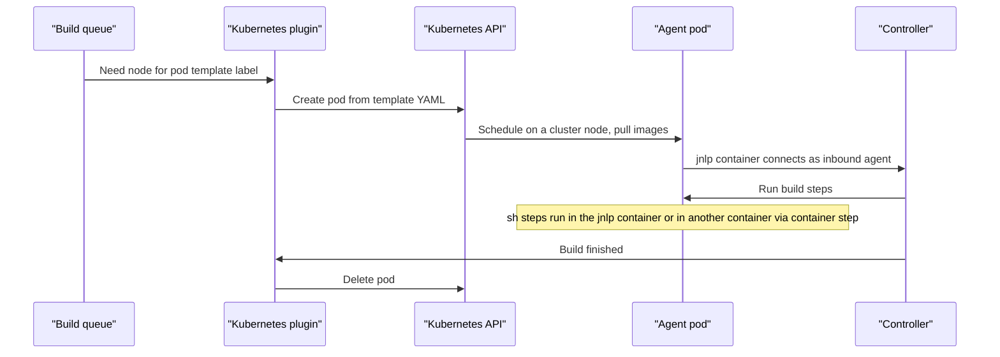

# Kubernetes Pod Agents

## Introduction

With the **Kubernetes** plugin (plugin ID `kubernetes`), Jenkins creates a new **pod** for each build, runs the build in it and deletes the pod afterwards. The pod contains one container that runs the Jenkins agent plus any containers you add: Maven, Node.js, Python, a database, an image builder. Nothing is left behind for the next build.

This is the most popular way to scale Jenkins today, for several reasons:

- **Elastic capacity.** Ten builds means ten pods. Zero builds means zero pods. The cluster autoscaler can add and remove nodes.
- **Clean environment.** Every build starts from the images you specified, so there is no drift.
- **Per-build toolchains.** The Jenkinsfile describes the pod, so each project chooses its own tools.
- **Shared infrastructure.** Platform teams already run Kubernetes. Jenkins agents become just another workload.

The trade-offs are real too: someone has to run the cluster, pods take a few seconds to start, caches are cold by default, and debugging a pod that never started requires `kubectl`.

The analogy: a static agent is an office desk you own. A pod agent is a hot desk in a co-working space. You book it, bring exactly the gear you need, work, and the desk is wiped when you leave.

This page assumes basic Kubernetes knowledge (pods, namespaces, service accounts). If you need a refresher, see the [Kubernetes tutorial](/docs/devops/kubernetes).

## How It Works



The container named **`jnlp`** runs the inbound agent (the historical name is kept for compatibility). If you do not define it, the plugin adds it using the `jenkins/inbound-agent` image. It connects back to the controller exactly like the [inbound agents](./2-jenkins-inbound-agents.mdx) from earlier, over TCP or WebSocket. Your other containers usually just run `sleep` or `cat` and wait for `sh` commands.

All containers in a pod share the **workspace** volume, so a file written by the Maven container is visible to the Node.js container.

## Step 1: Configure the Cloud

### Controller inside the cluster (the easy path)

If you installed Jenkins with the official Helm chart, as described in [Installing Jenkins on Kubernetes](../1-jenkins-installation/2-jenkins-install-kubernetes.mdx), the chart installs the Kubernetes plugin and configures a cloud named `kubernetes` that points at the same cluster. The controller's service account gets permission to manage pods in its namespace. You can start writing pod agents straight away.

When the controller runs in the same cluster, the default Kubernetes URL and Jenkins URL work without changes, as the plugin documentation notes.

### Controller outside the cluster

Go to **Manage Jenkins → Clouds → New cloud → Kubernetes** and fill in:

| Field | Example |
| --- | --- |
| Kubernetes URL | `https://k8s-api.example.com:6443` |
| Kubernetes Namespace | `jenkins-agents` |
| Credentials | A kubeconfig (Secret file), a token (Secret text) or a client certificate |
| Jenkins URL | `https://jenkins.example.com/` (how pods reach the controller) |
| WebSocket | Ticked, so pods connect over HTTPS through your ingress |

Click **Test Connection**. With WebSocket enabled, you do not need to expose TCP port 50000 to the cluster.

### The same cloud in JCasC

```yaml
jenkins:
  clouds:
    - kubernetes:
        name: "kubernetes"
        serverUrl: "https://k8s-api.example.com:6443"
        credentialsId: "k8s-agents-kubeconfig"
        namespace: "jenkins-agents"
        jenkinsUrl: "https://jenkins.example.com/"
        webSocket: true
        containerCapStr: "50"
        templates:
          - name: "default"
            label: "k8s"
            nodeUsageMode: NORMAL
            containers:
              - name: "jnlp"
                image: "jenkins/inbound-agent:jdk21"
                resourceRequestCpu: "500m"
                resourceRequestMemory: "512Mi"
                resourceLimitMemory: "1Gi"
            idleMinutes: 0
```

`containerCapStr` limits how many agent pods this cloud may run at once, which protects the cluster from a flood of builds. The structure follows the official JCasC `kubernetes` demo. Export your own configuration with **View Configuration** to confirm field names for your plugin version.

### RBAC for the agent namespace

The controller's service account needs to manage pods in the agent namespace. A minimal Role:

```yaml
apiVersion: v1
kind: ServiceAccount
metadata:
  name: jenkins-controller
  namespace: jenkins
---
apiVersion: rbac.authorization.k8s.io/v1
kind: Role
metadata:
  name: jenkins-agents
  namespace: jenkins-agents
rules:
  - apiGroups: [""]
    resources: ["pods"]
    verbs: ["create", "delete", "get", "list", "patch", "update", "watch"]
  - apiGroups: [""]
    resources: ["pods/exec"]
    verbs: ["create", "delete", "get", "list", "patch", "update", "watch"]
  - apiGroups: [""]
    resources: ["pods/log", "events"]
    verbs: ["get", "list", "watch"]
  - apiGroups: [""]
    resources: ["secrets"]
    verbs: ["get"]
---
apiVersion: rbac.authorization.k8s.io/v1
kind: RoleBinding
metadata:
  name: jenkins-agents
  namespace: jenkins-agents
roleRef:
  apiGroup: rbac.authorization.k8s.io
  kind: Role
  name: jenkins-agents
subjects:
  - kind: ServiceAccount
    name: jenkins-controller
    namespace: jenkins
```

Compare with the example service account in the [plugin repository](https://github.com/jenkinsci/kubernetes-plugin/tree/master/src/main/kubernetes), which may change between versions.

:::warning Agent pods must not see their own namespace
The plugin's security notes say that anyone who can view pods in the agent namespace can gather what they need to connect a fake agent to the controller. So **agent pods must not run with a service account that has permissions in their own namespace**, and untrusted users should have no read access there. Give agent pods a separate service account with no RBAC rights, or none at all.
:::

## Step 2: Your First Pod Agent

The recommended way to describe the pod is plain Kubernetes YAML inside the Jenkinsfile:

```groovy
pipeline {
    agent {
        kubernetes {
            yaml '''
                apiVersion: v1
                kind: Pod
                spec:
                  containers:
                  - name: maven
                    image: maven:3.9-eclipse-temurin-21
                    command: ["sleep"]
                    args: ["infinity"]
                    resources:
                      requests:
                        cpu: "1"
                        memory: "2Gi"
                      limits:
                        memory: "2Gi"
            '''
            defaultContainer 'maven'
            retries 2
        }
    }
    stages {
        stage('Build') {
            steps {
                sh 'mvn -B -ntp -v'
                sh 'mvn -B -ntp package'
            }
        }
    }
}
```

Example output:

```text
Created Pod: kubernetes jenkins-agents/maven-demo-12-k7x2q-0h1v3-9c5zm
Agent maven-demo-12-k7x2q-0h1v3-9c5zm is provisioned from template maven-demo_12-k7x2q-0h1v3
...
Running on maven-demo-12-k7x2q-0h1v3-9c5zm in /home/jenkins/agent/workspace/maven-demo
[Pipeline] sh
+ mvn -B -ntp -v
Apache Maven 3.9.11
Java version: 21.0.8, vendor: Eclipse Adoptium
...
[INFO] BUILD SUCCESS
```

What each part does:

- `yaml` is a normal pod spec. You do not need to write the `jnlp` container; the plugin adds it.
- `command: ["sleep"]` with `args: ["infinity"]` keeps the Maven container alive so Jenkins can run commands in it.
- `defaultContainer 'maven'` runs every `sh` step in the `maven` container instead of `jnlp`.
- `retries 2` retries the build on a fresh pod if the pod is lost for infrastructure reasons, such as a node drain or spot instance reclaim. It does not retry compile or test failures.
- Requests and limits let the scheduler place the pod properly. Set memory request and limit equal to avoid surprise OOM kills.

:::note `containerTemplate` and `label` are deprecated in Declarative
Older examples define containers with `containerTemplate` and set a `label` in the `kubernetes` block. The plugin docs mark both as deprecated in favor of YAML and `inheritFrom`. Prefer the YAML form for new pipelines.
:::

### Keep the pod YAML in its own file

Long YAML inside a Jenkinsfile gets messy. Move it next to the Jenkinsfile:

```yaml
# ci/build-pod.yaml
apiVersion: v1
kind: Pod
spec:
  containers:
    - name: maven
      image: maven:3.9-eclipse-temurin-21
      command: ["sleep"]
      args: ["infinity"]
      resources:
        requests:
          cpu: "1"
          memory: "2Gi"
        limits:
          memory: "2Gi"
    - name: node
      image: node:22-alpine
      command: ["sleep"]
      args: ["infinity"]
```

```groovy
pipeline {
    agent {
        kubernetes {
            yamlFile 'ci/build-pod.yaml'
            defaultContainer 'maven'
        }
    }
    stages {
        stage('Backend') {
            steps {
                sh 'mvn -B -ntp -f backend/pom.xml package'
            }
        }
        stage('Frontend') {
            steps {
                container('node') {
                    sh 'cd frontend && npm ci && npm run build'
                }
            }
        }
    }
}
```

The `container('node')` step switches containers for that block. Both containers see the same workspace, so the backend JAR and the frontend `dist/` folder are both available for a later stage.

## Different Pods per Stage

Like Docker agents, each stage can have its own pod. Note that **Declarative stage pods do not inherit from the pipeline pod**. Use `inheritFrom` if you want that.

```groovy
pipeline {
    agent none
    stages {
        stage('Unit tests') {
            agent {
                kubernetes {
                    yamlFile 'ci/build-pod.yaml'
                    defaultContainer 'maven'
                }
            }
            steps {
                sh 'mvn -B -ntp test'
            }
        }
        stage('Load test') {
            agent {
                kubernetes {
                    yaml '''
                        spec:
                          nodeSelector:
                            workload: perf
                          containers:
                          - name: k6
                            image: grafana/k6:latest
                            command: ["sleep"]
                            args: ["infinity"]
                            resources:
                              requests:
                                cpu: "4"
                                memory: "4Gi"
                    '''
                    defaultContainer 'k6'
                }
            }
            steps {
                sh 'k6 version'
            }
        }
    }
}
```

Big pods only exist while the load test runs, and `nodeSelector` sends them to a dedicated node pool.

## Reusable Pod Templates

When fifty repositories use the same pod, copying YAML into each one is a maintenance problem. Options:

1. **Templates in the cloud config** (UI or JCasC) with a label, then `agent { kubernetes { inheritFrom 'maven-21' } }` or simply `agent { label 'maven-21' }`.
2. **A shared library step** that returns standard YAML, such as `yaml libraryResource('pods/maven.yaml')`. See [Resources and Templates](../8-jenkins-shared-libraries/4-jenkins-library-resources.mdx).

```groovy
pipeline {
    agent {
        kubernetes {
            inheritFrom 'maven-21'
            defaultContainer 'maven'
        }
    }
    stages {
        stage('Test') {
            steps { sh 'mvn -B -ntp verify' }
        }
    }
}
```

The `yamlMergeStrategy` option controls how a child's YAML combines with the parent's: `override()` (the default) or `merge()`.

## Scripted Syntax

Scripted pipelines use `podTemplate` and the special `POD_LABEL` variable:

```groovy
podTemplate(yaml: '''
    apiVersion: v1
    kind: Pod
    spec:
      containers:
      - name: golang
        image: golang:1.25
        command: ["sleep"]
        args: ["infinity"]
''') {
    retry(count: 2, conditions: [kubernetesAgent(), nonresumable()]) {
        node(POD_LABEL) {
            checkout scm
            container('golang') {
                sh 'go version && go test ./...'
            }
        }
    }
}
```

The `retry` with `kubernetesAgent()` is the Scripted version of `retries 2`: it reruns the `node` block on a new pod only when the old pod was lost.

## Caching on Ephemeral Pods

A new pod has empty caches. Common fixes, in order of simplicity:

| Approach | How | Trade-off |
| --- | --- | --- |
| Accept cold caches | Do nothing | Simple, slower builds, more registry traffic |
| Dependency proxy | Nexus or Artifactory close to the cluster | Fast downloads, one more service to run |
| Shared PVC | `persistentVolumeClaim` volume mounted at `~/.m2` | Needs ReadWriteMany storage; concurrent writes can collide |
| `idleMinutes` | Keep pods alive for reuse for a few minutes | Warm caches for bursts; less isolation between builds |
| Remote build cache | Gradle or Bazel remote cache | Best for big builds; tool-specific |

A PVC mount in the pod YAML:

```yaml
spec:
  containers:
    - name: maven
      image: maven:3.9-eclipse-temurin-21
      command: ["sleep"]
      args: ["infinity"]
      volumeMounts:
        - name: m2
          mountPath: /root/.m2
  volumes:
    - name: m2
      persistentVolumeClaim:
        claimName: maven-cache
```

See [Build Caching and Speed](../9-jenkins-build-and-test/8-jenkins-build-caching.mdx) for more.

## Building Container Images in Pods

Pods normally have no Docker daemon, and mounting the node's container runtime socket into build pods is a serious security risk. Teams use daemonless builders such as BuildKit (rootless), Buildah or Kaniko inside the pod instead. The original Google Kaniko repository was archived in 2025, so check the maintenance status of any builder before choosing it. [Building and Pushing Docker Images](../9-jenkins-build-and-test/7-jenkins-docker-image-builds.mdx) shows complete examples.

## Debugging Pods

When a pod never connects, the build log shows it waiting. Look at the pod directly:

```bash
kubectl -n jenkins-agents get pods
kubectl -n jenkins-agents describe pod maven-demo-12-k7x2q-0h1v3-9c5zm
kubectl -n jenkins-agents logs maven-demo-12-k7x2q-0h1v3-9c5zm -c jnlp
```

Example output:

```text
NAME                               READY   STATUS             RESTARTS   AGE
maven-demo-12-k7x2q-0h1v3-9c5zm    1/2     ImagePullBackOff   0          45s
```

| Symptom | Likely cause |
| --- | --- |
| `Pending` for a long time | Not enough CPU or memory in the cluster; requests too large; no matching `nodeSelector` |
| `ImagePullBackOff` | Wrong image name or tag; missing `imagePullSecrets` |
| `jnlp` logs show connection refused | Wrong Jenkins URL; TCP 50000 not reachable; use WebSocket |
| `sh` step hangs in another container | Container exits or has no shell; use an image with `/bin/sh` and a long-running command |
| Pod `OOMKilled` | Memory limit too low for the build tool; raise limit or tune JVM heap |

To keep failed pods for inspection, set `podRetention` to `onFailure()` on the template, and remember to clean them up.

## Real-World Scenario

Your company has 30 development teams and a single overloaded Jenkins with 12 static VM agents. Queues are long at 10 a.m. and the agents sit idle at night. The platform team already runs an EKS cluster with the cluster autoscaler.

**The solution:**

1. Create a `jenkins-agents` namespace with a ResourceQuota, and a node pool (on-demand plus spot) labeled for CI.
2. Configure a Kubernetes cloud in JCasC with WebSocket, `containerCapStr: "100"` and three standard templates: `maven-21`, `node-22`, `python-3.13`.
3. Publish the matching pod YAML from a [shared library](../8-jenkins-shared-libraries/0-jenkins-shared-libraries-introduction.mdx) so teams use `agent { kubernetes { inheritFrom 'node-22' } }`.
4. Add `retries 2` everywhere, because spot nodes can disappear.
5. Run a Nexus proxy in the cluster for Maven and npm downloads.
6. Retire the static agents one label at a time.

**Why this approach:** capacity follows demand, so the morning rush gets more pods and nights cost almost nothing. Teams pick tool versions through YAML instead of tickets. Clean pods remove "works on agent 7" failures.

**When to use Kubernetes agents:** you already operate Kubernetes, load is bursty, many teams share Jenkins, and Linux containers cover your builds.

**When not to:** no one on the team can operate a cluster; builds need macOS, GUI, special hardware or very large local caches; or builds are long and steady enough that static agents are cheaper and simpler.

**Alternatives and trade-offs:**

| Approach | Pros | Cons | Best for |
| --- | --- | --- | --- |
| Kubernetes pod agents | Elastic, clean, per-build toolchains, shared infra | Cluster required, cold caches, pod startup time | Multi-team, bursty Linux builds |
| Static VM agents | Simple, warm caches | Drift, idle cost, manual scaling | Small steady workloads |
| Docker agents on VMs | Per-stage toolchains without a cluster | Docker socket risk, per-agent caches | Teams without Kubernetes |
| Cloud VM agents (EC2, Azure) | Full VMs, any OS | Minutes to boot, VM images to maintain | Windows, heavy or privileged builds |
| Hosted CI runners (GitHub Actions, GitLab) | No infrastructure | Less control, per-minute pricing | Teams not committed to Jenkins |

## Common Mistakes

- **No resource requests.** Pods get scheduled onto busy nodes and builds become slow and flaky. Always set requests, and memory limits.
- **Using `latest` images.** Pin tags; a new `latest` can break every build at once.
- **Giving agent pods a powerful service account.** A build could then manage pods, read secrets or impersonate agents. Agent pods should have no Kubernetes API rights.
- **Mounting the node's container runtime socket.** It hands builds root on the node. Use a daemonless builder.
- **Expecting containers to share `localhost` services but not files.** They share both the network namespace and the workspace volume, but not other directories like `/root/.m2` unless you mount a volume.
- **Forgetting `retries` on spot or preemptible nodes.** A reclaimed node turns into a failed build.
- **Huge inline YAML in every Jenkinsfile.** Move it to `yamlFile` or a shared library.

## Summary

- The Kubernetes plugin (`kubernetes`) creates one pod per build, runs the build and deletes the pod.
- The `jnlp` container runs the inbound agent; your tools run in extra containers. Use `defaultContainer` or `container('name')`.
- Define pods with YAML (`yaml` or `yamlFile`); `containerTemplate` in Declarative is deprecated.
- Configure the cloud in JCasC, use WebSocket for controllers outside the cluster, and cap concurrency.
- Set resource requests, pin images, keep agent pods without API rights, and add `retries` for pod loss.
- Solve cold caches with a proxy, a PVC, `idleMinutes` or a remote cache.

## Exercises

1. On a local cluster (kind or minikube), install Jenkins with the Helm chart and run the first pod agent example. Watch the pod appear and disappear with `kubectl get pods -w`.
2. Add a `postgres` container to the pod YAML and run `psql` against `localhost` from another container.
3. Request more CPU than any node has. Read the pod events and the Jenkins log while the build waits.
4. Move your pod YAML into a shared library resource and use it from two different Jenkinsfiles.

Related pages:

- [Inbound (JNLP) Agents](./2-jenkins-inbound-agents.mdx)
- [Docker Agents](./3-jenkins-docker-agents.mdx)
- [Choosing an Agent Strategy](./7-jenkins-agent-strategies.mdx)
- [Installing Jenkins on Kubernetes](../1-jenkins-installation/2-jenkins-install-kubernetes.mdx)
- Official docs: the [Kubernetes plugin](https://plugins.jenkins.io/kubernetes/) and its [README](https://github.com/jenkinsci/kubernetes-plugin)
