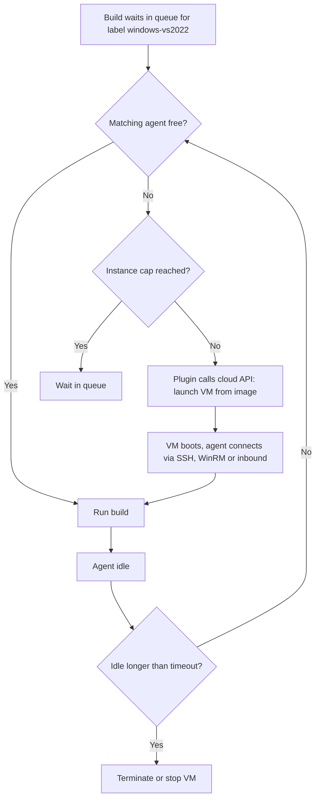
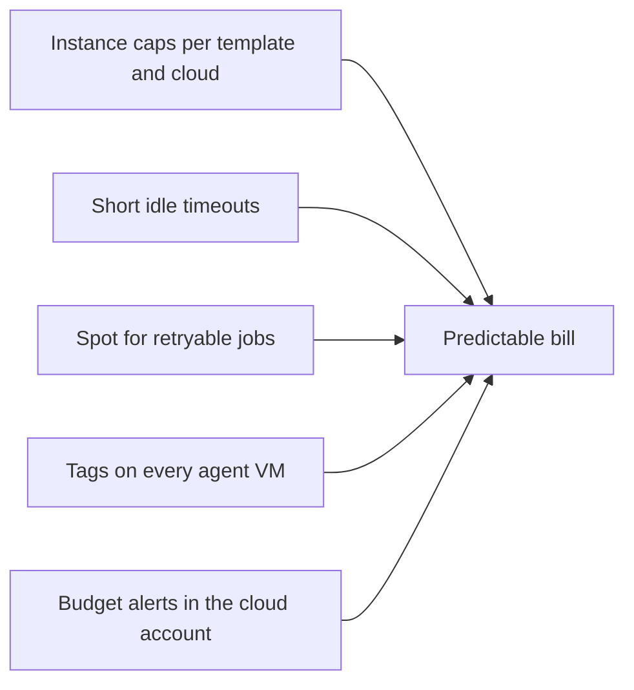

# Cloud Agents on AWS and Azure

## Introduction

[Kubernetes pod agents](./4-jenkins-kubernetes-agents.mdx) are great when every build fits in a Linux container. Some builds do not:

- Windows builds that need Visual Studio and a full desktop OS,
- builds that need a whole VM: nested virtualization, kernel modules, Docker with privileges, large local disks,
- GPU or high-memory jobs that only run a few times a day,
- organizations that have a cloud account but no Kubernetes cluster.

For these, Jenkins **cloud plugins** create **virtual machines** on demand. When a build needs a label such as `windows-vs2022`, the plugin launches a VM from a prepared image, connects it as an agent, runs the build, and terminates the VM after it has been idle for a while.

It is like a taxi rank instead of a company car fleet. You do not pay for cars parked in the garage. You pay per ride, and you wait a little for the taxi to arrive.

This page covers:

- the **Amazon EC2** plugin (`ec2`): one VM per agent, launched with the EC2 API,
- the **EC2 Fleet** plugin (`ec2-fleet`): scales an Auto Scaling Group or EC2 Fleet,
- the **Amazon ECS / Fargate** plugin (`amazon-ecs`): container agents on ECS,
- the **Azure VM Agents** plugin (`azure-vm-agents`): VMs on Azure,
- image building, cost control and security for all of them.

Plugin features change between versions. Treat the field names here as a guide and check the plugin pages linked at the end of this page.

## How Cloud Provisioning Works



Every cloud plugin has the same building blocks:

| Concept | Meaning | Typical value |
| --- | --- | --- |
| **Cloud** | Account, region and credentials | One per AWS region or Azure subscription |
| **Template** | Image, size, network, labels for one kind of agent | `linux-large`, `windows-vs2022` |
| **Label** | What builds ask for | `agent { label 'windows-vs2022' }` |
| **Instance cap** | Maximum VMs per template and per cloud | Protects your budget |
| **Idle timeout** | Minutes an idle agent waits before termination | 10 to 30 minutes |
| **Executors per VM** | Builds per VM at once | Often 1 for isolation |

## The Amazon EC2 Plugin

The EC2 plugin (ID `ec2`) is the long-standing way to run agents on AWS. It calls `RunInstances` directly for each agent.

### Step 1: IAM permissions

The safest setup is to run the controller on EC2 (or EKS) with an **instance profile** or IAM role, so no access keys are stored in Jenkins. Grant the role the permissions the plugin documentation lists:

```json
{
  "Version": "2012-10-17",
  "Statement": [
    {
      "Sid": "JenkinsEc2Agents",
      "Effect": "Allow",
      "Action": [
        "ec2:DescribeSpotInstanceRequests",
        "ec2:CancelSpotInstanceRequests",
        "ec2:GetConsoleOutput",
        "ec2:RequestSpotInstances",
        "ec2:RunInstances",
        "ec2:StartInstances",
        "ec2:StopInstances",
        "ec2:TerminateInstances",
        "ec2:CreateTags",
        "ec2:DeleteTags",
        "ec2:DescribeInstances",
        "ec2:DescribeInstanceTypes",
        "ec2:DescribeKeyPairs",
        "ec2:DescribeRegions",
        "ec2:DescribeImages",
        "ec2:DescribeAvailabilityZones",
        "ec2:DescribeSecurityGroups",
        "ec2:DescribeSubnets",
        "ec2:GetPasswordData"
      ],
      "Resource": "*"
    },
    {
      "Sid": "PassAgentRole",
      "Effect": "Allow",
      "Action": ["iam:ListInstanceProfilesForRole", "iam:PassRole"],
      "Resource": "arn:aws:iam::123456789012:role/jenkins-agent"
    }
  ]
}
```

`iam:PassRole` is only needed if agents get their own instance profile, and you should limit it to that one role, as above. `ec2:GetPasswordData` is only needed for Windows agents. You can tighten the first statement further with conditions on tags, for example allowing `TerminateInstances` only on instances tagged as Jenkins agents.

### Step 2: Prepare an AMI

The agent image needs:

- a supported Java runtime for `agent.jar` (Java 21 or 25 at the time of writing),
- your build tools (Git, JDKs, Docker, Node.js and so on),
- an SSH server and user (Linux) or WinRM (Windows, as the plugin uses WinRM over HTTPS for Windows AMIs).

Build the AMI with **Packer** from code, so you can rebuild and update it every month:

```hcl
# agent.pkr.hcl (simplified)
packer {
  required_plugins {
    amazon = {
      source  = "github.com/hashicorp/amazon"
      version = ">= 1.3.0"
    }
  }
}

source "amazon-ebs" "jenkins_agent" {
  region        = "eu-central-1"
  instance_type = "t3.medium"
  ssh_username  = "ubuntu"
  ami_name      = "jenkins-agent-linux-{{timestamp}}"
  source_ami_filter {
    filters = {
      name                = "ubuntu/images/hvm-ssd-gp3/ubuntu-noble-24.04-amd64-server-*"
      virtualization-type = "hvm"
    }
    owners      = ["099720109477"]
    most_recent = true
  }
}

build {
  sources = ["source.amazon-ebs.jenkins_agent"]
  provisioner "shell" {
    inline = [
      "sudo apt-get update",
      "sudo apt-get install -y openjdk-21-jre-headless git docker.io",
      "sudo usermod -aG docker ubuntu"
    ]
  }
}
```

```bash
packer init agent.pkr.hcl
packer build agent.pkr.hcl
```

Example output:

```text
==> amazon-ebs.jenkins_agent: Creating AMI jenkins-agent-linux-1791702000 from instance i-0abc123def4567890
==> amazon-ebs.jenkins_agent: AMI: ami-0f1e2d3c4b5a69788
Build 'amazon-ebs.jenkins_agent' finished after 6 minutes 12 seconds.
```

The [Terraform tutorial](/docs/devops/terraform) covers the related tooling for the surrounding infrastructure (VPC, subnets, security groups).

### Step 3: Configure the cloud in JCasC

This example follows the official configuration-as-code demo for the EC2 plugin, with a YAML anchor for settings shared by two templates:

```yaml
x-ec2-common: &ec2_common
  ami: "ami-0f1e2d3c4b5a69788"
  zone: "eu-central-1a"
  subnetId: "subnet-0123456789abcdef0"
  securityGroups: "sg-0123456789abcdef0"
  remoteFS: "/home/ubuntu/agent"
  remoteAdmin: "ubuntu"
  associateIPStrategy: PRIVATE_IP
  connectionStrategy: PRIVATE_IP
  idleTerminationMinutes: "15"
  numExecutors: 1
  mode: EXCLUSIVE
  amiType:
    unixData:
      sshPort: "22"

jenkins:
  clouds:
    - amazonEC2:
        name: "aws-eu"
        region: "eu-central-1"
        useInstanceProfileForCredentials: true
        sshKeysCredentialsId: "ec2-agent-ssh-key"
        instanceCapStr: "20"
        noDelayProvisioning: true
        templates:
          - description: "Linux build agent"
            type: "m7i.large"
            labelString: "linux ec2"
            instanceCapStr: "15"
            <<: *ec2_common
          - description: "Linux large agent for integration tests"
            type: "m7i.2xlarge"
            labelString: "linux-large ec2"
            instanceCapStr: "5"
            <<: *ec2_common
```

Notes on the important fields:

- `useInstanceProfileForCredentials: true` uses the controller's IAM role instead of stored access keys.
- `sshKeysCredentialsId` is the **SSH private key** credential that matches the EC2 key pair on the instances.
- `connectionStrategy: PRIVATE_IP` connects over the VPC's private network. Agents need no public IP.
- `noDelayProvisioning: true` launches VMs as soon as builds queue, instead of waiting for the default load statistics.
- `idleTerminationMinutes` controls cost. Shorter saves money; longer reuses warm agents.
- `instanceCapStr` at cloud and template level is your budget guardrail.

Field names have changed over the plugin's history. Configure one template in the UI and export it with **View Configuration** before writing YAML by hand.

### Step 4: Use it

```groovy
pipeline {
    agent { label 'linux-large' }
    stages {
        stage('Integration tests') {
            steps {
                sh 'nproc && free -g'
                sh './gradlew integrationTest'
            }
        }
    }
}
```

Example output:

```text
Still waiting to schedule task
All nodes of label 'linux-large' are offline
Launching instance i-0a1b2c3d4e5f60718 ...
Running on EC2 (aws-eu) - Linux large agent for integration tests (i-0a1b2c3d4e5f60718) in /home/ubuntu/agent/workspace/it
+ nproc
8
+ free -g
              total        used        free
Mem:             31           1          29
```

The first build waits a minute or two while the VM boots. Builds that arrive while it is idle start immediately.

### Spot instances

Spot capacity is much cheaper than on-demand but can be reclaimed by AWS at short notice. The EC2 plugin can request spot instances per template. Use spot for builds that can simply be rerun (unit tests, linting) and keep releases and long-running jobs on on-demand. Add retries to the Pipeline:

```groovy
pipeline {
    agent none
    stages {
        stage('Tests on spot') {
            steps {
                retry(count: 2, conditions: [agent(), nonresumable()]) {
                    node('linux-spot') {
                        checkout scm
                        sh './gradlew test'
                    }
                }
            }
        }
    }
}
```

The `agent()` condition retries only when the agent connection was lost, not when tests fail. Check current spot pricing and interruption rates in the AWS console; they change constantly.

## The EC2 Fleet Plugin: Auto Scaling Groups

The **EC2 Fleet** plugin (`ec2-fleet`) takes a different approach. Instead of launching instances itself, it **resizes an Auto Scaling Group** (or EC2 Fleet) that you define in AWS, typically with Terraform or CloudFormation. Jenkins scales the group up when builds queue and down when agents are idle.

Benefits over the EC2 plugin:

- Launch templates, mixed instance types and allocation strategies are handled by AWS.
- Spot diversification across many instance types is easier.
- Instance setup lives in your infrastructure code, not in Jenkins configuration.

The plugin documentation recommends Auto Scaling Groups over the legacy Spot Fleet API. Settings such as the maximum number of uses per node and a minimum spare size are configured on the cloud.

| Plugin | Who launches instances | Best for |
| --- | --- | --- |
| EC2 (`ec2`) | The plugin, via `RunInstances` | Few templates, simple setups, Windows via WinRM |
| EC2 Fleet (`ec2-fleet`) | An ASG or EC2 Fleet, resized by the plugin | Spot-heavy fleets, infra defined in Terraform |

## Amazon ECS and Fargate

The **Amazon ECS / Fargate** plugin (`amazon-ecs`) runs each agent as an ECS task, optionally on Fargate, so you manage no servers at all. It is conceptually similar to Kubernetes pod agents. Limitations to know: no privileged containers on Fargate, so no Docker-in-Docker, and task startup takes longer than a warm pod. If your company standardized on ECS rather than EKS, it is a reasonable choice for Linux container builds.

## Azure VM Agents

On Azure, the **Azure VM Agents** plugin (`azure-vm-agents`) provisions VMs from templates.

### Credentials

The plugin supports an **Azure Service Principal** or a **managed identity** assigned to the controller's VM. Prefer a managed identity when the controller runs on Azure, for the same reason as instance profiles on AWS: no secret to store or rotate. Grant it a role scoped to the resource group where agents are created, not the whole subscription.

```bash
# Create a resource group for agents and grant the controller's identity access to it
az group create --name rg-jenkins-agents --location westeurope
az role assignment create \
  --assignee "<controller-identity-principal-id>" \
  --role "Contributor" \
  --scope "/subscriptions/<subscription-id>/resourceGroups/rg-jenkins-agents"
```

Example output:

```text
{
  "principalType": "ServicePrincipal",
  "roleDefinitionName": "Contributor",
  "scope": "/subscriptions/0000.../resourceGroups/rg-jenkins-agents"
}
```

Contributor on one resource group is a pragmatic starting point. A custom role with only the compute, network and disk actions the plugin needs is tighter.

### Templates

Each VM template defines:

| Setting | Example |
| --- | --- |
| Label | `windows-vs2022` |
| Region and VM size | `West Europe`, `Standard_D4s_v5` |
| Image | Built-in Windows Server or Ubuntu image (optionally with Git, Maven or Docker), a custom image, or a marketplace image |
| Launch method | SSH (recommended by the plugin docs for simpler setup and clearer logs) or inbound |
| Admin credentials | SSH key or username and password credential |
| Retention strategy | Idle, Pool or Once |

The three retention strategies map to the main usage patterns:

- **Idle**: delete agents after N idle minutes. The default choice for cost control.
- **Pool**: keep a fixed number of VMs ready for a retention time in hours. Use it when VM boot time hurts and load is predictable.
- **Once**: use each VM for a single build, then delete it. Maximum isolation, for untrusted builds.

The plugin can be configured with JCasC. The plugin docs recommend configuring it once in the UI and exporting the YAML, which avoids guessing field names.

```groovy
pipeline {
    agent { label 'windows-vs2022' }
    stages {
        stage('Build') {
            steps {
                bat 'dotnet --info'
                bat 'dotnet build MyApp.sln -c Release'
            }
        }
    }
}
```

Example output:

```text
Running on azure-agents-0f3a2 in C:\jenkins\workspace\desktop-app
C:\jenkins\workspace\desktop-app>dotnet build MyApp.sln -c Release
  MyApp -> C:\jenkins\workspace\desktop-app\MyApp\bin\Release\net9.0\MyApp.dll
Build succeeded.
    0 Warning(s)
    0 Error(s)
```

## Cost Control

Cloud agents save money only when they are terminated. Guardrails to set from day one:



- **Caps**: set both cloud and template caps. A bug that triggers 500 builds should not launch 500 VMs.
- **Idle timeouts**: 10 to 30 minutes is common. Measure how often builds reuse warm agents before going longer.
- **Tags**: tag agent VMs (for example `owner=jenkins`, `team=platform`) so cost reports show CI spending.
- **Orphan sweeps**: if the controller crashes, VMs can be left running. A scheduled job or cloud-side rule that terminates old, tagged agent VMs is cheap insurance.
- **Budget alerts**: configure them in AWS Budgets or Azure Cost Management.

Prices for instance types, spot and data transfer change often. Check the official AWS and Azure pricing pages rather than relying on numbers from blog posts.

## Real-World Scenario

Your company ships a Windows desktop app and a Linux backend. Jenkins runs on an EC2 instance. Windows builds need Visual Studio and take 25 minutes. Linux unit tests run hundreds of times a day. Two always-on Windows VMs cost money all night and weekend.

**The solution:**

1. Build a Windows AMI with Packer every month (Visual Studio Build Tools, Git, Java 21, WinRM configured).
2. Add an EC2 template `windows-vs2022`, cap 4, idle timeout 30 minutes, on-demand instances.
3. Add a second template `linux-spot` on spot capacity, cap 20, idle timeout 10 minutes, and wrap those builds in `retry` with the `agent()` condition.
4. Use the controller's instance profile for AWS credentials, with a policy that only allows terminating instances tagged as Jenkins agents.
5. Set an AWS budget alert for the CI account.

**Why this approach:** Windows builds need full VMs, which Kubernetes cannot easily provide. On-demand VMs that terminate after 30 idle minutes cost nothing at night. Linux tests are retryable, so spot fits them.

**When to use cloud VM agents:** Windows or special OS images, builds that need full VMs or privileges, spiky load, and an existing cloud account without Kubernetes.

**When not to:** builds that need to start within seconds (VM boot takes a minute or more), steady 24/7 load (reserved or static capacity is simpler), or when you already run Kubernetes and builds fit in Linux containers.

**Alternatives and trade-offs:**

| Approach | Pros | Cons | Best for |
| --- | --- | --- | --- |
| EC2 plugin | Direct, mature, Windows via WinRM | Instance setup lives in Jenkins config | Simple AWS setups |
| EC2 Fleet + ASG | AWS handles mix and spot diversification | ASG to define and maintain | Large spot-heavy fleets |
| ECS / Fargate | No servers to manage | No privileged builds, slower startup | Linux container builds on ECS shops |
| Azure VM Agents | Native Azure VMs, Pool and Once strategies | Image and role setup | Azure-based organizations, Windows builds |
| Kubernetes pods | Fast startup, clean builds | Linux containers only in practice | Container-friendly builds |
| Static VMs | Instant start, warm caches | Pay 24/7, drift | Steady load, special licenses |

## Common Mistakes

- **Storing long-lived access keys in Jenkins.** Use instance profiles, IAM roles or managed identities.
- **No instance cap.** A runaway trigger becomes a large bill.
- **Hand-built images.** Nobody can rebuild them, and they never get patched. Use Packer and rebuild regularly.
- **Public IPs on agents.** Use private IPs inside a VPC or VNet and restrict security groups to the controller.
- **Spot instances for release builds.** An interruption at the wrong moment delays a release. Keep critical jobs on on-demand.
- **Forgetting orphaned VMs.** Controller crashes and plugin bugs can leave instances running. Tag them and sweep regularly.

## Summary

- Cloud plugins create agent VMs on demand from templates and terminate them when idle.
- On AWS: the **EC2** plugin (`ec2`) launches instances directly; **EC2 Fleet** (`ec2-fleet`) resizes Auto Scaling Groups; **Amazon ECS** (`amazon-ecs`) runs container agents on ECS and Fargate.
- On Azure: **Azure VM Agents** (`azure-vm-agents`) with Idle, Pool and Once retention strategies.
- Use instance profiles or managed identities instead of stored keys, and give the plugin only the permissions it needs.
- Build images with Packer, set caps and idle timeouts, use spot only for retryable work, and tag everything.

## Exercises

1. Write the IAM policy from this page for a sandbox account, then add a condition so `ec2:TerminateInstances` only applies to instances with the tag `jenkins-agent=true`.
2. Build an agent AMI with Packer that includes Java 21 and Git, and record the AMI ID in a JCasC template.
3. Compare the idle-timeout settings 5, 15 and 60 minutes for a job that runs every 20 minutes. Which one reuses agents, and what does each cost in idle time?
4. Sketch a design that uses Kubernetes pods for Linux builds and Azure VM Agents for Windows builds, and list the labels each template provides.

Related pages:

- [Kubernetes Pod Agents](./4-jenkins-kubernetes-agents.mdx)
- [Labels, Executors and Scheduling](./6-jenkins-labels-and-executors.mdx)
- [Choosing an Agent Strategy](./7-jenkins-agent-strategies.mdx)
- [Total Cost of Running Jenkins](../13-jenkins-best-practices/4-jenkins-cost-and-maintenance.mdx)
- Official plugin pages: [EC2](https://plugins.jenkins.io/ec2/), [EC2 Fleet](https://plugins.jenkins.io/ec2-fleet/), [Amazon ECS](https://plugins.jenkins.io/amazon-ecs/), [Azure VM Agents](https://plugins.jenkins.io/azure-vm-agents/)
