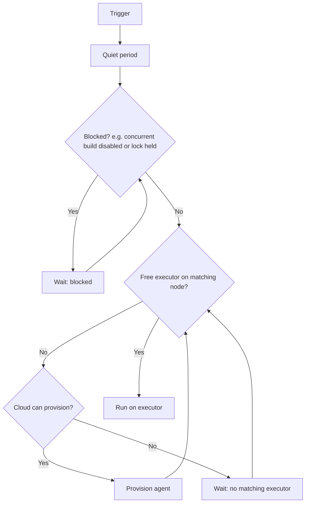

# Labels, Executors and Scheduling

## Introduction

Once you have more than one agent, two questions come up every day:

1. **Where** should this build run? On a Linux or Windows agent? One with Docker? The big machine with the GPU?
2. **How many** builds should run at once? Per agent, per job, and against shared things like a staging database?

Jenkins answers the first question with **labels** and **label expressions**, and the second with **executors**, **concurrency options** and **locks**. Between them sits the **build queue**, which matches waiting builds to free executors.

Think of a hospital. Labels are specialties ("cardiology", "pediatrics"), executors are the beds in each ward, the queue is the waiting room, and locks are the single MRI machine that only one patient can use at a time. The triage nurse (the scheduler) sends each patient to a ward with the right specialty and a free bed.

## Labels

A **label** is a tag on a node. A node can have many labels, separated by spaces:

```text
linux docker jdk21 x86_64
```

Jenkins also gives every node an implicit label equal to its **name**, so `agent { label 'linux-01' }` pins a build to that single machine. Avoid that except for debugging: it ties the build to one machine and defeats load balancing.

### Good label design

Labels should describe **capabilities**, not machines or teams:

| Good labels | Why | Avoid | Why |
| --- | --- | --- | --- |
| `linux`, `windows`, `macos` | Operating system | `bobs-box` | Ties builds to one machine |
| `docker` | Can run containers | `team-payments` | Teams change; capabilities do not |
| `jdk21`, `node22` | Installed toolchain | `fast` | Vague; nobody knows what qualifies |
| `arm64`, `x86_64` | CPU architecture | `new-agent` | Becomes wrong in six months |
| `gpu`, `large` | Hardware class | `agent-3` | Use the node name for that |

The Jenkins scaling guide recommends standardized, interchangeable agents rather than agents customized for one team. Capability labels make that possible.

### Label expressions

Pipelines and jobs ask for nodes with a **label expression**:

| Operator | Meaning | Example |
| --- | --- | --- |
| `a && b` | Both labels | `linux && docker` |
| `a \|\| b` | Either label | `jdk21 \|\| jdk25` |
| `!a` | Not this label | `linux && !arm64` |
| `( )` | Grouping | `(linux \|\| macos) && docker` |
| `a -> b` | Implies: if `a` then also `b` | Rarely used |
| `a <-> b` | If and only if | Rarely used |

```groovy
pipeline {
    agent { label 'linux && docker && !arm64' }
    stages {
        stage('Where') {
            steps {
                sh 'echo "Node: $NODE_NAME, labels: $NODE_LABELS"'
            }
        }
    }
}
```

Example output:

```text
Running on linux-02 in /home/jenkins/agent/workspace/labels-demo
[Pipeline] sh
+ echo Node: linux-02, labels: docker jdk21 linux linux-02 x86_64
Node: linux-02, labels: docker jdk21 linux linux-02 x86_64
```

`NODE_NAME`, `NODE_LABELS` and `EXECUTOR_NUMBER` are set for every build and help when you debug scheduling.

:::tip Check an expression before using it
In a freestyle job, tick **Restrict where this project can be run** and type an expression. Jenkins shows which nodes and clouds match. It is a quick way to test expressions before putting them in a Jenkinsfile. For pipelines, **Manage Jenkins → Nodes** also lets you click a label to see its nodes.
:::

## Choosing Agents in Declarative Pipelines

```groovy
pipeline {
    agent none
    stages {
        stage('Build') {
            agent { label 'linux && jdk21' }
            steps {
                sh './gradlew assemble'
                stash name: 'app', includes: 'build/libs/*.jar'
            }
        }
        stage('Windows smoke test') {
            agent { label 'windows' }
            steps {
                unstash 'app'
                bat 'java -jar build\\libs\\app.jar --smoke-test'
            }
        }
        stage('Package') {
            agent {
                node {
                    label 'linux && docker'
                    customWorkspace '/home/jenkins/agent/workspace/packaging'
                }
            }
            steps {
                sh 'docker build -t app:dev .'
            }
        }
    }
}
```

- `agent none` at the top means no executor is held between stages.
- Each stage asks for the capabilities it needs.
- `node { label ...; customWorkspace ... }` is the longer form of `label` that accepts extra options.

## Node Usage Modes

Each node has a **Usage** setting:

| UI text | JCasC `mode` | Effect |
| --- | --- | --- |
| Use this node as much as possible | `NORMAL` | Runs builds that match its labels and builds with no label at all |
| Only build jobs with label expressions matching this node | `EXCLUSIVE` | Runs only builds whose expression matches this node |

Use `EXCLUSIVE` for special or expensive nodes, such as the GPU box or the licensed compiler machines, so that unlabelled jobs never land there. Use `NORMAL` for the general-purpose pool. The built-in node should have 0 executors anyway, as explained in [Controller and Agents](./0-jenkins-controller-and-agents.mdx).

## Executors

An **executor** is one build slot. A node with 4 executors runs up to 4 builds (or 4 Pipeline `node` blocks) at once.

### How many executors per agent?

The Jenkins documentation says "one executor per node is the safest configuration", and that "one executor per CPU core can work well, if the tasks running are small." In practice:

| Situation | Executors | Reason |
| --- | --- | --- |
| Ephemeral agents (pods, cloud VMs) | 1 | One build per agent; scale by adding agents |
| Heavy builds (big Java, C++, Docker builds) | 1 to 2 | Each build can use all cores and lots of RAM |
| Light jobs (linting, small scripts) | Up to number of cores | Little contention |
| Tests that use fixed ports or shared files | 1 | Concurrent builds would collide |

Watch CPU, memory and disk I/O after a change. If builds get slower when two run side by side, you have too many executors.

### Where executors are set

```yaml
jenkins:
  numExecutors: 0
  nodes:
    - permanent:
        name: "linux-01"
        labelString: "linux docker jdk21"
        mode: NORMAL
        numExecutors: 2
        remoteFS: "/home/jenkins/agent"
        launcher:
          inbound:
            webSocket: true
```

For cloud templates, executors are set per template, such as `numExecutors: 1` for EC2 or the pod template for Kubernetes (which is effectively always one build per pod).

## The Build Queue



Hover over a queued item, or open it, to see **why** it waits. Common messages:

```text
Waiting for next available executor on 'linux && docker'
There are no nodes with the label 'linux && gpu'
All nodes of label 'windows' are offline
Build #42 is already in progress (ETA: 3 min 10 sec)
In the quiet period. Expires in 4.2 sec
```

The second message usually means a typo in a label, or a label nobody has. The fourth comes from `disableConcurrentBuilds()`.

### Which node gets the build?

When several nodes match, Jenkins' default load balancer uses a consistent hash of the job name, so the **same job tends to land on the same node** when that node has a free executor. That is useful: its workspace is likely there already, so the next checkout is faster. If the preferred node is busy, the build goes to another matching node with a free executor. You usually do not need to change this. If you need different placement, the fix is normally better labels, not a custom load balancer.

## Limiting Concurrency

### One build at a time per job or branch

```groovy
pipeline {
    agent { label 'linux' }
    options {
        disableConcurrentBuilds(abortPrevious: true)
    }
    stages {
        stage('Deploy to dev') {
            steps {
                sh './deploy.sh dev'
            }
        }
    }
}
```

`disableConcurrentBuilds()` queues new builds of the same job until the running one finishes. With `abortPrevious: true`, a new build aborts the running one instead, which is great for pull request builds where only the latest commit matters. In a multibranch pipeline, this applies per branch. See [Pipeline Options and Tuning](../4-jenkins-pipeline-advanced/6-jenkins-pipeline-options.mdx).

### Shared resources: Lockable Resources

When several **different** jobs share something, such as a staging environment, a test database or a hardware device, use the **Lockable Resources** plugin (`lockable-resources`) and its `lock` step:

```groovy
pipeline {
    agent { label 'linux' }
    stages {
        stage('Build') {
            steps {
                sh './gradlew assemble'
            }
        }
        stage('Integration tests on staging') {
            steps {
                lock(resource: 'staging-db', reason: 'Integration tests') {
                    sh './gradlew integrationTest -Ddb.host=staging-db.internal'
                }
            }
        }
    }
}
```

Example output while another build holds the lock:

```text
[Pipeline] lock
Trying to acquire lock on [Resource: staging-db]
Found 0 available resource(s). Waiting for correct amount: 1.
[Resource: staging-db] is locked by build api-service #87 and could be released soon
...
Lock acquired on [Resource: staging-db]
```

A pool of interchangeable resources works with labels and a variable:

```groovy
lock(label: 'test-device', quantity: 1, variable: 'DEVICE') {
    sh 'echo "Using device $DEVICE" && ./run-device-tests.sh "$DEVICE"'
}
```

The lock is held only inside the block, so the build stage before it does not block others. Keep locked sections short.

:::caution Locks do not hold executors free
A build waiting for a lock inside a stage that already has an agent is **occupying an executor while it waits**. If many builds wait for one lock, they can block the agent pool. Put the `lock` around the smallest possible section, or acquire it in a stage with no agent of its own.
:::

### Throttling categories

The **Throttle Concurrent Builds** plugin (`throttle-concurrents`) limits how many builds from a group of jobs run at once, overall or per node. It is useful for things like "at most two performance tests on any agent at the same time". For most other cases, labels, `disableConcurrentBuilds` and locks are enough, and fewer plugins mean fewer upgrades to test.

## Availability Strategies for Static Agents

Each permanent agent also has an **Availability** setting:

| UI text | Behavior | Use for |
| --- | --- | --- |
| Keep this agent online as much as possible | Reconnects whenever possible | Default for build agents |
| Bring this agent online when in demand, and take offline when idle | Launches when builds queue, disconnects after an idle delay | Machines you want free most of the time |
| Bring this agent online according to a schedule | Online only in configured windows | Shared lab machines, office desktops at night |

## Inspecting Nodes and Executors

The UI shows executors on the main page and under **Manage Jenkins → Nodes**. For a quick inventory, an administrator can run this in the **Script Console**:

```groovy
import jenkins.model.Jenkins

Jenkins.get().computers.each { c ->
    def node = c.node
    println String.format('%-14s online=%-5s executors=%d busy=%d labels=[%s]',
        c.displayName, !c.offline, c.numExecutors, c.countBusy(),
        node ? node.labelString : '')
}
```

Example output:

```text
Built-In Node  online=true  executors=0 busy=0 labels=[]
linux-01       online=true  executors=2 busy=1 labels=[linux docker jdk21]
linux-02       online=true  executors=2 busy=2 labels=[linux docker jdk21]
win-01         online=false executors=1 busy=0 labels=[windows msbuild]
```

Script Console access equals full administrator access, so keep it limited to admins. For dashboards, use the Prometheus metrics described in [Monitoring Jenkins](../12-jenkins-administration/3-jenkins-monitoring.mdx), which track queue length and executor use over time.

## Real-World Scenario

Your team has six agents: four general Linux VMs, one Windows VM and one Linux machine with a GPU for ML model tests. Problems this month:

- Normal Java builds sometimes land on the GPU machine and delay ML tests by an hour.
- Two pipelines deploy to the single shared staging environment at the same time and break each other.
- Pull request builds pile up: every push to a PR starts another full build.

**The solution:**

1. Relabel by capability: `linux docker jdk21` for the general VMs, `windows dotnet` for Windows, `linux gpu cuda` for the GPU machine.
2. Set the GPU machine to `EXCLUSIVE` and 1 executor. ML pipelines ask for `linux && gpu`.
3. Create a lockable resource `staging` and wrap deploy-plus-smoke-test stages in `lock(resource: 'staging')`.
4. Add `disableConcurrentBuilds(abortPrevious: true)` to PR pipelines.
5. Add a queue-length alert in monitoring so the team knows when to add agents.

**Why this approach:** each problem has a targeted, built-in or widely used fix. No custom scheduler is needed, and all changes live in code (Jenkinsfiles and JCasC).

**When to use it:** any shared Jenkins with mixed hardware, shared environments, or many PR builds.

**When not to:** if every build runs on identical ephemeral pods and no environments are shared, simple `agent { kubernetes ... }` blocks may be all the scheduling you need.

**Alternatives and trade-offs:**

| Approach | Pros | Cons | Best for |
| --- | --- | --- | --- |
| Capability labels + `EXCLUSIVE` nodes | Built in, simple, clear | Needs label discipline | Mixed hardware |
| Node-name labels | Precise | Breaks when the machine changes; no load balancing | Debugging only |
| `disableConcurrentBuilds` | Built in, per job or branch | Does not coordinate across jobs | Deploy jobs, PR builds |
| Lockable Resources | Cross-job coordination, resource pools | Waiting builds may hold executors | Shared environments and devices |
| Throttle Concurrent Builds | Category-wide limits per node | Another plugin to maintain | Heavy job families |
| Separate controllers or clouds | Strong isolation | More to operate | Large orgs with conflicting needs |

## Common Mistakes

- **Typos in labels.** `linux && dokcer` waits forever with "no nodes with the label". Copy labels from the node list.
- **Pinning to node names.** A build that needs `linux-03` stops when that VM is replaced.
- **Too many executors on one agent.** Builds fight for CPU and disk, and tests that use fixed ports collide.
- **`agent any` on mixed pools.** A Linux build lands on the Windows agent and fails on `sh`. Always use labels on mixed pools.
- **Locking a whole pipeline.** Wrap only the section that touches the shared resource.
- **Leaving special nodes in NORMAL mode.** Unlabelled jobs fill them up. Use EXCLUSIVE.

## Summary

- **Labels** describe capabilities. **Label expressions** (`&&`, `||`, `!`, parentheses) choose nodes.
- **Usage modes**: NORMAL accepts unlabelled builds; EXCLUSIVE accepts only matching expressions.
- **Executors** are build slots. One per agent is safest; more only for light jobs.
- The **queue** shows why a build waits: no matching node, no free executor, blocked or in the quiet period.
- Limit concurrency with `disableConcurrentBuilds`, the `lock` step from **Lockable Resources**, or **Throttle Concurrent Builds** for job categories.

## Exercises

1. Relabel your agents by capability and update three Jenkinsfiles to use expressions like `linux && docker`.
2. Create a lockable resource called `staging` and run two pipelines that lock it at the same time. Read the console of the waiting build.
3. Add `disableConcurrentBuilds(abortPrevious: true)` to a branch pipeline, push two commits quickly and check what happens to the first build.
4. Run the Script Console inventory script and identify any node with labels that do not describe a capability.

Related pages:

- [Controller and Agents](./0-jenkins-controller-and-agents.mdx)
- [Choosing an Agent Strategy](./7-jenkins-agent-strategies.mdx)
- [Parallel Stages](../4-jenkins-pipeline-advanced/0-jenkins-parallel-stages.mdx)
- [Performance Tuning](../12-jenkins-administration/4-jenkins-performance-tuning.mdx)
- Official docs: [Managing Nodes](https://www.jenkins.io/doc/book/managing/nodes/) and the [Lockable Resources plugin](https://plugins.jenkins.io/lockable-resources/)
