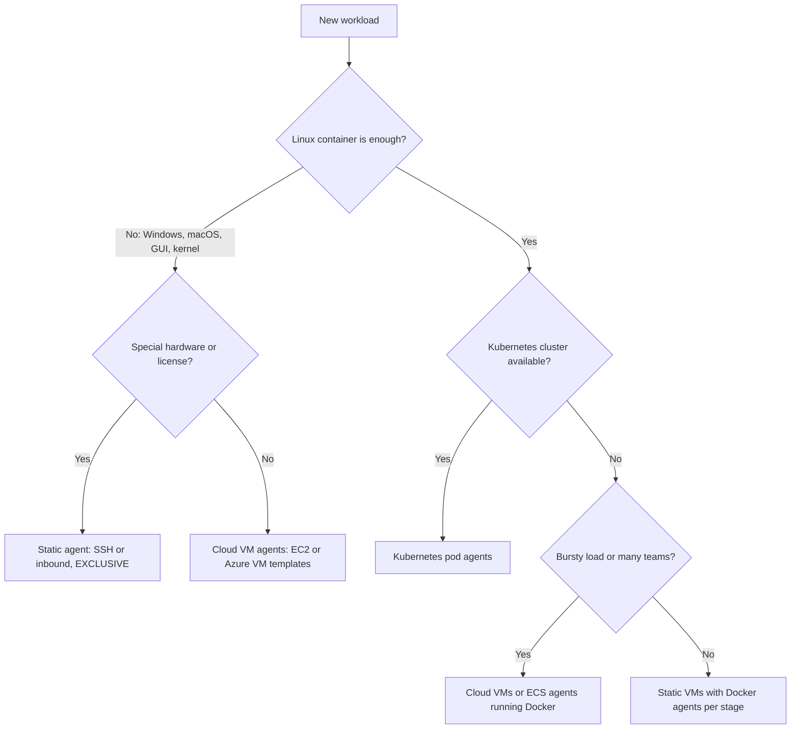
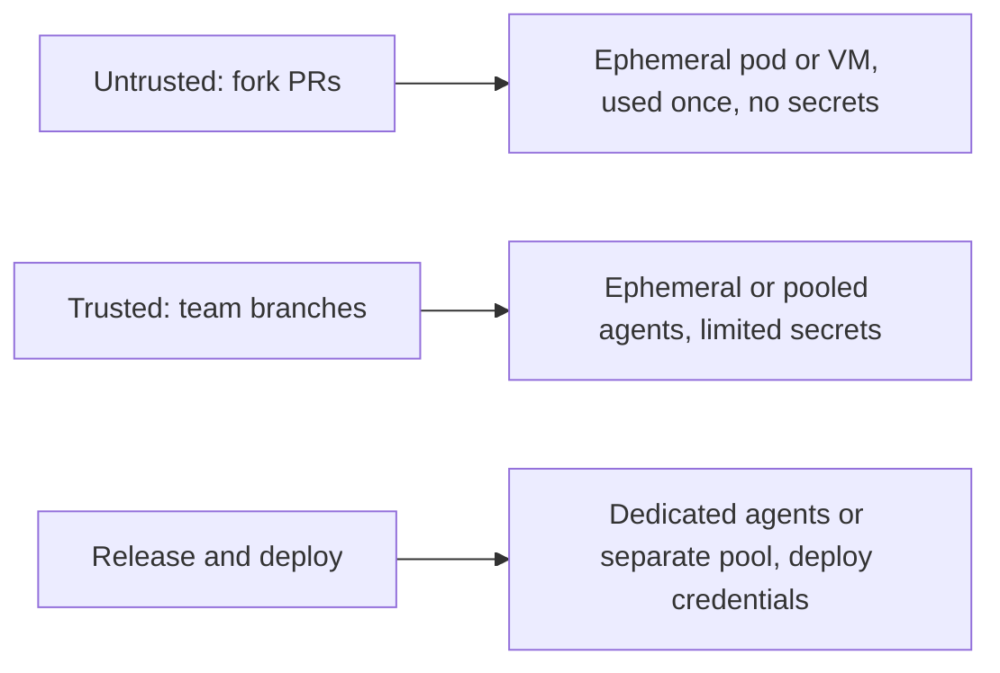
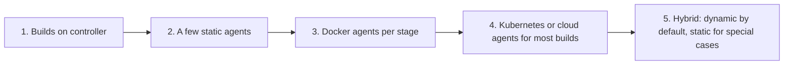

# Choosing an Agent Strategy

## Introduction

The previous pages showed how each kind of agent works: [SSH](./1-jenkins-ssh-agents.mdx), [inbound](./2-jenkins-inbound-agents.mdx), [Docker](./3-jenkins-docker-agents.mdx), [Kubernetes pods](./4-jenkins-kubernetes-agents.mdx) and [cloud VMs](./5-jenkins-cloud-agents.mdx). This page answers the question you face when designing a real Jenkins setup: **which ones should we use, and for what?**

There is no single right answer. A five-person startup and a bank with 300 teams need different designs. But the decision depends on a small set of factors, and once you know them the choice usually becomes obvious.

An analogy: choosing agents is like choosing how a company gets its staff to meetings. A few company cars (static agents) are simple and always ready. A taxi account (cloud VMs) scales but has a wait. A shuttle bus system (Kubernetes) is very efficient once it exists, but someone has to run the depot. Most companies end up with a mix.

## The Decision Factors

| Factor | Question to ask | Pushes toward |
| --- | --- | --- |
| **Operating system** | Do builds need Windows, macOS or special Linux kernels? | VMs or physical machines for non-Linux |
| **Load pattern** | Steady all day, or bursts (mornings, release days)? | Bursty: dynamic agents. Steady: static agents |
| **Isolation** | Do you build untrusted code (fork PRs, many teams)? | Ephemeral agents, one build per agent |
| **Startup time** | Does a 1 to 3 minute wait for a VM matter? | Pods or warm static agents |
| **Caches** | Do builds depend on large local caches? | Static agents, or dynamic agents with remote caches |
| **Special hardware** | GPUs, devices, licensed tools? | Static agents with EXCLUSIVE mode |
| **Platform skills** | Does the team already operate Kubernetes or a cloud account? | Reuse what you already run |
| **Cost model** | Pay for idle capacity, or per use? | Dynamic agents for spiky load |

## A Decision Flow



Read it as a starting point, not a law. A team with no Kubernetes experience should not build a cluster just for Jenkins; a pair of static VMs with Docker agents can serve them well for years.

## The Options Side by Side

| Strategy | Startup | Isolation | Caches | Ops effort | Idle cost | Typical fit |
| --- | --- | --- | --- | --- | --- | --- |
| Static SSH or inbound agents | Instant | Low (shared machine) | Warm | Low for a few, high for many | Full | Small teams, special hardware |
| Static agents + Docker per stage | Seconds | Medium (containers, Docker socket risk) | Warm on host | Low to medium | Full | Mixed toolchains without Kubernetes |
| Docker cloud plugin | Seconds | Medium to high | Cold unless mounted | Medium | Low | Small elastic pools |
| Kubernetes pods | Seconds (image pull can add more) | High (fresh pod per build) | Cold unless PVC, proxy or remote cache | Medium to high (cluster) | Very low | Multi-team, bursty Linux builds |
| Cloud VMs (EC2, Azure) | 1 to several minutes | High (VM per agent, or per build) | Cold unless image-baked | Medium (images, IAM) | Low with idle timeouts | Windows, privileged or heavy builds |

## Capacity: How Many Agents Do You Need?

A rough estimate uses Little's Law: the average number of busy executors equals the rate of builds times their average duration. Add headroom for peaks.

```python
import math

def executors_needed(builds_per_hour: float, avg_minutes: float, peak_factor: float = 2.0) -> int:
    """Estimate executors so the peak hour does not queue for long."""
    average_busy = builds_per_hour * avg_minutes / 60
    return math.ceil(average_busy * peak_factor)

teams = {
    "backend":  {"builds_per_hour": 30, "avg_minutes": 12},
    "frontend": {"builds_per_hour": 40, "avg_minutes": 6},
    "mobile":   {"builds_per_hour": 6,  "avg_minutes": 25},
}

total = 0
for name, t in teams.items():
    n = executors_needed(t["builds_per_hour"], t["avg_minutes"])
    total += n
    print(f"{name:9s} needs about {n} executors at peak")
print(f"total     about {total} executors at peak")
```

Output:

```text
backend   needs about 12 executors at peak
frontend  needs about 8 executors at peak
mobile    needs about 5 executors at peak
total     about 25 executors at peak
```

What this tells you:

- With **static agents**, you buy roughly 25 executors and they sit mostly idle at night and on weekends.
- With **dynamic agents**, you set a cap around 25 to 30 and pay only for what runs.
- The peak factor of 2 is a guess. Measure your real queue times and executor usage (see [Monitoring Jenkins](../12-jenkins-administration/3-jenkins-monitoring.mdx)) and adjust.

## Security Tiers

Not all builds deserve the same trust. A pull request from a fork can contain any code. A main-branch build from your own team is more trusted. A release build that holds production credentials is the most sensitive.



Practical rules:

- **Never let untrusted builds share an agent with builds that hold secrets.** A malicious build could leave a process behind or poison a cache.
- **Use one build per agent** (pods, Azure "Once" retention, EC2 with single-use settings) for untrusted code.
- **Keep deploy credentials on a separate label** such as `deploy`, available only to specific folders. The [Securing Agents and the Controller](../11-jenkins-security/6-jenkins-securing-agents.mdx) page goes deeper.

## Hybrid Designs in Practice

Most real Jenkins setups combine strategies. Labels make the combination invisible to pipeline authors.

```yaml
# JCasC sketch: one controller, three kinds of agents
jenkins:
  numExecutors: 0
  clouds:
    - kubernetes:
        name: "kubernetes"
        namespace: "jenkins-agents"
        webSocket: true
        containerCapStr: "60"
        templates:
          - name: "linux"
            label: "linux k8s"
            containers:
              - name: "jnlp"
                image: "jenkins/inbound-agent:jdk21"
  nodes:
    - permanent:
        name: "gpu-01"
        labelString: "linux gpu cuda"
        mode: EXCLUSIVE
        numExecutors: 1
        remoteFS: "/home/jenkins/agent"
        launcher:
          ssh:
            host: "gpu-01.internal"
            credentialsId: "agent-ssh-key"
            sshHostKeyVerificationStrategy:
              knownHostsFileKeyVerificationStrategy: {}
# Windows agents come from a cloud VM plugin (EC2 or Azure VM Agents) with label "windows",
# configured in the UI first and exported, as described on the Cloud Agents page.
```

A pipeline that uses all three:

```groovy
pipeline {
    agent none
    stages {
        stage('Build and unit test') {
            agent {
                kubernetes {
                    inheritFrom 'linux'
                    yaml '''
                        spec:
                          containers:
                          - name: build
                            image: python:3.13-slim
                            command: ["sleep"]
                            args: ["infinity"]
                    '''
                    defaultContainer 'build'
                    retries 2
                }
            }
            steps {
                sh 'pip install -r requirements.txt && pytest -q'
                stash name: 'src', includes: '**/*.py,requirements.txt'
            }
        }
        stage('Platform tests') {
            parallel {
                stage('GPU model tests') {
                    agent { label 'linux && gpu' }
                    steps {
                        unstash 'src'
                        sh 'nvidia-smi && python -m tests.gpu_suite'
                    }
                }
                stage('Windows client tests') {
                    agent { label 'windows' }
                    steps {
                        unstash 'src'
                        bat 'py -m pytest tests\\client -q'
                    }
                }
            }
        }
    }
}
```

Example output (abridged):

```text
[Build and unit test] Created Pod: kubernetes jenkins-agents/ml-app-main-55-...
[Build and unit test] 128 passed in 41.20s
[GPU model tests] Running on gpu-01 in /home/jenkins/agent/workspace/ml-app_main
[Windows client tests] Running on EC2 (aws-eu) - Windows agent (i-0b7...) in C:\jenkins\workspace\ml-app_main
[GPU model tests] All GPU checks passed
[Windows client tests] 22 passed in 18.03s
Finished: SUCCESS
```

Pipeline authors only see labels. The platform team can move `windows` from EC2 to Azure, or `linux` from one cluster to another, without touching Jenkinsfiles.

## Evolution Path

Teams rarely design the final architecture on day one. A common progression:



- **Step 1 → 2** is the most important, for security. Do it immediately.
- **Step 2 → 3** removes toolchain drift with almost no new infrastructure.
- **Step 3 → 4** happens when load grows, teams multiply or idle cost hurts.
- **Step 5** is where most mature setups land.

Move one label at a time, and keep the old agents until the new ones have run real builds for a while.

### A migration checklist

When you move a label from static agents to dynamic agents, work through this list:

1. **Inventory the tools.** List everything installed on the old agents that builds use: JDKs, Node.js, Python, CLIs, certificates, `~/.npmrc` and `~/.m2/settings.xml` files. Missing files are the most common migration failure.
2. **Build the new image or template.** A Dockerfile, pod YAML or Packer template that contains exactly that list, pinned to versions.
3. **Move configuration files into credentials or config.** Settings that lived in the agent's home directory should come from Jenkins credentials (`withCredentials`) or the Config File Provider, not from the image.
4. **Run both side by side.** Give the new agents a temporary label such as `linux-next` and point a few pipelines at it.
5. **Compare build times.** Expect the first builds to be slower because of cold caches. Add a dependency proxy or cache before switching everyone.
6. **Switch the real label.** Move `linux` to the new agents, and keep the old ones under `linux-legacy` for a rollback window.
7. **Delete the old agents** once nothing has used `linux-legacy` for a few weeks.

```groovy
// Step 4: a temporary canary label for the new agent pool
pipeline {
    agent { label 'linux-next' }
    stages {
        stage('Canary build') {
            steps {
                sh 'java -version && node --version && git --version'
                sh './gradlew build'
            }
        }
    }
}
```

Example output:

```text
Running on linux-next-pod-7x2kq in /home/jenkins/agent/workspace/canary
+ java -version
openjdk version "21.0.8" 2025-07-15 LTS
+ node --version
v22.20.0
+ git --version
git version 2.47.3
BUILD SUCCESSFUL in 3m 12s
```

### Questions to ask before you decide

Before committing to a design, get answers to these from the people involved:

| Ask | Why it matters |
| --- | --- |
| Platform team: can we run CI workloads on the existing cluster, with a quota? | Decides whether Kubernetes pods are an option at all |
| Security team: do we build code from outside contributors? | Decides whether you need single-use agents |
| Finance: is idle capacity or variable spend easier to budget? | Static vs dynamic cost model |
| Developers: which builds are slowest, and what do they wait for? | Shows whether startup time or caches matter more |
| Release managers: which builds need production credentials? | Defines the separate deploy pool |

## Real-World Scenario

You are the first platform engineer at a 60-developer company. Jenkins has 8 static Linux VMs, one Windows VM for the desktop client, and one Mac mini for iOS builds. Complaints: morning queues of 20+ minutes, "works on agent 5" failures, and a finance question about why CI VMs run all weekend. The company already runs production on EKS.

**The decision, workload by workload:**

| Workload | Choice | Reason |
| --- | --- | --- |
| Java and Node.js services (80% of builds) | Kubernetes pods on a CI node pool with spot | Already on EKS, bursty, Linux containers |
| Fork and external PR builds | Kubernetes pods, no credentials, separate namespace | Untrusted code needs fresh, isolated agents |
| Windows desktop client | EC2 Windows template, idle timeout 30 minutes | Needs full Windows; low volume |
| iOS builds | Keep the static Mac mini, EXCLUSIVE, label `macos xcode` | Apple hardware; cannot run in Linux containers |
| Release and deploy stages | Dedicated pod template with deploy service account, `deploy` label limited to release folders | Separate credentials from everyday builds |

**Why this approach:** each workload goes to the cheapest agent type that meets its needs. The common case moves to the platform the company already runs. Special cases stay simple.

**When this design is wrong:** if nobody can operate Kubernetes, use EC2 Fleet with an Auto Scaling Group and Docker agents instead. If builds are steady 24/7, reserved static capacity may cost less than dynamic agents.

**Alternatives and trade-offs:**

| Approach | Pros | Cons | Best for |
| --- | --- | --- | --- |
| All static | Simplest, warm caches | Idle cost, drift, manual scaling | Small teams, steady load |
| All Kubernetes | One platform, elastic, clean | Cannot cover macOS or Windows-heavy needs well | Linux-only shops already on Kubernetes |
| All cloud VMs | Any OS, elastic | Slow startup, image pipelines | Organizations without Kubernetes |
| Hybrid by label | Best fit per workload | More moving parts to understand | Most medium and large setups |
| Hosted CI runners (GitHub Actions, GitLab CI) | No agent infrastructure at all | Less control; usage-based pricing; may mean leaving Jenkins | Teams re-evaluating their CI platform |

If the honest answer is that you spend more time running agents than building software, compare the alternatives in [Jenkins vs GitHub Actions, GitLab CI and Others](../0-jenkins-fundamentals/3-jenkins-vs-alternatives.mdx) and [Total Cost of Running Jenkins](../13-jenkins-best-practices/4-jenkins-cost-and-maintenance.mdx).

## Best Practices

- **Zero executors on the controller.** Always, whatever else you choose.
- **Capability labels, stable over time.** Labels are the contract between pipelines and infrastructure.
- **Agents as code.** Agent images (Dockerfiles, Packer), node definitions and clouds (JCasC) all in Git.
- **One build per agent for untrusted code.** Never mix untrusted and secret-holding builds.
- **Caps on every cloud and template.** Protect the budget and the cluster.
- **Measure before scaling.** Track queue time, executor usage and agent startup time, then adjust.
- **Plan for agent loss.** Use `retries` on Kubernetes agents and `retry` with the `agent()` condition for spot and preemptible capacity.
- **Document the label catalog.** Keep a short page listing every label, what it guarantees (tools, OS, hardware) and who owns it. Pipeline authors should never have to guess.
- **Review the design yearly.** Load, team count and platforms change. A design that was right for 10 developers may be wrong for 100.
- **Keep agent Java current.** Every agent's Java must be supported by your Jenkins version. Check the Java support policy before upgrades.

## Summary

- Choose agents by OS needs, load pattern, isolation requirements, startup tolerance, caches, special hardware and the platforms your team already runs.
- Linux container builds with a cluster available: Kubernetes pods. Windows or full-VM needs: cloud VM templates. Special hardware: static EXCLUSIVE agents.
- Estimate capacity with builds per hour times average duration, plus peak headroom, then measure.
- Separate untrusted, trusted and release builds into different agent pools.
- Most mature setups are hybrid, held together by capability labels.

## Exercises

1. Fill in the decision-factor table for your own project or a sample one, and pick an agent type for each workload.
2. Run the capacity script with your real build counts and durations. Compare the result with your current number of executors.
3. Design label names for a hybrid setup with Kubernetes, one Windows template and one GPU machine. Write a Jenkinsfile that uses all three.
4. Write a one-page proposal for moving from static agents to dynamic agents, including a rollback plan and how you will measure success.

Related pages:

- [Controller and Agents](./0-jenkins-controller-and-agents.mdx)
- [Labels, Executors and Scheduling](./6-jenkins-labels-and-executors.mdx)
- [High Availability and Scaling](../12-jenkins-administration/5-jenkins-high-availability.mdx)
- [Capstone: Production CI/CD Platform with Jenkins](../14-jenkins-projects/6-jenkins-capstone.mdx)
- For CI/CD architecture in general, see the [CI/CD tutorial](/docs/devops/cicd).
