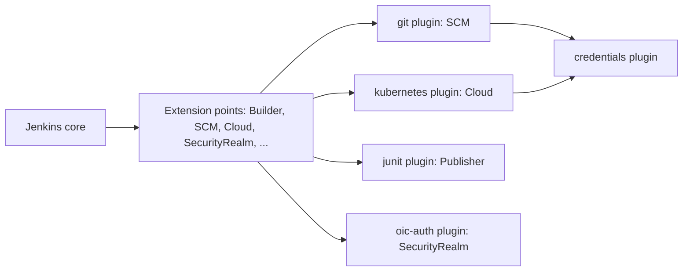
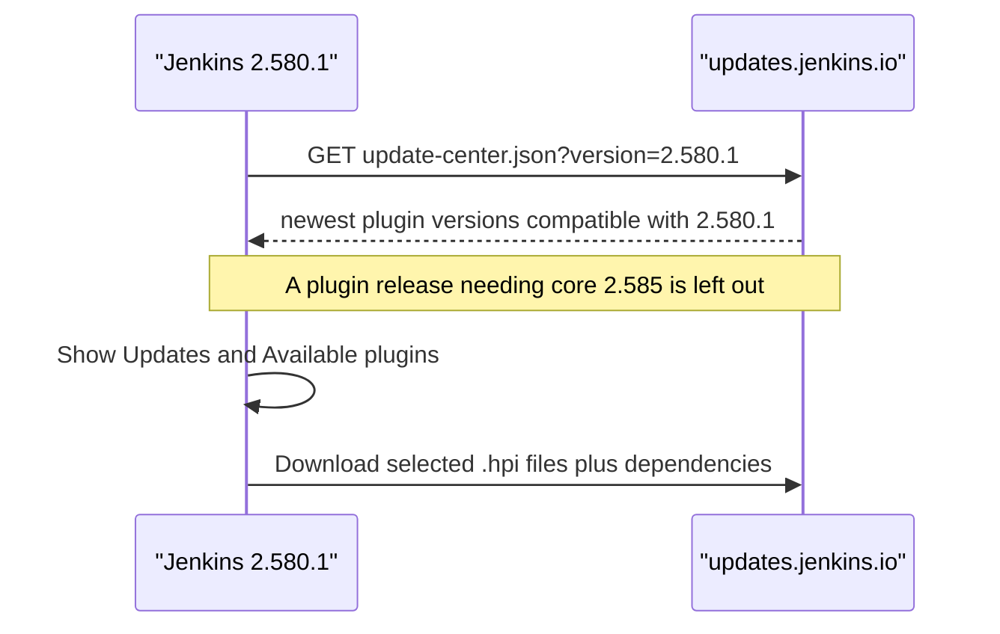
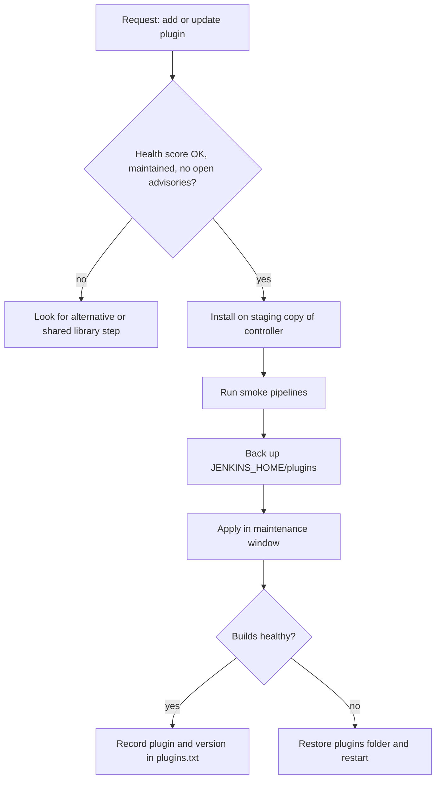

# Plugin Management

## Introduction

Out of the box, Jenkins core does surprisingly little. It can schedule work, run it on agents, store build history and show a web UI. Almost everything else you think of as "Jenkins" comes from **plugins**: Git checkout, Pipeline itself, credentials, Docker and Kubernetes agents, test reports, Slack notifications, single sign-on and more. The public update center lists over 2,000 of them.

Think of Jenkins core as a smartphone operating system and plugins as apps. The OS gives you the basics and a set of well-defined hooks (camera, notifications, storage). Apps plug into those hooks to add features. Like apps, plugins need updates, some get abandoned, and a badly written one can drain your battery or leak your data.

This page covers the day-to-day mechanics:

1. What a plugin actually is on disk and how Jenkins loads it.
2. The Plugin Manager UI: installing, updating, disabling and uninstalling.
3. Doing the same from the CLI and the REST API.
4. How the update center decides which version you get.
5. A safe routine for changing plugins on a shared controller.

Later pages in this section build on it: [Essential Plugins](./1-jenkins-essential-plugins.mdx) recommends a starter set, [Avoiding Plugin Sprawl and Dependency Problems](./2-jenkins-plugin-dependency-hell.mdx) covers the risks, and [Managing Plugins as Code](./3-jenkins-plugin-installation-manager.mdx) replaces clicking with a versioned file.

## What a Plugin Is

A plugin is a Java archive with a `.hpi` extension. When Jenkins downloads one, it saves it under `JENKINS_HOME/plugins/` with a `.jpi` extension and unpacks it into a folder of the same name.

```text
/var/jenkins_home/plugins/
├── git.jpi                     # the archive Jenkins downloaded
├── git/                        # unpacked contents
│   ├── META-INF/MANIFEST.MF    # name, version, dependencies, minimum Jenkins version
│   └── WEB-INF/lib/git.jar     # the plugin's classes
├── credentials.jpi
├── credentials/
├── workflow-cps.jpi
├── workflow-cps/
└── slack.jpi.disabled          # marker file: this plugin is disabled
```

Each plugin's manifest declares three things that matter to you as an administrator:

| Manifest field | Meaning | Why you care |
| --- | --- | --- |
| `Short-Name` | The plugin ID, such as `git` or `configuration-as-code` | This is the name you use in `plugins.txt`, the CLI and the REST API |
| `Jenkins-Version` | The minimum Jenkins core version | A plugin will not load on an older core |
| `Plugin-Dependencies` | Other plugins (and minimum versions) it needs | Installing one plugin often pulls in dozens more |

Plugins hook into Jenkins through **extension points**. Core defines interfaces such as "a build step", "an SCM", "a cloud that provisions agents" or "a security realm", and a plugin provides implementations annotated with `@Extension`. You will see this from the inside in [Writing a Simple Plugin](./4-jenkins-writing-a-plugin.mdx).



:::info Plugins run inside the controller
Every plugin runs inside the controller's Java process with full access to Jenkins internals. A plugin is not sandboxed the way a Pipeline script is. Installing a plugin is closer to installing software on your server than to installing a browser extension. Treat it with the same care.
:::

## The Plugin Manager UI

Open **Manage Jenkins → Plugins**. The page has these tabs:

| Tab | What it shows |
| --- | --- |
| **Updates** | Installed plugins that have a newer compatible version, plus any security warnings |
| **Available plugins** | Plugins from the update center that you have not installed |
| **Installed plugins** | Everything installed, with enable/disable toggles and uninstall buttons |
| **Advanced settings** | Proxy settings, manual `.hpi` upload, and the update site URL |
| **Download progress** | Appears while installs or updates are running |

The exact layout changes a little between releases, but these tabs have been stable for a long time. If something looks different on your version, the [official Managing Plugins page](https://www.jenkins.io/doc/book/managing/plugins/) is the reference.

### Installing a Plugin

1. Go to **Available plugins** and search for the plugin, for example `Timestamper`.
2. Tick the checkbox and click **Install**.
3. Watch the **Download progress** page. Jenkins downloads the plugin and every missing dependency.
4. Most plugins load immediately. If a plugin or one of its dependencies cannot be loaded dynamically, the page asks for a restart. Tick **Restart Jenkins when installation is complete and no jobs are running** to let Jenkins restart safely.

Each plugin in the list shows a **health score**. It comes from the [Plugin Health Scoring](https://plugin-health.jenkins.io/) project, which runs automated probes against the plugin's repository: is it deprecated, is the repository archived, is it up for adoption, are there unresolved security advisories, does it use Dependabot or Renovate, how recently was it released, and so on. A low score is a strong hint to look for an alternative. The score describes the plugin's latest release, not necessarily the version you run.

### Updating Plugins

The **Updates** tab lists every installed plugin that has a newer version available for *your* Jenkins version. Jenkins refreshes this list from the update center about once a day; **Check now** forces a refresh.

Updates are downloaded immediately but, unlike fresh installs, they only take effect after a restart, because the old version is already loaded in memory.

:::caution Update in batches, not all at once on Friday afternoon
"Select all → Update" on a production controller is the classic way to break Jenkins. Plugins depend on each other, and a new version of one sometimes needs a new version of another. Update on a staging copy first, read the release notes for plugins with major version jumps, and keep a backup of `JENKINS_HOME/plugins` so you can roll back. See [Backup and Restore](../12-jenkins-administration/2-jenkins-backup-and-restore.mdx).
:::

### Disabling vs Uninstalling

On the **Installed plugins** tab each plugin has a toggle (disable) and an uninstall button.

| Action | What happens | Reversible? | Restart needed |
| --- | --- | --- | --- |
| **Disable** | Jenkins creates `PLUGIN.jpi.disabled`; after restart the plugin contributes nothing | Yes, toggle back on and restart | Yes |
| **Uninstall** | The `.jpi` file is removed; the plugin keeps running until restart | Only by reinstalling | Yes |

Two important details from the official docs:

- **Uninstalling does not delete configuration.** Jobs and global config that referenced the plugin keep that data. On the next start Jenkins logs warnings about data it cannot load, and **Manage Jenkins → Manage Old Data** lets you inspect and discard it. If you reinstall the plugin, the configuration comes back.
- **You cannot disable or uninstall a plugin that others depend on** without dealing with the dependents first. The UI greys out those buttons and shows which plugins need it. Removing a required plugin by deleting files can stop Jenkins from booting.

That is why the safest removal routine is **disable first, run for a while, then uninstall**. If something breaks, re-enabling is one click and a restart.

### Manual Installation

Sometimes you need a plugin that is not in the update center (an internal plugin) or an older version (the update center only offers the newest compatible version). Two options:

- **Advanced settings → Deploy Plugin**: upload a `.hpi` file from your machine.
- Copy the file to `JENKINS_HOME/plugins/NAME.jpi` and restart.

Manual installation does **not** resolve dependencies. You must install those yourself. This is one of the reasons the next pages push you toward [Managing Plugins as Code](./3-jenkins-plugin-installation-manager.mdx).

## Which Version Do You Get?

Jenkins does not always offer the newest release of a plugin. It asks the update center for a **version-specific** list that matches your core version. A plugin release that needs a newer core than yours is hidden, and you get the newest release that still works.



For example, at the time of writing the newest Pipeline Graph View release requires Jenkins 2.585 (a weekly release), so an LTS 2.580.1 controller is offered the previous release instead. This is a feature: it stops you from installing something that will not load. It also means that **staying on an old core quietly freezes your plugins**, including security fixes. Keeping core current is part of plugin management. See [Upgrading Jenkins and LTS Releases](../1-jenkins-installation/6-jenkins-upgrading.mdx).

:::note Versions change
Plugin versions and core requirements quoted on this page were correct in autumn 2026 and will move. Check [plugins.jenkins.io](https://plugins.jenkins.io/) for current values.
:::

### Reading Plugin Version Numbers

Many plugins now use version numbers like `1511.v2e3cb_0008ef0`. This format comes from JEP-229 (continuous delivery of plugins): the first number is a build count that always increases, and the part after `.v` is derived from the Git commit. You cannot tell "major" from "minor" changes by looking at it, so read the release notes on GitHub when an update matters. Older plugins still use classic numbers such as `5.10.1` or `1.30`.

## Detached Plugins: Features That Moved Out of Core

Over the years, features that used to live in Jenkins core were split out into plugins, such as JUnit reporting, the Mailer, Matrix Authorization and Matrix Project. These are called **detached plugins**. For a long time Jenkins bundled them in the WAR file and installed them automatically on upgrade, so old configurations kept working.

That is ending. The Jenkins 2.580.1 LTS changelog says Jenkins **stopped bundling** JUnit, Mailer, Matrix Authorization Strategy, Matrix Project and OWASP Markup Formatter, along with a group of library plugins such as bouncycastle API, JAXB and Instance Identity. Instances upgraded from very old versions no longer get them installed automatically, and you install them through the plugin manager if you need them.

In practice most controllers already have them, because popular plugins depend on them (the Git plugin requires Mailer, for example). The lesson is broader: **declare every plugin you rely on explicitly**, even if it "came with Jenkins". A `plugins.txt` that lists `junit` and `matrix-auth` keeps working no matter what the WAR bundles.

## Managing Plugins from the Command Line

### Jenkins CLI

The [Jenkins CLI](../12-jenkins-administration/8-jenkins-rest-api-and-cli.mdx) has plugin commands. Download `jenkins-cli.jar` from `JENKINS_URL/jnlpJars/jenkins-cli.jar` and authenticate with an API token.

```bash
export JENKINS_URL=http://localhost:8080
export JENKINS_AUTH=admin:11a2b3c4d5e6f7a8b9c0d1e2f3a4b5c6d7   # user:apiToken

# List installed plugins (name, display name, version)
java -jar jenkins-cli.jar -s "$JENKINS_URL" -auth "$JENKINS_AUTH" list-plugins | head -5

# Install from the update center and load it without a restart
java -jar jenkins-cli.jar -s "$JENKINS_URL" -auth "$JENKINS_AUTH" install-plugin timestamper -deploy

# Disable a plugin and restart safely
java -jar jenkins-cli.jar -s "$JENKINS_URL" -auth "$JENKINS_AUTH" disable-plugin slack -restart
```

Example output:

```text
antisamy-markup-formatter  OWASP Markup Formatter Plugin   173.v680e3a_b_69ff3
apache-httpcomponents-client-4-api  Jakarta HttpComponents Client 4.x API Plugin  4.5.14-269.vfa_2321039a_83
bouncycastle-api  bouncycastle API Plugin  2.30.1.86.1-306.vfc711fa_36d5f
branch-api  Branch API Plugin  2.1303.v9f3b_95dc329d
caffeine-api  Caffeine API Plugin  3.3.0-210.v71b_2985ce530
Installing timestamper from update center
```

`install-plugin` accepts an update center short name, a URL, or a local file. `disable-plugin` takes a `-strategy` option (`none`, `mandatory` or `all`) that controls what happens to plugins depending on the one you disable.

### REST API

The plugin manager exposes JSON, which is ideal for audits and dashboards:

```bash
curl -s -g -u "$JENKINS_AUTH" \
  "$JENKINS_URL/pluginManager/api/json?depth=1&tree=plugins[shortName,version,active,enabled,hasUpdate]" \
  | jq -r '.plugins[] | select(.hasUpdate) | "\(.shortName) \(.version)"'
```

Example output:

```text
credentials-binding 687.v619cb_15e923f
git 5.7.0
```

The `-g` flag stops curl from interpreting the square brackets in the `tree` parameter.

### Script Console

For one-off inspection, **Manage Jenkins → Script Console** runs Groovy with full admin rights. This prints every plugin in `plugins.txt` format:

```groovy
Jenkins.instance.pluginManager.plugins
    .sort { it.shortName }
    .each { p -> println "${p.shortName}:${p.version}" + (p.isEnabled() ? '' : '   # disabled') }
```

Example output:

```text
ansicolor:542.v03d235fee02d
credentials:1511.v2e3cb_0008ef0
git:5.10.1
slack:795.v4b_9705b_e6d47   # disabled
timestamper:1.30
```

You will reuse this snippet to bootstrap a `plugins.txt` in [Managing Plugins as Code](./3-jenkins-plugin-installation-manager.mdx).

:::warning The Script Console is root access
Anything you run there can read every credential and change any setting. Restrict it to administrators, and prefer the REST API for read-only automation. See [Script Security and Sandboxing](../11-jenkins-security/5-jenkins-script-security.mdx).
:::

## Security Warnings

The update center also publishes **security warnings**. When an installed plugin version has a published vulnerability, Jenkins shows a red banner in **Manage Jenkins** and marks the plugin on the **Updates** tab with a link to the advisory. Do not dismiss these casually:

- If a fixed version exists, schedule the update promptly.
- If no fix exists (common for abandoned plugins), the advisory usually says so. Decide whether you can live with the risk, apply the workaround, or remove the plugin.

The Jenkins project publishes advisories at [jenkins.io/security/advisories](https://www.jenkins.io/security/advisories/). Subscribing to the advisory mailing list is covered in [Security Advisories and Hardening](../11-jenkins-security/7-jenkins-security-advisories.mdx).

### Vetting a Plugin Before You Install It

The update center data that Jenkins downloads is public JSON, so you can check a plugin's health score, core requirement, dependency count and deprecation labels from a script before anyone clicks **Install**. This is handy in a request template or a chat bot.

```python
import json
import sys
import urllib.request

CORE = "2.580.1"  # your Jenkins version
URL = f"https://updates.jenkins.io/update-center.actual.json?version={CORE}"


def vet(uc: dict, plugin_id: str) -> None:
    plugin = uc["plugins"].get(plugin_id)
    if plugin is None:
        print(f"{plugin_id}: not found (check the ID on plugins.jenkins.io)")
        return
    required = [d["name"] for d in plugin.get("dependencies", []) if not d["optional"]]
    advisories = [w["id"] for w in uc.get("warnings", []) if w.get("name") == plugin_id]
    flags = [l for l in plugin.get("labels", []) if l in ("deprecated", "adopt-this-plugin")]
    print(f"{plugin_id} {plugin['version']}")
    print(f"  released:      {plugin.get('releaseTimestamp', '?')[:10]}")
    print(f"  needs core:    {plugin.get('requiredCore')}")
    print(f"  health score:  {plugin.get('health', 'n/a')}")
    print(f"  required deps: {len(required)}")
    print(f"  flags:         {', '.join(flags) or 'none'}")
    print(f"  advisories (any version): {len(advisories)}")


if __name__ == "__main__":
    with urllib.request.urlopen(URL, timeout=60) as resp:
        update_center = json.load(resp)
    for pid in sys.argv[1:] or ["slack"]:
        vet(update_center, pid)
```

Run it with `python3 vet_plugin.py slack jacoco`. Example output (values from autumn 2026):

```text
slack 795.v4b_9705b_e6d47
  released:      2025-08-04
  needs core:    2.479.3
  health score:  92
  required deps: 13
  flags:         none
  advisories (any version): 1
jacoco 3.3.7
  released:      2024-11-09
  needs core:    2.426.3
  health score:  73
  required deps: 1
  flags:         deprecated
  advisories (any version): 1
```

The JaCoCo plugin is labeled deprecated (the Coverage plugin replaces it), which is exactly what you want to catch before a team builds on it. "Advisories (any version)" counts every published warning for the plugin, including ones fixed long ago, so follow the links on the plugin page to see whether the current version is affected.

## Using a Custom Update Site

Organizations behind a strict firewall often point Jenkins at an internal mirror. Under **Advanced settings → Update Site** you can replace `https://updates.jenkins.io/update-center.json` with an internal URL, for example an Artifactory or Nexus proxy of the Jenkins update center.

Reasons to do this:

- Controllers have no direct internet access.
- You want to curate which plugins are visible at all.
- You need an audit log of what was downloaded.

Reasons not to: you now own the mirror. If it goes stale, you stop receiving security fixes without noticing.

## Real-World Scenario

**Situation.** You run the single Jenkins controller for a 40-person product team. It has grown organically: anyone with admin rights installed whatever they needed. Last month someone clicked "update all" on a Thursday afternoon, a Kubernetes plugin update needed a newer Credentials plugin, and builds stayed red until a restart the next morning. Now a developer asks for a Slack plugin so the team gets build notifications.

**Solution.** You introduce a lightweight change routine for plugins:



1. **Vet the plugin.** On [plugins.jenkins.io](https://plugins.jenkins.io/slack/) you check the health score, the last release date, the open security warnings and the list of maintainers. Slack Notification (`slack`) is widely used and maintained, so it passes.
2. **Stage it.** A staging controller started from last night's backup gets the plugin first. You run a pipeline that calls `slackSend` against a test channel.
3. **Back up and apply.** You copy `JENKINS_HOME/plugins` aside, install in the evening when the queue is empty, and let Jenkins restart when idle.
4. **Write it down.** The plugin and its version go into a `plugins.txt` in Git, which is the first step toward the fully codified setup in [Managing Plugins as Code](./3-jenkins-plugin-installation-manager.mdx).
5. **Restrict admin.** Only two people keep the Overall/Administer permission, so plugin changes go through this path. See [Authorization and Role-Based Access](../11-jenkins-security/2-jenkins-authorization.mdx).

**Why this approach.** It is cheap. You do not need new tooling, only a staging copy and a habit. It addresses the actual failure: untested changes landing on a shared controller during working hours.

**When to use it / when not to.** It suits a single controller managed by hand. Once you run several controllers, or you already build the controller as a container image, skip straight to plugins-as-code. Doing this by hand across five controllers does not scale.

**Alternatives and trade-offs:**

| Approach | Pros | Cons | Best for |
| --- | --- | --- | --- |
| Click in the UI, no process | Fast, zero setup | Untracked, untested, easy to break production | Personal or throwaway instances |
| UI plus staging and backups (this scenario) | Low effort, catches most breakage | Still manual, drift between staging and prod | One long-lived controller |
| CLI or REST scripts | Repeatable, can be scheduled | Still mutates a running server | Small fleets, transitional setups |
| Plugins baked into an image from `plugins.txt` | Versioned, reviewed, reproducible, easy rollback | Needs image build pipeline | Containers, Kubernetes, multiple controllers |

## Common Mistakes

- **Installing plugins to solve one-off problems.** A plugin for a single job's convenience becomes a permanent upgrade burden for everyone. Often a shell step or a [shared library](../8-jenkins-shared-libraries/0-jenkins-shared-libraries-introduction.mdx) function does the same job.
- **Updating everything at once on production.** Update in small batches on staging first.
- **Deleting `.jpi` files by hand.** You can remove a dependency and stop Jenkins from starting. Use the UI or CLI, and disable before uninstalling.
- **Ignoring security warnings** because "it's an internal server". Internal Jenkins servers hold deploy credentials and are prime targets.
- **Letting core fall behind.** The version-specific update center then stops offering plugin fixes, including security fixes.
- **Treating the update center UI as the record of what is installed.** It only shows the current state. Keep the list in Git.
- **Choosing deprecated plugins** like Blue Ocean for new setups. Check the plugin page for a deprecation notice before installing.

## Summary

- Plugins are `.hpi`/`.jpi` archives in `JENKINS_HOME/plugins` that implement Jenkins extension points and run with full access inside the controller.
- The Plugin Manager has tabs for updates, available plugins, installed plugins and advanced settings. Health scores and security warnings help you judge plugins.
- Installs usually load without a restart; updates, disables and uninstalls need one. Uninstalling leaves configuration behind.
- Jenkins gets plugin versions from a version-specific update center, so an old core quietly stops receiving plugin updates.
- Detached plugins such as JUnit and Mailer are no longer bundled starting with 2.580.1, so declare every plugin you rely on.
- The CLI (`install-plugin`, `disable-plugin`, `list-plugins`), the REST API (`/pluginManager/api/json`) and the Script Console all let you inspect and change plugins without clicking.
- For shared controllers, stage, back up and record every plugin change. Then move to plugins-as-code.

## Exercises

1. Start a disposable controller with Docker (see [Installing Jenkins with Docker](../1-jenkins-installation/0-jenkins-install-docker.mdx)). Install `timestamper` from the UI and note how many plugins Jenkins reports in the download progress page.
2. Use the REST API with `jq` to print every plugin that has an update and every plugin that is disabled.
3. Disable a plugin that has no dependents, restart, and confirm the `.jpi.disabled` marker file exists in `JENKINS_HOME/plugins`. Then re-enable it.
4. Run the Script Console snippet above and save the output as `plugins.txt`. Keep it: you will use it in [Managing Plugins as Code](./3-jenkins-plugin-installation-manager.mdx).

Next, see which plugins are worth installing in [Essential Plugins](./1-jenkins-essential-plugins.mdx).
