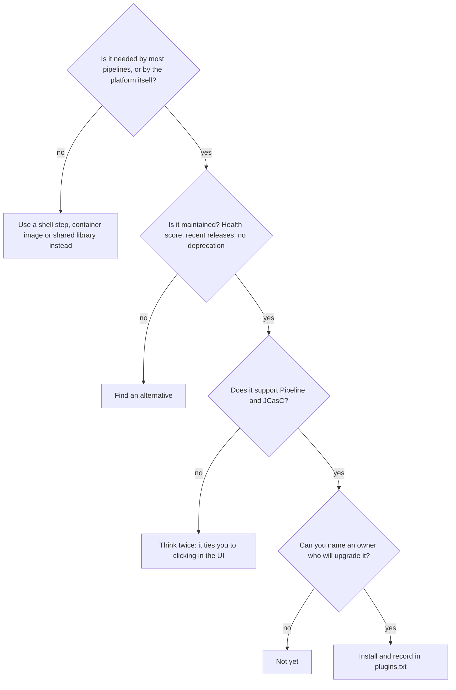

# Essential Plugins

## Introduction

The Jenkins update center lists more than 2,000 plugins. Most teams need fewer than twenty that they choose on purpose. Everything else either arrives as a dependency or should not be there at all.

Picking plugins is like packing for a long hike. Every item you add has weight: upgrades to test, security advisories to watch, and one more thing that can break at startup. Experienced hikers pack a short, proven list and leave the gadgets at home. This page gives you that short list for Jenkins, grouped by job, with a minimal example for each so you can see what you are getting.

You will learn:

1. Which plugins the setup wizard suggests, and why.
2. A recommended core set for modern Pipeline-based Jenkins.
3. Optional plugins you add only when you need them.
4. Plugins that are deprecated or superseded and should not be used for new work.

If you are not yet comfortable installing and updating plugins, read [Plugin Management](./0-jenkins-plugin-management.mdx) first.

:::note Versions change
Plugin IDs on this page were verified against the Jenkins update center in autumn 2026. Plugins get renamed, deprecated and replaced. Always confirm on [plugins.jenkins.io](https://plugins.jenkins.io/) before installing, and check the health score and deprecation notices there.
:::

## How to Think About Plugin Choice

Before the list, a simple filter. A plugin earns a place on your controller when it passes all four questions:



The first question matters most. Many popular plugins exist only to wrap a command-line tool. If a pipeline can run `npm`, `terraform` or `aws` inside a container, it does not need a plugin for that tool, and the tool version is controlled by the container image rather than the controller. See [Docker Agents](../6-jenkins-agents/3-jenkins-docker-agents.mdx).

## What the Setup Wizard Suggests

When you pick **Install suggested plugins** in the [Initial Setup Wizard](../1-jenkins-installation/3-jenkins-initial-setup.mdx), Jenkins installs a list defined in core. In current Jenkins source it is:

| Category | Suggested plugins (IDs) |
| --- | --- |
| Organization and administration | `cloudbees-folder`, `antisamy-markup-formatter` |
| Build features | `build-timeout`, `credentials-binding`, `timestamper`, `ws-cleanup` |
| Build tools | `ant`, `gradle` |
| Pipelines and CD | `workflow-aggregator`, `github-branch-source`, `pipeline-github-lib`, `pipeline-graph-view` |
| Source code management | `git` |
| Distributed builds | `ssh-slaves` |
| User management and security | `matrix-auth`, `ldap` |
| Notifications | `email-ext`, `mailer` |
| Appearance | `dark-theme` |

That is a reasonable starting point, and with dependencies it already expands to dozens of installed plugins. Notice it includes `ant` and `gradle`, which you may not need if you build inside containers, and `ldap`, which you only need if you authenticate against LDAP.

## The Core Set

These are the plugins almost every Pipeline-based Jenkins benefits from.

### Pipeline: `workflow-aggregator`

The "Pipeline" plugin is an aggregator: it installs nothing of its own but pulls in the plugins that make up Pipeline, including `workflow-job`, `workflow-cps` (the Groovy engine), `workflow-basic-steps`, `workflow-durable-task-step`, `workflow-multibranch`, `pipeline-input-step`, `pipeline-groovy-lib` (shared libraries) and `pipeline-model-definition` (Declarative syntax).

```groovy
pipeline {
    agent any
    stages {
        stage('Hello') {
            steps {
                echo 'Pipeline plugins are working'
            }
        }
    }
}
```

Example output:

```text
[Pipeline] Start of Pipeline
[Pipeline] node
[Pipeline] stage
[Pipeline] { (Hello)
[Pipeline] echo
Pipeline plugins are working
[Pipeline] }
[Pipeline] End of Pipeline
Finished: SUCCESS
```

### Source Control: `git` and a Branch Source

- `git` provides the `git` and `checkout scm` steps. See [Git Integration](../5-jenkins-scm-integration/0-jenkins-git-integration.mdx).
- A **branch source** plugin discovers branches and pull requests for [Multibranch Pipelines](../5-jenkins-scm-integration/1-jenkins-multibranch-pipelines.mdx). Install the one for your platform: `github-branch-source`, `gitlab-branch-source`, or `cloudbees-bitbucket-branch-source`.

Only install the branch sources you use. Each one brings its own API client and dependencies.

### Credentials: `credentials` and `credentials-binding`

`credentials` stores secrets; `credentials-binding` provides `withCredentials` to expose them to steps as masked environment variables.

```groovy
pipeline {
    agent any
    stages {
        stage('Publish') {
            steps {
                withCredentials([usernamePassword(credentialsId: 'registry-creds',
                                                  usernameVariable: 'REG_USER',
                                                  passwordVariable: 'REG_PASS')]) {
                    sh 'echo "$REG_PASS" | docker login registry.example.com -u "$REG_USER" --password-stdin'
                }
            }
        }
    }
}
```

Example output:

```text
[Pipeline] withCredentials
Masking supported pattern matches of $REG_USER or $REG_PASS
[Pipeline] sh
+ docker login registry.example.com -u **** --password-stdin
Login Succeeded
```

Note the single quotes around the `sh` script: the shell expands the variables, not Groovy, so the secret never ends up in Groovy string interpolation. More in [Credentials Management](../11-jenkins-security/3-jenkins-credentials.mdx).

### Agents: `docker-workflow` and/or `kubernetes`

Pick the plugin that matches your agent strategy (see [Choosing an Agent Strategy](../6-jenkins-agents/7-jenkins-agent-strategies.mdx)):

- `docker-workflow` (Docker Pipeline) enables `agent { docker { ... } }` and the `docker.image(...).inside` step.
- `kubernetes` provisions a fresh pod per build with `agent { kubernetes { ... } }`.
- `ssh-slaves` (SSH Build Agents) connects static Linux agents over SSH.

```groovy
pipeline {
    agent {
        docker { image 'maven:3.9-eclipse-temurin-21' }
    }
    stages {
        stage('Build') {
            steps {
                sh 'mvn -v'
            }
        }
    }
}
```

Example output:

```text
+ mvn -v
Apache Maven 3.9.11
Java version: 21.0.8, vendor: Eclipse Adoptium
```

### Test Results: `junit`

`junit` parses JUnit-style XML reports, which nearly every test framework can produce, and draws trend charts. Note that starting with Jenkins 2.580.1 it is no longer bundled with core, so list it explicitly.

```groovy
post {
    always {
        junit testResults: 'target/surefire-reports/*.xml', allowEmptyResults: true
    }
}
```

Example output:

```text
[Pipeline] junit
Recording test results
[Checks API] No suitable checks publisher found.
```

Details in [Test Reports with JUnit](../9-jenkins-build-and-test/4-jenkins-test-reports.mdx).

### Quality of Life: `timestamper`, `ws-cleanup`, `build-timeout`, `ansicolor`

```groovy
pipeline {
    agent any
    options {
        timestamps()                       // timestamper
        ansiColor('xterm')                 // ansicolor
        timeout(time: 30, unit: 'MINUTES') // core Pipeline step, no extra plugin
    }
    stages {
        stage('Build') {
            steps {
                sh 'make build'
            }
        }
    }
    post {
        cleanup {
            cleanWs()                      // ws-cleanup
        }
    }
}
```

Example output:

```text
10:41:02  + make build
10:41:07  build complete
[Pipeline] cleanWs
[WS-CLEANUP] Deleting project workspace...
[WS-CLEANUP] done
```

`build-timeout` adds timeouts to Freestyle jobs. Pipelines already have the `timeout` step from `workflow-basic-steps`, so you only need `build-timeout` if you still run Freestyle jobs.

### Visualization: `pipeline-graph-view`

Pipeline Graph View shows each run as a graph of stages with logs per step. It is in the current suggested set and is the actively developed way to visualize pipelines. Pipeline: Stage View (`pipeline-stage-view`) still exists and is maintained, but Graph View is where new work happens.

### Configuration as Code: `configuration-as-code`

JCasC lets you define global configuration, security, clouds and credentials in YAML. It is the foundation for a reproducible controller and is covered in [Configuration as Code (JCasC)](../12-jenkins-administration/0-jenkins-configuration-as-code.mdx). Install it on day one, even if you do not use it yet: it makes **Manage Jenkins → Configuration as Code → View Configuration** available, which exports your current setup as YAML.

### Security: an Authorization Strategy and SSO

- `matrix-auth` (Matrix Authorization Strategy) for fine-grained permissions, or `role-strategy` (Role-based Authorization Strategy) for role-based permissions. Like JUnit, `matrix-auth` is no longer bundled from 2.580.1, so declare it.
- One authentication plugin that matches your identity provider: `oic-auth` (OpenID Connect), `saml`, `ldap`, or `github-oauth`.

See [Authentication and SSO](../11-jenkins-security/1-jenkins-authentication.mdx) and [Authorization and Role-Based Access](../11-jenkins-security/2-jenkins-authorization.mdx).

## The Core Set at a Glance

| Need | Plugin ID | Main step or feature |
| --- | --- | --- |
| Pipeline engine and Declarative | `workflow-aggregator` | `pipeline { }`, `node`, `stage` |
| Git checkout | `git` | `git`, `checkout scm` |
| PR and branch discovery | `github-branch-source` (or GitLab/Bitbucket equivalent) | Multibranch, Organization Folders |
| Secrets | `credentials`, `credentials-binding` | `withCredentials` |
| Container agents | `docker-workflow` or `kubernetes` | `agent { docker }`, `agent { kubernetes }` |
| Test reports | `junit` | `junit` |
| Logs | `timestamper`, `ansicolor` | `timestamps()`, `ansiColor()` |
| Workspace hygiene | `ws-cleanup` | `cleanWs()` |
| Visualization | `pipeline-graph-view` | Graph of stages |
| Configuration as code | `configuration-as-code` | `jenkins.yaml` |
| Access control | `matrix-auth` or `role-strategy`, plus an SSO plugin | Permissions |

## Add When Needed

These are good plugins, but add them only when a real need appears.

| Need | Plugin ID | Example use |
| --- | --- | --- |
| Code coverage | `coverage` | `recordCoverage(tools: [[parser: 'JACOCO']])` |
| Static analysis results | `warnings-ng` | `recordIssues(tools: [java(), checkStyle()])` |
| Read JSON, YAML, CSV, zip files | `pipeline-utility-steps` | `readJSON file: 'package.json'` |
| SSH keys for `git push` or `scp` | `ssh-agent` | `sshagent(['deploy-key']) { sh 'ssh ...' }` |
| Rich email | `email-ext` | `emailext subject: ..., body: ..., to: ...` |
| Slack notifications | `slack` | `slackSend channel: '#builds', message: 'Done'` |
| Generate jobs from code | `job-dsl` | Seed jobs; see [Job DSL](../12-jenkins-administration/1-jenkins-job-dsl.mdx) |
| Metrics for Prometheus | `prometheus` | `/prometheus` endpoint; see [Monitoring Jenkins](../12-jenkins-administration/3-jenkins-monitoring.mdx) |
| Tracing pipelines | `opentelemetry` | Export build traces to an OTel backend |
| Audit plugin usage | `plugin-usage-plugin` | Report which jobs use which plugins |

A few of these in action:

```groovy
pipeline {
    agent any
    stages {
        stage('Read version') {
            steps {
                script {
                    def pkg = readJSON file: 'package.json'   // pipeline-utility-steps
                    echo "Building ${pkg.name} ${pkg.version}"
                }
            }
        }
        stage('Test') {
            steps {
                sh 'mvn -B verify'
            }
            post {
                always {
                    junit 'target/surefire-reports/*.xml'
                    recordCoverage(tools: [[parser: 'JACOCO']])                  // coverage
                    recordIssues(tools: [java(), checkStyle(pattern: 'target/checkstyle-result.xml')]) // warnings-ng
                }
            }
        }
    }
}
```

Example output:

```text
Building demo-app 1.4.2
...
[Coverage] Recording coverage results
[Coverage] Searching for all files that match the pattern '**/jacoco.xml'
[Java] Searching for all files in '/var/jenkins_home/workspace/demo-app' that match the pattern '**/*'
[CheckStyle] Successfully parsed file target/checkstyle-result.xml
[CheckStyle] -> found 3 issues (skipped 0 duplicates)
```

`coverage` and `warnings-ng` are heavy: each pulls in around twenty or more dependencies (charting libraries, forensics, data tables). They are worth it for teams that look at the reports. If your team already uses SonarQube for quality gates, you may not need them at all. See [Code Coverage](../9-jenkins-build-and-test/5-jenkins-code-coverage.mdx) and [Code Quality with SonarQube](../9-jenkins-build-and-test/6-jenkins-code-quality.mdx).

## Plugins to Avoid for New Work

| Plugin | Status | Use instead |
| --- | --- | --- |
| Blue Ocean (`blueocean`) | Deprecated; maintenance only, no new features | `pipeline-graph-view` for visualization, Snippet Generator for authoring |
| Cobertura (`cobertura`) | Labeled deprecated | `coverage` with the `COBERTURA` parser |
| JaCoCo (`jacoco`) | Labeled deprecated | `coverage` with the `JACOCO` parser |
| Code Coverage API (`code-coverage-api`) | Old predecessor of `coverage`, steps deprecated | `coverage` |
| Tool-wrapper plugins (for example plugins that only run a CLI) | Often unmaintained | Run the CLI in a container agent |

The Blue Ocean plugin page itself states that it will not receive further functionality updates and points to Pipeline Graph View and Stage View. If you still have it installed, it is fine to keep for a while, but do not build team workflows around it.

:::tip Spot deprecation quickly
On [plugins.jenkins.io](https://plugins.jenkins.io/), deprecated plugins show a deprecation banner, and plugins that need a new maintainer are labeled "Up for adoption". The Plugin Manager in Jenkins also shows a warning next to deprecated plugins you have installed.
:::

## Real-World Scenario

**Situation.** Your company is replacing an old Jenkins server that has 180 plugins nobody can explain. The new controller will run on Kubernetes and build two kinds of projects: Java services with Maven and React front ends with npm. Code lives on GitHub, users sign in with the company's OpenID Connect provider, and the team wants test results and coverage in Jenkins. You are asked for the plugin list.

**Solution.** You start from needs, not from the old server:

```text
# plugins.txt for the new controller (top-level only; dependencies are resolved)
configuration-as-code
workflow-aggregator
git
github-branch-source
kubernetes
credentials-binding
junit
coverage
timestamper
ansicolor
ws-cleanup
pipeline-graph-view
oic-auth
role-strategy
prometheus
```

Then you check what you deliberately left out:

- No `ant`, `gradle`, `nodejs` or `maven-plugin`: Maven and npm run inside pod containers whose images pin the tool versions.
- No `docker-workflow`: the Kubernetes plugin provides agents, and images are built with a rootless builder in a pod.
- No `blueocean`: deprecated.
- No `warnings-ng` yet: the team will try SonarQube first. You add it later if needed.
- No `ldap` and no `matrix-auth`: OIDC and role-based permissions cover both needs.

Fifteen top-level plugins still resolve to 97 installed plugins once dependencies are included (checked against Jenkins 2.580.1 with `jenkins-plugin-cli --list`). That sounds like a lot, but every one of them is there because a plugin you chose on purpose needs it, and the list you maintain is fifteen lines long instead of 180 unexplained entries.

**Why this approach.** Starting from needs keeps the controller small, which means faster startups, fewer security advisories to track and fewer surprises on upgrade. Moving tool installation into container images separates "what tools a project needs" (owned by the project) from "what the platform needs" (owned by you).

**When to use it / when not to.** Use this "minimal core + containers" approach for any new controller. It is harder when you inherit hundreds of Freestyle jobs that depend on plugin-specific build steps; there, you trim gradually as jobs migrate (see [Migrating Freestyle Jobs to Pipelines](../13-jenkins-best-practices/2-jenkins-migrating-freestyle.mdx)).

**Alternatives and trade-offs:**

| Approach | Pros | Cons | Best for |
| --- | --- | --- | --- |
| Wizard's suggested plugins | One click, sensible defaults | Includes things you may not need | Learning, small teams |
| Minimal core plus container tools (this scenario) | Small attack surface, simple upgrades | Needs container images per toolchain | New controllers, Kubernetes |
| Plugin per tool (Maven, NodeJS, Gradle tool installers) | Familiar UI, tool auto-install | Tool versions tied to controller config, more plugins | Static agents without containers |
| Commercial distribution (for example CloudBees CI) | Vendor-curated, tested plugin set, support | Licensing cost | Large enterprises that want support |

## Best Practices

- **Write down why each top-level plugin is installed.** A comment in `plugins.txt` such as `# owner: platform team, needed for PR builds` saves hours during later cleanups.
- **Prefer plugins that support Pipeline and JCasC.** A plugin you can only configure by clicking cannot be reproduced.
- **Use the official IDs.** Display names change; IDs (`ssh-slaves` is "SSH Build Agents") rarely do.
- **Declare formerly bundled plugins** such as `junit`, `mailer` and `matrix-auth` explicitly.
- **Review the list twice a year.** Remove plugins nobody uses, and replace deprecated ones. [Avoiding Plugin Sprawl and Dependency Problems](./2-jenkins-plugin-dependency-hell.mdx) shows how to find them.

## Summary

- Most teams need a short core set: Pipeline, Git plus a branch source, credentials binding, an agent plugin, JUnit, Timestamper, Workspace Cleanup, Pipeline Graph View, JCasC and an auth setup.
- Add reporting plugins like `coverage` and `warnings-ng`, and utilities like `pipeline-utility-steps`, `ssh-agent` and notifications, only when you need them.
- Avoid deprecated plugins for new work: Blue Ocean, Cobertura, JaCoCo and Code Coverage API.
- Prefer running tools in containers over installing a plugin per tool.
- JUnit, Mailer and Matrix Authorization are no longer bundled starting with 2.580.1, so list them explicitly.

## Exercises

1. Run the setup wizard on a fresh Docker controller with suggested plugins, then count installed plugins with the REST API from [Plugin Management](./0-jenkins-plugin-management.mdx). Compare that number to the 19 suggested IDs.
2. Write a `plugins.txt` for a team that builds Python services on Kubernetes, uses GitLab and signs in with SAML. Justify each line in a comment.
3. Convert a pipeline that uses the `jacoco` step to `recordCoverage(tools: [[parser: 'JACOCO']])` and confirm the coverage report still appears.
4. Look up three plugins you have installed on [plugins.jenkins.io](https://plugins.jenkins.io/) and record their health score, last release date and any deprecation notice.

Next, learn how plugins pull in dependencies and how to keep that under control in [Avoiding Plugin Sprawl and Dependency Problems](./2-jenkins-plugin-dependency-hell.mdx).
