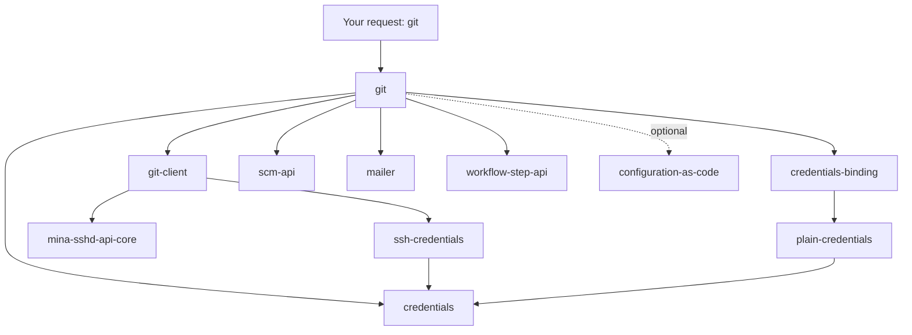
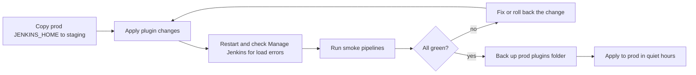

# Avoiding Plugin Sprawl and Dependency Problems

## Introduction

Plugins are Jenkins' greatest strength and its most common source of pain. The typical story goes like this: a controller starts with 20 plugins. Over five years, different people install whatever solved their problem that week. Nobody removes anything. One day there are 250 plugins, an upgrade fails, Jenkins will not start, and nobody knows which of those plugins actually matter.

That is **plugin sprawl**, and its painful side effect is **dependency hell**: a web of plugins that depend on specific versions of other plugins and of Jenkins core, where changing one piece breaks another.

Think of it like a kitchen junk drawer. Each item went in for a good reason, but after a few years you cannot close the drawer, you cannot find the scissors, and you are afraid to throw anything away in case it turns out to be important. The fix is the same in both cases: know what is in there, know why, and have a routine for clearing it out.

This page covers:

1. How plugin dependencies work and how they fail.
2. Why sprawl is expensive even when nothing is broken.
3. Tools to see your real dependency tree and find unused plugins.
4. A safe routine for upgrades and removals.

It builds on [Plugin Management](./0-jenkins-plugin-management.mdx). The long-term cure, versioned plugin lists, is in [Managing Plugins as Code](./3-jenkins-plugin-installation-manager.mdx).

## How Plugin Dependencies Work

Every plugin declares the plugins it needs and the minimum version of each. Some dependencies are **required**, and the plugin will not load without them. Others are **optional**: the plugin enables extra features if the other plugin happens to be installed.



Three kinds of version constraints apply at the same time:

| Constraint | Example | What breaks if violated |
| --- | --- | --- |
| Plugin needs a minimum core | `kubernetes` requires Jenkins 2.516.3 or newer | The plugin is not offered, or fails to load after a downgrade |
| Plugin needs a minimum version of another plugin | `git` needs `credentials` at a certain version or newer | "Update required" error, the plugin does not load |
| Plugin needs another plugin to be present | `git` requires `mailer` | "Plugin is missing" error, the plugin and its dependents do not load |

Constraints are always **minimums**. Jenkins plugins do not declare maximum versions, so in theory newer is always fine. In practice, an upgrade sometimes removes or changes an API another plugin used, and you discover this at runtime.

### Optional and Implied Dependencies

Two less obvious kinds of dependency trip people up:

- **Optional dependencies** are not installed for you. The `git` plugin, for example, has optional integrations with `configuration-as-code` and `matrix-project`. If you install those later, `git` may expose extra features, and if you remove them, those features disappear quietly.
- **Implied dependencies** come from detached plugins. When a feature moved out of core into a plugin (JUnit, Mailer and others), older plugins that were built against the old core are assumed to need it, even though they never declared it. The Plugin Manager shows these when you hover over the uninstall button. They go away once the plugin releases a version built against a newer core.

Both explain why "nothing depends on this plugin" is a strong hint, not a guarantee. Disable first, then uninstall.

### A Small Request Becomes a Big Tree

The numbers grow quickly. The Plugin Installation Manager Tool (covered in [Managing Plugins as Code](./3-jenkins-plugin-installation-manager.mdx)) can resolve a plugin list without downloading anything. Resolving four plugins against Jenkins 2.580.1:

```text
# plugins.txt
workflow-aggregator
git
configuration-as-code
cobertura
```

```bash
jenkins-plugin-cli --plugin-file plugins.txt --jenkins-version 2.580.1 --no-download --list
```

Example output (shortened):

```text
Resulting plugin list:
antisamy-markup-formatter 173.v680e3a_b_69ff3
apache-httpcomponents-client-4-api 4.5.14-269.vfa_2321039a_83
asm-api 9.10.1-216.va_9256d3b_844b_
...
workflow-step-api 724.v538c2362b_dfb_
workflow-support 1015.v785e5a_b_b_8b_22
```

Four requests produced **73 plugins**. That is normal. Many of them are small "library plugins" such as `jackson2-api`, `commons-lang3-api` or `bootstrap5-api`, which package a third-party library once so that every plugin uses the same copy. Library plugins are good: they prevent class-loading conflicts. But they also mean a single library upgrade can touch many plugins at once.

### Seeing Why Each Plugin Is There

The update center JSON is public, so you can compute the tree yourself and ask useful questions: which plugins are depended on most, and which deprecated plugins sneaked in. Save this as `deptree.py`:

```python
import json
import sys
import urllib.request
from collections import defaultdict

CORE = "2.580.1"
URL = f"https://updates.jenkins.io/update-center.actual.json?version={CORE}"


def read_plugins_txt(path: str) -> list[str]:
    ids = []
    with open(path, encoding="utf-8") as f:
        for line in f:
            line = line.split("#", 1)[0].strip()
            if line:
                ids.append(line.split(":", 1)[0])
    return ids


def resolve(plugins: dict, top_level: list[str]) -> dict[str, set[str]]:
    """Return {plugin: set of plugins that pulled it in} for required deps."""
    pulled_by = defaultdict(set)
    stack = list(top_level)
    for pid in top_level:
        pulled_by[pid].add("(you)")
    while stack:
        pid = stack.pop()
        for dep in plugins[pid].get("dependencies", []):
            if dep["optional"]:
                continue
            name = dep["name"]
            if name not in pulled_by:
                stack.append(name)
            pulled_by[name].add(pid)
    return pulled_by


def main(path: str) -> None:
    with urllib.request.urlopen(URL, timeout=60) as resp:
        plugins = json.load(resp)["plugins"]
    top = read_plugins_txt(path)
    pulled_by = resolve(plugins, top)
    print(f"{len(top)} requested -> {len(pulled_by)} installed\n")
    print("Most depended-on plugins:")
    ranked = sorted(pulled_by.items(), key=lambda kv: -len(kv[1]))
    for name, parents in ranked[:5]:
        print(f"  {name:28} needed by {len(parents)} plugins")
    print("\nDeprecated plugins in the tree:")
    for name in sorted(pulled_by):
        if "deprecated" in plugins[name].get("labels", []):
            print(f"  {name} <- {', '.join(sorted(pulled_by[name]))}")


if __name__ == "__main__":
    main(sys.argv[1])
```

Run it with `python3 deptree.py plugins.txt`. Example output:

```text
4 requested -> 73 installed

Most depended-on plugins:
  commons-lang3-api            needed by 22 plugins
  workflow-step-api            needed by 20 plugins
  workflow-api                 needed by 17 plugins
  structs                      needed by 15 plugins
  commons-text-api             needed by 13 plugins

Deprecated plugins in the tree:
  cobertura <- (you)
  code-coverage-api <- cobertura
```

The last section is the interesting one. Requesting the deprecated `cobertura` plugin also dragged in the deprecated `code-coverage-api`. Replacing it with `coverage` (see [Essential Plugins](./1-jenkins-essential-plugins.mdx)) removes both.

## How Dependency Problems Show Up

### "Update Required" on Startup

The most common failure: a plugin was updated, but one of its dependencies was not. Jenkins refuses to load the plugin and shows a banner on **Manage Jenkins** saying there are dependency errors loading some plugins. The log has a message similar to this:

```text
SEVERE  jenkins.InitReactorRunner$1#onTaskFailed: Failed Loading plugin Kubernetes plugin v4560.vc25b_83890c34 (kubernetes)
java.io.IOException: Failed to load: Kubernetes plugin (kubernetes 4560.vc25b_83890c34)
 - Update required: Credentials Plugin (credentials 1480.v2246fd131e83) to be updated to 1511.v2e3cb_0008ef0 or higher
```

The message tells you exactly what to do: update `credentials`. Plugins that depend on `kubernetes` also fail to load, so one missing update can disable several features. This is why manual `.hpi` uploads, which do not resolve dependencies, are risky.

### Core Too Old

If you install a plugin by hand that needs a newer core, it fails with a message like `Jenkins (2.568.3) or higher required`. The update center normally prevents this, but it happens with manual uploads and when you restore a newer `plugins` folder onto an older Jenkins.

### Runtime Breakage After a "Successful" Upgrade

Everything loads, but a pipeline step fails with `NoSuchMethodError` or `ClassNotFoundException`, or a configuration page throws a stack trace. One plugin changed an internal API another plugin relied on. These are the hardest to predict, and the reason you test upgrades with real pipelines, not just a startup check.

### Abandoned Plugins Hold You Back

An unmaintained plugin may depend on an old API that a newer core or library plugin removed. You then face a choice between upgrading (and losing the plugin) or staying on old versions (and missing security fixes). The Jenkins project marks such plugins as "up for adoption" or deprecated, and the update center publishes **security warnings** for vulnerable versions, some of which will never be fixed.

## Why Sprawl Costs You Even When Nothing Breaks

| Cost | Why it grows with plugin count |
| --- | --- |
| Security exposure | Every plugin runs with full rights in the controller; each has its own advisory history |
| Upgrade effort | More plugins means more release notes, more combinations to test |
| Startup time and memory | Each plugin loads classes and extensions at boot |
| UI clutter | Job configuration pages fill with options nobody uses |
| Knowledge loss | Nobody remembers why a plugin is there, so nobody dares remove it |
| Lock-in to an old core | One abandoned plugin can block the whole controller from upgrading |

This is one of the honest downsides of Jenkins compared with hosted CI systems, where the vendor maintains the integrations. The [Total Cost of Running Jenkins](../13-jenkins-best-practices/4-jenkins-cost-and-maintenance.mdx) page puts numbers on this effort.

## Auditing an Existing Controller

### Step 1: List Plugins With Their Dependents

Run this in **Manage Jenkins → Script Console** (admin only). It lists every plugin that no other plugin depends on, which is the set of candidates you might remove, together with update and deprecation status:

```groovy
def pm = Jenkins.instance.pluginManager
def leaves = pm.plugins.findAll { it.dependents.isEmpty() }.sort { it.shortName }

leaves.each { p ->
    def flags = []
    if (!p.isEnabled())             flags << 'disabled'
    if (p.isDeprecated())           flags << 'DEPRECATED'
    if (p.hasUpdate())              flags << 'update available'
    if (!p.activeWarnings.isEmpty()) flags << 'SECURITY WARNING'
    println "${p.shortName.padRight(32)} ${p.version.padRight(28)} ${flags.join(', ')}"
}
println "\n${pm.plugins.size()} plugins installed, ${leaves.size()} have no dependents"
```

Example output:

```text
ansicolor                        542.v03d235fee02d
blueocean                        1.27.26                      DEPRECATED
configuration-as-code            2134.ve13a_2fc90835
dark-theme                       652.vea_da_dfea_e769
jacoco                           3.3.7                        DEPRECATED
pipeline-graph-view              1053.v9df19e6ceed2
slack                            795.v4b_9705b_e6d47          disabled
timestamper                      1.30
workflow-aggregator              608.v67378e9d3db_1

212 plugins installed, 41 have no dependents
```

Plugins with no dependents are the ones someone installed on purpose (or that are left over from something removed). Plugins that others depend on will be handled automatically when you remove their parents.

### Step 2: Find Out Which Jobs Use Them

The **Plugin Usage** plugin (`plugin-usage-plugin`) adds a report showing which jobs use which plugins' extensions. It handles Freestyle jobs well; its own documentation calls Pipeline support experimental, because Pipeline steps are not stored in job configuration. For pipelines, search the Jenkinsfiles in your repositories instead:

```bash
# Which repositories call steps from a plugin? Example: jacoco and slackSend
grep -rnE "^\s*(jacoco|slackSend)\b" --include=Jenkinsfile --include='*.groovy' ~/src/
```

Example output:

```text
/home/dev/src/billing-service/Jenkinsfile:41:            jacoco execPattern: 'target/*.exec'
/home/dev/src/shared-pipeline-lib/vars/notify.groovy:12:    slackSend channel: channel, message: msg
```

### Step 3: Classify and Decide

Put every leaf plugin in one of four buckets:

| Bucket | Example | Action |
| --- | --- | --- |
| Keep, platform need | `configuration-as-code`, `kubernetes` | Record in `plugins.txt` with an owner |
| Keep, but replace soon | `jacoco` (deprecated) | Migrate users to `coverage`, then remove |
| Remove, unused | A plugin for a tool nobody uses anymore | Disable, wait, uninstall |
| Remove, replace with code | A plugin that only wraps a CLI | Run the CLI in a container or shared library step |

## A Safe Routine for Upgrades and Removals



Practical rules:

- **Upgrade core and plugins together, regularly.** Small, frequent upgrades are much easier than a two-year jump. Many teams upgrade with every LTS release, about once a month to once a quarter. See [Upgrading Jenkins and LTS Releases](../1-jenkins-installation/6-jenkins-upgrading.mdx).
- **Disable before you uninstall.** A disabled plugin can be re-enabled with one click if something turns out to depend on it.
- **Clean old data after removal.** **Manage Jenkins → Manage Old Data** shows configuration left behind by removed plugins.
- **Keep the plugins folder in backups.** Rolling back is then a file copy and a restart. See [Backup and Restore](../12-jenkins-administration/2-jenkins-backup-and-restore.mdx).
- **Make the plugin list the source of truth**, not the running server. That is the subject of [Managing Plugins as Code](./3-jenkins-plugin-installation-manager.mdx).

## Real-World Scenario

**Situation.** You have inherited a Jenkins controller that 15 teams share. It runs 212 plugins, sits two LTS releases behind, and shows five security warnings. The last upgrade attempt failed because an old plugin blocked a library update, and the previous admin rolled everything back. Management wants it upgraded without a big-bang outage.

**Solution.** You treat it as a cleanup project in phases:

1. **Inventory (week 1).** Run the Script Console audit and export the full list with the REST API. Store both in Git so you can diff later.
2. **Usage (week 1-2).** Install Plugin Usage for Freestyle jobs, search all Jenkinsfiles and shared libraries for step names, and ask teams about anything unclear. Each leaf plugin gets an owner or a removal date.
3. **Quick wins (week 2).** Disable 15 plugins that nothing uses. Wait two weeks, then uninstall.
4. **Replacements (weeks 3-6).** Move JaCoCo users to `coverage`, Blue Ocean users to Pipeline Graph View, and tool-wrapper plugins to container steps. Each migration is a small change in a Jenkinsfile or shared library.
5. **Upgrade (week 7).** With 130 plugins left, test the LTS upgrade on a staging copy, then apply it in a maintenance window.
6. **Prevent regrowth.** Generate a `plugins.txt` from the result and make it the only way to change plugins. Remove the admin permission from people who used it only to install plugins.

**Why this approach.** Removing unused plugins first shrinks the upgrade's blast radius. Doing it in phases means each step is reversible, and the teams see small, explained changes instead of a weekend outage.

**When to use it / when not to.** This suits a long-lived shared controller you cannot rebuild from scratch. If you can start fresh (for example, migrating to Kubernetes anyway), it is often faster to build a new controller from a minimal `plugins.txt` and move teams over, as in the scenario in [Essential Plugins](./1-jenkins-essential-plugins.mdx).

**Alternatives and trade-offs:**

| Approach | Pros | Cons | Best for |
| --- | --- | --- | --- |
| Phased cleanup of the existing controller (this scenario) | No migration, reversible steps | Slow, needs coordination | Busy shared controllers |
| Fresh controller from a minimal plugin list | Clean slate, fastest to reach a good state | Job and credential migration effort | Teams already moving platform |
| One controller per team or department | Each team's plugins are isolated | More controllers to upgrade and secure | Large orgs with very different needs |
| Commercial curated distribution | Vendor-tested plugin combinations | Cost, limited to their plugin set | Enterprises wanting support |
| Hosted CI (GitHub Actions, GitLab CI) | No plugin maintenance at all | Migration, different extension model | Teams that do not need Jenkins' flexibility |

## Common Mistakes

- **Installing a plugin for a single job.** Prefer a shell step or a [shared library](../8-jenkins-shared-libraries/0-jenkins-shared-libraries-introduction.mdx) function.
- **Uploading `.hpi` files manually** to get a specific version. Dependencies are not resolved, and the next person will not know.
- **Updating plugins without updating core** for years, until the version-specific update center no longer offers fixes.
- **Removing a plugin and immediately deleting old data.** Wait until you are sure nobody needs it.
- **Treating library plugins as clutter.** `jackson2-api`, `commons-lang3-api` and similar are dependencies, not sprawl. Remove the plugins that need them and they become removable too.
- **Ignoring "up for adoption" labels.** They are an early warning that the plugin may become a blocker.

## Summary

- Plugins declare required and optional dependencies with minimum versions, and a minimum Jenkins core version.
- A handful of requested plugins easily expands to 70 or more installed plugins, mostly small library plugins.
- Dependency problems show up as "update required" load errors, core-too-old errors, or runtime `NoSuchMethodError` failures after upgrades.
- Sprawl costs security exposure, upgrade effort, startup time and knowledge, even when nothing is broken.
- Audit with the Script Console (plugins with no dependents, deprecated, warnings), Plugin Usage for Freestyle jobs, and code search for Pipelines.
- Upgrade often in small steps on a staging copy, disable before uninstalling, and make a versioned plugin list the source of truth.

## Exercises

1. Run `deptree.py` on your own `plugins.txt`. Which plugin pulls in the largest number of other plugins?
2. Run the Script Console audit on a test controller and classify each leaf plugin into the four buckets above.
3. On a disposable Docker controller, manually upload an old version of a plugin whose dependencies are missing, and read the error on **Manage Jenkins**. Then fix it through the Plugin Manager.
4. Pick one deprecated plugin from your audit and write the Jenkinsfile change needed to replace it.

Next, turn your cleaned-up list into code in [Managing Plugins as Code](./3-jenkins-plugin-installation-manager.mdx).
