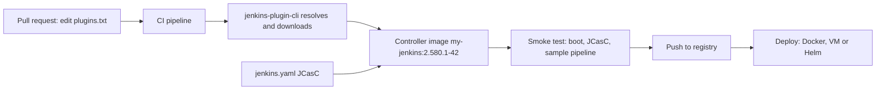

# Managing Plugins as Code

## Introduction

In [Plugin Management](./0-jenkins-plugin-management.mdx) you installed plugins by clicking. That works for one person on one laptop. It stops working the moment you need to answer questions like "what exactly changed last Tuesday?", "can we rebuild this controller after a disk failure?" or "is staging running the same plugins as production?".

**Managing plugins as code** means the list of plugins (and usually their versions) lives in a file in Git. A build turns that file into a controller image. Changing a plugin becomes a pull request that someone reviews, a pipeline tests, and anyone can roll back.

It is the same idea as a `package-lock.json` or `requirements.txt`: you would never set up a Node.js production server by running `npm install` by hand and hoping. Jenkins plugins deserve the same treatment.

This page covers:

1. The Plugin Installation Manager Tool (`jenkins-plugin-cli`) and its file formats.
2. Three pinning strategies and when to use each.
3. Baking plugins into a custom Docker image.
4. Installing plugins with the official Helm chart.
5. Keeping plugins up to date automatically, with a pipeline that tests every change.

Configuring Jenkins itself (security, clouds, credentials) as code is a separate topic, covered in [Configuration as Code (JCasC)](../12-jenkins-administration/0-jenkins-configuration-as-code.mdx). The two are designed to be used together.

## The Big Picture



The controller's `JENKINS_HOME` volume still holds jobs and build history. What changes is that **plugins and configuration come from the image**, so the image is the source of truth and the volume only holds data.

:::info JCasC configures plugins, it does not install them
A common confusion: the Configuration as Code plugin configures installed plugins, but it does not download them. Use `jenkins-plugin-cli` (or the Helm chart, which calls it) to install, and JCasC to configure.
:::

## The Plugin Installation Manager Tool

The [Plugin Installation Manager Tool](https://github.com/jenkinsci/plugin-installation-manager-tool) is the official tool for downloading plugins and their dependencies. The official `jenkins/jenkins` Docker images include it as the `jenkins-plugin-cli` command. Outside Docker you run the jar directly; at the time of writing the latest release is 2.15.0 (check the GitHub releases page for newer versions).

```bash
# Outside Docker: download the jar once
curl -sSLO https://github.com/jenkinsci/plugin-installation-manager-tool/releases/download/2.15.0/jenkins-plugin-manager-2.15.0.jar
java -jar jenkins-plugin-manager-2.15.0.jar --version
```

Example output:

```text
2.15.0
```

The options you will use most:

| Option | Purpose |
| --- | --- |
| `--plugin-file`, `-f` | Read plugins from a `.txt` or `.yaml` file |
| `--plugins`, `-p` | Space-separated plugins on the command line |
| `--jenkins-version` | Resolve for this core version (instead of reading a WAR) |
| `--war`, `-w` | Path to `jenkins.war`; the core version and bundled plugins are read from it |
| `--plugin-download-directory`, `-d` | Where to put the `.jpi` files |
| `--no-download` | Resolve only, download nothing |
| `--list`, `-l` | Print the requested, to-be-downloaded and resulting plugin lists |
| `--available-updates` | Show newer versions of the requested plugins |
| `--output` | Format for `--available-updates`: `stdout`, `txt` or `yaml` |
| `--view-all-security-warnings` | List every plugin that has published security warnings |
| `--latest` | `true` (default) uses latest dependency versions; `false` uses minimum required |

### The `plugins.txt` Format

One plugin per line. `#` starts a comment.

```text
# Pipeline and SCM
workflow-aggregator
git:5.10.1
github-branch-source:latest

# Configuration as code
configuration-as-code:2134.ve13a_2fc90835

# Internal plugin from our artifact repository
acme-deploy:1.4.0:https://repo.example.com/jenkins/acme-deploy-1.4.0.hpi
```

| Form | Meaning |
| --- | --- |
| `id` | Latest version compatible with your core |
| `id:version` | Exact version |
| `id:latest` | Explicitly latest |
| `id:experimental` | Latest from the experimental update center (avoid in production) |
| `id:version:url` | Download from a custom URL |

Use the plugin ID (`ssh-slaves`), not the display name ("SSH Build Agents").

### The `plugins.yaml` Format

The same information in YAML, which some teams prefer for comments and structure:

```yaml
plugins:
  - artifactId: workflow-aggregator
  - artifactId: git
    source:
      version: 5.10.1
  - artifactId: configuration-as-code
    source:
      version: 2134.ve13a_2fc90835
  - artifactId: acme-deploy
    source:
      url: https://repo.example.com/jenkins/acme-deploy-1.4.0.hpi
```

### Resolving Without Downloading

Before building anything, check what a list resolves to and whether it has security problems:

```bash
jenkins-plugin-cli --plugin-file plugins.txt --jenkins-version 2.580.1 --no-download --list
```

If you request a version that has a published vulnerability, the tool says so before downloading:

```bash
jenkins-plugin-cli --plugins script-security:1172.v35f6a_0b_8207e --jenkins-version 2.580.1 --no-download
```

Example output (shortened):

```text
Security warnings:
script-security (1172.v35f6a_0b_8207e): SECURITY-2824-1-script-security Sandbox bypass vulnerability https://www.jenkins.io/security/advisory/2022-10-19/#SECURITY-2824%20(1)
script-security (1172.v35f6a_0b_8207e): SECURITY-3016 Sandbox bypass vulnerability https://www.jenkins.io/security/advisory/2023-01-24/#SECURITY-3016
script-security (1172.v35f6a_0b_8207e): SECURITY-3792 Sandbox bypass vulnerability https://www.jenkins.io/security/advisory/2026-06-24/#SECURITY-3792
```

And if a pinned version needs a newer core, it fails fast:

```text
Plugin prerequisite not met:

pipeline-graph-view (1062.v294de5b_d7c0e) requires a greater version of Jenkins (2.585) than 2.580.1
```

That second message is exactly the kind of error you want in a pull request check, not on a production restart.

## Choosing a Pinning Strategy

How much should you pin? There are three common answers.

| Strategy | What the file contains | Reproducible? | Effort | Best for |
| --- | --- | --- | --- | --- |
| Unpinned | Top-level IDs only | No: each build may pick new versions | Lowest | Labs, short-lived test instances |
| Top-level pinned | Top-level IDs with versions | Mostly: dependencies can still float | Medium | Small teams, single controller |
| Fully locked | Every plugin, including dependencies, with versions | Yes, byte for byte | Highest, needs automation | Production, multiple controllers, regulated environments |

With only top-level pins, a dependency such as `credentials` may still change between two image builds a week apart, because the tool picks the latest compatible dependency. For production, generate a **lockfile**: keep a short, human-edited `plugins.txt` and generate a fully pinned `plugins-lock.txt` from it.

```bash
#!/usr/bin/env bash
# lock-plugins.sh: resolve plugins.txt into a fully pinned plugins-lock.txt
set -euo pipefail
JENKINS_VERSION="${1:-2.580.1}"

jenkins-plugin-cli --plugin-file plugins.txt \
  --jenkins-version "$JENKINS_VERSION" --no-download --list 2>/dev/null \
  | sed -n '/^Resulting plugin list:/,/^$/p' \
  | tail -n +2 \
  | awk 'NF==2 {print $1":"$2}' \
  > plugins-lock.txt

echo "Locked $(wc -l < plugins-lock.txt) plugins for Jenkins $JENKINS_VERSION"
```

Example output for a three-line `plugins.txt` (`configuration-as-code`, `git`, `workflow-aggregator`):

```text
Locked 62 plugins for Jenkins 2.580.1
```

```text
antisamy-markup-formatter:173.v680e3a_b_69ff3
apache-httpcomponents-client-4-api:4.5.14-269.vfa_2321039a_83
asm-api:9.11-224.v369c884f7a_a_b_
...
```

Commit both files. Humans edit `plugins.txt`; the image build installs from `plugins-lock.txt`; a CI check fails if the lockfile is out of date. This mirrors `package.json` and `package-lock.json`.

## Baking Plugins Into a Docker Image

The basics are shown in [Installing Jenkins with Docker](../1-jenkins-installation/0-jenkins-install-docker.mdx). A production-style image adds the lockfile and JCasC:

```dockerfile
FROM jenkins/jenkins:2.580.1-lts-jdk21

# Plugins: install the fully pinned list, resolved at build time
COPY --chown=jenkins:jenkins plugins-lock.txt /usr/share/jenkins/ref/plugins.txt
RUN jenkins-plugin-cli --plugin-file /usr/share/jenkins/ref/plugins.txt

# Configuration as code
COPY --chown=jenkins:jenkins casc/ /usr/share/jenkins/ref/casc/
ENV CASC_JENKINS_CONFIG=/var/jenkins_home/casc
ENV JAVA_OPTS="-Djenkins.install.runSetupWizard=false"
```

```bash
docker build -t registry.example.com/platform/jenkins:2.580.1-42 .
```

Example output (shortened):

```text
 => [2/4] COPY --chown=jenkins:jenkins plugins-lock.txt /usr/share/jenkins/ref/plugins.txt
 => [3/4] RUN jenkins-plugin-cli --plugin-file /usr/share/jenkins/ref/plugins.txt
 => [4/4] COPY --chown=jenkins:jenkins casc/ /usr/share/jenkins/ref/casc/
 => => naming to registry.example.com/platform/jenkins:2.580.1-42
```

### What Happens to the Volume on Upgrade

Files under `/usr/share/jenkins/ref/` are copied into `JENKINS_HOME` when the container starts. For plugins, the official image's rules (from its README) are:

- A plugin from the image is copied if the image's version is newer than what the volume has, **unless** someone upgraded that plugin manually in the UI.
- Set `PLUGINS_FORCE_UPGRADE=true` to make the image win even over manual upgrades.
- Plugins that exist in the volume but not in the image are **not deleted**.

That last rule matters: removing a line from `plugins.txt` does not remove the plugin from an existing volume. For a truly declarative setup, either start from an empty `plugins` directory on each deploy (some teams mount `JENKINS_HOME/plugins` as an `emptyDir` in Kubernetes), or remove plugins explicitly as part of the change.

:::tip Block UI changes
Once plugins are code, stop people from changing them in the UI. Limit the Overall/Administer permission, and tell administrators that UI changes will be overwritten. Otherwise the volume and the image drift apart.
:::

## Installing Plugins With the Helm Chart

The official `jenkinsci/jenkins` Helm chart (see [Installing Jenkins on Kubernetes](../1-jenkins-installation/2-jenkins-install-kubernetes.mdx)) can install plugins itself. An init container runs `jenkins-plugin-cli` before the controller starts. The relevant values:

```yaml
controller:
  installPlugins:
    - kubernetes:4560.vc25b_83890c34
    - workflow-aggregator:608.v67378e9d3db_1
    - git:5.10.1
    - configuration-as-code:2134.ve13a_2fc90835
  additionalPlugins:
    - pipeline-graph-view:1053.v9df19e6ceed2
  # Download newest compatible dependencies (true) or minimum required (false)
  installLatestPlugins: true
  # Replace plugins already in JENKINS_HOME with the listed ones on every start
  overwritePlugins: true
```

Two ways to use the chart:

| Approach | How | Pros | Cons |
| --- | --- | --- | --- |
| Chart installs plugins | `controller.installPlugins` list | No image to build | Downloads on every pod start; depends on update center availability; dependency versions can float |
| Custom image | Build image from lockfile; set `controller.image.repository` and `controller.installPlugins: false` | Fast, offline, fully reproducible startup | Needs an image pipeline |

For production, the custom image is usually better: a pod restart should not depend on `updates.jenkins.io` being reachable, and it should never pick up new plugin versions by accident. The chart's own comments warn about the latter and offer `initializeOnce` as a mitigation.

## Keeping Plugins Up to Date

A pinned list is only safe if you update it regularly; otherwise you pin known vulnerabilities. Two good options:

### Option 1: `--available-updates`

```bash
jenkins-plugin-cli --plugin-file plugins.txt --jenkins-version 2.580.1 \
  --no-download --available-updates --output txt > plugins.txt.new
diff plugins.txt plugins.txt.new
```

Example output:

```text
1,2c1,2
< git:5.7.0
< credentials-binding:687.v619cb_15e923f
---
> git:5.10.1
> credentials-binding:728.v902a_273b_8947
```

Wrap this in a scheduled pipeline that opens a pull request with the new file.

### Option 2: Renovate

[Renovate](https://docs.renovatebot.com/modules/manager/jenkins/) has a `jenkins` manager that understands files named `plugins.txt`, `plugins.yaml` or `plugins.yml` and opens pull requests when new plugin versions appear.

Whichever bot opens the pull request, the next part is what makes it safe: a pipeline that tests the change.

## A Pipeline That Tests Plugin Changes

This Jenkinsfile lives in the same repository as `plugins.txt`. It verifies the lockfile, builds the image, boots it, and checks that every plugin loaded and JCasC applied. It runs on an agent with Docker (see [Docker Agents](../6-jenkins-agents/3-jenkins-docker-agents.mdx)).

```groovy
pipeline {
    agent { label 'docker' }
    environment {
        JENKINS_VERSION = '2.580.1'
        IMAGE = "registry.example.com/platform/jenkins:${JENKINS_VERSION}-${BUILD_NUMBER}"
    }
    stages {
        stage('Lockfile up to date') {
            steps {
                sh '''
                  docker run --rm -v "$PWD:/work" -w /work --entrypoint bash \
                    jenkins/jenkins:${JENKINS_VERSION}-lts-jdk21 ./lock-plugins.sh ${JENKINS_VERSION}
                  git diff --exit-code plugins-lock.txt
                '''
            }
        }
        stage('Build image') {
            steps {
                sh 'docker build -t "$IMAGE" .'
            }
        }
        stage('Smoke test') {
            steps {
                sh './smoke-test.sh "$IMAGE"'
            }
        }
        stage('Push') {
            when { branch 'main' }
            steps {
                sh 'docker push "$IMAGE"'
            }
        }
    }
}
```

And the smoke test it calls:

```bash
#!/usr/bin/env bash
# smoke-test.sh IMAGE: boot the controller and fail on plugin load errors
set -euo pipefail
IMAGE="$1"
NAME="jenkins-smoke-$$"

docker run -d --name "$NAME" "$IMAGE" >/dev/null
trap 'docker rm -f "$NAME" >/dev/null' EXIT

for i in $(seq 1 60); do
  if docker logs "$NAME" 2>&1 | grep -q "Jenkins is fully up and running"; then
    break
  fi
  sleep 5
done

if docker logs "$NAME" 2>&1 | grep -E "Failed Loading plugin|Failed to load|ConfiguratorException"; then
  echo "Plugin or JCasC errors found"
  exit 1
fi
echo "Controller started cleanly"
```

Example output:

```text
Controller started cleanly
```

When a plugin update breaks loading or makes the JCasC file invalid, the pull request fails here instead of in production. Teams that want more confidence add a stage that creates a sample pipeline through JCasC or the REST API and runs it.

## Real-World Scenario

**Situation.** A platform team runs three Jenkins controllers (one per business unit) on Kubernetes. Each was set up by hand, and an audit found 14 plugins with different versions across the three. Two incidents last quarter came from plugin updates clicked in production. The team wants every plugin change reviewed and tested, and identical plugins on all three controllers.

**Solution.**

1. Export each controller's plugins with the Script Console snippet from [Plugin Management](./0-jenkins-plugin-management.mdx), diff the three lists, and agree on one set of **top-level** plugins in `plugins.txt`. Business-unit-specific plugins go in small extra files.
2. Generate `plugins-lock.txt` with `lock-plugins.sh` and commit both.
3. Build one image per controller in the pipeline above, tagged `2.580.1-BUILD`. The Helm releases set `controller.image` to that tag and `controller.installPlugins: false`.
4. Enable Renovate on the repository. Plugin updates arrive as pull requests, the pipeline boots the image and runs smoke tests, and a platform engineer merges.
5. Remove the plugin permissions from everyone else.

**Why this approach.** Every change is visible in Git history with a review, and the same artifact runs in test and production. Rollback is a Helm rollback to the previous image tag. The lockfile removes the "works on staging, fails on prod" class of problems caused by floating dependency versions.

**When to use it / when not to.** It pays off as soon as you have more than one controller or any compliance requirement. For a single hobby or lab controller, a pinned `plugins.txt` without the lockfile and bot is enough. If you cannot run containers at all, you can still use `jenkins-plugin-cli --war /usr/share/java/jenkins.war -d /var/lib/jenkins/plugins` on a VM from a configuration management tool such as [Ansible](/docs/devops/ansible).

**Alternatives and trade-offs:**

| Approach | Pros | Cons | Best for |
| --- | --- | --- | --- |
| UI clicks | No setup | No history, no review, drift | Personal instances |
| Unpinned `plugins.txt` in an image | Easy, always fresh | Not reproducible between builds | Labs, demos |
| Helm `installPlugins` | Simple Kubernetes setup | Downloads at start, can float | Small Kubernetes installs |
| Lockfile + image + update bot (this scenario) | Reproducible, reviewed, tested, easy rollback | Most setup, needs CI and registry | Production, multiple controllers |
| Ansible or similar on VMs | Works without containers | Mutates servers in place | VM-based estates |

## Common Mistakes

- **Pinning once and never updating.** A lockfile that is a year old is a list of known vulnerabilities. Automate update pull requests.
- **Forgetting that removed plugins stay on the volume.** Deleting a line does not uninstall the plugin from an existing `JENKINS_HOME`.
- **Mixing UI changes and code.** Someone upgrades a plugin in the UI, the image no longer overrides it, and the two drift apart. Use `PLUGINS_FORCE_UPGRADE=true` or block the permission.
- **Using `experimental` or `latest` in production files.** They make builds non-reproducible.
- **Resolving against the wrong core version.** Always pass `--jenkins-version` (or `--war`) matching the image you build, or the resolution may not match what Jenkins accepts.
- **Expecting JCasC to install plugins.** It only configures them.

## Summary

- `jenkins-plugin-cli` (the Plugin Installation Manager Tool) resolves and downloads plugins and dependencies from `plugins.txt` or `plugins.yaml`.
- Use `--no-download --list` to check resolution, and watch for security warnings and core-version errors before building.
- Choose a pinning strategy: unpinned for labs, top-level pins for small setups, a generated lockfile for production.
- Bake plugins into a custom image; understand the `/usr/share/jenkins/ref` copy rules and `PLUGINS_FORCE_UPGRADE`.
- The Helm chart can install plugins at startup, but a custom image is more reliable for production.
- Keep pinned lists fresh with `--available-updates` or Renovate, and test every change with a pipeline that boots the image.

## Exercises

1. Write a three-line `plugins.txt`, run `lock-plugins.sh`, and count how many plugins end up in the lockfile.
2. Pin an old version of one plugin, run `--available-updates --output txt`, and turn the output into a pull request in a test repository.
3. Build the image from the Dockerfile above, then deliberately pin a plugin that needs a newer core. Confirm the build fails with a clear message.
4. Extend `smoke-test.sh` to call `/pluginManager/api/json` and fail if any plugin is enabled but not active.

Related pages: [Configuration as Code (JCasC)](../12-jenkins-administration/0-jenkins-configuration-as-code.mdx) and [Project: Fully Codified Jenkins Instance](../14-jenkins-projects/5-jenkins-project-jenkins-as-code.mdx). Next, see how plugins are built in [Writing a Simple Plugin](./4-jenkins-writing-a-plugin.mdx).
