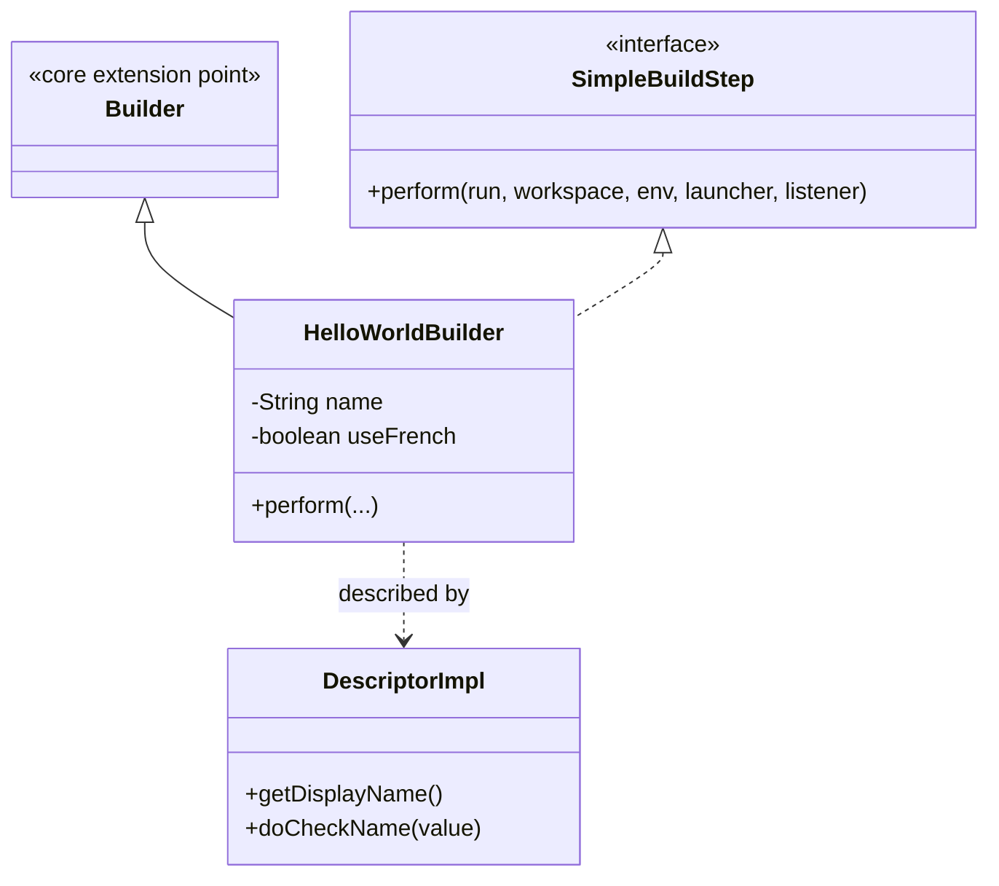
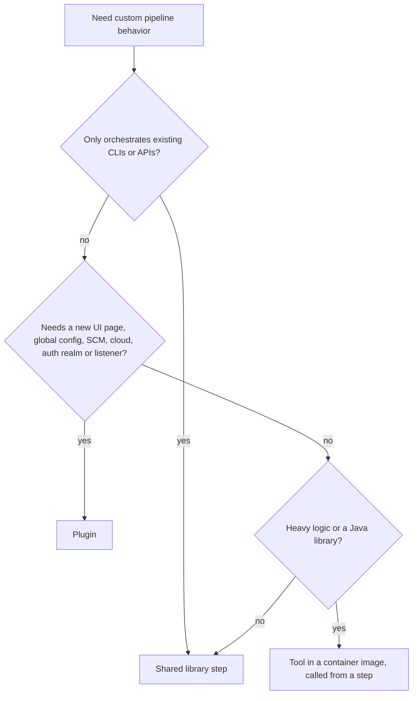

# Writing a Simple Plugin

## Introduction

Most Jenkins users never write a plugin, and that is a good thing. Shared libraries, shell steps and container images solve the large majority of customization needs with far less effort. But knowing how a plugin works from the inside makes you a better Jenkins administrator: you understand what extension points are, why plugins can break each other, why some steps work in Pipeline and others do not, and why every plugin runs with full rights inside the controller.

Writing a plugin is like adding a new appliance to a building's electrical system. You do not rewire the building; you build something that fits a standard socket (an extension point). If it is built well it just works. If it is built badly, it can trip the breaker for everyone.

In this page you will:

1. Generate a plugin project from the official archetype.
2. Read the code of a build step that says hello, and understand each annotation.
3. Run Jenkins with the plugin in development mode.
4. Use the step from a Declarative Pipeline.
5. Write automated tests with `JenkinsRule`.
6. Package the plugin and install it on a controller.
7. Decide when a plugin is the right tool, and when a shared library is better.

You need to be comfortable reading Java. If plugins are new to you as an administrator, read [Plugin Management](./0-jenkins-plugin-management.mdx) first.

## How a Plugin Fits Into Jenkins



Three ideas carry most of Jenkins plugin development:

| Concept | What it is | In this example |
| --- | --- | --- |
| **Extension point** | A core (or plugin) type that others can implement | `Builder`, a build step |
| **Describable / Descriptor** | The configured instance, and a singleton that describes the type (display name, validation, form) | `HelloWorldBuilder` and its `DescriptorImpl` |
| **`@Extension`** | Annotation that registers an implementation so Jenkins discovers it at startup | On `DescriptorImpl` |

Implementing `SimpleBuildStep` is what makes the same class usable both in Freestyle jobs and in Pipelines.

## Prerequisites

The [official plugin tutorial](https://www.jenkins.io/doc/developer/tutorial/prepare/) recommends:

- **JDK 21** (the Java version the Jenkins project recommends to users).
- **Maven 3.9.6 or newer**. Older Maven versions can fail with `Unknown packaging: hpi`.
- An IDE with Maven support, such as IntelliJ IDEA, Eclipse or VS Code.

```bash
java -version
mvn -version
```

Example output:

```text
openjdk version "21.0.8" 2025-07-15 LTS
Apache Maven 3.9.11
Java version: 21.0.8, vendor: Eclipse Adoptium
```

## Step 1: Generate the Project

Jenkins publishes Maven archetypes in the `io.jenkins.archetypes` group. The interactive way, from the official tutorial, is:

```bash
mvn -U archetype:generate -Dfilter=io.jenkins.archetypes:
```

Pick `hello-world-plugin` from the list, accept the newest archetype version, and enter an `artifactId` such as `greeter`. For scripts, the same thing non-interactively:

```bash
mvn -B archetype:generate \
  -DarchetypeGroupId=io.jenkins.archetypes \
  -DarchetypeArtifactId=hello-world-plugin \
  -DarchetypeVersion=1.37 \
  -DartifactId=greeter \
  -Dpackage=io.jenkins.plugins.greeter \
  -DhostOnJenkinsGitHub=false
mv greeter greeter-plugin
cd greeter-plugin
mvn verify
```

Example output (end of `mvn verify`):

```text
[INFO] Tests run: 5, Failures: 0, Errors: 0, Skipped: 0
[INFO]
[INFO] --- hpi:3.x:hpi (default-hpi) @ greeter ---
[INFO] Generating .../greeter-plugin/target/greeter.hpi
[INFO] BUILD SUCCESS
```

The archetype version (1.37 here) changes over time; check the [archetypes repository](https://github.com/jenkinsci/archetypes) for the newest one. If `archetype:generate` hangs behind a corporate Maven mirror, the tutorial suggests running it with an empty settings file: `mvn -s /tmp/empty.xml ...` where the file contains only `<settings/>`.

### What You Get

```text
greeter-plugin/
├── pom.xml
└── src/
    ├── main/
    │   ├── java/io/jenkins/plugins/greeter/
    │   │   └── HelloWorldBuilder.java          # the build step
    │   └── resources/
    │       ├── index.jelly                     # plugin description
    │       └── io/jenkins/plugins/greeter/
    │           ├── Messages.properties         # localized strings
    │           └── HelloWorldBuilder/
    │               ├── config.jelly            # configuration form
    │               └── help-name.html          # inline help text
    └── test/java/io/jenkins/plugins/greeter/
        └── HelloWorldBuilderTest.java          # JenkinsRule tests
```

### The POM

The important parts of the generated `pom.xml`:

```xml
<parent>
  <groupId>org.jenkins-ci.plugins</groupId>
  <artifactId>plugin</artifactId>
  <version>6.2236.v12dd4c483242</version>
  <relativePath />
</parent>

<artifactId>greeter</artifactId>
<packaging>hpi</packaging>

<properties>
  <jenkins.baseline>2.568</jenkins.baseline>
  <jenkins.version>${jenkins.baseline}.3</jenkins.version>
</properties>

<dependencyManagement>
  <dependencies>
    <dependency>
      <groupId>io.jenkins.tools.bom</groupId>
      <artifactId>bom-${jenkins.baseline}.x</artifactId>
      <version>7002.v028a_3607ddc8</version>
      <type>pom</type>
      <scope>import</scope>
    </dependency>
  </dependencies>
</dependencyManagement>
```

- **Parent POM** (`org.jenkins-ci.plugins:plugin`) brings the build tooling: the `hpi` packaging, test harness, static analysis.
- **`jenkins.version`** is the minimum Jenkins core your plugin supports. It becomes the `Jenkins-Version` in the manifest. Choosing an older baseline reaches more users but limits which APIs you can use; the [choosing a baseline guide](https://www.jenkins.io/doc/developer/plugin-development/choosing-jenkins-baseline/) explains the trade-off.
- **The plugin BOM** (`io.jenkins.tools.bom`) supplies tested versions of common plugin dependencies for that LTS line, so you do not pick versions one by one. This is the developer-side cure for the dependency problems in [Avoiding Plugin Sprawl and Dependency Problems](./2-jenkins-plugin-dependency-hell.mdx).

Versions shown here are those in the archetype in autumn 2026 and will be newer when you generate yours.

## Step 2: Read the Build Step

Here is the generated builder, lightly trimmed (the archetype uses localized `Messages` for strings; plain strings are used here for readability):

```java
package io.jenkins.plugins.greeter;

import hudson.EnvVars;
import hudson.Extension;
import hudson.FilePath;
import hudson.Launcher;
import hudson.model.AbstractProject;
import hudson.model.Run;
import hudson.model.TaskListener;
import hudson.tasks.BuildStepDescriptor;
import hudson.tasks.Builder;
import hudson.util.FormValidation;
import java.io.IOException;
import jenkins.tasks.SimpleBuildStep;
import org.jenkinsci.Symbol;
import org.kohsuke.stapler.DataBoundConstructor;
import org.kohsuke.stapler.DataBoundSetter;
import org.kohsuke.stapler.QueryParameter;

public class HelloWorldBuilder extends Builder implements SimpleBuildStep {

    private final String name;      // required parameter
    private boolean useFrench;      // optional parameter

    @DataBoundConstructor
    public HelloWorldBuilder(String name) {
        this.name = name;
    }

    public String getName() {
        return name;
    }

    public boolean isUseFrench() {
        return useFrench;
    }

    @DataBoundSetter
    public void setUseFrench(boolean useFrench) {
        this.useFrench = useFrench;
    }

    @Override
    public void perform(Run<?, ?> run, FilePath workspace, EnvVars env,
                        Launcher launcher, TaskListener listener)
            throws InterruptedException, IOException {
        String greeting = useFrench ? "Bonjour, " : "Hello, ";
        listener.getLogger().println(greeting + name + "!");
    }

    @Symbol("greet")
    @Extension
    public static final class DescriptorImpl extends BuildStepDescriptor<Builder> {

        public FormValidation doCheckName(@QueryParameter String value) {
            if (value.isEmpty()) {
                return FormValidation.error("Please set a name");
            }
            if (value.length() < 4) {
                return FormValidation.warning("Isn't the name too short?");
            }
            return FormValidation.ok();
        }

        @Override
        public boolean isApplicable(Class<? extends AbstractProject> jobType) {
            return true;
        }

        @Override
        public String getDisplayName() {
            return "Say hello world";
        }
    }
}
```

What each piece does:

| Element | Role |
| --- | --- |
| `extends Builder implements SimpleBuildStep` | A build step that works in Freestyle jobs and Pipelines |
| `@DataBoundConstructor` | Tells Jenkins how to create the object from a form or a Pipeline step; constructor parameters are **required** |
| `@DataBoundSetter` | Optional parameters, set after construction |
| Getters (`getName`, `isUseFrench`) | Used to fill the form when editing and to save the configuration to XML |
| `perform(...)` | The work. `listener.getLogger()` writes to the build log |
| `@Extension` on the descriptor | Registers the step so it appears in the UI and in Pipeline |
| `@Symbol("greet")` | Gives the step a short Pipeline name: `greet` |
| `doCheckName` | Live form validation; Jenkins calls it as you type in the `name` field |

:::note Where does `perform` run?
The `Builder` object is created on the controller, but `workspace` is a `FilePath` that may point to an agent. Reading and writing files through `FilePath` methods (or `FilePath.act`) works across machines. Using `java.io.File` directly in `perform` silently touches the controller's disk instead, which is a classic plugin bug and a security concern. See [Securing Agents and the Controller](../11-jenkins-security/6-jenkins-securing-agents.mdx).
:::

### The Configuration Form

`config.jelly` next to the class defines the Freestyle job form. `field` attributes map to the constructor parameters and setters by name:

```xml
<?jelly escape-by-default='true'?>
<j:jelly xmlns:j="jelly:core" xmlns:f="/lib/form">
    <f:entry title="${%Name}" field="name">
        <f:textbox />
    </f:entry>
    <f:advanced>
        <f:entry title="${%French}" field="useFrench" description="${%FrenchDescr}">
            <f:checkbox />
        </f:entry>
    </f:advanced>
</j:jelly>
```

The `${%Name}` syntax looks up a localized label from `config.properties`. Pipeline users never see this form; they pass parameters directly.

## Step 3: Run Jenkins With Your Plugin

The `hpi` Maven plugin starts a development Jenkins with your plugin installed:

```bash
mvn hpi:run
```

Example output (shortened):

```text
[INFO] --- hpi:3.x:run (default-cli) @ greeter ---
[INFO] Started Jetty Server
INFO    jenkins.InitReactorRunner$1#onAttained: Completed initialization
INFO    hudson.lifecycle.Lifecycle#onReady: Jenkins is fully up and running
```

Open `http://localhost:8080/jenkins/`. If port 8080 is taken, use `mvn hpi:run -Dport=5000`. The development instance keeps its data in the `work/` directory of your project, so you can delete that folder to start over.

To try it in a Freestyle job: create a job, add the **Say hello world** build step, enter a name and build. The console output shows:

```text
Hello, Jenkins!
Finished: SUCCESS
```

## Step 4: Use It From a Pipeline

Because of `SimpleBuildStep` and `@Symbol("greet")`, the step is available in Pipelines without any extra code. Create a Pipeline job in the development instance with:

```groovy
pipeline {
    agent any
    stages {
        stage('Greet') {
            steps {
                greet 'Jenkins'
                greet name: 'Jenkins', useFrench: true
            }
        }
    }
}
```

Example output:

```text
[Pipeline] stage
[Pipeline] { (Greet)
[Pipeline] greet
Hello, Jenkins!
[Pipeline] greet
Bonjour, Jenkins!
[Pipeline] }
Finished: SUCCESS
```

The first call uses the single required parameter positionally; the second uses named parameters, which works for any combination of constructor parameters and setters. The step also appears in the [Snippet Generator](../3-jenkins-pipeline-basics/9-jenkins-pipeline-syntax-generator.mdx) automatically, generated from the same annotations.

Without `@Symbol`, Pipeline users would have to write the much clumsier `step([$class: 'HelloWorldBuilder', name: 'Jenkins'])`. Always add a symbol.

## Step 5: Test It With JenkinsRule

The Jenkins test harness starts a real, temporary Jenkins inside your test. The archetype generates JUnit 5 tests like these:

```java
package io.jenkins.plugins.greeter;

import hudson.model.FreeStyleBuild;
import hudson.model.FreeStyleProject;
import org.jenkinsci.plugins.workflow.cps.CpsFlowDefinition;
import org.jenkinsci.plugins.workflow.job.WorkflowJob;
import org.jenkinsci.plugins.workflow.job.WorkflowRun;
import org.junit.jupiter.api.Test;
import org.jvnet.hudson.test.JenkinsRule;
import org.jvnet.hudson.test.junit.jupiter.WithJenkins;

@WithJenkins
class HelloWorldBuilderTest {

    @Test
    void configRoundtrip(JenkinsRule jenkins) throws Exception {
        FreeStyleProject project = jenkins.createFreeStyleProject();
        project.getBuildersList().add(new HelloWorldBuilder("Bobby"));
        project = jenkins.configRoundtrip(project);   // save and reload the form
        jenkins.assertEqualDataBoundBeans(
                new HelloWorldBuilder("Bobby"), project.getBuildersList().get(0));
    }

    @Test
    void freestyleBuild(JenkinsRule jenkins) throws Exception {
        FreeStyleProject project = jenkins.createFreeStyleProject();
        project.getBuildersList().add(new HelloWorldBuilder("Bobby"));
        FreeStyleBuild build = jenkins.buildAndAssertSuccess(project);
        jenkins.assertLogContains("Hello, Bobby", build);
    }

    @Test
    void pipelineStep(JenkinsRule jenkins) throws Exception {
        WorkflowJob job = jenkins.createProject(WorkflowJob.class, "p");
        job.setDefinition(new CpsFlowDefinition("node { greet 'Bobby' }", true));
        WorkflowRun run = jenkins.assertBuildStatusSuccess(job.scheduleBuild2(0));
        jenkins.assertLogContains("Hello, Bobby!", run);
    }
}
```

```bash
mvn test
```

Example output:

```text
[INFO] Running io.jenkins.plugins.greeter.HelloWorldBuilderTest
[INFO] Tests run: 3, Failures: 0, Errors: 0, Skipped: 0
[INFO] BUILD SUCCESS
```

`configRoundtrip` is the test you should never skip: it catches the very common mistake of a getter or setter whose name does not match the form field, which silently loses configuration when someone saves a job. The `true` in `CpsFlowDefinition` runs the script in the Groovy sandbox, like a real user's pipeline.

## Step 6: Package and Install

```bash
mvn package -DskipTests
ls target/*.hpi
```

Example output:

```text
target/greeter.hpi
```

How to get it onto a real controller:

| Method | How | Notes |
| --- | --- | --- |
| Manual upload | **Manage Jenkins → Plugins → Advanced settings → Deploy Plugin** | Fine for a test controller; no dependency resolution |
| `plugins.txt` with URL | `greeter:1.0.0:https://repo.example.com/jenkins/greeter-1.0.0.hpi` | The recommended route for internal plugins; see [Managing Plugins as Code](./3-jenkins-plugin-installation-manager.mdx) |
| Copy into image | `COPY greeter.hpi /usr/share/jenkins/ref/plugins/greeter.jpi` in a Dockerfile | Simple, but you track dependencies yourself |
| Public update center | Request hosting in the `jenkinsci` GitHub organization | For plugins useful to others |

To publish a plugin for everyone, you open a hosting request issue in the `jenkins-infra/repository-permissions-updater` repository, following the [Requesting Hosting](https://www.jenkins.io/doc/developer/publishing/requesting-hosting/) guide. The hosting team reviews the plugin and, once approved, forks it into the `jenkinsci` organization. Before you do that, search [plugins.jenkins.io](https://plugins.jenkins.io/) to make sure a similar plugin does not already exist.

## Plugin, Shared Library or Container Step?

Before writing a real plugin, ask whether you need one. Each option puts code in a different place with different risks.



| Option | Can do | Runs where | Change cost | Main risk |
| --- | --- | --- | --- | --- |
| Shell step in a container | Anything a CLI can do | Agent | Edit a Jenkinsfile or image | Little; isolated per build |
| [Shared library](../8-jenkins-shared-libraries/0-jenkins-shared-libraries-introduction.mdx) | Combine steps, enforce standards | Groovy (CPS) on controller, steps on agents | Git push, no restart | CPS quirks, controller load if misused |
| Plugin | New extension points: UI, global config, clouds, SCMs, security realms, listeners, typed steps | Inside the controller JVM | Build, release, restart controllers | Can break or slow the whole controller; you own security fixes forever |

## Real-World Scenario

**Situation.** Your company runs an internal deployment registry. Every deployment pipeline must record "service X version Y went to environment Z" through its REST API. Teams currently copy a `curl` command around, and some forget it. A developer proposes writing a Jenkins plugin with a `recordDeployment` step and a global configuration page for the registry URL and credentials.

**Solution.** You walk through the decision tree:

1. Is it only calling an existing API? Yes, it is a single REST call.
2. Does it need a new UI or extension point? A global URL setting would be nice, but a shared library can read it from an environment variable set in JCasC, and credentials already work with `withCredentials`.

So you start with a shared library step:

```groovy
// vars/recordDeployment.groovy in the shared library
def call(Map args) {
    withCredentials([string(credentialsId: 'deploy-registry-token', variable: 'TOKEN')]) {
        sh """
          curl -fsS -X POST "\$DEPLOY_REGISTRY_URL/api/deployments" \\
            -H "Authorization: Bearer \$TOKEN" -H 'Content-Type: application/json' \\
            -d '{"service":"${args.service}","version":"${args.version}","env":"${args.env}"}'
        """
    }
}
```

Teams call `recordDeployment service: 'billing', version: env.VERSION, env: 'prod'`, and the platform team makes it mandatory through a [pipeline template](../8-jenkins-shared-libraries/7-jenkins-pipeline-templates.mdx).

A year later the requirements grow: the registry should show a link back to every build, Jenkins should display the current version per environment on each job page, and deployments should be recorded even for Freestyle jobs. Those need a UI contribution (a job action) and a listener on build completion, which only a plugin can provide. Now writing a plugin is justified, and you build it with the pattern from this page plus a `RunListener` extension.

**Why this approach.** The shared library ships in a day, needs no controller restarts, and cannot crash the controller. You only pay the plugin's cost (Java code, releases, restarts, security responsibility) when you need features nothing else can provide.

**When to use a plugin / when not to.** Write a plugin when you need a Jenkins extension point: new UI, global configuration with form validation, a new SCM, cloud, security realm, credentials type, or listeners on Jenkins events. Do not write one to wrap a CLI, to share pipeline snippets, or for logic that only one team uses.

**Alternatives and trade-offs:**

| Approach | Pros | Cons | Best for |
| --- | --- | --- | --- |
| Copy-pasted `curl` in Jenkinsfiles | No setup | Drift, forgotten calls | Never, beyond a prototype |
| Shared library step (first phase) | Fast, versioned, no restarts | No UI, Groovy CPS limitations | Orchestrating APIs and CLIs |
| Custom plugin (second phase) | Full access to Jenkins extension points and UI | Java, release process, restarts, security ownership | Platform-level features |
| Contribute to an existing plugin | Shared maintenance, community review | Needs maintainer buy-in | Features others want too |

## Common Mistakes

- **Writing a plugin for something a shared library or shell step can do.** You take on a permanent maintenance and security burden.
- **Forgetting `@Symbol`.** Pipeline users are left with the clumsy `step([$class: ...])` syntax.
- **Getter and field names that do not match the form.** Configuration silently disappears on save. The `configRoundtrip` test catches this.
- **Using `java.io.File` instead of `FilePath`.** Code then runs against the controller's disk, not the agent's workspace.
- **Storing secrets as plain `String` fields.** Use the Credentials API and `Secret`, or values end up readable in `config.xml`.
- **Skipping permission checks on web methods.** Any `doXxx` method reachable over HTTP must check permissions (and use POST for changes). Many published plugin advisories are exactly this bug.
- **Setting `jenkins.version` to the newest weekly.** Your plugin will not install on the LTS controllers most people run.

## Summary

- A plugin implements Jenkins extension points; `@Extension` registers it, a `Descriptor` describes it, and `@DataBoundConstructor`/`@DataBoundSetter` bind parameters from forms and Pipelines.
- Generate a project with `mvn archetype:generate -Dfilter=io.jenkins.archetypes:` and the `hello-world-plugin` archetype; use JDK 21 and Maven 3.9.6 or newer.
- `mvn hpi:run` starts a development Jenkins at `http://localhost:8080/jenkins/`.
- Implementing `SimpleBuildStep` and adding `@Symbol` makes a step usable in Declarative and Scripted Pipelines.
- `JenkinsRule` tests (`configRoundtrip`, build and Pipeline tests) run a real Jenkins in your test.
- Package with `mvn package` into a `.hpi`; distribute internal plugins through `plugins.txt` URLs, and public ones through the `jenkinsci` hosting process.
- Prefer shared libraries and container steps; write a plugin only when you need an extension point.

## Exercises

1. Generate the hello-world plugin, run `mvn hpi:run`, and use `greet` from both a Freestyle job and a Declarative Pipeline.
2. Add an optional `greeting` parameter with a `@DataBoundSetter` (for example "Howdy"), update `config.jelly`, and extend the `configRoundtrip` test to cover it.
3. Make `perform` write the greeting to a file `greeting.txt` in the workspace using `workspace.child("greeting.txt").write(...)`, then archive it in a Pipeline. Explain why `FilePath` is required here.
4. Take a step your team copies between Jenkinsfiles and write a one-paragraph decision: shared library, container step or plugin, using the table above.

Related pages: [Shared Libraries Introduction](../8-jenkins-shared-libraries/0-jenkins-shared-libraries-introduction.mdx), [Script Security and Sandboxing](../11-jenkins-security/5-jenkins-script-security.mdx) and [Managing Plugins as Code](./3-jenkins-plugin-installation-manager.mdx).
