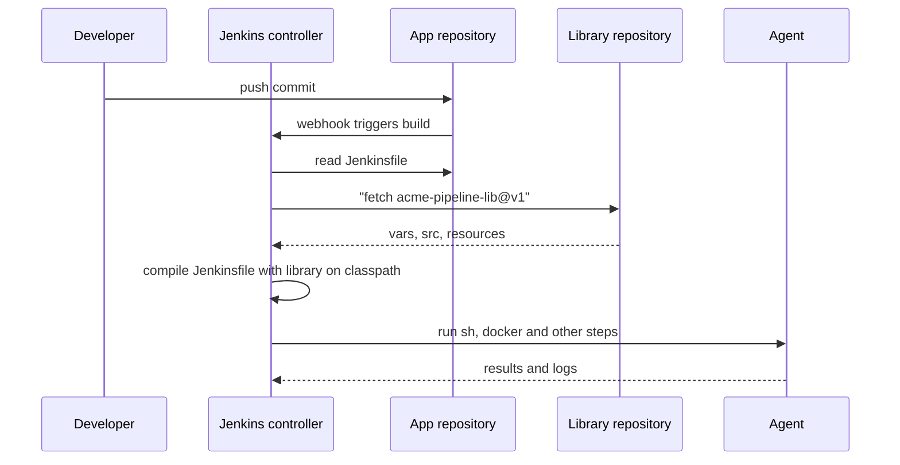
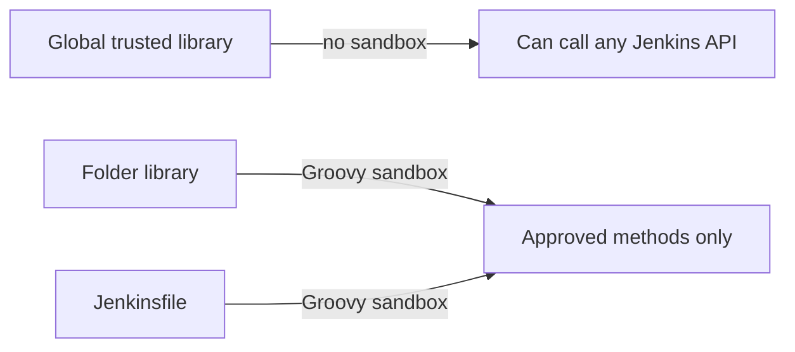

# Shared Libraries Introduction

## Introduction

Picture a company with 40 repositories, each with its own `Jenkinsfile`. They all started from the same example, so every file contains the same 60 lines: check out the code, run the build, publish test reports, push a Docker image, and post to Slack when something fails. Then the security team asks everyone to add an image scan. Someone has to open 40 pull requests, and three months later half the repositories still have the old version.

A **Jenkins shared library** fixes this. It is a separate Git repository with Groovy code that any pipeline can load. Instead of 60 copied lines, each `Jenkinsfile` calls one step that the platform team maintains:

```groovy
@Library('acme-pipeline-lib@v1') _

buildDockerService(
    imageName: 'billing-api',
    slackChannel: '#billing-alerts'
)
```

Think of it like the standard building codes a city publishes. Each builder still designs their own house, but nobody reinvents the wiring rules, and when the code changes it changes in one place.

This page covers:

- what a shared library is and how Jenkins loads it at build time
- your first library with one custom step
- how to register a library globally, per folder, or on the fly
- trusted versus untrusted libraries, and why that difference matters for security
- when a shared library is the right tool, and when it is not

The rest of this section goes deeper into [library structure](./1-jenkins-library-structure.mdx), [custom steps](./2-jenkins-global-vars.mdx), [classes](./3-jenkins-library-classes.mdx), [resources](./4-jenkins-library-resources.mdx), [versioning](./5-jenkins-library-versioning.mdx), [testing](./6-jenkins-library-testing.mdx) and [templates for many teams](./7-jenkins-pipeline-templates.mdx).

:::note Prerequisites
You should be comfortable with [Declarative Pipeline syntax](../3-jenkins-pipeline-basics/2-jenkins-declarative-pipeline.mdx) and have seen [Scripted Pipeline](../3-jenkins-pipeline-basics/3-jenkins-scripted-pipeline.mdx), because library code is written in the Scripted style. [Groovy Essentials for Pipelines](../4-jenkins-pipeline-advanced/5-jenkins-groovy-for-pipelines.mdx) is also useful background.
:::

## What a Shared Library Is

A shared library is just a Git repository (or another SCM) with a fixed directory layout:

```text
acme-pipeline-lib/
├── vars/                 # custom steps, one file per step
│   └── sayHello.groovy
├── src/                  # Groovy classes, normal package layout
│   └── com/acme/ci/
│       └── Version.groovy
└── resources/            # non-Groovy files: templates, scripts, JSON
    └── com/acme/ci/
        └── Dockerfile.template
```

- `vars/` holds **global variables**. Every `.groovy` file here becomes a step that pipelines can call by name.
- `src/` holds **classes** in the usual Java package layout. They are added to the pipeline's classpath.
- `resources/` holds **files** that the library can read with the `libraryResource` step.

The next page, [Shared Library Structure](./1-jenkins-library-structure.mdx), explains each directory in detail. For now you only need `vars/`.

The feature comes from the **Pipeline: Groovy Libraries** plugin (plugin ID `pipeline-groovy-lib`). It is part of the standard Pipeline plugin set, so it is already present on almost every Jenkins controller that runs pipelines. Older articles call it "Pipeline: Shared Groovy Libraries" (`workflow-cps-global-lib`). That is the older plugin name, and the features described here are the same.

## How Jenkins Loads a Library

When a build starts, Jenkins reads the `Jenkinsfile` and sees the `@Library` annotation. Before it compiles the pipeline, it fetches the library at the requested version and adds `src/` and `vars/` to the script's classpath.



Two facts about this flow matter later:

1. **Library Groovy code runs on the controller**, not on the agent. Only steps like `sh` and `bat` run on the agent. Heavy logic in a library slows down the controller for everyone, the same as heavy logic in a `Jenkinsfile`.
2. **The library is fetched for every build.** You can enable caching, but by default each build checks out the library again. Keep libraries small and focused.

## Your First Library

Create a new Git repository called `acme-pipeline-lib` and add one file:

```groovy
// vars/sayHello.groovy
def call(String name = 'human') {
    echo "Hello, ${name}. This message comes from acme-pipeline-lib."
}
```

The file name `sayHello` becomes the step name. The `call` method is what runs when a pipeline writes `sayHello(...)`. Names in `vars/` must be camelCase or all lowercase identifiers. Jenkins does not accept dashes in step names.

Commit and push it:

```bash
git init acme-pipeline-lib
cd acme-pipeline-lib
mkdir vars
# create vars/sayHello.groovy with the content above
git add vars/sayHello.groovy
git commit -m "Add sayHello step"
git remote add origin https://git.example.com/platform/acme-pipeline-lib.git
git push -u origin main
```

Example output:

```text
[main (root-commit) 3f2c1a9] Add sayHello step
 1 file changed, 3 insertions(+)
 create mode 100644 vars/sayHello.groovy
branch 'main' set up to track 'origin/main'.
```

## Registering the Library in Jenkins

Jenkins needs to know where the library lives. There are three places to register it.

### Option 1: Global Trusted Pipeline Libraries

Go to **Manage Jenkins » System » Global Trusted Pipeline Libraries** and add a library:

| Field | Example value | What it means |
| --- | --- | --- |
| Name | `acme-pipeline-lib` | The identifier used in `@Library` |
| Default version | `main` | Branch, tag or commit used when the pipeline does not ask for one |
| Load implicitly | unchecked | If checked, every pipeline gets the library without `@Library` |
| Allow default version to be overridden | checked | Lets a pipeline request `@Library('acme-pipeline-lib@v2')` |
| Include @Library changes in job recent changes | your choice | Shows library commits in each job's change list |
| Retrieval method | Modern SCM, Git | Where to fetch the code from |
| Cache fetched versions on controller | optional | Reuses a checkout for a number of minutes |

The menu labels move a little between Jenkins versions. If you cannot find the section, search "Pipeline Libraries" in the Manage Jenkins search box. Always choose **Modern SCM**. Legacy SCM exists only for SCM plugins that have not been updated, and it requires extra placeholder variables.

### Option 2: Configuration as Code

On a controller managed with [JCasC](../12-jenkins-administration/0-jenkins-configuration-as-code.mdx), the same settings live in YAML:

```yaml
unclassified:
  globalLibraries:
    libraries:
      - name: "acme-pipeline-lib"
        defaultVersion: "main"
        implicit: false
        allowVersionOverride: true
        includeInChangesets: false
        retriever:
          modernSCM:
            scm:
              git:
                remote: "https://git.example.com/platform/acme-pipeline-lib.git"
                credentialsId: "git-readonly"
```

The easiest way to get the exact keys for your plugin versions is to configure the library once in the UI, then open **Manage Jenkins » Configuration as Code » View Configuration** and copy the generated YAML.

### Option 3: Folder-Level Libraries

If you use folders, multibranch projects or [organization folders](../5-jenkins-scm-integration/5-jenkins-organization-folders.mdx), you can add a library in the folder's **Configure** page under **Pipeline Libraries**. It is visible only to jobs inside that folder. This is useful when one team wants its own helpers without asking a Jenkins admin.

## Trusted vs Untrusted Libraries

This is the most important security detail on this page.

- **Global trusted libraries** run **outside** the Groovy sandbox. Their code can call any Java or Groovy method, any Jenkins internal API, and any plugin class. Only users with the `Overall/RunScripts` permission (effectively administrators) can configure them.
- **Folder-level libraries** and libraries configured by users with only `Overall/Manage` are **untrusted**. They run inside the [Groovy sandbox](../11-jenkins-security/5-jenkins-script-security.mdx), with the same restrictions as a `Jenkinsfile`.



:::warning
Anyone who can push to a trusted library's repository can effectively run arbitrary code on your Jenkins controller, including reading every stored credential. Protect the library repository like production infrastructure: branch protection, required reviews, and a small group of people with merge rights.
:::

The trusted mode is also convenient: library code can use methods that the sandbox blocks, without script approvals. That convenience is exactly why the repository must be locked down.

## Loading a Library in a Pipeline

### The `@Library` Annotation

The most common form goes at the very top of the `Jenkinsfile`:

```groovy
@Library('acme-pipeline-lib') _

pipeline {
    agent any
    stages {
        stage('Greet') {
            steps {
                sayHello 'Compile N Run'
            }
        }
    }
}
```

Example console output:

```text
Loading library acme-pipeline-lib@main
Attempting to resolve main from remote references...
 > git ls-remote -h -- https://git.example.com/platform/acme-pipeline-lib.git # timeout=10
Found match: refs/heads/main revision 3f2c1a9e5d...
...
[Pipeline] stage
[Pipeline] { (Greet)
[Pipeline] echo
Hello, Compile N Run. This message comes from acme-pipeline-lib.
[Pipeline] }
[Pipeline] // stage
Finished: SUCCESS
```

The trailing underscore `_` is not a typo. Java annotations must be attached to something, such as an import or a variable. When you only use steps from `vars/`, there is nothing to import, so `_` is a placeholder for the annotation to attach to.

Other forms of the annotation:

```groovy
// A specific version: branch, tag or commit
@Library('acme-pipeline-lib@v1.4.0') _

// Several libraries at once
@Library(['acme-pipeline-lib@v1', 'security-scans']) _

// Attach to an import when you use classes from src/
@Library('acme-pipeline-lib@v1')
import com.acme.ci.Version
```

### The `library` Step

The `library` step loads a library while the pipeline is already running. This lets you choose the version dynamically:

```groovy
library "acme-pipeline-lib@${params.LIB_VERSION}"

pipeline {
    agent any
    parameters {
        string(name: 'LIB_VERSION', defaultValue: 'main', description: 'Library version')
    }
    stages {
        stage('Greet') {
            steps {
                sayHello 'dynamic loading'
            }
        }
    }
}
```

The step has limits. Classes from `src/` are not available through normal imports, because imports are resolved at compile time before the step runs. You have to reach them through the step's return value, for example `library('acme-pipeline-lib').com.acme.ci.Version.parse('1.2.3')`. For most pipelines, `@Library` is simpler.

### Loading a Library Without Registering It

The `library` step can also fetch a library that is not configured anywhere, by giving the retriever inline:

```groovy
library identifier: 'acme-pipeline-lib@main', retriever: modernSCM([
    $class: 'GitSCMSource',
    remote: 'https://git.example.com/platform/acme-pipeline-lib.git',
    credentialsId: 'git-readonly'
])
```

A library loaded this way is **untrusted** and runs in the sandbox. It is handy for experiments, but for a company-wide library, register it centrally so that every team uses the same source.

### Implicit Loading

If you tick **Load implicitly**, every pipeline on the controller gets the library at its default version without writing `@Library`. That is convenient, but it hides a dependency: someone reading the `Jenkinsfile` cannot see where `buildDockerService` comes from, and you cannot pin a version per repository. Most teams leave implicit loading off and keep `@Library` explicit.

## Real-World Scenario

Your team runs an e-commerce platform with 35 microservices: 20 Java services built with Maven and 15 Node.js services. Each repository has a `Jenkinsfile` of about 120 lines, copied from a template written two years ago. The files have drifted. Some publish JUnit reports and some do not. Six still push images to a registry that was retired last quarter. Compliance now requires a container image scan before every production deploy.

The platform team creates `acme-pipeline-lib` with two steps, `javaService` and `nodeService`. Each one contains the full standard pipeline: build, test, report, scan, push, and notify. A service's `Jenkinsfile` shrinks to a few lines:

```groovy
@Library('acme-pipeline-lib@v1') _

javaService(
    imageName: 'checkout-api',
    javaVersion: '21',
    slackChannel: '#checkout'
)
```

The rollout plan:

1. Release `v1.0.0` of the library and migrate five pilot services.
2. Add the image scan to the library in `v1.1.0`. Pipelines pinned to `v1` pick it up on their next build.
3. Migrate the remaining services over two sprints, one pull request each.
4. Protect the library repository with required reviews, because it is trusted code.

### Why this approach

The scan, the registry address and the reporting rules now live in one place. A change that used to take 35 pull requests now takes one. Teams still own their repositories and can pass options, so the library does not take control away from them.

### When to use it and when not to

Use a shared library when:

- three or more pipelines repeat the same logic
- a central team must roll out policy changes (security scans, registries, notification rules)
- the shared logic is stable enough to version

Do not use one when:

- you have one or two pipelines. The extra repository, versioning and testing cost more than they save.
- the "shared" logic differs in every repository. A library full of `if (team == 'x')` branches is worse than separate files.
- the logic is really a build tool concern. A Maven parent POM, a Gradle convention plugin or a `Makefile` often belongs in the build, not in Jenkins.

### Alternatives and trade-offs

| Approach | Pros | Cons | Best for |
| --- | --- | --- | --- |
| Copy-paste `Jenkinsfile` | Simple, no setup, each repo is independent | Drift, slow policy rollout, many PRs for every change | One to three repositories |
| Shared library | One source of truth, versioned, testable | Extra repo, Groovy CPS quirks, trusted code risk | Many repos with similar pipelines |
| Build tool conventions (parent POM, Makefile) | Works locally and in any CI | Does not cover Jenkins-specific steps such as credentials or reports | Logic that belongs to the build itself |
| Templating Engine plugin (JTE) | Repos need no `Jenkinsfile` at all | Small user base, plugin seeking a maintainer | Organizations with strict, uniform pipelines |
| Writing a Jenkins plugin | Full Java API access, real step classes | Much harder to build and release | Reusable features for the wider Jenkins community |

The [pipeline templates page](./7-jenkins-pipeline-templates.mdx) compares these options again for organizations with many teams.

## Common Mistakes

**Forgetting the underscore.** `@Library('acme-pipeline-lib')` with nothing after it fails to compile with an error about an unexpected token, because the annotation has nothing to attach to. Add `_` or an `import`.

**Using dashes in step names.** `vars/build-app.groovy` cannot be called as a step. Use `buildApp.groovy`.

**Pointing production pipelines at `main`.** A bad commit on `main` breaks every build at once. Pin to a tag or a major version branch. See [Versioning Shared Libraries](./5-jenkins-library-versioning.mdx).

**Putting heavy logic in Groovy.** Parsing large JSON files or looping over thousands of items in library code runs on the controller. Push the work to the agent with `sh` and a real script.

**Loose control of a trusted library.** Treat merge rights as administrator rights.

**Overriding built-in steps.** A `vars/sh.groovy` or `vars/checkout.groovy` file shadows the real step. The Jenkins pipeline best practices guide explicitly advises against this, because every pipeline that loads the library gets your version silently.

## Summary

- A shared library is a separate repository with `vars/`, `src/` and `resources/` directories that pipelines load at build time.
- Files in `vars/` become custom steps. The `call` method runs when the step is used.
- Register libraries globally (trusted), per folder (untrusted), or load them inline with the `library` step.
- Load with `@Library('name@version') _` at the top of the `Jenkinsfile`, or with the `library` step for dynamic versions.
- Trusted libraries skip the sandbox, so protect their repository as carefully as the controller itself.
- Library Groovy runs on the controller. Keep it thin and push real work to agents.
- Share code when many pipelines repeat the same logic, not before.

## Exercises

1. Create a library with a `vars/sayHello.groovy` step, register it as a global library, and call it from a test pipeline. Then change the message, push, and rerun the build to see the new version load.
2. Register the same library as a folder-level library inside a folder. Try calling `Jenkins.instance.getItemByFullName(...)` from a library step in both setups and compare what happens.
3. Load the library with the inline `library identifier: ..., retriever: modernSCM(...)` form and note in the console log how Jenkins reports it.
4. List three pieces of logic repeated in your own pipelines. For each, decide whether it belongs in a shared library, the build tool, or nowhere at all.

Next, learn how to lay out the repository in [Shared Library Structure](./1-jenkins-library-structure.mdx). For general CI/CD background, see the [CI/CD tutorial](/docs/devops/cicd).
