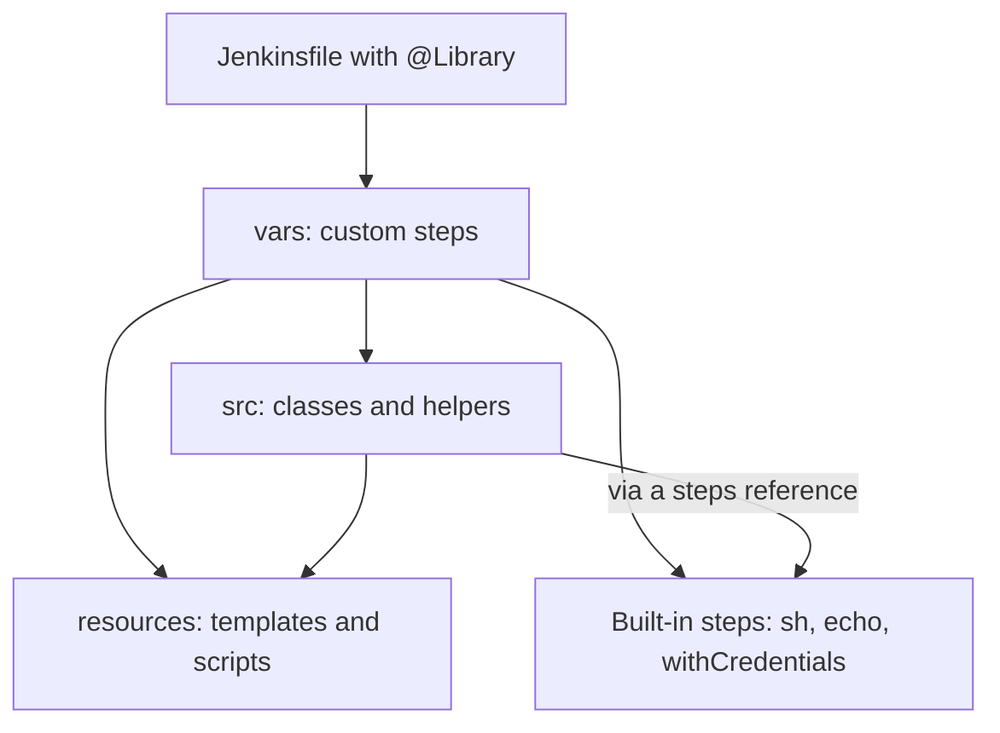

# Shared Library Structure

## Introduction

A Jenkins shared library is an ordinary Git repository, but Jenkins only looks at three top-level directories: `vars/`, `src/` and `resources/`. Everything else in the repository (tests, build files, documentation) is ignored at build time. Knowing what goes where saves you from the most common library bugs: steps that cannot be found, classes that cannot call `sh`, and files that cannot be read.

A good analogy is a kitchen. `vars/` is the menu: the named dishes customers can order. `src/` is the kitchen equipment and techniques that the cooks use to make those dishes. `resources/` is the pantry: raw ingredients, such as templates and scripts, that recipes pull from. Customers (pipelines) usually order from the menu and never see the kitchen.

On this page you will:

- learn what each directory does and how Jenkins loads it
- build a realistic library layout step by step
- add documentation that shows up in the Jenkins UI
- see how to organize a library that grows to dozens of steps
- decide between one big library and several small ones

If you have not set up a library yet, start with [Shared Libraries Introduction](./0-jenkins-shared-libraries-introduction.mdx).

## The Three Directories

```text
acme-pipeline-lib/
├── vars/
│   ├── buildMaven.groovy
│   ├── buildMaven.txt
│   └── notifySlack.groovy
├── src/
│   └── com/acme/ci/
│       ├── SemVer.groovy
│       └── DockerImage.groovy
└── resources/
    └── com/acme/ci/
        ├── Dockerfile.java.template
        └── scripts/
            └── smoke-test.sh
```

| Directory | Contains | How pipelines use it | Loaded |
| --- | --- | --- | --- |
| `vars/` | One `.groovy` file per global variable or step | Call by file name: `buildMaven()` | Global variables resolved at runtime |
| `vars/*.txt` | Help text for a step | Shown in the Global Variable Reference | Read by the UI |
| `src/` | Groovy classes in Java package folders | `import com.acme.ci.SemVer` | Added to the classpath at compile time |
| `resources/` | Any non-Groovy files | `libraryResource 'com/acme/ci/...'` | Read on demand as a string |

Jenkins reserves other top-level directories for future use, so do not rely on custom ones being ignored forever. Repository tooling such as `test/`, `build.gradle` and `README.md` is fine and widely used.



The arrows show the usual direction of calls. Pipelines call `vars/` steps. Those steps use classes from `src/` and files from `resources/`. Classes in `src/` cannot call pipeline steps directly; they need a reference to the script, which [Classes in src](./3-jenkins-library-classes.mdx) explains.

## The `vars` Directory

Every `.groovy` file in `vars/` becomes a global variable named after the file. Jenkins creates one instance of it per build.

The most common pattern is a file with a `call` method, which makes the variable callable like a step:

```groovy
// vars/notifySlack.groovy
def call(String channel, String message) {
    // slackSend comes from the Slack Notification plugin
    slackSend(channel: channel, message: message)
}
```

```groovy
// Jenkinsfile
@Library('acme-pipeline-lib@v1') _

pipeline {
    agent any
    stages {
        stage('Build') {
            steps {
                sh 'make build'
            }
        }
    }
    post {
        failure {
            notifySlack('#payments', "Build failed: ${env.JOB_NAME} #${env.BUILD_NUMBER}")
        }
    }
}
```

A `vars` file can also expose several methods. Pipelines then call them with a dot:

```groovy
// vars/log.groovy
def info(String message) {
    echo "INFO: ${message}"
}

def warning(String message) {
    echo "WARNING: ${message}"
}
```

```groovy
// Jenkinsfile (Declarative): dotted calls need a script block
steps {
    script {
        log.info 'Starting deployment'
        log.warning 'Using the fallback registry'
    }
}
```

Declarative Pipeline does not allow `object.method()` calls directly in a `steps` block, so it fails validation with an error like "Method calls on objects not permitted outside script blocks." A step with a plain `call` method, such as `notifySlack(...)`, works without `script`.

Example output:

```text
[Pipeline] echo
INFO: Starting deployment
[Pipeline] echo
WARNING: Using the fallback registry
```

[Custom Steps with vars](./2-jenkins-global-vars.mdx) covers arguments, maps, closures and Declarative usage in detail.

### Naming Rules

- File names must be valid Groovy identifiers: camelCase or lowercase, no dashes, no spaces.
- A `vars` name should not match a built-in step. `vars/sh.groovy` would hide the real `sh` step for every pipeline that loads the library.
- Pick names that read like verbs or nouns in a `Jenkinsfile`: `buildMaven`, `deployToK8s`, `semver`, `log`.

### Documentation Files

Next to `buildMaven.groovy` you can add `buildMaven.txt`. Jenkins shows its contents on the **Global Variable Reference** page, which you reach from **Pipeline Syntax** in any pipeline job. The file may contain simple HTML, depending on your markup formatter:

```text
<p>Builds a Maven project and publishes JUnit results.</p>
<ul>
  <li><b>goals</b>: Maven goals to run. Default: clean verify</li>
  <li><b>jdk</b>: JDK version for the build container. Default: 21</li>
</ul>
<p>Example: buildMaven(goals: 'clean package', jdk: '17')</p>
```

Jenkins only shows this help after a pipeline has loaded the library at least once successfully. Keep the text short and include one example call, because this page is where developers look first.

## The `src` Directory

`src/` uses the standard Java source layout. A file at `src/com/acme/ci/SemVer.groovy` must declare `package com.acme.ci` and defines the class `com.acme.ci.SemVer`.

```groovy
// src/com/acme/ci/SemVer.groovy
package com.acme.ci

class SemVer implements Serializable {
    int major
    int minor
    int patch

    static SemVer parse(String text) {
        def parts = text.tokenize('.')
        return new SemVer(
            major: parts[0] as int,
            minor: parts[1] as int,
            patch: parts[2] as int
        )
    }

    SemVer bumpMinor() {
        return new SemVer(major: major, minor: minor + 1, patch: 0)
    }

    String toString() {
        return "${major}.${minor}.${patch}"
    }
}
```

A pipeline imports it like any Groovy class:

```groovy
@Library('acme-pipeline-lib@v1')
import com.acme.ci.SemVer

pipeline {
    agent any
    stages {
        stage('Version') {
            steps {
                script {
                    def next = SemVer.parse('2.4.9').bumpMinor()
                    echo "Next version: ${next}"
                }
            }
        }
    }
}
```

Example output:

```text
[Pipeline] echo
Next version: 2.5.0
```

Notice two details:

- The annotation is attached to the `import`, so no underscore is needed.
- In Declarative Pipeline, calling class methods directly needs a `script` block. Steps from `vars/` do not.

Use a package name that is unique to your organization, such as `com.acme.ci`. If two libraries both define `utils.Helper`, the class that wins depends on load order, and the bug is very confusing.

## The `resources` Directory

`resources/` holds files that are not Groovy: shell scripts, Dockerfile templates, JSON request bodies, YAML pod templates. Library code reads them with the `libraryResource` step, which returns the file content as a string:

```groovy
// vars/runSmokeTest.groovy
def call(String baseUrl) {
    def script = libraryResource 'com/acme/ci/scripts/smoke-test.sh'
    writeFile file: 'smoke-test.sh', text: script
    sh "chmod +x smoke-test.sh && ./smoke-test.sh ${baseUrl}"
}
```

Use the same package-style folders as `src/` so that resource paths from different libraries cannot collide. [Resources and Templates](./4-jenkins-library-resources.mdx) goes further, including templating and binary files.

## A Realistic Layout

Here is how a mature library might look after a year:

```text
acme-pipeline-lib/
├── README.md
├── CHANGELOG.md
├── build.gradle              # only for running unit tests
├── vars/
│   ├── javaService.groovy    # full pipeline template
│   ├── javaService.txt
│   ├── nodeService.groovy
│   ├── nodeService.txt
│   ├── buildMaven.groovy     # building blocks
│   ├── buildNpm.groovy
│   ├── dockerBuildPush.groovy
│   ├── deployToK8s.groovy
│   ├── notifySlack.groovy
│   └── log.groovy
├── src/
│   └── com/acme/ci/
│       ├── SemVer.groovy
│       ├── DockerImage.groovy
│       ├── GitInfo.groovy
│       └── config/
│           └── PipelineConfig.groovy
├── resources/
│   └── com/acme/ci/
│       ├── k8s/
│       │   └── pod-maven.yaml
│       ├── docker/
│       │   └── Dockerfile.java.template
│       └── scripts/
│           └── smoke-test.sh
└── test/
    └── com/acme/ci/
        ├── SemVerTest.groovy
        └── BuildMavenTest.groovy
```

The steps fall into three layers:

1. **Templates** such as `javaService`, which define a complete pipeline. Teams with standard needs call only these.
2. **Building blocks** such as `buildMaven` and `deployToK8s`, which teams with unusual needs combine in their own `Jenkinsfile`.
3. **Helpers** in `src/`, which keep the steps short and are easy to unit test.

This layering is what makes a library useful to both the 80 percent of teams with standard pipelines and the 20 percent who need custom ones. [Pipeline Templates for Many Teams](./7-jenkins-pipeline-templates.mdx) builds on it.

## How the Pieces Are Resolved

It helps to know when each part is resolved, because the timing explains several error messages:

| Part | Resolved | Consequence |
| --- | --- | --- |
| `@Library` annotation | Before compiling the `Jenkinsfile` | A wrong library name fails the build immediately |
| `import` of a `src/` class | Compile time | A typo in the class name is a compile error |
| `vars/` step call | Runtime, when the line executes | A typo in a step name fails only when that line runs, with `No such DSL method` |
| `libraryResource` | Runtime | A wrong path fails when the step runs |

Because `vars/` steps are resolved at runtime, a misspelled step inside a rarely used `post` branch can hide for weeks. Unit tests, covered in [Testing Shared Libraries](./6-jenkins-library-testing.mdx), catch this before release.

## Real-World Scenario

Your platform team at a logistics company started a library a year ago with five steps. It now has 45 files in `vars/`, some over 400 lines long. Every pipeline loads all of them. Two teams added their own helpers named `utils.groovy` in different folders, and new developers cannot tell which steps are supported and which are leftovers.

The team restructures:

1. **Split by audience.** The organization-wide library `acme-pipeline-lib` keeps only supported templates and building blocks. Team-specific helpers move to folder-level libraries owned by those teams.
2. **Move logic from `vars/` to `src/`.** Long step files become thin wrappers that call classes. The classes are unit tested.
3. **Move inline strings to `resources/`.** A 150-line Kubernetes pod spec that lived inside a Groovy string becomes `resources/com/acme/ci/k8s/pod-maven.yaml`.
4. **Add `.txt` docs** for every supported step and delete the unused ones after checking build logs for usage.

### Why this approach

Smaller `vars/` files load faster and are easier to read. Logic in classes can be tested without a Jenkins instance. Splitting by audience makes ownership clear: the platform team supports the global library, and each team supports its own.

### When to use it and when not to

Restructure when steps get long, names collide, or nobody knows what is supported. Do not split a small library just to look tidy. Every extra library is another repository to version and another `@Library` line to keep current.

### Alternatives and trade-offs

| Approach | Pros | Cons | Best for |
| --- | --- | --- | --- |
| One global library | One place to look, one version to pin | Grows large, everyone loads everything | Small and mid-size organizations |
| Global library plus folder libraries | Clear ownership, teams move fast | Folder libraries are sandboxed, more repos | Many teams with different needs |
| Several global libraries by domain (build, deploy, security) | Smaller loads, separate release cycles | Versions must stay compatible with each other | Large platform teams |
| Everything inline in `Jenkinsfile` | No indirection | Drift and copy-paste | Very few pipelines |

## Best Practices

- **Keep `vars/` files thin.** Parse arguments, call a class or a few steps, and return. Put logic in `src/`.
- **Use an organization-unique package** for both `src/` and `resources/`.
- **Implement `Serializable`** on classes that hold state across steps, so pipelines survive controller restarts.
- **Do not keep state in `vars/` fields.** Global variables are recreated when a pipeline resumes, so values stored in them are lost. Pass data as arguments or return values.
- **Avoid huge variable files.** The Jenkins best practices guide warns that every pipeline loads them, needed or not.
- **Write a README** with the list of supported steps, the version policy, and how to request changes.
- **Keep tests in the same repository** in a `test/` folder that Jenkins ignores.

## Summary

- Jenkins reads only `vars/`, `src/` and `resources/` from a library repository.
- `vars/` files become steps or global objects named after the file. Matching `.txt` files document them in the UI.
- `src/` holds packaged classes that pipelines import. They need a script reference to call steps.
- `resources/` holds non-Groovy files read with `libraryResource`.
- `src/` imports are resolved at compile time; `vars/` calls and resources at runtime.
- Organize larger libraries in layers: templates, building blocks, and tested helper classes.

## Exercises

1. Create a library with one `vars/` step, one class in `src/`, and one shell script in `resources/`. Make the step use both, and call it from a pipeline.
2. Add a `.txt` file for your step, run the pipeline once, and find the text on the Global Variable Reference page.
3. Misspell a step name inside a `post { unstable { ... } }` block and confirm the build still passes when the condition is not met. What does this tell you about testing?
4. Sketch the directory tree for a library that serves Java, Node.js and Python teams. Which steps are templates, which are building blocks, and which logic belongs in `src/`?

Continue with [Custom Steps with vars](./2-jenkins-global-vars.mdx).
