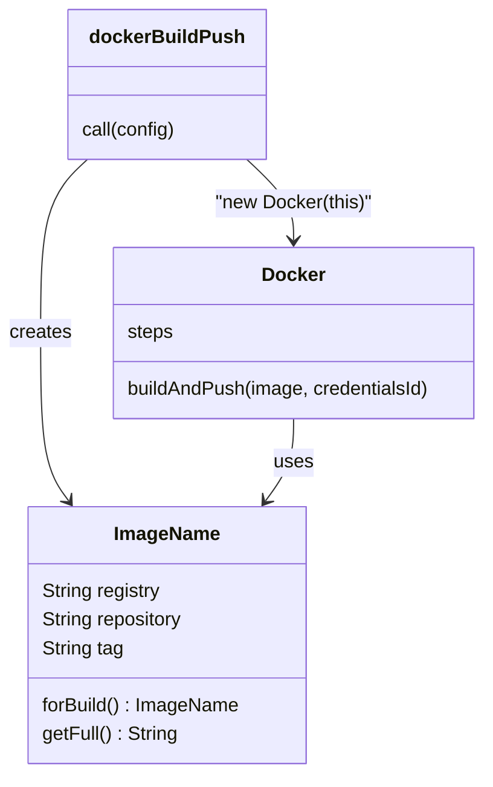

# Classes in src

## Introduction

Custom steps in `vars/` are great for short, readable glue. When the logic grows (parsing versions, building image names from many inputs, deciding which environments a branch may deploy to), long `vars` files get hard to read and harder to test. That is the moment to move logic into **classes** in the library's `src/` directory.

Classes in `src/` are normal Groovy classes in Java-style packages. They give you constructors, typed fields, private helpers, and code you can unit test without Jenkins. They also come with three Jenkins-specific rules that surprise almost everyone the first time:

1. A class cannot call pipeline steps like `sh` or `echo` on its own. It needs a reference to the running script.
2. A class that keeps state across steps must implement `Serializable`.
3. Pipeline code is transformed by Jenkins' **CPS** engine, so some ordinary Groovy behaves differently.

Think of a `vars` step as a waiter and a `src` class as a chef. The chef does the complex work, but the chef cannot walk to the customer's table. If the chef needs to talk to the outside world, the waiter has to pass the message along, which in Jenkins means passing a `steps` reference.

This page builds on [Custom Steps with vars](./2-jenkins-global-vars.mdx) and [Groovy Essentials for Pipelines](../4-jenkins-pipeline-advanced/5-jenkins-groovy-for-pipelines.mdx).

## Pure Classes: The Easy Case

The simplest and most testable classes do not call any pipeline steps. They take data in and return data:

```groovy
// src/com/acme/ci/ImageName.groovy
package com.acme.ci

class ImageName implements Serializable {
    private static final long serialVersionUID = 1L

    String registry
    String repository
    String tag

    static ImageName forBuild(String registry, String service, String branch, String commit, int buildNumber) {
        String cleanBranch = branch.toLowerCase().replaceAll('[^a-z0-9.-]', '-')
        String tag = (branch == 'main')
            ? "${buildNumber}-${commit.take(7)}"
            : "${cleanBranch}-${commit.take(7)}"
        return new ImageName(registry: registry, repository: service, tag: tag)
    }

    String getFull() {
        return "${registry}/${repository}:${tag}"
    }
}
```

Use it from a `vars` step or a `script` block:

```groovy
@Library('acme-pipeline-lib@v1')
import com.acme.ci.ImageName

pipeline {
    agent any
    stages {
        stage('Name image') {
            steps {
                script {
                    def image = ImageName.forBuild('registry.example.com', 'billing-api',
                                                   'feature/JIRA-12_new-tax', '9b1e4c2a77f0', 57)
                    echo "Image: ${image.full}"
                }
            }
        }
    }
}
```

Example output:

```text
[Pipeline] echo
Image: registry.example.com/billing-api:feature-jira-12-new-tax-9b1e4c2
```

Pure classes are the best kind. They are fast, they have no Jenkins dependencies, and you can test them with plain JUnit or Spock. Push as much logic as you can into this shape.

## Calling Steps from a Class

Library classes cannot call `sh`, `echo` or other steps directly, because those steps are methods on the pipeline script object, not global functions. The solution is to pass the script object in.

### Pattern 1: Pass `steps` to the Constructor

```groovy
// src/com/acme/ci/Docker.groovy
package com.acme.ci

class Docker implements Serializable {
    private static final long serialVersionUID = 1L

    private final def steps

    Docker(steps) {
        this.steps = steps
    }

    void buildAndPush(ImageName image, String credentialsId) {
        steps.echo "Building ${image.full}"
        steps.sh "docker build -t ${image.full} ."
        steps.withCredentials([steps.usernamePassword(
                credentialsId: credentialsId,
                usernameVariable: 'REG_USER',
                passwordVariable: 'REG_PASS')]) {
            steps.sh 'echo "$REG_PASS" | docker login -u "$REG_USER" --password-stdin ' + image.registry
            steps.sh "docker push ${image.full}"
        }
    }
}
```

The `vars` step passes `this`, which is the running script:

```groovy
// vars/dockerBuildPush.groovy
import com.acme.ci.Docker
import com.acme.ci.ImageName

def call(Map config) {
    def image = ImageName.forBuild(
        config.registry ?: 'registry.example.com',
        config.service,
        env.BRANCH_NAME ?: 'main',
        env.GIT_COMMIT ?: sh(script: 'git rev-parse HEAD', returnStdout: true).trim(),
        env.BUILD_NUMBER as int)
    new Docker(this).buildAndPush(image, config.credentialsId ?: 'registry-push')
    return image.full
}
```

Notice that every step call goes through `steps.`: `steps.sh`, `steps.echo`, even `steps.usernamePassword` for the credential helper. Forgetting the prefix gives a `MissingMethodException`.

The registry password uses single quotes, so the shell reads `$REG_PASS` from the environment and the secret never appears in a Groovy string.

### Pattern 2: Static Methods that Take the Script

For stateless helpers, pass the script to each call:

```groovy
// src/com/acme/ci/Maven.groovy
package com.acme.ci

class Maven {
    static void run(script, String goals) {
        script.sh "mvn -B ${goals}"
    }
}
```

```groovy
script {
    com.acme.ci.Maven.run(this, 'clean verify')
}
```

### Pattern 3: Access `env` and `params`

`env`, `params` and `currentBuild` are also properties of the script, so read them through the same reference:

```groovy
String branch = steps.env.BRANCH_NAME
String result = steps.currentBuild.currentResult
```

A cleaner design passes the values the class needs as arguments, as `dockerBuildPush` does above. The class then has no hidden dependency on the environment, and tests do not need to fake it.



## Why Serializable Matters

Jenkins pipelines survive controller restarts. To do that, Jenkins regularly saves the state of every running pipeline to disk, including local variables, and restores it after a restart. Any object stored in a variable must be serializable, or the save fails.

If you forget `implements Serializable`, you may see this when a step pauses (for example, during a long `sh` or an `input`):

```text
java.io.NotSerializableException: com.acme.ci.Docker
```

The rules:

- Classes in `src/` whose instances live across steps should implement `Serializable`.
- Fields must be serializable too. Strings, numbers, lists and maps of those are fine. The `steps` reference is handled by Jenkins.
- Non-serializable objects such as `java.util.regex.Matcher`, or an open `HttpURLConnection` should be used inside one method and not kept in fields or local variables across steps.

Adding `serialVersionUID` is optional but avoids warnings when you change the class.

## CPS: Why Groovy Feels Different

Jenkins runs pipeline code through a **Continuation Passing Style (CPS)** transformation. This is how it can pause in the middle of your code and resume after a restart. The cost is that some Groovy features behave differently or are slower.

Things to know when writing classes:

| Situation | What happens | What to do |
| --- | --- | --- |
| Calling a step in a constructor | Constructors are not CPS-transformed, so step calls there fail | Keep constructors trivial; call steps in normal methods |
| Overridden `toString`, `equals`, `hashCode` and some other methods called by Java code | Called from non-CPS Java code | Keep them simple and do not call steps in them |
| Sorting with a closure comparator, some closure-heavy collection methods | Older Jenkins versions failed or behaved oddly | Use current Jenkins; if a call misbehaves, move it into a `@NonCPS` method |
| Pure computation over large data | Slow under CPS because every operation is tracked | Move it to a `@NonCPS` method, or better, to `sh` on the agent |

### Using `@NonCPS`

`@NonCPS` marks a method to run as normal Groovy, without the CPS transformation:

```groovy
// src/com/acme/ci/Changelog.groovy
package com.acme.ci

class Changelog implements Serializable {
    private static final long serialVersionUID = 1L

    @NonCPS
    static List<String> ticketIds(String gitLog) {
        def matcher = gitLog =~ /[A-Z]+-\d+/
        return matcher.collect { it }.unique().sort()
    }
}
```

```groovy
script {
    def log = sh(script: 'git log --oneline origin/main..HEAD', returnStdout: true)
    def tickets = com.acme.ci.Changelog.ticketIds(log)
    echo "Tickets in this change: ${tickets.join(', ')}"
}
```

Example output:

```text
[Pipeline] sh
+ git log --oneline origin/main..HEAD
[Pipeline] echo
Tickets in this change: PAY-101, PAY-114
```

The rules for `@NonCPS`, from the Jenkins pipeline best practices:

- Use it only for methods that need it, typically pure computations or code using non-serializable objects like `Matcher`.
- **Do not call pipeline steps** such as `sh`, `echo` or `sleep` inside a `@NonCPS` method. Steps are asynchronous and must be CPS-transformed. Calling them from `@NonCPS` code gives wrong results or errors.
- A `@NonCPS` method cannot be paused halfway. If the controller restarts during it, it runs again from the start.

## A Configuration Class

A common use for classes is a typed, validated configuration object that every step in a pipeline template shares:

```groovy
// src/com/acme/ci/PipelineConfig.groovy
package com.acme.ci

class PipelineConfig implements Serializable {
    private static final long serialVersionUID = 1L

    String service
    String language = 'java'
    String jdk = '21'
    List<String> deployTo = ['dev']
    boolean runSonar = true

    static final List<String> LANGUAGES = ['java', 'node', 'python']
    static final List<String> ENVIRONMENTS = ['dev', 'staging', 'prod']

    static PipelineConfig from(Map raw) {
        def known = ['service', 'language', 'jdk', 'deployTo', 'runSonar'] as Set
        def unknown = raw.keySet() - known
        if (unknown) {
            throw new IllegalArgumentException("Unknown options: ${unknown}")
        }
        def cfg = new PipelineConfig(raw)
        cfg.validate()
        return cfg
    }

    void validate() {
        if (!service) {
            throw new IllegalArgumentException('service is required')
        }
        if (!(language in LANGUAGES)) {
            throw new IllegalArgumentException("language must be one of ${LANGUAGES}")
        }
        def bad = deployTo - ENVIRONMENTS
        if (bad) {
            throw new IllegalArgumentException("unknown environments: ${bad}")
        }
    }

    boolean deploysTo(String env) {
        return env in deployTo
    }
}
```

The class does not touch Jenkins at all, so it is trivial to test. The `vars` step converts exceptions into a clean build error:

```groovy
// vars/standardPipeline.groovy (excerpt)
import com.acme.ci.PipelineConfig

def call(Map raw) {
    PipelineConfig cfg
    try {
        cfg = PipelineConfig.from(raw)
    } catch (IllegalArgumentException e) {
        error "standardPipeline: ${e.message}"
    }
    echo "Service ${cfg.service}, language ${cfg.language}, deploys to ${cfg.deployTo}"
    // ... stages use cfg
}
```

Example output for a bad call:

```text
[Pipeline] error
ERROR: standardPipeline: language must be one of [java, node, python]
Finished: FAILURE
```

## Classes and the Sandbox

Global **trusted** libraries run outside the Groovy sandbox, so classes there can use any Java or Groovy API. **Untrusted** libraries (folder-level or loaded inline) run in the sandbox, so methods like `String.execute()` or reflection calls need administrator approval, and many are blocked entirely. See [Script Security and Sandboxing](../11-jenkins-security/5-jenkins-script-security.mdx).

Even in trusted code, do not use `Jenkins.instance` or other internal Jenkins APIs from a library. The Jenkins best practices guide calls this a sign of misuse: it creates security risks and breaks on upgrades. If you really need internal APIs, a small plugin is the supported way (see [Writing a Simple Plugin](../7-jenkins-plugins/4-jenkins-writing-a-plugin.mdx)).

## Real-World Scenario

Your fintech team has a `vars/release.groovy` step of 380 lines. It computes the next semantic version from commit messages, tags the repository, builds a changelog, and decides whether the release needs a manual approval based on the branch and the size of the change. Every change to it breaks something, and the only way to test it is to run a real pipeline.

You refactor it into:

- `src/com/acme/ci/SemVer.groovy`: parse and bump versions (pure)
- `src/com/acme/ci/CommitAnalyzer.groovy`: decide major/minor/patch from commit subjects (pure, with a `@NonCPS` regex helper)
- `src/com/acme/ci/ReleasePolicy.groovy`: decide whether approval is needed (pure)
- `src/com/acme/ci/GitOps.groovy`: wraps `sh 'git tag ...'` and `sh 'git push ...'` (needs `steps`)
- `vars/release.groovy`: 40 lines of glue that runs `git log` with `sh`, calls the pure classes, asks for `input` if needed, and calls `GitOps`

### Why this approach

Three of the four classes have no Jenkins dependency, so the tricky logic gets fast unit tests (see [Testing Shared Libraries](./6-jenkins-library-testing.mdx)). The class that touches Git is small and easy to mock. The `vars` step reads like a description of the release process.

### When to use it and when not to

Use classes when logic has branches worth testing, when several steps share helpers, or when you want typed configuration. Do not create classes for three-line steps: `new Notifier(this).notify(channel)` is harder to read than `notifySlack(channel)`.

### Alternatives and trade-offs

| Approach | Pros | Cons | Best for |
| --- | --- | --- | --- |
| Pure classes in `src/` | Fast unit tests, no Jenkins coupling | Cannot call steps | Calculations, validation, naming rules |
| Classes with a `steps` reference | Encapsulate step sequences | Need mocks in tests, `steps.` prefix everywhere | Wrappers around tools (Docker, Git, kubectl) |
| Logic in `vars/` | Simple, direct access to steps | Hard to test, grows messy | Short glue code |
| Script in `resources/` run with `sh` | Runs on the agent, any language | Data exchange through files or stdout | Heavy processing, existing tooling |
| Jenkins plugin | Full API, proper extension points | Java build and release cycle | Features that need Jenkins internals |

## Common Mistakes

**Calling steps without the reference.** `sh 'make'` inside a class fails with `No signature of method: com.acme.ci.Docker.sh()`. Use `steps.sh`.

**Calling steps in the constructor.** Constructors are not CPS-transformed. Store the reference in the constructor and do the work in a method.

**Forgetting `Serializable`.** The build works until the first long step or restart, then fails with `NotSerializableException`.

**Steps inside `@NonCPS`.** It may appear to work in simple cases, then return wrong values. Never mix them.

**Using `Jenkins.instance`.** It ties your library to internal APIs, needs trusted mode, and is a common source of security problems.

**Wrong package declaration.** `src/com/acme/ci/Docker.groovy` must start with `package com.acme.ci`. A mismatch gives `unable to resolve class` errors.

## Summary

- `src/` holds Groovy classes in Java package folders, imported with `@Library(...) import ...`.
- Prefer pure classes with no Jenkins dependencies; they are the easiest to test.
- To call steps, pass the script (`this`) into the class and call `steps.sh`, `steps.echo` and so on.
- Implement `Serializable` on classes that hold state, so pipelines can survive restarts.
- Use `@NonCPS` only for pure computations, never for methods that call steps.
- Avoid internal Jenkins APIs; write a plugin if you truly need them.

## Exercises

1. Write a pure `SemVer` class with `parse`, `bumpMajor`, `bumpMinor`, `bumpPatch` and `compareTo`, and use it from a `vars` step that prints the next version.
2. Create a `Kubectl` class that takes `steps` and wraps `apply`, `rolloutStatus` and `rollback`. Use it from a `deployToK8s` step.
3. Remove `implements Serializable` from a class, then add `sleep 5` between two calls that use the same instance, restart the controller during the sleep in a test instance, and read the error.
4. Write a `@NonCPS` method that extracts all ticket IDs from a commit log, and explain why it must not call `echo`.

Next, learn how to ship files with your library in [Resources and Templates](./4-jenkins-library-resources.mdx).
