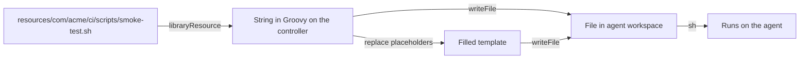

# Resources and Templates

## Introduction

Not everything a pipeline needs is Groovy. A standard build often needs a shell script for smoke tests, a Dockerfile, a Kubernetes pod definition for the build agent, or a JSON file of default settings. You could embed these as long strings inside `vars/` files, but that quickly turns into unreadable Groovy full of escaped quotes and dollar signs.

The `resources/` directory of a shared library is where those files belong. A library step reads them with the **`libraryResource`** step, which returns the file's content as a string. The step can then write the file into the workspace, fill in placeholders, or pass the text to another step.

Think of `resources/` as a box of printed forms. The library keeps the blank forms. When a pipeline needs one, the step takes a copy, fills in the blanks (service name, version, port), and hands the filled-in form to the agent.

On this page you will learn how to:

- read resources with `libraryResource`
- run shell scripts shipped with the library
- fill simple templates without unsafe template engines
- use resources for Kubernetes pod templates and configuration defaults
- handle binary files
- decide what belongs in `resources/` and what does not

This page assumes you know the [library structure](./1-jenkins-library-structure.mdx) and [custom steps](./2-jenkins-global-vars.mdx).

## How libraryResource Works



Key facts:

- `libraryResource` reads from the library checkout on the **controller**, not from the agent's workspace. The returned string lives in the pipeline's memory.
- The path is relative to `resources/`. Use package-style folders such as `com/acme/ci/...` so paths from two different libraries cannot collide.
- If two loaded libraries contain the same resource path, which one you get is not something to rely on.
- The result is a `String`. If you want a file on the agent, you must write it with `writeFile`.
- File permissions are not preserved. A script written with `writeFile` is not executable until you `chmod` it or call it through an interpreter.

## Step 1: Ship and Run a Script

A smoke test that checks a few URLs is easier to write and test as a normal Bash script than as Groovy.

```bash
#!/usr/bin/env bash
# resources/com/acme/ci/scripts/smoke-test.sh
set -euo pipefail

BASE_URL="${1:?usage: smoke-test.sh BASE_URL}"
PATHS=("/healthz" "/readyz" "/api/version")

for p in "${PATHS[@]}"; do
  code=$(curl -s -o /dev/null -w '%{http_code}' --max-time 10 "${BASE_URL}${p}")
  if [[ "$code" != "200" ]]; then
    echo "FAIL ${p} returned ${code}"
    exit 1
  fi
  echo "OK   ${p}"
done
echo "Smoke test passed for ${BASE_URL}"
```

The library step copies it into the workspace and runs it:

```groovy
// vars/smokeTest.groovy
def call(String baseUrl) {
    def script = libraryResource 'com/acme/ci/scripts/smoke-test.sh'
    writeFile file: '.ci/smoke-test.sh', text: script
    sh "bash .ci/smoke-test.sh '${baseUrl}'"
}
```

```groovy
// Jenkinsfile, in a steps block
smokeTest 'https://billing.staging.example.com'
```

Example output:

```text
[Pipeline] libraryResource
[Pipeline] writeFile
[Pipeline] sh
+ bash .ci/smoke-test.sh https://billing.staging.example.com
OK   /healthz
OK   /readyz
OK   /api/version
Smoke test passed for https://billing.staging.example.com
```

Two choices here are deliberate:

- The script goes into a `.ci/` folder so it does not clash with files in the application repository. Add `.ci/` to the repository's `.gitignore` or clean it up afterwards.
- Calling it with `bash` means the missing executable bit does not matter.

You can check the script outside Jenkins, which is a big advantage over Groovy:

```bash
bash -n resources/com/acme/ci/scripts/smoke-test.sh && echo "syntax ok"
shellcheck resources/com/acme/ci/scripts/smoke-test.sh
```

Example output:

```text
syntax ok
```

## Step 2: Simple Templates

A standard Dockerfile for Java services differs only in a few values. Store it with placeholders:

```dockerfile
# resources/com/acme/ci/docker/Dockerfile.java.template
FROM eclipse-temurin:@JAVA_VERSION@-jre
WORKDIR /app
COPY target/@ARTIFACT@ /app/app.jar
EXPOSE @PORT@
USER 1000
ENTRYPOINT ["java", "-jar", "/app/app.jar"]
```

The placeholders use `@NAME@` rather than `${NAME}`. That avoids any confusion with Groovy string interpolation and with shell or Docker variables, which also use `$`.

Fill it with a small helper that replaces known keys and fails on anything left over:

```groovy
// vars/renderTemplate.groovy
def call(String resourcePath, Map values) {
    String text = libraryResource(resourcePath)
    values.each { key, value ->
        text = text.replace("@${key}@".toString(), value.toString())
    }
    def leftover = (text =~ /@[A-Z_]+@/).collect { it }
    if (leftover) {
        error "renderTemplate: unfilled placeholders in ${resourcePath}: ${leftover.unique()}"
    }
    return text
}
```

```groovy
// vars/javaDockerfile.groovy
def call(Map config = [:]) {
    def dockerfile = renderTemplate('com/acme/ci/docker/Dockerfile.java.template', [
        JAVA_VERSION: config.javaVersion ?: '21',
        ARTIFACT    : config.artifact ?: 'app.jar',
        PORT        : config.port ?: 8080
    ])
    writeFile file: 'Dockerfile.generated', text: dockerfile
    echo "Generated Dockerfile:\n${dockerfile}"
}
```

Example output:

```text
[Pipeline] echo
Generated Dockerfile:
FROM eclipse-temurin:21-jre
WORKDIR /app
COPY target/app.jar /app/app.jar
EXPOSE 8080
USER 1000
ENTRYPOINT ["java", "-jar", "/app/app.jar"]
```

### Why Not a Template Engine?

Groovy ships with `SimpleTemplateEngine` and `GStringTemplateEngine`, and you will find old examples that use them in pipelines. Avoid them:

- They are not designed for CPS, so they often need `@NonCPS` wrappers.
- In untrusted libraries the sandbox blocks them.
- A template engine evaluates Groovy expressions inside the template. If any value comes from a branch name or a build parameter, that is a code-injection risk on your controller.

Plain `replace` with a fixed list of keys is boring, safe and fast. If you need loops or conditionals in a template, the template is probably doing a job that belongs in a real tool, such as Helm for Kubernetes manifests or a script on the agent.

## Step 3: Kubernetes Pod Templates

When builds run on [Kubernetes pod agents](../6-jenkins-agents/4-jenkins-kubernetes-agents.mdx), each pipeline needs a pod spec. Keeping a standard spec in the library means every team gets the same images, resource limits and security settings.

```yaml
# resources/com/acme/ci/k8s/pod-maven.yaml
apiVersion: v1
kind: Pod
spec:
  securityContext:
    runAsUser: 1000
    runAsNonRoot: true
  containers:
    - name: maven
      image: maven:3.9-eclipse-temurin-21
      command: ["sleep"]
      args: ["infinity"]
      resources:
        requests:
          cpu: "1"
          memory: 2Gi
        limits:
          memory: 2Gi
```

A library pipeline template can read it before the `pipeline` block and hand it to the Kubernetes plugin's `yaml` option:

```groovy
// vars/mavenOnK8s.groovy
def call(Map config = [:]) {
    def podYaml = libraryResource 'com/acme/ci/k8s/pod-maven.yaml'

    pipeline {
        agent {
            kubernetes {
                yaml podYaml
                defaultContainer 'maven'
            }
        }
        stages {
            stage('Build') {
                steps {
                    sh "mvn -B ${config.goals ?: 'clean verify'}"
                }
            }
        }
    }
}
```

The Kubernetes plugin (`kubernetes`) accepts the pod spec as a YAML string. Check your plugin version's documentation for the exact options, such as `yamlMergeStrategy` for combining a library default with a team's own additions. Defining whole pipelines inside `vars/` is covered in [Pipeline Templates for Many Teams](./7-jenkins-pipeline-templates.mdx).

## Step 4: Configuration Defaults

Resources are a good home for default settings that should be easy to read and change without touching Groovy.

```yaml
# resources/com/acme/ci/defaults/java.yaml
jdk: "21"
goals: "clean verify"
sonar: true
deploy:
  environments: [dev, staging]
  timeoutMinutes: 10
notifications:
  slackChannel: "#builds"
```

Load the defaults, then let the team's options override them:

```groovy
// vars/loadPipelineConfig.groovy
def call(String language, Map overrides = [:]) {
    def text = libraryResource "com/acme/ci/defaults/${language}.yaml"
    Map defaults = readYaml(text: text)
    return deepMerge(defaults, overrides)
}

private Map deepMerge(Map base, Map extra) {
    Map result = [:] + base
    extra.each { k, v ->
        if (v instanceof Map && result[k] instanceof Map) {
            result[k] = deepMerge(result[k] as Map, v as Map)
        } else {
            result[k] = v
        }
    }
    return result
}
```

```groovy
// Jenkinsfile, inside script
def cfg = loadPipelineConfig('java', [jdk: '17', deploy: [timeoutMinutes: 20]])
echo "JDK ${cfg.jdk}, deploy to ${cfg.deploy.environments} with timeout ${cfg.deploy.timeoutMinutes}m"
```

Example output:

```text
[Pipeline] libraryResource
[Pipeline] readYaml
[Pipeline] echo
JDK 17, deploy to [dev, staging] with timeout 20m
```

`readYaml` comes from the Pipeline Utility Steps plugin (`pipeline-utility-steps`). It also has `readJSON` for JSON resources. Validate the YAML in your library's CI so a broken defaults file never reaches Jenkins:

```bash
python3 -c "import sys, yaml; [yaml.safe_load(open(f)) for f in sys.argv[1:]]; print('yaml ok')" resources/com/acme/ci/defaults/*.yaml
```

Example output:

```text
yaml ok
```

## Step 5: Binary Files

`libraryResource` reads text by default. For binary files such as a small JAR or a certificate bundle, ask for Base64 and decode it when writing:

```groovy
// vars/installTruststore.groovy
def call() {
    def encoded = libraryResource resource: 'com/acme/ci/certs/truststore.jks', encoding: 'Base64'
    writeFile file: '.ci/truststore.jks', text: encoded, encoding: 'Base64'
}
```

Keep binary resources small. Every build that loads the library fetches them. Large tools belong in the agent image or an artifact repository, not in the library.

:::warning
Never put secrets (private keys, tokens, passwords) in `resources/`. The library repository is readable by every pipeline that uses it, and often by many developers. Use [Jenkins credentials](../11-jenkins-security/3-jenkins-credentials.mdx) or an external secret manager.
:::

## What Belongs in resources

| Put in `resources/` | Keep elsewhere |
| --- | --- |
| Shell or Python helper scripts used by steps | Secrets of any kind |
| Dockerfile and pod spec templates | Large binaries and tool distributions |
| Default config in YAML or JSON | Application-specific config (keep it in the app repo) |
| JSON request bodies for APIs | Helm charts with real logic (version them as charts) |
| Small certificate bundles of public CAs | Anything a team needs to edit often |

## Real-World Scenario

A media company runs 50 Java services on Kubernetes. Every repository has its own `Dockerfile` and a 70-line pod spec in its `Jenkinsfile`. Security finds that 30 of the images run as root and 12 use an end-of-life base image. Fixing it means editing 50 repositories, and the problem will return.

The platform team moves both into the library:

1. `resources/com/acme/ci/docker/Dockerfile.java.template` with a non-root user and a supported base image, parameterized by Java version and artifact name.
2. `resources/com/acme/ci/k8s/pod-maven.yaml` with resource limits and `runAsNonRoot`.
3. A `javaService` template step that renders the Dockerfile unless the repository has its own, and always uses the standard pod spec.
4. A `defaults/java.yaml` file with the supported Java versions, so upgrading the base image is a one-line change and a library release.

### Why this approach

The fixes now apply everywhere on the next library release. Templates are plain files that security reviewers can read without knowing Groovy. Teams with special needs can still ship their own `Dockerfile`, and the step respects it.

### When to use it and when not to

Use library resources for files that should be **the same across many repositories**. Do not use them for files that belong to one application, and do not pull in a whole deployment system: once your "template" needs loops and conditionals, use Helm, Kustomize or a proper code generator.

### Alternatives and trade-offs

| Approach | Pros | Cons | Best for |
| --- | --- | --- | --- |
| Library resources with simple placeholders | Central, versioned with the library, safe | Limited templating | Standard Dockerfiles, pod specs, scripts |
| Strings inside `vars/` Groovy | No extra files | Escaping hell, hard to review | Very short snippets |
| Base image or agent image with tools baked in | Fast, no copying per build | Image rebuilds for every change | Heavy tools and scripts used everywhere |
| Helm or Kustomize in a separate repo | Full templating, ecosystem support | Another artifact to version | Kubernetes deployment manifests |
| Groovy template engines | Powerful syntax | CPS issues, sandbox blocks, injection risk | Rarely a good choice in pipelines |

## Common Mistakes

**Wrong path.** `libraryResource 'smoke-test.sh'` fails if the file lives in `resources/com/acme/ci/scripts/`. The path always starts below `resources/`.

**Expecting the file on the agent.** `libraryResource` returns a string. Nothing exists in the workspace until you call `writeFile`.

**Running a written script directly.** `sh './.ci/smoke-test.sh'` fails with "Permission denied" because the executable bit is lost. Use `sh 'bash .ci/smoke-test.sh'` or `chmod +x` first.

**Windows line endings.** A script saved with CRLF line endings fails on Linux with confusing errors. Add a `.gitattributes` rule such as `*.sh text eol=lf` to the library repository.

**Editing resources during Replay.** Replay lets you change library Groovy in untrusted libraries, but not resource files. Push a branch and point a test job at it instead.

**Huge resources.** Every build that loads the library pays for them. Keep the library small.

## Summary

- `resources/` holds non-Groovy files that ship with the library; read them with `libraryResource`.
- Use package-style paths to avoid collisions between libraries.
- Write resources into the workspace with `writeFile`, and run scripts through an interpreter.
- Fill templates with simple, explicit placeholder replacement and fail on leftovers; avoid Groovy template engines.
- Resources work well for pod specs, Dockerfiles and config defaults read with `readYaml`.
- Use `encoding: 'Base64'` for binary files, and never store secrets in resources.

## Exercises

1. Add a `resources/com/acme/ci/scripts/wait-for-url.sh` script that polls a URL until it returns 200 or a timeout passes, and a `waitForUrl(url, timeoutSeconds)` step that runs it.
2. Write a Dockerfile template for Node.js services with placeholders for the Node version and start command, and extend `renderTemplate` so it also rejects values that contain newlines.
3. Store a Kubernetes pod spec with two containers (build tool and `docker`-compatible builder) in `resources/` and use it from a pipeline step.
4. Add a CI job for the library repository that runs `shellcheck` on every script and parses every YAML resource.

Next, learn how to release library changes safely in [Versioning Shared Libraries](./5-jenkins-library-versioning.mdx).
