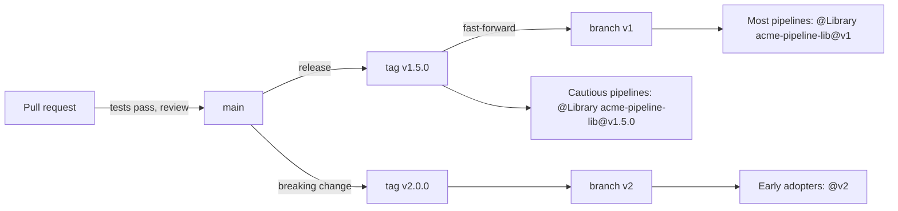
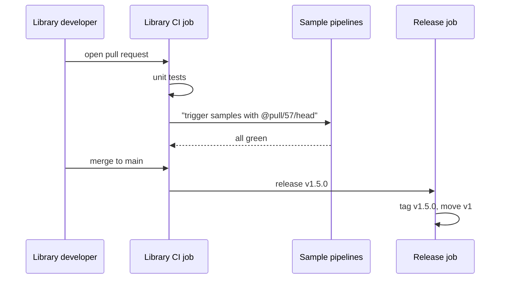

# Versioning Shared Libraries

## Introduction

A shared library is code that runs inside every pipeline that loads it. That is its strength and its danger. If 200 pipelines load `acme-pipeline-lib` from `main`, one careless commit can fail 200 builds within the hour, including the hotfix someone is trying to ship to production.

**Versioning** is how you make library changes safe. Each pipeline asks for a specific version, the library team releases changes deliberately, and teams upgrade on a schedule they control. Breaking changes become planned migrations instead of surprises.

It works like a published API. The authors of a popular package do not change behavior under their users' feet. They release `2.0.0`, document what changed, and keep `1.x` working for a while. Your library deserves the same discipline, because your users are your colleagues and their deployments.

On this page you will learn:

- what a "version" means to Jenkins (branch, tag or commit)
- how the default version and overrides work
- a practical scheme: semantic version tags plus major-version branches
- how to test a library change before it reaches anyone
- how caching interacts with versions
- how to roll out breaking changes and deprecations

## What Jenkins Treats as a Version

For Git-based libraries, the part after `@` in `@Library('name@version')` is any Git reference:

| Reference | Example | Behavior |
| --- | --- | --- |
| Branch | `@Library('acme-pipeline-lib@main') _` | Latest commit on that branch at build time; changes constantly |
| Tag | `@Library('acme-pipeline-lib@v1.4.2') _` | Fixed release; changes only if someone moves the tag |
| Commit hash | `@Library('acme-pipeline-lib@3f2c1a9') _` | Exactly one revision; fully reproducible |
| Pull request ref | `@Library('acme-pipeline-lib@pull/57/head') _` | A GitHub PR head, used for testing |

The build log records the exact commit that was loaded, whichever form you used:

```text
Loading library acme-pipeline-lib@v1
Attempting to resolve v1 from remote references...
Found match: refs/heads/v1 revision 8d41c07e2b...
```

That line is your audit trail. When a build breaks after a library change, it tells you which revision the build used.

:::note
When you **Replay** a build, Jenkins reuses the exact library revision of the original build, even if the original asked for a branch. To pick up new library commits, start a new build.
:::

## Default Version and Overrides

In the library configuration (globally under **Manage Jenkins » System**, or on a folder) you set:

- **Default version**: used when a pipeline writes `@Library('acme-pipeline-lib') _` with no version, and for implicitly loaded libraries.
- **Allow default version to be overridden**: whether pipelines may request a different version with `@version`.

```yaml
unclassified:
  globalLibraries:
    libraries:
      - name: "acme-pipeline-lib"
        defaultVersion: "v1"
        allowVersionOverride: true
        implicit: false
        retriever:
          modernSCM:
            scm:
              git:
                remote: "https://git.example.com/platform/acme-pipeline-lib.git"
                credentialsId: "git-readonly"
```

The two settings together decide how much control teams have:

| Default version | Override allowed | Effect |
| --- | --- | --- |
| `main` | yes | Teams on the edge by default; risky |
| `v1` (major branch) | yes | Safe default, teams can pin or try newer versions |
| `v1` | no | Platform team controls every pipeline's version; teams cannot test new versions |
| none | yes | Every pipeline must name a version explicitly |

For most organizations, a **major-version default with overrides allowed** is the best balance.

## A Practical Versioning Scheme

Combine three kinds of refs:

1. **`main`**: integration branch. Changes are merged here after review and tests. Production pipelines never load it.
2. **Semantic version tags** such as `v1.4.0`, `v1.4.1`, `v2.0.0`: immutable releases.
3. **Major-version branches** such as `v1` and `v2`: they always point at the latest release of that major line.



Semantic versioning rules for a library:

- **Patch** (`v1.4.1`): bug fixes, no behavior change for correct callers.
- **Minor** (`v1.5.0`): new steps, new optional parameters, new defaults that do not break callers.
- **Major** (`v2.0.0`): removed or renamed steps, removed parameters, changed defaults that callers will notice.

Pipelines that load `@v1` get fixes and features automatically but never a breaking change. Pipelines that need full reproducibility, such as regulated release pipelines, pin an exact tag.

### Releasing a Version

A release script, run by a library CI job after tests pass on `main`:

```bash
#!/usr/bin/env bash
# release.sh VERSION, e.g. ./release.sh 1.5.0
set -euo pipefail

VERSION="${1:?usage: release.sh X.Y.Z}"
MAJOR="v${VERSION%%.*}"
TAG="v${VERSION}"

git fetch origin --tags
git checkout main
git pull --ff-only origin main

if git rev-parse "${TAG}" >/dev/null 2>&1; then
  echo "Tag ${TAG} already exists" >&2
  exit 1
fi

git tag -a "${TAG}" -m "Release ${TAG}"
git push origin "${TAG}"

# Move the major branch to this release
git push origin "${TAG}^{commit}:refs/heads/${MAJOR}" --force-with-lease
echo "Released ${TAG} and updated ${MAJOR}"
```

Example output:

```text
Released v1.5.0 and updated v1
```

A few notes:

- Tags are never moved. If `v1.5.0` is broken, release `v1.5.1`.
- The major branch is updated with `--force-with-lease`, which refuses to overwrite it if someone else changed it in between. Protect the `v1` branch so only the release job can push.
- Some teams use a moving **tag** called `v1` instead of a branch. Moving tags confuse Git clients that cached the old tag, so a branch is usually simpler.

Check the script before committing it:

```bash
bash -n release.sh && echo "syntax ok"
```

Example output:

```text
syntax ok
```

### Keep a Changelog

Teams decide whether to upgrade by reading release notes. Keep a `CHANGELOG.md` in the library repository:

```text
## v1.5.0
- Added: dockerBuildPush accepts a `platforms` option for multi-arch builds.
- Changed: default Maven image updated to 3.9 with Temurin 21.
- Deprecated: buildJava (use buildMaven). Removal planned for v2.0.0.

## v1.4.1
- Fixed: notifyBuild no longer posts "Fixed" after an aborted build.
```

You can also tick **Include @Library changes in job recent changes** in the library configuration. Library commits then show up in each job's **Changes** page, which helps when someone asks "why did my build behavior change?" It can also add noise to every job's change list, so many teams enable it only on major-version defaults where commits are infrequent.

## Testing a Change Before Release

Library unit tests catch many problems (see [Testing Shared Libraries](./6-jenkins-library-testing.mdx)), but you also want to run a real pipeline against the change.

### Point a Test Job at the Branch

Create a small "canary" job that loads the library from a branch or PR:

```groovy
// Jenkinsfile of the canary job
@Library('acme-pipeline-lib@pull/57/head') _

javaService(
    imageName: 'canary-sample-app',
    slackChannel: '#platform-canary'
)
```

On GitHub, `pull/<number>/head` is a ref every PR has. GitLab and Bitbucket use different ref names, so check your provider. With a parameter you can reuse one job for any branch:

```groovy
library "acme-pipeline-lib@${params.LIB_REF}"

javaService(imageName: 'canary-sample-app', slackChannel: '#platform-canary')
```

The `library` step must be called before the steps it provides are used, and you cannot use it to override the version of a library that is already loaded implicitly.

### Run a Fleet of Sample Projects

Better still, keep a few small sample repositories (one Java, one Node.js, one Python) and trigger their pipelines with the candidate version as part of the library's own CI. If all of them pass, the release job tags the version. This catches integration problems that unit tests cannot, such as a changed plugin step signature after a Jenkins upgrade.



## Caching Fetched Versions

Without caching, Jenkins checks out the library for every build. With hundreds of builds an hour, that is real load on your Git server and adds seconds to each build.

The library configuration has an option to **cache fetched versions on the controller**, with:

- a **refresh time** in minutes
- a list of **versions to include** in the cache
- a list of **versions to exclude** from the cache (exclusion wins)

A sensible setup:

- Cache tags like `v1.5.0`. They never change, so a long refresh time is safe.
- Cache major branches like `v1` with a short refresh time, such as 15 to 30 minutes, if your Git server load justifies it.
- **Exclude** `main` and PR refs, so tests always get the latest commit.

Remember that caching means a release may take up to the refresh time to reach every pipeline. If you need to push an urgent fix, you can clear the cache from the library configuration page, or bump the patch version and ask the affected teams to pin it.

## Rolling Out Breaking Changes

Breaking changes are sometimes necessary: a step's design was wrong, or a tool was replaced. Plan them like an API migration.

### Step 1: Deprecate in a Minor Release

Keep the old behavior working and warn loudly:

```groovy
// vars/buildJava.groovy (deprecated in v1.5.0, removed in v2.0.0)
def call(Map config = [:]) {
    echo "WARNING: buildJava is deprecated and will be removed in acme-pipeline-lib v2. Use buildMaven instead."
    // Optional: mark the build UNSTABLE so the warning is noticed
    // unstable('buildJava is deprecated')
    buildMaven(config)
}
```

Example output:

```text
[Pipeline] echo
WARNING: buildJava is deprecated and will be removed in acme-pipeline-lib v2. Use buildMaven instead.
```

Marking builds `UNSTABLE` gets attention fast but annoys teams; use it close to the removal date, not on day one.

### Step 2: Find Who Still Uses It

Search your repositories for the old step:

```bash
# Run against a local mirror of all application repositories
grep -rl --include=Jenkinsfile 'buildJava' ~/mirrors/ | sort
```

Example output:

```text
/home/dev/mirrors/inventory-service/Jenkinsfile
/home/dev/mirrors/legacy-reports/Jenkinsfile
```

You can also search build logs for the deprecation warning, or have the step send a metric.

### Step 3: Release the Major Version

Release `v2.0.0`, create the `v2` branch, and keep `v1` receiving security and critical fixes for an announced period. Change the **default version** to `v2` only after most pipelines have migrated, and announce the date in advance.

## Real-World Scenario

A retail company has 120 pipelines loading `acme-pipeline-lib` implicitly from `main`. Last month a refactor of `dockerBuildPush` changed the default registry and broke 40 builds during a release freeze. Nobody could tell which library revision each build had used, and rolling back meant reverting on `main` while other changes were also in flight.

The platform team introduces:

1. Implicit loading off, explicit `@Library('acme-pipeline-lib@v1') _` in every `Jenkinsfile` (rolled out with a scripted pull request to each repository).
2. Default version `v1`, overrides allowed.
3. A release job that runs unit tests and three sample pipelines, then tags and moves `v1`.
4. Caching for tags and `v1` with a 30 minute refresh, `main` excluded.
5. Payments and other regulated services pin exact tags and upgrade monthly.

### Why this approach

Every build log now shows an explicit version. Rolling back a bad release means moving `v1` back to the previous tag, which takes seconds and does not touch `main`. Regulated teams get reproducibility; everyone else gets fixes automatically.

### When to use it and when not to

Use full versioning as soon as more than one team depends on the library. A single team with five pipelines can live with tags only, or even `main` plus good tests, but should still avoid implicit loading so the dependency is visible.

### Alternatives and trade-offs

| Strategy | Pros | Cons | Best for |
| --- | --- | --- | --- |
| Everyone on `main` | Zero release work, fixes arrive instantly | One bad commit breaks everyone, no reproducibility | A single small team |
| Major branch (`@v1`) | Automatic fixes, no breaking changes | Not fully reproducible within a major version | Most pipelines |
| Exact tag (`@v1.5.0`) | Fully reproducible, controlled upgrades | Teams fall behind, need upgrade PRs | Regulated or critical pipelines |
| Commit hash | Most precise | Unreadable, easy to forget | Debugging, emergency pins |
| Implicit loading at a default version | No `@Library` line at all | Hidden dependency, no per-repo pinning | Small, uniform setups |

## Common Mistakes

**Loading from `main` in production.** The most common cause of company-wide pipeline outages. Use a major branch or a tag.

**Moving release tags.** A tag that changes meaning destroys reproducibility and confuses caches. Release a new patch instead.

**Forgetting the cache.** A fix is released, but builds still use the old version for the cache refresh period. Exclude test refs, keep refresh times short for moving refs, and know how to clear the cache.

**Breaking changes in a minor release.** Renaming a parameter "because nobody uses it" will break someone. Deprecate first.

**No changelog.** Without release notes, teams cannot judge an upgrade and stay pinned forever.

**Unprotected release refs.** Anyone who can push to `v1` controls what runs in most pipelines. Protect major branches and tags so only the release job can update them.

## Summary

- A library version is any Git ref: branch, tag, commit, or PR ref. The build log records the exact commit used.
- Set a safe **default version** (a major branch) and allow overrides so teams can test and pin.
- Use immutable semantic version tags plus moving major-version branches.
- Test changes with canary jobs and sample pipelines using `@pull/N/head` or a branch.
- Cache immutable versions, exclude `main` and PR refs, and remember the refresh delay.
- Roll out breaking changes with deprecation warnings, usage searches, and a new major version.

## Exercises

1. Set up a library with tags `v1.0.0` and `v1.1.0` and a `v1` branch. Configure the default version as `v1` and confirm in a build log which commit was loaded.
2. Write a canary pipeline with a `LIB_REF` string parameter that loads the library dynamically, and use it to test a feature branch.
3. Deprecate a step: make it print a warning and delegate to its replacement, then write the `CHANGELOG.md` entry.
4. Enable caching with `main` excluded, release a patch, and measure how long it takes for a pipeline loading `@v1` to pick it up.

Next, catch bugs before release with [Testing Shared Libraries](./6-jenkins-library-testing.mdx). For release practices in general, see the [CI/CD tutorial](/docs/devops/cicd).
