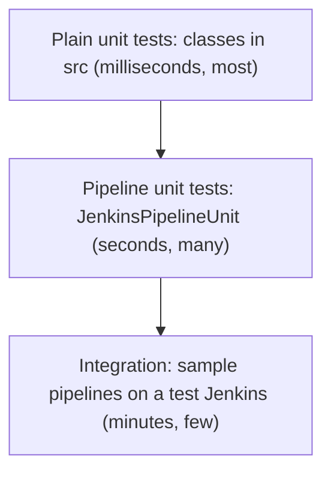

# Testing Shared Libraries

## Introduction

A shared library runs inside many pipelines. A bug in a `Jenkinsfile` breaks one project; a bug in a library breaks all of them. Yet many library teams test only by pushing a change and watching what fails. That is testing in production, with your colleagues as the test suite.

You can do much better with three layers of tests:

1. **Plain unit tests** for pure classes in `src/`. They run in milliseconds.
2. **Pipeline unit tests** with **JenkinsPipelineUnit**, which runs your `vars/` steps and pipeline templates against a fake Jenkins, so you can check which commands they would run.
3. **Integration tests** that run real pipelines on a real (test) Jenkins against the candidate library version.

This is the familiar test pyramid applied to pipeline code. Most checks live at the cheap bottom; a few expensive end-to-end runs at the top catch what the fakes cannot.



This page builds a working test setup for a small library and runs it with Gradle. All the test code below was run with JenkinsPipelineUnit 1.31 on Java 21.

## The Library Under Test

The examples use three files from earlier pages, slightly simplified.

A pure class:

```groovy
// src/com/acme/ci/SemVer.groovy
package com.acme.ci

class SemVer implements Serializable {
    private static final long serialVersionUID = 1L

    final int major
    final int minor
    final int patch

    SemVer(int major, int minor, int patch) {
        this.major = major
        this.minor = minor
        this.patch = patch
    }

    static SemVer parse(String text) {
        def m = (text =~ /^v?(\d+)\.(\d+)\.(\d+)$/)
        if (!m.matches()) {
            throw new IllegalArgumentException("Not a semantic version: '${text}'")
        }
        return new SemVer(m.group(1) as int, m.group(2) as int, m.group(3) as int)
    }

    SemVer bump(String part) {
        switch (part) {
            case 'major': return new SemVer(major + 1, 0, 0)
            case 'minor': return new SemVer(major, minor + 1, 0)
            case 'patch': return new SemVer(major, minor, patch + 1)
            default: throw new IllegalArgumentException("Unknown part '${part}'")
        }
    }

    String toString() {
        return "${major}.${minor}.${patch}"
    }
}
```

A custom step:

```groovy
// vars/buildMaven.groovy
def call(Map config = [:]) {
    def allowed = ['goals', 'jdk', 'publishTests']
    def unknown = config.keySet() - allowed
    if (unknown) {
        error "buildMaven: unknown option(s) ${unknown}"
    }
    def goals = config.goals ?: 'clean verify'
    def jdk = config.jdk ?: '21'
    def publishTests = config.containsKey('publishTests') ? config.publishTests : true

    docker.image("maven:3.9-eclipse-temurin-${jdk}").inside {
        sh "mvn -B ${goals}"
    }
    if (publishTests) {
        junit testResults: '**/target/surefire-reports/*.xml', allowEmptyResults: true
    }
}
```

And a Declarative pipeline template:

```groovy
// vars/javaService.groovy
def call(Map config = [:]) {
    pipeline {
        agent any
        stages {
            stage('Build') {
                steps {
                    buildMaven(goals: config.goals ?: 'clean verify')
                }
            }
            stage('Deploy') {
                when {
                    branch 'main'
                }
                steps {
                    sh "./deploy.sh ${config.service}"
                }
            }
        }
        post {
            failure {
                echo "Build of ${config.service} failed"
            }
        }
    }
}
```

## Setting Up the Test Project

Jenkins ignores everything except `vars/`, `src/` and `resources/`, so you can keep a build file and tests in the same repository:

```text
acme-pipeline-lib/
├── build.gradle
├── src/com/acme/ci/SemVer.groovy
├── vars/
│   ├── buildMaven.groovy
│   └── javaService.groovy
└── test/
    ├── com/acme/ci/
    │   ├── SemVerTest.groovy
    │   ├── BuildMavenTest.groovy
    │   └── JavaServiceTest.groovy
    └── resources/
        └── Jenkinsfile.sample
```

The Gradle build:

```groovy
// build.gradle
plugins {
    id 'groovy'
}

repositories {
    mavenCentral()
    maven { url = 'https://repo.jenkins-ci.org/releases/' }
}

java {
    toolchain {
        languageVersion = JavaLanguageVersion.of(21)
    }
}

dependencies {
    implementation 'org.codehaus.groovy:groovy-all:2.4.21'
    testImplementation 'com.lesfurets:jenkins-pipeline-unit:1.31'
    testImplementation 'org.junit.jupiter:junit-jupiter:5.11.4'
    testRuntimeOnly 'org.junit.platform:junit-platform-launcher'
}

sourceSets {
    main {
        groovy { srcDirs = ['src'] }
    }
    test {
        groovy { srcDirs = ['test'] }
    }
}

test {
    useJUnitPlatform()
    testLogging {
        events 'passed', 'failed'
    }
}
```

Notes on these choices:

- **JenkinsPipelineUnit** is published under the group `com.lesfurets` in the Jenkins Maven repository. Version 1.31 requires Java 21. Check the [releases page](https://github.com/jenkinsci/JenkinsPipelineUnit/releases) for the current version.
- **Groovy 2.4** matches the Groovy version that Jenkins pipelines run on, and the one JenkinsPipelineUnit itself builds against. Its README says it is not compatible with Groovy 4. Using a newer Groovy than Jenkins lets you write code that compiles in tests but fails in Jenkins.
- `src/` is compiled as main code, so class errors fail the build early. `vars/` is not compiled here; JenkinsPipelineUnit loads those scripts at test time.

If you do not have Gradle installed, you can run it in a container:

```bash
docker run --rm -u "$(id -u):$(id -g)" -e GRADLE_USER_HOME=/tmp/gradle \
  -v "$PWD":/project -w /project gradle:8.14-jdk21 gradle test --no-daemon
```

## Layer 1: Plain Unit Tests for Classes

Pure classes need nothing from Jenkins. Write ordinary JUnit 5 tests:

```groovy
// test/com/acme/ci/SemVerTest.groovy
package com.acme.ci

import org.junit.jupiter.api.Test

import static org.junit.jupiter.api.Assertions.assertEquals
import static org.junit.jupiter.api.Assertions.assertThrows

class SemVerTest {

    @Test
    void parsesWithAndWithoutPrefix() {
        assertEquals('1.4.2', SemVer.parse('1.4.2').toString())
        assertEquals('1.4.2', SemVer.parse('v1.4.2').toString())
    }

    @Test
    void bumpsEachPart() {
        def v = SemVer.parse('1.4.2')
        assertEquals('2.0.0', v.bump('major').toString())
        assertEquals('1.5.0', v.bump('minor').toString())
        assertEquals('1.4.3', v.bump('patch').toString())
    }

    @Test
    void rejectsGarbage() {
        assertThrows(IllegalArgumentException) { SemVer.parse('1.4') }
        assertThrows(IllegalArgumentException) { SemVer.parse('latest') }
    }
}
```

This is why the [Classes in src](./3-jenkins-library-classes.mdx) page pushes logic into pure classes: these tests are fast, need no mocks, and cover the trickiest code.

## Layer 2: Testing vars Steps with JenkinsPipelineUnit

JenkinsPipelineUnit (JPU) loads a pipeline script, intercepts every method it calls, and records them in a **call stack**. Steps such as `sh` and `echo` are already registered as no-ops. You register fakes for anything else your code uses, then make assertions on the call stack.

```groovy
// test/com/acme/ci/BuildMavenTest.groovy
package com.acme.ci

import com.lesfurets.jenkins.unit.BasePipelineTest
import org.junit.jupiter.api.BeforeEach
import org.junit.jupiter.api.Test

import static org.junit.jupiter.api.Assertions.assertEquals
import static org.junit.jupiter.api.Assertions.assertThrows
import static org.junit.jupiter.api.Assertions.assertTrue

class BuildMavenTest extends BasePipelineTest {

    def step

    @Override
    @BeforeEach
    void setUp() throws Exception {
        super.setUp()
        // Fake the Docker Pipeline global: docker.image(name).inside { ... }
        def fakeImage = [inside: { Closure body -> body() }]
        binding.setVariable('docker', [image: { String name -> fakeImage }])
        helper.registerAllowedMethod('junit', [Map], null)
        helper.registerAllowedMethod('error', [String]) { String msg ->
            throw new RuntimeException(msg)
        }
        step = loadScript('vars/buildMaven.groovy')
    }

    private List<String> shellCommands() {
        helper.callStack.findAll { it.methodName == 'sh' }
                        .collect { it.args[0].toString() }
    }

    @Test
    void usesDefaults() {
        step.call()
        printCallStack()
        assertEquals(['mvn -B clean verify'], shellCommands())
        assertTrue(helper.callStack.any { it.methodName == 'junit' })
    }

    @Test
    void honoursOptions() {
        step.call(goals: 'package', publishTests: false)
        assertEquals(['mvn -B package'], shellCommands())
        assertTrue(helper.callStack.every { it.methodName != 'junit' })
    }

    @Test
    void rejectsUnknownOptions() {
        def e = assertThrows(RuntimeException) { step.call(jkd: '17') }
        assertTrue(e.message.contains('unknown option(s) [jkd]'))
    }
}
```

What each piece does:

- `BasePipelineTest` provides `helper`, `binding`, `loadScript` and the assertion helpers. With JUnit 5, override `setUp`, annotate it with `@BeforeEach`, and call `super.setUp()` first.
- `binding.setVariable('docker', ...)` replaces the `docker` global from the Docker Pipeline plugin with a tiny fake that just runs the closure.
- `helper.registerAllowedMethod(name, argTypes, implementation)` registers a step. Passing `null` makes it a no-op that is still recorded. Passing a closure lets you return values or throw, as the fake `error` does.
- `loadScript('vars/buildMaven.groovy')` loads the step script; `step.call(...)` runs it exactly as a pipeline would.
- `helper.callStack` is the list of recorded calls, and `printCallStack()` prints them.

`printCallStack()` output for `usesDefaults`:

```text
   buildMaven.call()
      buildMaven.sh(mvn -B clean verify)
      buildMaven.junit({testResults=**/target/surefire-reports/*.xml, allowEmptyResults=true})
```

The call stack is the real value of JPU. It shows exactly which commands your step would send to the agent, so you can assert on them without an agent, Docker or Maven.

### Faking Return Values

Steps such as `sh` with `returnStdout` return data that your code depends on. Register a fake that returns something realistic:

```groovy
helper.registerAllowedMethod('sh', [Map]) { Map args ->
    if (args.script == 'git rev-parse --short HEAD') {
        return '9b1e4c2\n'
    }
    return ''
}
```

You can also set environment variables and parameters with `addEnvVar('BRANCH_NAME', 'main')` and `addParam('DEPLOY', true)`. The `params` map itself is read-only in JPU, just as in Jenkins.

## Layer 2b: Testing a Declarative Template

For pipeline templates, extend `DeclarativePipelineTest`, which understands `pipeline`, `stages`, `when`, `post` and the other Declarative sections. Register the library from the project directory itself with `projectSource()`:

```groovy
// test/com/acme/ci/JavaServiceTest.groovy
package com.acme.ci

import com.lesfurets.jenkins.unit.declarative.DeclarativePipelineTest
import org.junit.jupiter.api.BeforeEach
import org.junit.jupiter.api.Test

import static com.lesfurets.jenkins.unit.global.lib.LibraryConfiguration.library
import static com.lesfurets.jenkins.unit.global.lib.ProjectSource.projectSource
import static org.junit.jupiter.api.Assertions.assertFalse
import static org.junit.jupiter.api.Assertions.assertTrue

class JavaServiceTest extends DeclarativePipelineTest {

    @Override
    @BeforeEach
    void setUp() throws Exception {
        super.setUp()
        def lib = library()
            .name('acme-pipeline-lib')
            .retriever(projectSource())
            .defaultVersion('<notNeeded>')
            .allowOverride(true)
            .implicit(true)
            .targetPath('<notNeeded>')
            .build()
        helper.registerSharedLibrary(lib)

        def fakeImage = [inside: { Closure body -> body() }]
        binding.setVariable('docker', [image: { String name -> fakeImage }])
        helper.registerAllowedMethod('junit', [Map], null)
    }

    private boolean deployed() {
        helper.callStack.any { it.methodName == 'sh' && it.args[0].toString().startsWith('./deploy.sh') }
    }

    @Test
    void deploysOnMain() {
        addEnvVar('BRANCH_NAME', 'main')
        runScript('test/resources/Jenkinsfile.sample')
        printCallStack()
        assertJobStatusSuccess()
        assertTrue(deployed())
    }

    @Test
    void skipsDeployOnFeatureBranch() {
        addEnvVar('BRANCH_NAME', 'feature/login')
        runScript('test/resources/Jenkinsfile.sample')
        assertJobStatusSuccess()
        assertFalse(deployed())
    }
}
```

The sample `Jenkinsfile` is what a team would write:

```groovy
// test/resources/Jenkinsfile.sample
javaService(service: 'billing-api')
```

Because the library is registered as `implicit(true)`, the sample does not need an `@Library` line. `projectSource()` loads `vars/` and `src/` from the project root, so tests always use the working copy.

Output of `deploysOnMain`:

```text
Loading shared library acme-pipeline-lib with version <notNeeded>
Executing on agent [label:any]

   Jenkinsfile.run()
      Jenkinsfile.javaService({service=billing-api})
         javaService.pipeline(groovy.lang.Closure)
            javaService.echo(Executing on agent [label:any])
            javaService.stage(Build, groovy.lang.Closure)
               javaService.buildMaven({goals=clean verify})
                  buildMaven.sh(mvn -B clean verify)
                  buildMaven.junit({testResults=**/target/surefire-reports/*.xml, allowEmptyResults=true})
            javaService.stage(Deploy, groovy.lang.Closure)
               javaService.sh(./deploy.sh billing-api)
```

For the feature branch, JPU prints `Skipping stage Deploy`, and the assertion confirms `deploy.sh` never ran. Running the whole suite:

```text
SemVerTest > parsesWithAndWithoutPrefix() PASSED
SemVerTest > bumpsEachPart() PASSED
SemVerTest > rejectsGarbage() PASSED
BuildMavenTest > usesDefaults() PASSED
BuildMavenTest > honoursOptions() PASSED
BuildMavenTest > rejectsUnknownOptions() PASSED
JavaServiceTest > deploysOnMain() PASSED
JavaServiceTest > skipsDeployOnFeatureBranch() PASSED

BUILD SUCCESSFUL
```

### What JPU Does Not Test

JPU is fast because it fakes Jenkins. Know its blind spots:

- It does not run the real CPS engine by default, so CPS-specific problems (such as steps inside `@NonCPS` methods) may pass in tests. JPU has CPS-aware base classes; see its README if you need them.
- It does not apply the Groovy sandbox, so script approval problems in untrusted libraries do not show up.
- Plugin steps are fakes you wrote. If a plugin changes a parameter name, your tests still pass.
- It does not check that serialization works across restarts.

Those gaps are why you still need a few real runs.

## Layer 3: Integration Tests on a Real Jenkins

Run a handful of sample pipelines on a test controller against the candidate library version. A common setup:

1. A disposable Jenkins started from `jenkins/jenkins:lts-jdk21` with the same plugin list as production (see [Managing Plugins as Code](../7-jenkins-plugins/3-jenkins-plugin-installation-manager.mdx)) and the library configured through [JCasC](../12-jenkins-administration/0-jenkins-configuration-as-code.mdx).
2. Two or three small sample repositories, one per supported language.
3. A canary job that loads the library at the version under test, for example `@Library('acme-pipeline-lib@pull/57/head') _` on GitHub, as described in [Versioning Shared Libraries](./5-jenkins-library-versioning.mdx).

For plugin-level fidelity, the Jenkins test harness (`JenkinsRule`, used for plugin development) can start a real Jenkins inside a JUnit test. It is much heavier and slower, so most library teams reserve it for unusual needs.

## The Library's Own Pipeline

Tie it together with a `Jenkinsfile` in the library repository:

```groovy
// Jenkinsfile of acme-pipeline-lib
pipeline {
    agent {
        docker { image 'gradle:8.14-jdk21' }
    }
    options {
        timeout(time: 20, unit: 'MINUTES')
    }
    stages {
        stage('Unit tests') {
            steps {
                sh 'gradle test --no-daemon'
            }
            post {
                always {
                    junit 'build/test-results/test/*.xml'
                }
            }
        }
        stage('Lint scripts') {
            steps {
                sh 'find resources -name "*.sh" -print0 | xargs -0 -r bash -n'
            }
        }
        stage('Canary pipelines') {
            when { changeRequest() }
            steps {
                build job: 'platform/library-canary',
                      parameters: [string(name: 'LIB_REF', value: "pull/${env.CHANGE_ID}/head")]
            }
        }
    }
}
```

The `docker` agent uses the Docker Pipeline plugin; on Kubernetes, use a pod template instead. The `build` step triggers the canary job and waits for it, so the library PR fails if a real pipeline fails.

## Real-World Scenario

A healthcare software company's library has 25 steps and no tests. Last quarter, three releases broke production pipelines: a renamed option, a typo in a rarely used `post` branch, and a missing `Serializable` that only failed during long deploys. The platform team now spends more time firefighting than building.

They introduce the pyramid over two sprints:

1. Move version, naming and policy logic into pure classes and cover them with JUnit (about 60 tests, under a second).
2. Add JPU tests for every `vars` step and for both pipeline templates, focusing on the commands sent to `sh` and on which stages run for main, feature and PR branches.
3. Add a canary job with three sample services, run on every library PR.
4. Require all three layers to pass before the release job tags a version.

### Why this approach

Each failure from last quarter maps to a layer: the renamed option and the typo are caught by JPU tests, and the serialization bug by the canary pipelines on a real Jenkins. Fast layers give quick feedback; the slow layer is small enough to run on every PR.

### When to use it and when not to

Any library used by more than one team deserves at least the first two layers. A personal library with three steps can live with a canary job only. Do not chase 100 percent coverage of thin glue code; test logic and branching behavior.

### Alternatives and trade-offs

| Approach | Pros | Cons | Best for |
| --- | --- | --- | --- |
| Plain JUnit on `src/` classes | Fastest, no fakes | Only covers pure logic | Calculations, validation, policies |
| JenkinsPipelineUnit | Tests `vars` and templates in seconds, call stack assertions | Fake Jenkins, no sandbox or real plugins | Step behavior and stage selection |
| Canary pipelines on a test Jenkins | Real plugins, real CPS, real agents | Slow, needs infrastructure | Integration and upgrade checks |
| Jenkins test harness (`JenkinsRule`) | Real Jenkins inside a unit test | Heavy setup, slow | Teams with plugin-development experience |
| Replay on production Jenkins | No setup | Manual, risky, not repeatable, trusted libraries cannot be replayed | Quick experiments only |

## Common Mistakes

**Testing only by pushing to `main`.** Every bug reaches every team. Add at least JPU tests and a canary job.

**Using a modern Groovy version in tests.** Code using newer syntax passes tests and fails in Jenkins. Match Jenkins' Groovy 2.4.

**Over-mocking.** If a test fakes every step and asserts that the fakes were called, it proves little. Assert on meaningful outputs: commands, stage selection, error messages.

**Forgetting `super.setUp()`.** Without it, JPU's helper is not initialized and every test fails with confusing errors.

**No test for failure paths.** Test that bad options produce clear `error` messages and that `post { failure { ... } }` logic runs when a stage fails.

**Treating tests as optional for resources.** Lint shell scripts and parse YAML or JSON resources in the library pipeline.

## Summary

- Test libraries in three layers: plain unit tests for classes, JenkinsPipelineUnit for steps and templates, and canary pipelines on a real Jenkins.
- JenkinsPipelineUnit (`com.lesfurets:jenkins-pipeline-unit`, 1.31 at the time of writing, Java 21) records every step call so you can assert on commands and stage selection.
- Use `BasePipelineTest` for `vars` steps and `DeclarativePipelineTest` with `projectSource()` for pipeline templates.
- Fake plugin globals and steps with `binding.setVariable` and `helper.registerAllowedMethod`.
- Know JPU's blind spots (sandbox, real CPS, plugin changes) and cover them with real runs.
- Run all layers in the library's own pipeline before any release.

## Exercises

1. Recreate the project on this page, run `gradle test`, and then break `buildMaven` (for example, change the default goals). Watch which test fails and read its message.
2. Add a JPU test for a `notifyBuild` step that checks it sends a "Fixed" message only when the previous build failed. Hint: set `binding.getVariable('currentBuild').previousBuild = [result: 'FAILURE']`.
3. Add a test for `javaService` that makes the `Build` stage fail (fake `sh` to set `currentBuild.result = 'FAILURE'` and throw) and asserts that `assertJobStatusFailure()` passes and the failure message was echoed.
4. Write the canary job `platform/library-canary` with a `LIB_REF` parameter and wire it into the library pipeline.

Next, use your tested library to standardize pipelines across an organization in [Pipeline Templates for Many Teams](./7-jenkins-pipeline-templates.mdx). For general testing strategy, see the [CI/CD tutorial](/docs/devops/cicd).
