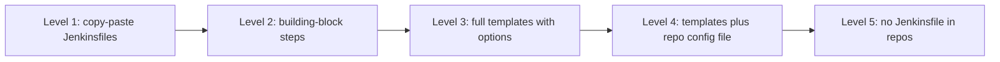

# Pipeline Templates for Many Teams

## Introduction

Once a company has dozens of teams on Jenkins, a new question appears: how much of each pipeline should be **standard**? Security wants every image scanned. Operations wants every deploy to go through the same approval and rollback logic. Teams want to ship without learning Groovy, but some of them have needs nobody else has.

A **pipeline template** is a shared library step that defines an entire pipeline. A team's `Jenkinsfile` shrinks to a handful of settings:

```groovy
@Library('acme-pipeline-lib@v2') _

javaService(
    service: 'billing-api',
    deployTo: ['dev', 'staging', 'prod']
)
```

It is like a franchise kitchen. Every restaurant follows the same recipes and safety rules, which is what makes the brand trustworthy. Each location can still adjust the menu within limits. Too few rules and quality varies; too many and good local cooks leave.

This page covers:

- the spectrum from building blocks to fully managed pipelines
- defining a whole Declarative pipeline in `vars/`
- reading per-repository settings from a config file
- extension points so teams are not trapped
- enforcing required stages and handling governance
- how this compares to the Templating Engine plugin and other approaches

It builds on everything earlier in this section, especially [Custom Steps with vars](./2-jenkins-global-vars.mdx), [Versioning](./5-jenkins-library-versioning.mdx) and [Testing](./6-jenkins-library-testing.mdx).

## The Standardization Spectrum



| Level | Team writes | Platform controls | Flexibility |
| --- | --- | --- | --- |
| 1. Copy-paste | Everything | Nothing | Total, with drift |
| 2. Building blocks | Stage structure, calls steps like `buildMaven` | Step internals | High |
| 3. Full templates | A few options in `Jenkinsfile` | Stage structure and steps | Medium |
| 4. Template plus config file | A YAML file, `Jenkinsfile` is one line | Everything in the pipeline | Medium, data only |
| 5. No `Jenkinsfile` | Nothing, or a config file | Everything, including which pipeline runs | Low |

Most organizations do best with **levels 2 and 3 side by side**: templates for the common case, building blocks for teams that need something different. Pushing everyone to level 5 usually creates a queue of special-case requests to the platform team.

## Defining a Whole Pipeline in vars

A `vars` step can contain a complete Declarative `pipeline` block. The Jenkins documentation sets a few rules:

- Only an **entire** `pipeline` block can be defined this way, inside the step's `call` method. You cannot share a single `stage` as Declarative syntax.
- Only one Declarative pipeline can run per build. Calling a second template from the same `Jenkinsfile` fails the build.
- The `Jenkinsfile` then contains only the `@Library` line and the call.

A first template:

```groovy
// vars/javaService.groovy
import com.acme.ci.PipelineConfig

def call(Map raw = [:]) {
    PipelineConfig cfg
    try {
        cfg = PipelineConfig.from(raw)
    } catch (IllegalArgumentException e) {
        error "javaService: ${e.message}"
    }
    def podYaml = libraryResource 'com/acme/ci/k8s/pod-maven.yaml'

    pipeline {
        agent {
            kubernetes {
                yaml podYaml
                defaultContainer 'maven'
            }
        }
        options {
            timeout(time: 45, unit: 'MINUTES')
            buildDiscarder(logRotator(numToKeepStr: '30'))
            disableConcurrentBuilds(abortPrevious: true)
        }
        stages {
            stage('Build and test') {
                steps {
                    buildMaven(goals: 'clean verify', jdk: cfg.jdk)
                }
            }
            stage('Image') {
                when { branch 'main' }
                steps {
                    script {
                        env.IMAGE = dockerBuildPush(service: cfg.service)
                    }
                }
            }
            stage('Security scan') {
                when { branch 'main' }
                steps {
                    imageScan(image: env.IMAGE, failOn: 'CRITICAL')
                }
            }
            stage('Deploy dev') {
                when { allOf { branch 'main'; expression { cfg.deploysTo('dev') } } }
                steps {
                    deployService(service: cfg.service, environment: 'dev', imageTag: env.IMAGE.tokenize(':').last())
                }
            }
            stage('Deploy prod') {
                when { allOf { branch 'main'; expression { cfg.deploysTo('prod') } } }
                steps {
                    input message: "Deploy ${cfg.service} to prod?", submitter: 'release-managers'
                    deployService(service: cfg.service, environment: 'prod', imageTag: env.IMAGE.tokenize(':').last())
                }
            }
        }
        post {
            always {
                notifyBuild(channel: cfg.slackChannel)
            }
        }
    }
}
```

This assumes a `PipelineConfig` class like the one in [Classes in src](./3-jenkins-library-classes.mdx), extended with `jdk` and `slackChannel` fields, and the building-block steps from earlier pages. `imageScan` stands for whatever scanner step your organization uses.

Notice that the template is itself made of building blocks. Teams that outgrow the template can write their own `Jenkinsfile` with the same steps and keep most of the standard behavior. For production approvals, prefer putting `input` outside an agent so a waiting build does not hold a pod; see [Manual Input and Approvals](../4-jenkins-pipeline-advanced/2-jenkins-input-and-approvals.mdx).

### How Values Flow into Declarative

Inside the `pipeline` block, Groovy variables from the enclosing `call` method (like `cfg`) are visible in `steps`, `script`, and `expression` blocks, as in the example. Two practical rules:

- Use `expression { ... }` in `when` for conditions that depend on template options.
- Put values that later stages need into `env` (as with `env.IMAGE`), since `env` values are strings and survive restarts cleanly.

## Reading a Config File from the Repository

At level 4, the `Jenkinsfile` is one line and teams describe their service in a YAML file. Data files are easier to review and validate than Groovy, and teams cannot accidentally write pipeline code.

```yaml
# .ci.yaml in the application repository
service: billing-api
language: java
jdk: "21"
deployTo: [dev, staging, prod]
slackChannel: "#billing"
```

```groovy
// Jenkinsfile
@Library('acme-pipeline-lib@v2') _
standardPipeline()
```

The template must check out the repository before it can read the file, so it does that in a short node block before the `pipeline` starts:

```groovy
// vars/standardPipeline.groovy
def call() {
    Map raw
    node {
        checkout scm
        if (!fileExists('.ci.yaml')) {
            error 'standardPipeline: .ci.yaml not found in the repository root'
        }
        raw = readYaml(file: '.ci.yaml')
    }

    switch (raw.language) {
        case 'java':
            javaService(raw.findAll { it.key != 'language' })
            break
        case 'node':
            nodeService(raw.findAll { it.key != 'language' })
            break
        default:
            error "standardPipeline: unsupported language '${raw.language}'"
    }
}
```

Example output for a repository with the file above:

```text
[Pipeline] node
[Pipeline] checkout
[Pipeline] fileExists
[Pipeline] readYaml
[Pipeline] }
[Pipeline] // node
[Pipeline] stage
[Pipeline] { (Build and test)
...
```

`readYaml` comes from the Pipeline Utility Steps plugin (`pipeline-utility-steps`). The extra checkout costs a few seconds. You can publish a JSON Schema for `.ci.yaml` so editors validate it as developers type.

## Escape Hatches

A template without escape hatches becomes a bottleneck: every unusual need turns into a ticket for the platform team. Plan extension points from the start.

### Optional Hook Closures

Let teams pass closures that run at defined points:

```groovy
// Jenkinsfile of a team that needs a database migration check
@Library('acme-pipeline-lib@v2') _

javaService(
    service: 'orders-api',
    deployTo: ['dev', 'staging'],
    afterTests: {
        sh './scripts/check-migrations.sh'
    }
)
```

```groovy
// in vars/javaService.groovy, inside the 'Build and test' stage
steps {
    buildMaven(goals: 'clean verify', jdk: cfg.jdk)
    script {
        if (raw.afterTests) {
            raw.afterTests.call()
        }
    }
}
```

Keep the number of hooks small and well named (`beforeBuild`, `afterTests`, `beforeDeploy`). The hook names are part of your library's API, so they follow the same versioning rules as step options. If you validate unknown option keys, remember to allow the hook names.

### Opting Out of the Template

Teams with very different needs should drop to level 2 and write their own `Jenkinsfile` with building blocks. Make that path official, documented, and still covered by required steps (next section). If leaving the template feels like breaking the rules, teams will hide workarounds in hooks instead.

## Governance: Required Steps

Some steps are not optional: security scans, signing, audit notifications. Templates enforce them for teams that use the template. For teams with custom `Jenkinsfile`s, you have a few options:

| Mechanism | How it works | Strength | Weakness |
| --- | --- | --- | --- |
| Put the rule in a building block | `deployService` refuses to deploy an image without a scan record | Hard to bypass when using the library | Teams can call `kubectl` directly |
| Enforce outside Jenkins | Registry or cluster admission policy rejects unscanned or unsigned images | Works for every CI system | Needs platform tooling outside Jenkins |
| Implicitly loaded library with `post` checks | Library code is always on the classpath | Easy to add | Implicit steps do not run unless called |
| Restrict deploy credentials | Only the template's deploy step can use prod credentials, via folder-scoped credentials | Strong in combination | More admin work |

The most robust rules are enforced at the **destination** (registry, cluster, cloud account) rather than in pipeline code, because pipeline code can always be changed by someone with write access to a `Jenkinsfile`. Use the library to make the right thing easy, and use the platform to make the wrong thing impossible. See [Deployment Pipelines](../10-jenkins-deployment/index.mdx) and [Authorization and Role-Based Access](../11-jenkins-security/2-jenkins-authorization.mdx) for the deploy side.

## Rolling Templates Out to Many Repositories

Templates are only useful once repositories use them. A practical rollout:

1. **Start with volunteers.** Migrate three friendly teams and fix what hurts them.
2. **Automate the migration pull requests.** A script that replaces a known `Jenkinsfile` pattern with the template call and opens a PR per repository saves weeks.
3. **Use organization folders** so new repositories are picked up automatically; see [Organization Folders](../5-jenkins-scm-integration/5-jenkins-organization-folders.mdx).
4. **Pin a major version** (`@v2`) and upgrade with announced dates, as in [Versioning Shared Libraries](./5-jenkins-library-versioning.mdx).
5. **Measure adoption** by searching repositories for `@Library('acme-pipeline-lib` and the template names.

```bash
# Count template usage across a local mirror of all repositories
grep -rhoE --include=Jenkinsfile '^(javaService|nodeService|standardPipeline)\(' ~/mirrors/ | sort | uniq -c
```

Example output:

```text
     41 javaService(
     12 nodeService(
     23 standardPipeline(
```

## Supporting Templates as a Product

A template used by 30 teams is a product, and its users are your colleagues. Treat it that way:

- **Documentation.** Every template gets a `.txt` help file (shown on the Global Variable Reference page) and a section in the library README with all options, defaults, and hooks. Include a complete example `Jenkinsfile` and `.ci.yaml`.
- **Clear error messages.** Validation errors should name the option, the allowed values, and a link to the docs. A developer who sees `javaService: deployTo contains unknown environment 'production', allowed: [dev, staging, prod]` fixes it in seconds.
- **A support channel and an owner.** Publish who owns the library and where to ask questions. Rotate a "library on-call" if many teams depend on it.
- **Tests for every supported path.** For each template, test main, feature branch and pull request builds with JenkinsPipelineUnit, as shown in [Testing Shared Libraries](./6-jenkins-library-testing.mdx), so a change to one stage cannot silently skip another.
- **A deprecation policy.** State how long old major versions get fixes, for example six months after the next major release.

A small example of a template help file:

```text
<p><b>javaService</b>: standard pipeline for Java services.</p>
<ul>
  <li><b>service</b> (required): service and image name</li>
  <li><b>jdk</b>: 17 or 21. Default: 21</li>
  <li><b>deployTo</b>: list of dev, staging, prod. Default: [dev]</li>
  <li><b>afterTests</b>: optional closure run after unit tests</li>
</ul>
```

## Real-World Scenario

A bank's digital division has 30 teams and about 250 repositories. Audit findings require that every production deploy has a security scan, a signed image and a recorded approval. Today, teams copy pipelines from each other, and nobody can prove that all of them follow the rules.

The platform team's plan:

- **Templates** `javaService`, `nodeService` and `pythonService` for standard services, driven by `.ci.yaml` through `standardPipeline`. About 80 percent of repositories fit.
- **Building blocks** (`buildMaven`, `dockerBuildPush`, `imageScan`, `signImage`, `deployService`) for the remaining 20 percent, documented and versioned with the templates.
- **Hooks** `beforeBuild`, `afterTests` and `beforeDeploy` for small customizations.
- **Platform enforcement:** the production cluster's admission policy rejects unsigned images; production credentials are scoped to a folder whose jobs can only be created from the template.
- **Testing:** every template is covered by JenkinsPipelineUnit tests and canary pipelines; releases follow semantic versioning with a `v2` major branch.

### Why this approach

Audit gets proof from the platform (signed images, admission logs), not from trusting pipeline code. Most teams write a ten-line YAML file and get a compliant pipeline. Unusual teams are not blocked, because the building blocks carry the same rules.

### When to use it and when not to

Use full templates when many teams build similar services and a central team can support them. Avoid them when services are genuinely diverse (games, firmware, data pipelines and web apps in one organization), when nobody owns the library full time, or when only a few teams exist. A template no one maintains becomes the worst kind of legacy code: everyone depends on it and no one dares change it.

### Alternatives and trade-offs

| Approach | Pros | Cons | Best for |
| --- | --- | --- | --- |
| Shared library templates in `vars/` | Flexible, testable, standard Jenkins feature | Groovy and CPS knowledge needed by the platform team | Most organizations on Jenkins |
| Templating Engine plugin (`templating-engine`) | Repos need no `Jenkinsfile`, templates and step libraries separated cleanly | Small user base, plugin listed as up for adoption with no recent releases | Teams already invested in it |
| Pipeline: Multibranch with defaults plugin | One default `Jenkinsfile` for all branches | Last released years ago; check status before adopting | Rarely a good choice today |
| Job DSL or JCasC seed jobs generating pipelines | Jobs themselves are code, consistent setup | Generates jobs, not pipeline logic; still needs a library | Creating and configuring many jobs ([Job DSL](../12-jenkins-administration/1-jenkins-job-dsl.mdx)) |
| Reusable workflows in another CI (GitHub Actions, GitLab CI includes) | Native in those platforms, no controller to run | Requires migrating off Jenkins | Organizations open to changing CI ([Migrating](../13-jenkins-best-practices/3-jenkins-migrating-to-other-ci.mdx)) |

## Common Mistakes

**One template with a hundred options.** A template that tries to fit everyone becomes harder to use than writing a pipeline. Split by service type and keep options few.

**No escape hatch.** Teams either wait on the platform team or copy the template and modify it, which brings back drift. Offer hooks and official building blocks.

**Calling two templates in one `Jenkinsfile`.** Only one Declarative pipeline can run per build. Combine behavior with options instead.

**Enforcing compliance only in Groovy.** Anyone who can edit a `Jenkinsfile` can skip a library step. Enforce critical rules where artifacts land.

**Breaking changes without a major version.** A changed default in a template affects every repository at once. Version, deprecate and announce.

**Heavy logic before the `pipeline` block.** Code in `call` before `pipeline` runs outside any stage. Keep it to reading config and validation, or the build log becomes hard to follow.

## Summary

- Pipeline templates are `vars` steps that define a whole Declarative pipeline; a team's `Jenkinsfile` passes options.
- Only one Declarative pipeline can run per build, and only whole `pipeline` blocks can be shared this way.
- Repository config files (such as `.ci.yaml` read with `readYaml`) let teams describe services as data.
- Build templates from building-block steps and offer a few named hooks, so teams are never trapped.
- Enforce critical policies at the destination (registry, cluster, credentials), not only in Groovy.
- Roll out with volunteers, automated PRs, organization folders and pinned major versions.

## Exercises

1. Write a `nodeService` template with stages for install, test, image and deploy, driven by a `PipelineConfig` object, and a JenkinsPipelineUnit test that checks deploys only happen on `main`.
2. Implement `standardPipeline` with `.ci.yaml` support for two languages and a clear error for unsupported ones. Test it with a sample repository.
3. Add `beforeDeploy` and `afterTests` hooks to your template, and update the option validation so unknown keys are still rejected.
4. Design governance for your organization: list which rules belong in the template, which in building blocks, and which must be enforced outside Jenkins.

For a full worked example, see [Project: Company-Wide Shared Library](../14-jenkins-projects/4-jenkins-project-shared-library.mdx). For broader guidance, see [Pipeline Best Practices](../13-jenkins-best-practices/0-jenkins-pipeline-best-practices.mdx).
