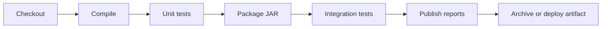

# Building Java Projects with Maven and Gradle

## Introduction

Java is where Jenkins grew up. Jenkins itself is written in Java, and for years the most common Jenkins job was "check out a Maven project and run `mvn install`". That history is useful: Java builds are well supported, and almost every plugin you need (test reports, coverage, static analysis) understands Maven and Gradle output out of the box.

It also means there are several ways to do the same thing, and some of them are outdated. You can:

- run the build inside a **Docker image** that already contains the JDK and Maven or Gradle,
- use Jenkins **tool installations** (`tools { maven '...' jdk '...' }`) that Jenkins downloads onto the agent,
- wrap the build in **`withMaven`** from the Pipeline Maven Integration plugin, which adds automatic reporting,
- or simply call the **wrapper scripts** (`./mvnw`, `./gradlew`) that live in the repository.

This page shows each approach, explains what it is good for, and builds up to a realistic Jenkinsfile for a Spring Boot style service. Think of the build tool as the kitchen recipe and Jenkins as the restaurant manager: Jenkins decides *when* and *where* to cook, but Maven or Gradle decides *how*. A good Jenkinsfile stays thin and lets the build tool do the real work.

If the pipeline syntax is new to you, read [Declarative Pipeline Syntax](../3-jenkins-pipeline-basics/2-jenkins-declarative-pipeline.mdx) and [Docker Agents](../6-jenkins-agents/3-jenkins-docker-agents.mdx) first.

## The Shape of a Java Build Pipeline

Most Java pipelines follow the same flow, regardless of build tool:



Maven's lifecycle already chains these steps: `mvn verify` compiles, runs unit tests (Surefire), packages, and runs integration tests (Failsafe). Gradle's `build` task does the same for its world. So in Jenkins you mostly decide how to **split** these phases into stages for visibility, and how to **collect** the results.

## A Sample Project

The examples use a tiny Maven project. Here is the `pom.xml` you can drop into an empty repository:

```xml
<project xmlns="http://maven.apache.org/POM/4.0.0"
         xmlns:xsi="http://www.w3.org/2001/XMLSchema-instance"
         xsi:schemaLocation="http://maven.apache.org/POM/4.0.0 https://maven.apache.org/xsd/maven-4.0.0.xsd">
  <modelVersion>4.0.0</modelVersion>
  <groupId>com.example</groupId>
  <artifactId>greeter</artifactId>
  <version>1.0.0-SNAPSHOT</version>

  <properties>
    <maven.compiler.release>21</maven.compiler.release>
    <project.build.sourceEncoding>UTF-8</project.build.sourceEncoding>
  </properties>

  <dependencies>
    <dependency>
      <groupId>org.junit.jupiter</groupId>
      <artifactId>junit-jupiter</artifactId>
      <version>5.11.4</version>
      <scope>test</scope>
    </dependency>
  </dependencies>

  <build>
    <plugins>
      <plugin>
        <groupId>org.apache.maven.plugins</groupId>
        <artifactId>maven-surefire-plugin</artifactId>
        <version>3.5.2</version>
      </plugin>
    </plugins>
  </build>
</project>
```

And one class with a test:

```java
// src/main/java/com/example/Greeter.java
package com.example;

public class Greeter {
    public String greet(String name) {
        return "Hello, " + name + "!";
    }
}
```

```java
// src/test/java/com/example/GreeterTest.java
package com.example;

import static org.junit.jupiter.api.Assertions.assertEquals;
import org.junit.jupiter.api.Test;

class GreeterTest {
    @Test
    void greetsByName() {
        assertEquals("Hello, Ada!", new Greeter().greet("Ada"));
    }
}
```

:::note
Library versions in these examples are illustrative. Check Maven Central for the current JUnit and Surefire releases before you copy them.
:::

## Approach 1: Build Inside a Docker Image

The simplest and most portable approach is to run the whole build in an official image that already has the JDK and Maven. The agent only needs Docker and the Docker Pipeline plugin (`docker-workflow`).

```groovy
pipeline {
    agent {
        docker {
            image 'maven:3.9-eclipse-temurin-21'
            args '-v maven-repo:/root/.m2'
        }
    }

    options {
        timeout(time: 20, unit: 'MINUTES')
        buildDiscarder(logRotator(numToKeepStr: '20'))
    }

    stages {
        stage('Build and Test') {
            steps {
                sh 'mvn -B -ntp verify'
            }
        }
    }

    post {
        always {
            junit 'target/surefire-reports/*.xml'
        }
        success {
            archiveArtifacts artifacts: 'target/*.jar', fingerprint: true
        }
    }
}
```

What each piece does:

- `maven:3.9-eclipse-temurin-21` pins Maven 3.9 and the Eclipse Temurin JDK 21. Every build gets the same toolchain, whatever agent it lands on.
- `-v maven-repo:/root/.m2` mounts a named Docker volume as the local Maven repository, so dependencies are not downloaded on every build. See [Build Caching and Speed](./8-jenkins-build-caching.mdx) for the trade-offs.
- `-B` (batch mode) removes colors and interactive prompts. `-ntp` (no transfer progress) stops Maven from flooding the log with download progress lines.
- `junit` in `post { always }` publishes test results even when tests fail. That is covered in depth in [Test Reports with JUnit](./4-jenkins-test-reports.mdx).

Example output (console log, trimmed):

```text
[Pipeline] withDockerContainer
$ docker run -t -d -u 1000:1000 -v maven-repo:/root/.m2 ... maven:3.9-eclipse-temurin-21 cat
[Pipeline] sh
+ mvn -B -ntp verify
[INFO] Building greeter 1.0.0-SNAPSHOT
[INFO] --- surefire:3.5.2:test (default-test) @ greeter ---
[INFO] Tests run: 1, Failures: 0, Errors: 0, Skipped: 0
[INFO] --- jar:3.4.1:jar (default-jar) @ greeter ---
[INFO] Building jar: /var/jenkins_home/workspace/greeter/target/greeter-1.0.0-SNAPSHOT.jar
[INFO] BUILD SUCCESS
[Pipeline] junit
Recording test results
[Pipeline] archiveArtifacts
Archiving artifacts
Finished: SUCCESS
```

:::caution
Jenkins runs the container with your agent's user ID (for example `-u 1000:1000`), not root. Mounting a volume at `/root/.m2` can then cause permission errors or a Maven warning about the home directory. A common fix is to point Maven at a path the user can write: `sh 'mvn -B -ntp -Dmaven.repo.local=/cache/m2 verify'` together with `args '-v maven-repo:/cache/m2'`.
:::

## Approach 2: Jenkins Tool Installations

Before containers were common, teams configured JDKs and Maven under **Manage Jenkins > Tools** and referred to them by name. Jenkins downloads the tool onto the agent the first time it is needed and puts it on the `PATH`.

```groovy
pipeline {
    agent { label 'linux' }

    tools {
        jdk 'temurin-21'
        maven 'maven-3.9'
    }

    stages {
        stage('Versions') {
            steps {
                sh 'java -version && mvn -version'
            }
        }
        stage('Build') {
            steps {
                sh 'mvn -B -ntp verify'
            }
        }
    }

    post {
        always {
            junit 'target/surefire-reports/*.xml'
        }
    }
}
```

The names `temurin-21` and `maven-3.9` are whatever an administrator typed in the Tools page. If the name does not exist, the build fails immediately with a "Tool type maven does not have an install of maven-3.9 configured" style error.

This approach still makes sense when:

- your agents are long-lived VMs or bare-metal machines without Docker,
- you build on Windows or macOS, where Linux container images do not help,
- you want administrators, not developers, to control which JDKs are allowed.

The downside is that tool configuration lives in the Jenkins UI unless you manage it with [Configuration as Code](../12-jenkins-administration/0-jenkins-configuration-as-code.mdx), and it drifts between controllers.

## Approach 3: The Maven and Gradle Wrappers

Both Maven and Gradle support a **wrapper**: a small script committed to the repository that downloads the exact build tool version the project expects.

- Maven: `./mvnw`, configured in `.mvn/wrapper/maven-wrapper.properties`
- Gradle: `./gradlew`, configured in `gradle/wrapper/gradle-wrapper.properties`

With a wrapper, the agent only needs a JDK. The build tool version is controlled by the developers in Git, so a version upgrade goes through code review like any other change.

Here is a Gradle build using the wrapper inside a plain JDK image:

```groovy
pipeline {
    agent {
        docker {
            image 'eclipse-temurin:21-jdk'
            args '-v gradle-cache:/home/gradle/.gradle'
        }
    }

    environment {
        GRADLE_USER_HOME = '/home/gradle/.gradle'
        GRADLE_OPTS = '-Dorg.gradle.daemon=false'
    }

    stages {
        stage('Build') {
            steps {
                sh './gradlew --no-daemon --build-cache build'
            }
        }
    }

    post {
        always {
            junit 'build/test-results/test/*.xml'
        }
        success {
            archiveArtifacts artifacts: 'build/libs/*.jar', fingerprint: true
        }
    }
}
```

Notes on the Gradle flags:

- `--no-daemon` avoids leaving a background Gradle daemon running in a container that is about to be destroyed. On long-lived static agents, the daemon can speed up repeated builds, but it also holds memory between jobs.
- `--build-cache` reuses task outputs from earlier builds. It only helps if the cache directory survives between builds (the mounted volume here) or if you use a remote build cache.
- Gradle writes JUnit XML to `build/test-results/test/`. Maven Surefire writes to `target/surefire-reports/`.

Example output:

```text
+ ./gradlew --no-daemon --build-cache build
Downloading https://services.gradle.org/distributions/gradle-8.x-bin.zip
> Task :compileJava
> Task :test
> Task :jar
> Task :build

BUILD SUCCESSFUL in 41s
5 actionable tasks: 5 executed
```

:::tip
Make sure the wrapper script is executable in Git (`git update-index --chmod=+x gradlew`). A very common first failure on Linux agents is `./gradlew: Permission denied` because the file was committed from Windows.
:::

## Approach 4: withMaven for Automatic Reporting

The **Pipeline Maven Integration** plugin (plugin ID `pipeline-maven`) adds a `withMaven` step. It sets up Maven, injects settings files, and, most usefully, inspects the build afterwards and publishes reports automatically:

- JUnit results from Surefire and Failsafe
- JaCoCo or Cobertura coverage (if the Coverage plugin is installed)
- archived and fingerprinted artifacts
- dependency fingerprints for downstream triggering

```groovy
pipeline {
    agent { label 'linux' }

    stages {
        stage('Build') {
            steps {
                withMaven(
                    maven: 'maven-3.9',
                    jdk: 'temurin-21',
                    mavenSettingsConfig: 'company-maven-settings'
                ) {
                    sh 'mvn verify'
                }
            }
        }
    }
}
```

Points to know:

- `withMaven` adds `-B` and `-ntp` for you.
- `mavenSettingsConfig` is the **ID** of a `settings.xml` stored with the Config File Provider plugin. That is the clean way to give Maven credentials for a private repository such as Nexus or Artifactory without committing them.
- Publishers can be disabled one by one, for example `options: [junitPublisher(disabled: true)]`, if you prefer to call `junit` yourself.
- The plugin's documentation warns that Maven and JDK *installers* do not work inside `docker.image(...).inside`. Inside containers it discovers the preinstalled tools instead.

`withMaven` is convenient, but it hides what is published. Many teams prefer explicit `junit` and `recordCoverage` calls so the Jenkinsfile reads like a checklist. Either is fine. Pick one and be consistent.

## Splitting Stages for Feedback

A single `mvn verify` stage works, but it tells you little when it goes red. Splitting the lifecycle gives the stage view meaningful boxes:

```groovy
pipeline {
    agent {
        docker {
            image 'maven:3.9-eclipse-temurin-21'
            args '-v maven-repo:/cache/m2'
        }
    }

    environment {
        MVN = 'mvn -B -ntp -Dmaven.repo.local=/cache/m2'
    }

    stages {
        stage('Compile') {
            steps {
                sh "${MVN} compile"
            }
        }
        stage('Unit Tests') {
            steps {
                sh "${MVN} test"
            }
            post {
                always {
                    junit 'target/surefire-reports/*.xml'
                }
            }
        }
        stage('Package') {
            steps {
                sh "${MVN} package -DskipTests"
            }
        }
        stage('Integration Tests') {
            steps {
                sh "${MVN} failsafe:integration-test failsafe:verify"
            }
            post {
                always {
                    junit allowEmptyResults: true, testResults: 'target/failsafe-reports/*.xml'
                }
            }
        }
    }
}
```

Each Maven call restarts the lifecycle from the beginning, so `package` recompiles quickly (classes are up to date) and `-DskipTests` avoids running unit tests twice. The cost is a few seconds of Maven startup per stage. The benefit is a red box labeled "Integration Tests" instead of a generic "Build" failure.

## Private Repositories and Credentials

Real projects pull internal libraries from Nexus, Artifactory, GitHub Packages or a similar registry. Never put credentials in `pom.xml` or `build.gradle`. Two clean options:

1. **Config File Provider + withMaven**, shown above.
2. **Credentials Binding**, which exposes a username and password as environment variables for the duration of a block:

```groovy
stage('Build') {
    steps {
        withCredentials([usernamePassword(
            credentialsId: 'nexus-reader',
            usernameVariable: 'REPO_USER',
            passwordVariable: 'REPO_PASS'
        )]) {
            sh './gradlew --no-daemon build'
        }
    }
}
```

Gradle can read these through `System.getenv("REPO_USER")` in its repository block. Maven's `settings.xml` can reference `${env.REPO_USER}`. Jenkins masks the values in the console log. More detail is in [Credentials Management](../11-jenkins-security/3-jenkins-credentials.mdx).

## Real-World Scenario

Your team maintains six Spring Boot microservices. Three use Maven, three use Gradle, and they target Java 21. Builds currently run on two hand-configured VMs, and last month a JDK patch upgrade on one VM broke half the builds because the other VM was still on the old version. Builds also download about 300 MB of dependencies every time.

**The solution:**

- Run every build in a pinned container image (`maven:3.9-eclipse-temurin-21` or `eclipse-temurin:21-jdk` with the wrapper).
- Commit the Maven and Gradle wrappers so each repository controls its own build tool version.
- Mount a dependency cache (a Docker volume on static agents, or a persistent volume or `cache` step on Kubernetes).
- Use the same stage names in every Jenkinsfile: Compile, Unit Tests, Package, Integration Tests. Later, move the common pipeline into a shared library (see [Pipeline Templates for Many Teams](../8-jenkins-shared-libraries/7-jenkins-pipeline-templates.mdx)).

```groovy
pipeline {
    agent {
        docker {
            image 'eclipse-temurin:21-jdk'
            args '-v gradle-cache:/cache/gradle'
        }
    }
    environment {
        GRADLE_USER_HOME = '/cache/gradle'
    }
    options {
        timeout(time: 30, unit: 'MINUTES')
        disableConcurrentBuilds()
    }
    stages {
        stage('Build and Unit Tests') {
            steps {
                sh './gradlew --no-daemon --build-cache test'
            }
        }
        stage('Package') {
            steps {
                sh './gradlew --no-daemon --build-cache bootJar'
            }
        }
    }
    post {
        always {
            junit 'build/test-results/test/*.xml'
        }
        success {
            archiveArtifacts artifacts: 'build/libs/*.jar', fingerprint: true
        }
    }
}
```

**Why this approach:** Pinned images remove "works on agent A, fails on agent B" problems. Wrappers put tool upgrades under code review. The cache cuts the 300 MB download to a few kilobytes of metadata checks on a warm agent.

**When to use it:** whenever you have Docker or Kubernetes agents and Linux builds. **When not to:** builds that need Windows or macOS (desktop apps, some signing tools), or air-gapped agents where pulling images is hard. There, tool installations or pre-baked VM images are simpler.

| Approach | Pros | Cons | Best for |
| --- | --- | --- | --- |
| Docker image | Reproducible, no agent setup, easy upgrades | Needs Docker on agents, user ID and cache quirks | Most Linux builds |
| Tool installations | Works on any OS, admin-controlled versions | UI config drifts, agent disk grows | Windows/macOS or no-Docker agents |
| Wrappers (`mvnw`, `gradlew`) | Version in Git, works everywhere a JDK exists | Still need a JDK from somewhere | Every project, combined with one of the above |
| `withMaven` | Automatic reports, settings injection | Hidden behavior, Maven only | Maven-heavy shops wanting zero-config reports |

## Common Mistakes

- **Forgetting `-B`.** Without batch mode, Maven prints ANSI color codes and may wait for input. With `withMaven`, it is added for you.
- **Publishing tests only on success.** Put `junit` in `post { always }`, otherwise you lose the report exactly when you need it.
- **Running `mvn clean install` everywhere.** `install` writes to the local repository, which is shared if you cache it. Concurrent builds can then overwrite each other's SNAPSHOT JARs. Prefer `verify` unless another job on the same agent needs the installed artifact.
- **Leaking credentials into `pom.xml`.** Use Config File Provider or `withCredentials`.
- **Running the Gradle daemon in throwaway containers.** It wastes memory and gives no speed-up. Use `--no-daemon` there.
- **Not pinning image tags.** `maven:latest` changes underneath you. Pin at least the major line, such as `3.9-eclipse-temurin-21`.

## Summary

- Jenkins orchestrates, Maven and Gradle build. Keep the Jenkinsfile thin.
- Docker images with a pinned JDK are the most reproducible way to build Java on Linux agents.
- Tool installations still help on Windows, macOS, or agents without Docker.
- Commit `mvnw` or `gradlew` so the build tool version lives in Git.
- `withMaven` publishes reports automatically. Explicit `junit` calls are more transparent.
- Cache the dependency repository and keep credentials out of build files.

## Exercises

1. Create the `greeter` project above, push it to a Git repository, and build it with the Docker-based Jenkinsfile. Break the test on purpose and confirm the build turns **UNSTABLE**, not FAILED, and that the test report shows the failure.
2. Convert the same project to Gradle with `gradle init` and build it with `./gradlew`. Compare the report paths.
3. Run the build twice with and without the `maven-repo` volume, and compare build durations in the build history.
4. Add a `Package` stage that archives the JAR, then download it from the build page.

Next, read [Building Node.js Projects](./1-jenkins-node-builds.mdx), or jump to [Code Coverage](./5-jenkins-code-coverage.mdx) to add JaCoCo reports to this pipeline. The full Java example comes together in [Project: CI/CD for a Java Microservice](../14-jenkins-projects/0-jenkins-project-java-microservice.mdx).
