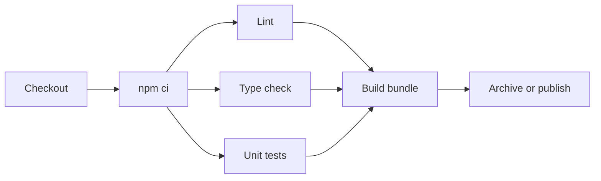

# Building Node.js Projects

## Introduction

Node.js builds look simple: `npm install`, `npm test`, done. In practice, a Jenkins pipeline for a JavaScript or TypeScript project has to answer a few more questions:

- Which Node.js version runs the build, and how do you keep it the same on every agent?
- How do you install dependencies **reproducibly** so that a build from last month can be repeated?
- How do you turn Jest or Vitest output into something Jenkins understands?
- How do you authenticate to a private npm registry without leaking a token?
- How do you stop `node_modules` downloads from dominating build time?

This page answers each one and builds up to a pipeline for a TypeScript web service. A useful mental model: `package.json` and the lockfile are the shopping list, the registry is the store, and Jenkins is the person who goes shopping. You want that person to buy exactly what is on the list, every time, and to keep a pantry (cache) so they do not drive to the store for every build.

If you have not set up Docker agents yet, read [Docker Agents](../6-jenkins-agents/3-jenkins-docker-agents.mdx) first. For general CI ideas, see the [CI/CD tutorial](/docs/devops/cicd).

## The Node.js Build Flow



Lint, type checking and tests do not depend on each other, so they are good candidates for [Parallel Stages](../4-jenkins-pipeline-advanced/0-jenkins-parallel-stages.mdx). All of them depend on dependencies being installed first.

## A Sample Project

A minimal `package.json` with Jest and a JUnit reporter:

```json
{
  "name": "greeter-api",
  "version": "1.0.0",
  "private": true,
  "type": "commonjs",
  "scripts": {
    "lint": "eslint .",
    "test": "jest",
    "test:ci": "jest --ci --reporters=default --reporters=jest-junit",
    "build": "node scripts/build.js"
  },
  "devDependencies": {
    "eslint": "^9.0.0",
    "jest": "^29.7.0",
    "jest-junit": "^16.0.0"
  }
}
```

A module and its test:

```javascript
// src/greet.js
function greet(name) {
  return `Hello, ${name}!`;
}
module.exports = { greet };
```

```javascript
// src/greet.test.js
const { greet } = require('./greet');

test('greets by name', () => {
  expect(greet('Ada')).toBe('Hello, Ada!');
});
```

Run `npm install` once on your laptop and **commit `package-lock.json`**. The lockfile is what makes CI builds reproducible.

:::note
Package versions above are examples. Check npm for current releases before you copy them.
:::

## npm ci vs npm install

This is the single most important choice in a Node.js pipeline.

| Command | Reads | Writes lockfile? | If lockfile and package.json disagree | Use in CI? |
| --- | --- | --- | --- | --- |
| `npm install` | `package.json` and lockfile | Yes, may update it | Resolves and updates | No |
| `npm ci` | Lockfile only | Never | Fails with an error | Yes |

`npm ci` deletes any existing `node_modules`, installs exactly what the lockfile says, and fails loudly if the lockfile is out of date. That is what you want in CI: the build either matches what a developer tested, or it stops. The equivalents for other package managers are `yarn install --immutable` (Yarn Berry) and `pnpm install --frozen-lockfile`.

## Approach 1: Build in a Node.js Container

The cleanest way to pin the Node.js version is to use the official `node` image as the agent:

```groovy
pipeline {
    agent {
        docker {
            image 'node:24-bookworm-slim'
        }
    }

    environment {
        CI = 'true'
        npm_config_cache = "${WORKSPACE}/.npm"
    }

    options {
        timeout(time: 15, unit: 'MINUTES')
    }

    stages {
        stage('Install') {
            steps {
                sh 'node --version && npm --version'
                sh 'npm ci --no-audit --no-fund'
            }
        }
        stage('Lint') {
            steps {
                sh 'npm run lint'
            }
        }
        stage('Test') {
            environment {
                JEST_JUNIT_OUTPUT_DIR = 'reports'
                JEST_JUNIT_OUTPUT_NAME = 'junit.xml'
            }
            steps {
                sh 'npm run test:ci'
            }
        }
    }

    post {
        always {
            junit allowEmptyResults: true, testResults: 'reports/junit.xml'
        }
    }
}
```

Why each piece is there:

- `node:24-bookworm-slim` pins the major Node.js line. Node.js 24 is an LTS line. Node.js 26 is scheduled to become LTS at the end of October 2026, so check the [Node.js release schedule](https://nodejs.org/en/about/previous-releases) and move when your dependencies support it.
- `CI=true` tells many tools (Jest, Create React App, Vitest and others) to run non-interactively, without watch mode.
- `npm_config_cache` moves npm's download cache into the workspace. The container runs as your agent's user ID, which usually cannot write to the default `/root/.npm` or a missing home directory. Without this, you often see `EACCES: permission denied, mkdir '/.npm'`.
- `--no-audit --no-fund` skips network calls and messages that slow the install and add nothing in CI. Run `npm audit` as a separate, deliberate step if you want it.
- `jest-junit` writes a JUnit XML file that the `junit` step can publish.

Example output (trimmed):

```text
+ node --version
v24.x.x
+ npm --version
11.x.x
+ npm ci --no-audit --no-fund
added 287 packages in 9s
+ npm run lint
> greeter-api@1.0.0 lint
> eslint .
+ npm run test:ci
> jest --ci --reporters=default --reporters=jest-junit
 PASS  src/greet.test.js
  ✓ greets by name (2 ms)
Tests:       1 passed, 1 total
[Pipeline] junit
Recording test results
Finished: SUCCESS
```

### Vitest instead of Jest

Vitest has a built-in JUnit reporter, so you do not need an extra package:

```bash
npx vitest run --reporter=default --reporter=junit --outputFile.junit=reports/junit.xml
```

Example output:

```text
 ✓ src/greet.test.ts (1 test) 3ms
 Test Files  1 passed (1)
      Tests  1 passed (1)
JUNIT report written to /workspace/reports/junit.xml
```

## Approach 2: The NodeJS Plugin

If your agents cannot run Docker (for example Windows or macOS agents building Electron apps), the **NodeJS plugin** (plugin ID `nodejs`) installs Node.js versions as Jenkins tools. An administrator adds an installation under **Manage Jenkins > Tools**, for example named `node-24`.

```groovy
pipeline {
    agent { label 'macos' }

    tools {
        nodejs 'node-24'
    }

    stages {
        stage('Install and Test') {
            steps {
                sh 'npm ci'
                sh 'npm test'
            }
        }
    }
}
```

The plugin also offers a `nodejs` wrapper step that can inject an `.npmrc` stored with the Config File Provider plugin:

```groovy
stage('Install') {
    steps {
        nodejs(nodeJSInstallationName: 'node-24', configId: 'company-npmrc') {
            sh 'npm ci'
        }
    }
}
```

Trade-off: tool installations are fine on a few long-lived agents, but versions are configured in the UI, not in Git. With containers, the Node.js version sits in the Jenkinsfile and changes through a pull request.

:::tip
Some teams use `nvm` or `fnm` on static agents and read the version from a committed `.nvmrc`. That keeps the version in Git without Docker. It works, but every agent must have the version manager installed and its shell setup loaded in non-interactive `sh` steps, which is a common source of "nvm: command not found" errors.
:::

## Private Registries Without Leaking Tokens

Most companies publish internal packages to a private registry (GitHub Packages, Artifactory, Nexus, Verdaccio or npm's paid org registry). npm reads authentication from `.npmrc`. Do **not** commit a token. Instead, commit an `.npmrc` that references an environment variable:

```text
@example:registry=https://npm.example.com/
//npm.example.com/:_authToken=${NPM_TOKEN}
```

Then bind the token from Jenkins credentials only for the install step:

```groovy
stage('Install') {
    steps {
        withCredentials([string(credentialsId: 'npm-read-token', variable: 'NPM_TOKEN')]) {
            sh 'npm ci --no-audit --no-fund'
        }
    }
}
```

npm expands `${NPM_TOKEN}` from the environment at runtime, and Jenkins masks the value if it ever appears in the log. Use single quotes around the `sh` script so Groovy does not interpolate the secret into the command string. That rule is explained in [Credentials Management](../11-jenkins-security/3-jenkins-credentials.mdx).

## Running Checks in Parallel

Lint, type checking and tests are independent once dependencies are installed. Running them in parallel on the same agent shares the installed `node_modules`:

```groovy
pipeline {
    agent { docker { image 'node:24-bookworm-slim' } }

    environment {
        CI = 'true'
        npm_config_cache = "${WORKSPACE}/.npm"
    }

    stages {
        stage('Install') {
            steps {
                sh 'npm ci --no-audit --no-fund'
            }
        }
        stage('Checks') {
            parallel {
                stage('Lint') {
                    steps { sh 'npm run lint' }
                }
                stage('Type Check') {
                    steps { sh 'npx tsc --noEmit' }
                }
                stage('Unit Tests') {
                    environment {
                        JEST_JUNIT_OUTPUT_DIR = 'reports'
                    }
                    steps { sh 'npm run test:ci' }
                    post {
                        always { junit 'reports/*.xml' }
                    }
                }
            }
        }
        stage('Build') {
            steps {
                sh 'npm run build'
                archiveArtifacts artifacts: 'dist/**', fingerprint: true
            }
        }
    }
}
```

Because there is a single top-level agent, all branches use the same container and workspace. That is what you want here: one `npm ci`, three consumers. If each branch had its own `agent`, each would need its own install.

## Monorepos and Workspaces

npm, Yarn and pnpm all support **workspaces**, where one repository holds several packages. Two tips for Jenkins:

- Install once at the root with `npm ci`. It installs every workspace.
- Run a script in every workspace with `npm run test --workspaces --if-present`, or in one package with `npm run test -w packages/api`.

For larger monorepos, build tools such as Nx or Turborepo can run only the packages affected by a change. Jenkins-side strategies (changesets, `when { changeset ... }`) are covered in [Building Monorepos](../5-jenkins-scm-integration/6-jenkins-monorepo-builds.mdx).

## Real-World Scenario

Your team runs a React front end and a TypeScript Express API in separate repositories. Builds take 7 minutes, and 4 of those are `npm install`. Twice this quarter, a build passed on Monday and failed on Tuesday with no code change because a transitive dependency published a broken minor version.

**The solution:**

1. Commit lockfiles and switch from `npm install` to `npm ci`. This alone stops the "no code change, new failure" problem.
2. Pin the Node.js major version with `node:24-bookworm-slim`.
3. Cache npm's download directory between builds. On static Docker agents, mount a volume. On Kubernetes, use the `cache` step from the Job Cacher plugin keyed on `package-lock.json` (see [Build Caching and Speed](./8-jenkins-build-caching.mdx)).
4. Run lint, type check and tests in parallel.
5. Publish JUnit results so failures show by test name.

```groovy
pipeline {
    agent {
        docker {
            image 'node:24-bookworm-slim'
            args '-v npm-cache:/cache/npm'
        }
    }
    environment {
        CI = 'true'
        npm_config_cache = '/cache/npm'
    }
    stages {
        stage('Install') {
            steps { sh 'npm ci --prefer-offline --no-audit --no-fund' }
        }
        stage('Checks') {
            parallel {
                stage('Lint') { steps { sh 'npm run lint' } }
                stage('Types') { steps { sh 'npx tsc --noEmit' } }
                stage('Tests') {
                    environment { JEST_JUNIT_OUTPUT_DIR = 'reports' }
                    steps { sh 'npm run test:ci' }
                }
            }
        }
    }
    post {
        always { junit allowEmptyResults: true, testResults: 'reports/*.xml' }
    }
}
```

`--prefer-offline` tells npm to use cached package tarballs without checking the registry for freshness when possible. It still respects the lockfile.

**Why this approach:** `npm ci` plus a lockfile fixes reproducibility. The npm cache removes most of the download time while keeping `node_modules` fresh on each build. Caching `node_modules` itself is faster but riskier, because a stale or partially written folder can survive across builds.

**When not to use it:** if your agents are ephemeral Kubernetes pods with no shared storage, a Docker volume is not available. Use the Job Cacher plugin or a registry proxy (Verdaccio, Nexus, Artifactory) close to the cluster instead.

| Option | Pros | Cons | Best for |
| --- | --- | --- | --- |
| No cache | Simple, always clean | Slowest, depends on registry uptime | Small projects |
| Cache npm download dir | Safe, `npm ci` still clean | Install step still unpacks every package | Most teams |
| Cache `node_modules` | Fastest | Stale or corrupt state, Node version mismatches | Huge repos with careful cache keys |
| Local registry proxy | Speeds every agent, survives outages | Another service to run | Many teams, many repos |

## Common Mistakes

- **Using `npm install` in CI.** It can modify the lockfile and silently pick up new versions. Use `npm ci`.
- **Not committing the lockfile.** Then `npm ci` fails, and reproducible builds are impossible.
- **Permission errors in containers.** Set `npm_config_cache` (or `HOME`) to a writable path.
- **Forgetting `CI=true`.** Some test runners start watch mode and the build hangs until the timeout.
- **Committing `.npmrc` with a real token.** Use `${NPM_TOKEN}` in the file and `withCredentials` in the pipeline.
- **Publishing tests only on success.** Use `post { always }` so failed runs still produce a report.
- **Using `node:latest`.** It jumps to the newest odd-numbered "Current" release. Pin an LTS major.

## Summary

- Pin Node.js with a `node:<major>` image, or the NodeJS plugin on agents without Docker.
- Commit the lockfile and use `npm ci` (or the Yarn and pnpm frozen equivalents).
- Use `jest-junit` or Vitest's `junit` reporter, and publish with `junit` in `post { always }`.
- Inject registry tokens with `withCredentials`, never commit them.
- Cache the npm download directory and run independent checks in parallel.

## Exercises

1. Build the sample project with the container pipeline. Then delete `package-lock.json` and observe the `npm ci` error.
2. Swap Jest for Vitest and change only the reporter flags. Confirm the test report still appears.
3. Add a `Types` stage with `npx tsc --noEmit` and run all checks in parallel. Compare timings in Pipeline Graph View.
4. Mount an npm cache volume and measure how much faster the second build installs.

Continue with [Building Python Projects](./2-jenkins-python-builds.mdx). For a full end-to-end example, see [Project: Node.js Web App Pipeline](../14-jenkins-projects/1-jenkins-project-node-webapp.mdx). Coverage with Istanbul and LCOV is covered in [Code Coverage](./5-jenkins-code-coverage.mdx).
