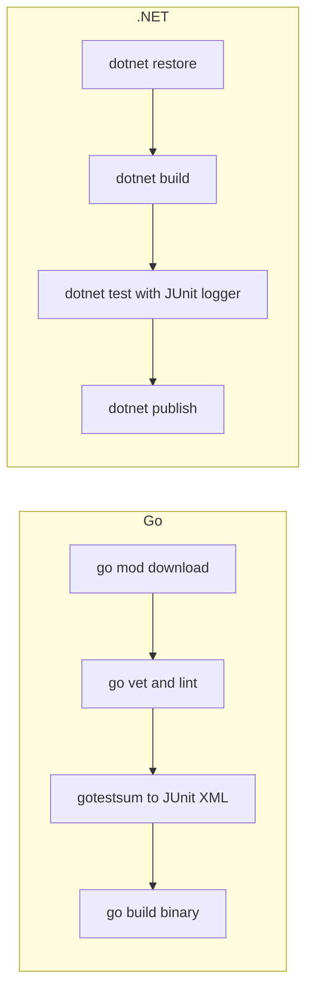

# Building Go and .NET Projects

## Introduction

Go and .NET look very different, but in Jenkins they share a pattern: both have a **single, official command-line tool** that does almost everything. For Go it is `go` (`go build`, `go test`, `go vet`). For .NET it is `dotnet` (`dotnet restore`, `dotnet build`, `dotnet test`, `dotnet publish`). Both also produce compiled artifacts, which makes them simpler to package than interpreted languages.

The Jenkins-specific work is the same as for any language:

- pick and pin the toolchain version,
- make module or package downloads fast and reproducible,
- convert test output into JUnit XML so Jenkins can show per-test results,
- and, for .NET, decide whether you need **Windows agents** at all.

This page covers Go first, then .NET, and finishes with a scenario that builds both in one company. If Docker agents are new to you, read [Docker Agents](../6-jenkins-agents/3-jenkins-docker-agents.mdx) first.



## Part 1: Go

### A Sample Go Module

```go
// go.mod
module example.com/greeter

go 1.26
```

```go
// greet.go
package greeter

import "fmt"

// Greet returns a greeting for name.
func Greet(name string) string {
	return fmt.Sprintf("Hello, %s!", name)
}
```

```go
// greet_test.go
package greeter

import "testing"

func TestGreet(t *testing.T) {
	if got := Greet("Ada"); got != "Hello, Ada!" {
		t.Fatalf("Greet() = %q, want %q", got, "Hello, Ada!")
	}
}
```

```go
// cmd/greeter/main.go
package main

import (
	"fmt"

	"example.com/greeter"
)

func main() {
	fmt.Println(greeter.Greet("Jenkins"))
}
```

### A Go Pipeline

```groovy
pipeline {
    agent {
        docker {
            image 'golang:1.27'
        }
    }

    environment {
        GOCACHE    = "${WORKSPACE}/.cache/go-build"
        GOMODCACHE = "${WORKSPACE}/.cache/go-mod"
        GOFLAGS    = '-mod=readonly'
        CGO_ENABLED = '0'
    }

    options {
        timeout(time: 15, unit: 'MINUTES')
    }

    stages {
        stage('Download Modules') {
            steps {
                sh 'go version'
                sh 'go mod download'
                sh 'go mod verify'
            }
        }
        stage('Vet') {
            steps {
                sh 'go vet ./...'
            }
        }
        stage('Test') {
            steps {
                sh '''
                    go install gotest.tools/gotestsum@latest
                    "$(go env GOPATH)/bin/gotestsum" --junitfile reports/junit.xml ./...
                '''
            }
        }
        stage('Build') {
            steps {
                sh 'go build -trimpath -o bin/greeter ./cmd/greeter'
                archiveArtifacts artifacts: 'bin/greeter', fingerprint: true
            }
        }
    }

    post {
        always {
            junit allowEmptyResults: true, testResults: 'reports/junit.xml'
        }
    }
}
```

What matters here:

- **`golang:1.27`** pins the Go minor line. Go releases a new minor version every six months (February and August) and supports the two most recent. Check [go.dev/dl](https://go.dev/dl/) for current versions.
- **`GOCACHE` and `GOMODCACHE`** point Go's build cache and module cache at writable paths. Jenkins runs the container as the agent's user ID, whose home directory often does not exist inside the image. Without these, you can see `mkdir /.cache: permission denied`.
- **`GOFLAGS=-mod=readonly`** makes the build fail if `go.mod` would need to change, which is the Go version of "use the lockfile". `go.sum` is Go's lockfile.
- **`go mod verify`** checks that downloaded modules match the hashes in `go.sum`.
- **`CGO_ENABLED=0`** produces a static binary that runs in minimal images such as `scratch` or distroless.
- **`gotestsum`** wraps `go test` and writes JUnit XML. `go test` itself only prints text or JSON (`go test -json`). Any `go test` flags go after a `--` separator, for example `gotestsum --junitfile reports/junit.xml -- -count=1 ./...`.

Example output (trimmed):

```text
+ go version
go version go1.27.x linux/amd64
+ go mod download
+ go mod verify
all modules verified
+ go vet ./...
+ gotestsum --junitfile reports/junit.xml ./...
✓  . (12ms)
DONE 1 tests in 1.204s
+ go build -trimpath -o bin/greeter ./cmd/greeter
[Pipeline] junit
Recording test results
Finished: SUCCESS
```

:::tip
`go install gotest.tools/gotestsum@latest` downloads the tool on every build. For reproducibility, pin a version (`@v1.x.y`), or bake the tool into your own build image. The same goes for `golangci-lint`.
:::

### Linting With golangci-lint

[golangci-lint](https://golangci-lint.run/) runs many Go linters in one pass. The official image makes it easy to add as a stage with its own agent:

```groovy
stage('Lint') {
    agent {
        docker {
            image 'golangci/golangci-lint:v2.14'
            reuseNode true
        }
    }
    environment {
        GOLANGCI_LINT_CACHE = "${WORKSPACE}/.cache/golangci"
    }
    steps {
        sh 'golangci-lint run --timeout 5m ./...'
    }
}
```

`reuseNode true` runs the container on the same node and workspace as the outer agent, so it sees the checked-out code and module cache. You can publish golangci-lint findings in Jenkins with the Warnings Next Generation plugin, covered in [Code Quality with SonarQube](./6-jenkins-code-quality.mdx).

:::note
The image tag above is an example. golangci-lint moved to a v2 configuration format in 2025, so check its documentation for the current tag and config format before upgrading.
:::

### Cross-Compiling Go

Go can build for other platforms without extra toolchains. A small matrix produces binaries for Linux, macOS and Windows from one Linux agent:

```groovy
stage('Release Binaries') {
    matrix {
        axes {
            axis {
                name 'GOOS'
                values 'linux', 'darwin', 'windows'
            }
            axis {
                name 'GOARCH'
                values 'amd64', 'arm64'
            }
        }
        stages {
            stage('Build') {
                steps {
                    sh 'go build -trimpath -o "dist/greeter-${GOOS}-${GOARCH}" ./cmd/greeter'
                }
            }
        }
    }
}
```

Jenkins exports the axis values as environment variables, and `go build` reads `GOOS` and `GOARCH` directly. This is one of Go's strongest CI advantages: no Windows or macOS agent is needed to produce those binaries (as long as you do not use cgo).

## Part 2: .NET

### A Sample .NET Solution

Create a library and an xUnit test project with the .NET CLI:

```bash
dotnet new sln -n Greeter
dotnet new classlib -n Greeter -o src/Greeter
dotnet new xunit -n Greeter.Tests -o tests/Greeter.Tests
dotnet sln add src/Greeter tests/Greeter.Tests
dotnet add tests/Greeter.Tests reference src/Greeter
dotnet add tests/Greeter.Tests package JunitXml.TestLogger
```

```csharp
// src/Greeter/Greeting.cs
namespace Greeter;

public static class Greeting
{
    public static string Greet(string name) => $"Hello, {name}!";
}
```

```csharp
// tests/Greeter.Tests/GreetingTests.cs
using Greeter;
using Xunit;

public class GreetingTests
{
    [Fact]
    public void GreetsByName() =>
        Assert.Equal("Hello, Ada!", Greeting.Greet("Ada"));
}
```

The `JunitXml.TestLogger` package (from the [spekt/testlogger](https://github.com/spekt/testlogger) project) lets `dotnet test` write JUnit XML.

### A .NET Pipeline on Linux

```groovy
pipeline {
    agent {
        docker {
            image 'mcr.microsoft.com/dotnet/sdk:10.0'
        }
    }

    environment {
        DOTNET_CLI_HOME = "${WORKSPACE}/.dotnet-home"
        NUGET_PACKAGES = "${WORKSPACE}/.nuget/packages"
        DOTNET_CLI_TELEMETRY_OPTOUT = '1'
        DOTNET_NOLOGO = '1'
    }

    stages {
        stage('Restore') {
            steps {
                sh 'dotnet restore Greeter.sln --locked-mode'
            }
        }
        stage('Build') {
            steps {
                sh 'dotnet build Greeter.sln --no-restore -c Release'
            }
        }
        stage('Test') {
            steps {
                sh '''
                    dotnet test Greeter.sln --no-build -c Release \
                      --logger "junit;LogFilePath=../../reports/{assembly}.junit.xml"
                '''
            }
        }
        stage('Publish') {
            steps {
                sh 'dotnet publish src/Greeter -c Release --no-build -o out'
                archiveArtifacts artifacts: 'out/**', fingerprint: true
            }
        }
    }

    post {
        always {
            junit allowEmptyResults: true, testResults: 'reports/*.junit.xml'
        }
    }
}
```

Details:

- **`mcr.microsoft.com/dotnet/sdk:10.0`** is the official SDK image. .NET 10 is the current LTS release (three years of support). Check the [.NET support policy](https://dotnet.microsoft.com/platform/support/policy/dotnet-core) for dates.
- **`DOTNET_CLI_HOME` and `NUGET_PACKAGES`** move the CLI's home folder and the NuGet cache to writable paths in the workspace.
- **`--locked-mode`** makes restore fail if `packages.lock.json` does not match. To get lockfiles, set `<RestorePackagesWithLockFile>true</RestorePackagesWithLockFile>` in your project or `Directory.Build.props` and commit the generated files. Drop the flag if you have not enabled lockfiles yet.
- **`--no-restore` and `--no-build`** stop each later command from redoing earlier work.
- **`LogFilePath`** is relative to each test project's directory. The `{assembly}` token gives one file per test assembly, so multiple projects do not overwrite each other.

Example output (trimmed):

```text
+ dotnet restore Greeter.sln --locked-mode
  Restored /workspace/src/Greeter/Greeter.csproj (in 312 ms).
  Restored /workspace/tests/Greeter.Tests/Greeter.Tests.csproj (in 1.1 sec).
+ dotnet build Greeter.sln --no-restore -c Release
  Greeter -> /workspace/src/Greeter/bin/Release/net10.0/Greeter.dll
Build succeeded.
    0 Warning(s)
    0 Error(s)
+ dotnet test Greeter.sln --no-build -c Release --logger junit;...
Passed!  - Failed:     0, Passed:     1, Skipped:     0, Total:     1
Finished: SUCCESS
```

:::note
.NET is moving test projects from VSTest to **Microsoft.Testing.Platform (MTP)**, which changes some `dotnet test` options. The spekt loggers support both, but logger configuration differs. If your test projects use MTP, follow the [testlogger wiki](https://github.com/spekt/testlogger/wiki) for the current syntax.
:::

### When You Need Windows Agents

Modern .NET (formerly .NET Core) builds fine on Linux. You still need Windows agents for:

- .NET Framework 4.x projects,
- WPF or WinForms apps you want to test on Windows,
- MSI installers, code signing with Windows-only tools, or tests against Windows APIs.

On Windows agents, use `bat` or `powershell` instead of `sh`:

```groovy
pipeline {
    agent { label 'windows && dotnet' }

    stages {
        stage('Build and Test') {
            steps {
                bat 'dotnet build Greeter.sln -c Release'
                bat 'dotnet test Greeter.sln --no-build -c Release --logger "junit;LogFilePath=%WORKSPACE%\\reports\\{assembly}.junit.xml"'
            }
        }
    }
    post {
        always {
            junit allowEmptyResults: true, testResults: 'reports/*.junit.xml'
        }
    }
}
```

Note the Windows environment variable syntax `%WORKSPACE%` and the doubled backslashes inside a Groovy string. Windows agents cost more to run and maintain, so keep as much of the build on Linux as you can.

## Real-World Scenario

Your company has a Go CLI tool shipped to customers on Linux, macOS and Windows, and an ASP.NET Core API that runs in containers. Today the CLI is built by hand on a developer's laptop, and the API is built on a single Windows VM that nobody wants to patch.

**The solution:**

- **Go CLI:** one Linux Docker agent, `golang:1.27`, a vet and test stage with JUnit output, and a GOOS/GOARCH matrix that produces six binaries. Archive them with fingerprints so you can trace a customer's binary to a build.
- **ASP.NET Core API:** move to `mcr.microsoft.com/dotnet/sdk:10.0` on Linux. Enable NuGet lockfiles, restore with `--locked-mode`, publish JUnit results, and build a container image (see [Building and Pushing Docker Images](./7-jenkins-docker-image-builds.mdx)).
- Retire the Windows VM, or keep a small Windows pool only for jobs that really need it.

**Why this approach:** both toolchains are first-class on Linux, so containers give reproducible builds at the lowest cost. Go's cross-compilation removes the need for macOS and Windows build machines entirely.

**When not to use it:** if the Go tool uses cgo (for example SQLite through a C library), cross-compiling needs a C cross-compiler per target, and a native agent per OS may be simpler. If the .NET app targets .NET Framework, you need Windows.

| Approach | Pros | Cons | Best for |
| --- | --- | --- | --- |
| Linux container agents | Cheap, reproducible, easy upgrades | No Windows-only tooling | Go, modern .NET |
| Windows static agents | Full Windows toolchain, .NET Framework | Costly, slower to patch, licensing | Legacy .NET, desktop apps |
| Go cross-compile matrix | Many targets from one agent | Hard with cgo | CLI tools, agents, small services |
| Native agent per OS | Real-platform tests | Many agents to maintain | Apps with OS-specific behavior |

## Common Mistakes

- **Cache paths that the container user cannot write.** Set `GOCACHE`, `GOMODCACHE`, `DOTNET_CLI_HOME` and `NUGET_PACKAGES`.
- **Expecting `go test` to produce JUnit XML.** Use `gotestsum` or `go-junit-report`.
- **Several .NET test projects writing to one report file.** Use the `{assembly}` token in `LogFilePath`.
- **Running `dotnet test` without `--no-build`** after a build stage, which compiles everything again.
- **Floating tool versions** such as `@latest` for linters. Pin them for repeatable results.
- **Assuming you need Windows for .NET.** For .NET (not .NET Framework), Linux agents are usually enough.

## Summary

- Both Go and .NET are driven by one official CLI, which keeps Jenkinsfiles short.
- Pin the toolchain with `golang:<version>` or `mcr.microsoft.com/dotnet/sdk:<version>` images.
- Point caches at writable paths and use lockfiles (`go.sum`, `packages.lock.json`).
- Convert test output to JUnit XML with `gotestsum` or `JunitXml.TestLogger`.
- Go cross-compiles easily. .NET needs Windows agents only for Windows-specific work.

## Exercises

1. Build the Go module with the pipeline above. Break the test and confirm the failure appears in the Tests tab by name.
2. Add the GOOS/GOARCH matrix and archive all binaries. Check the fingerprints on the build page.
3. Create the .NET solution, enable `RestorePackagesWithLockFile`, commit the lockfiles, and run the .NET pipeline with `--locked-mode`.
4. Add a second test project and confirm two JUnit files are produced and both appear in the report.

Next, learn how Jenkins processes all these XML files in [Test Reports with JUnit](./4-jenkins-test-reports.mdx). For agent choices, see [Choosing an Agent Strategy](../6-jenkins-agents/7-jenkins-agent-strategies.mdx).
