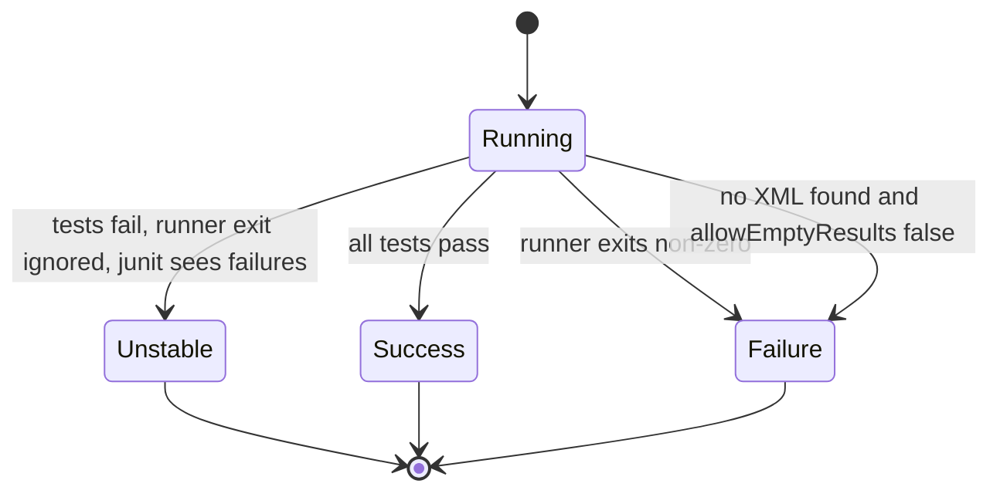

# Test Reports with JUnit

## Introduction

Reading a 5,000-line console log to find which test failed is nobody's idea of fun. Jenkins can do much better: if your test runner writes its results as **JUnit XML**, the `junit` step turns them into a test report with pass and fail counts, a trend chart across builds, per-test history, and a direct link to the failing test's error message and stack trace.

The name is historical. The XML format was invented by the Java JUnit ecosystem (through Ant and Maven Surefire), but today almost every test runner can produce it: pytest, Jest, Vitest, Go's `gotestsum`, .NET's JUnit logger, PHPUnit, RSpec and many more. So "JUnit reports" really means "the common test result format Jenkins understands".

Think of the console log as a raw security camera recording and the JUnit report as the incident summary: both contain the truth, but only one is quick to read.

This page covers:

- what the JUnit XML format looks like,
- the `junit` step and its most useful options,
- how test results change the build result (UNSTABLE vs FAILED),
- using results in pipeline logic,
- GitHub checks and the Pipeline Graph View,
- splitting slow test suites across agents.

The language pages in this section show how to *produce* the XML: [Java](./0-jenkins-java-builds.mdx), [Node.js](./1-jenkins-node-builds.mdx), [Python](./2-jenkins-python-builds.mdx), and [Go and .NET](./3-jenkins-go-and-dotnet-builds.mdx).

## The JUnit XML Format

A minimal report with one passing test, one failure and one skipped test:

```xml
<?xml version="1.0" encoding="UTF-8"?>
<testsuites>
  <testsuite name="greeter.GreeterTest" tests="3" failures="1" errors="0" skipped="1" time="0.042">
    <testcase classname="greeter.GreeterTest" name="greetsByName" time="0.010"/>
    <testcase classname="greeter.GreeterTest" name="greetsEmptyName" time="0.020">
      <failure message="expected 'Hello, stranger!' but was 'Hello, !'" type="AssertionError">
        AssertionError: expected 'Hello, stranger!' but was 'Hello, !'
          at greeter.GreeterTest.greetsEmptyName(GreeterTest.java:18)
      </failure>
    </testcase>
    <testcase classname="greeter.GreeterTest" name="greetsInFrench" time="0.000">
      <skipped message="not implemented yet"/>
    </testcase>
  </testsuite>
</testsuites>
```

The parts Jenkins uses:

- `testsuite` groups tests (often one class or file).
- `testcase` has a `classname` and `name`. Jenkins builds the report tree from these, so stable, meaningful names matter.
- `failure` means an assertion failed. `error` means an unexpected exception. Jenkins counts both as failed tests.
- `skipped` marks tests that did not run.
- `system-out` and `system-err` (not shown) hold captured output.

You can validate a file you generated by parsing it with Python before blaming Jenkins:

```python
import sys
import xml.etree.ElementTree as ET

root = ET.parse(sys.argv[1]).getroot()
cases = root.iter("testcase")
total = failed = skipped = 0
for case in cases:
    total += 1
    if case.find("failure") is not None or case.find("error") is not None:
        failed += 1
    if case.find("skipped") is not None:
        skipped += 1
print(f"total={total} failed={failed} skipped={skipped}")
```

Example output:

```text
$ python3 check_junit.py reports/junit.xml
total=3 failed=1 skipped=1
```

## The junit Step

The step comes from the **JUnit plugin** (plugin ID `junit`), which is installed with the suggested plugins.

```groovy
pipeline {
    agent any

    stages {
        stage('Test') {
            steps {
                sh 'mkdir -p reports && cp sample-results/*.xml reports/'
            }
        }
    }

    post {
        always {
            junit 'reports/**/*.xml'
        }
    }
}
```

The single argument is an Ant-style glob relative to the workspace. You can pass several patterns separated by commas, for example `'target/surefire-reports/*.xml, target/failsafe-reports/*.xml'`.

The longer, named form shows the options:

```groovy
junit(
    testResults: 'reports/**/*.xml',
    allowEmptyResults: true,
    skipMarkingBuildUnstable: false,
    skipPublishingChecks: false,
    stdioRetention: 'FAILED',
    keepProperties: false,
    healthScaleFactor: 1.0
)
```

| Option | What it does | Default |
| --- | --- | --- |
| `testResults` | Glob of XML files | required |
| `allowEmptyResults` | Do not fail when no files match | `false` (no files = failed build) |
| `skipMarkingBuildUnstable` | Test failures do not make the build UNSTABLE | `false` |
| `skipMarkingStageUnstable` | Neither stage nor build is marked UNSTABLE | `false` |
| `skipPublishingChecks` | Do not send results to GitHub Checks | `false` |
| `stdioRetention` | Keep full (untruncated) output for `ALL` tests, only `FAILED` ones, or `NONE` | `NONE` |
| `keepProperties` | Keep `property` elements from the XML | `false` |
| `healthScaleFactor` | How strongly failures affect the weather icon. `0` disables it | `1.0` |
| `skipOldReports` | Ignore XML files older than the current build | `false` |

:::tip
The Snippet Generator (see [Snippet Generator and Pipeline Syntax Tools](../3-jenkins-pipeline-basics/9-jenkins-pipeline-syntax-generator.mdx)) lists every option for the exact plugin version you have installed. Use it when an option name here does not work on your controller.
:::

### Always publish in post

Put `junit` in `post { always { ... } }`. If you put it in `steps` after the test command, a failing test command stops the stage before `junit` runs, and you lose the report exactly when you need it.

```groovy
stage('Unit Tests') {
    steps {
        sh 'npm run test:ci'
    }
    post {
        always {
            junit 'reports/junit.xml'
        }
    }
}
```

Stage-level `post` keeps the report next to the stage that produced it. A pipeline-level `post` works too. See [Post Conditions](../3-jenkins-pipeline-basics/7-jenkins-post-conditions.mdx).

## How Test Results Affect the Build Result

This is the part that confuses most beginners. Two different things can go wrong:

1. The **test command exits with a non-zero code** (because tests failed). The `sh` step fails, and Jenkins marks the stage and build as **FAILURE**.
2. The `junit` step **finds failed tests** in the XML. It marks the build **UNSTABLE** (yellow), not FAILURE.



Jenkins' convention is: **FAILURE** means the build is broken (compile error, crash, infrastructure problem); **UNSTABLE** means the build worked but tests found problems. Many teams want that distinction. To get it, let the test command "succeed" and let `junit` decide:

```groovy
stage('Test') {
    steps {
        // Maven: keep going after test failures so junit can report them
        sh 'mvn -B -ntp verify -Dmaven.test.failure.ignore=true'
    }
    post {
        always {
            junit 'target/surefire-reports/*.xml'
        }
    }
}
```

For other runners that do not have such a flag, wrap the command with `catchError`:

```groovy
stage('Test') {
    steps {
        catchError(buildResult: 'UNSTABLE', stageResult: 'UNSTABLE') {
            sh 'pytest --junitxml=reports/junit.xml'
        }
    }
    post {
        always {
            junit 'reports/junit.xml'
        }
    }
}
```

Example output:

```text
+ pytest --junitxml=reports/junit.xml
FAILED tests/test_greet.py::test_greets_empty_name - AssertionError
1 failed, 4 passed in 0.08s
ERROR: script returned exit code 1
[Pipeline] junit
Recording test results
[Checks API] No suitable checks publisher found.
Finished: UNSTABLE
```

:::caution
Be careful with `catchError` around commands that can fail for reasons other than tests, such as a missing dependency. A broken environment would then show as UNSTABLE instead of FAILURE. Keep the wrapped command narrow, and rely on `junit` failing the build when no XML is produced.
:::

Should UNSTABLE block a merge? Usually yes. Branch protection in GitHub or GitLab treats anything other than success as failing, so the distinction is mainly for humans reading the build history.

## Using Test Results in Pipeline Logic

The `junit` step returns a summary object with `totalCount`, `failCount`, `skipCount` and `passCount`. You can use it to post a message or make a decision:

```groovy
post {
    always {
        script {
            def results = junit testResults: 'reports/*.xml', allowEmptyResults: true
            echo "Tests: ${results.totalCount}, failed: ${results.failCount}, skipped: ${results.skipCount}"
            if (results.failCount > 0) {
                currentBuild.description = "${results.failCount} failing tests"
            }
        }
    }
}
```

Example output:

```text
Recording test results
Tests: 214, failed: 2, skipped: 3
```

This is handy for notifications. For example, a Slack message can say "2 of 214 tests failed" instead of just "build unstable". See [Notifications: Email, Slack and Teams](../12-jenkins-administration/6-jenkins-notifications.mdx).

## Where Results Appear

After the step runs, you get:

- **Test Result** link on the build page: the tree of suites and cases, with failures first, each with its error message, stack trace and (if retained) output.
- **Test Result Trend** chart on the job page: passes, failures and skips over recent builds.
- **Per-test history**: open any test to see when it started failing and how long it takes over time. "Age" tells you how many builds a test has been failing for.
- **Pipeline Graph View** (plugin ID `pipeline-graph-view`) marks UNSTABLE stages in yellow, so you can see which stage's tests failed. Blue Ocean also showed tests, but it is no longer actively developed and should not be used for new setups.
- **GitHub Checks**: with the GitHub Checks plugin and a GitHub App credential, results appear as a check run on the pull request, with annotations. Disable this per call with `skipPublishingChecks: true`.

### HTML reports from other tools

Some tools write rich HTML reports (Playwright, Cypress, pytest-html). JUnit XML gives Jenkins the numbers, and the **HTML Publisher** plugin (plugin ID `htmlpublisher`) can attach the HTML page to the build:

```groovy
post {
    always {
        junit 'test-results/junit.xml'
        publishHTML(target: [
            reportDir: 'playwright-report',
            reportFiles: 'index.html',
            reportName: 'Playwright Report',
            keepAll: true,
            alwaysLinkToLastBuild: true,
            allowMissing: true
        ])
    }
}
```

Jenkins serves these pages with a strict Content Security Policy by default, so JavaScript-heavy reports may render blank. Relaxing the policy is a security decision for administrators. See [Securing Agents and the Controller](../11-jenkins-security/6-jenkins-securing-agents.mdx).

## Splitting Slow Test Suites

When a suite takes 40 minutes, parallelism helps. The **Parallel Test Executor** plugin (plugin ID `parallel-test-executor`) reads test durations from the last successful build and splits tests into roughly equal groups:

```groovy
def splits
node('linux') {
    checkout scm
    splits = splitTests parallelism: count(4), generateInclusions: true
}

def branches = [:]
for (int i = 0; i < splits.size(); i++) {
    def num = i
    def split = splits[num]
    branches["split-${num}"] = {
        node('linux') {
            checkout scm
            writeFile file: (split.includes ? 'inclusions.txt' : 'exclusions.txt'), text: split.list.join('\n')
            writeFile file: (split.includes ? 'exclusions.txt' : 'inclusions.txt'), text: ''
            sh 'mvn -B -ntp test -Dmaven.test.failure.ignore=true'
            junit 'target/surefire-reports/*.xml'
        }
    }
}
parallel branches
```

This is Scripted Pipeline because the number of branches is dynamic. Your build tool must read `inclusions.txt` and `exclusions.txt` (Maven Surefire supports `includesFile` and `excludesFile`). The first build has no timing data, so splits are based on file counts until results exist.

Many test runners now shard on their own (`jest --shard=1/4`, `vitest --shard`, `pytest-xdist`, Playwright `--shard`). Using those inside a [Matrix Build](../4-jenkins-pipeline-advanced/1-jenkins-matrix-builds.mdx) is often simpler than the plugin.

## Real-World Scenario

Your team's Java monolith has 3,800 tests. Builds go red about twice a week, and each time someone scrolls through a 12 MB console log to find the failing test. Managers ask "is the build broken or just a flaky test?" and nobody can answer quickly.

**The solution:**

1. Publish Surefire and Failsafe XML with `junit` in `post { always }`.
2. Run Maven with `-Dmaven.test.failure.ignore=true` so test failures make the build UNSTABLE, while compile errors stay FAILURE.
3. Keep full output only for failed tests (`stdioRetention: 'FAILED'`) to limit disk usage on the controller.
4. Use the per-test history and "Age" column to spot flaky tests: a test that alternates pass and fail across builds with no related code change is flaky.
5. Add the failure count to the build description and to the Slack notification.

```groovy
post {
    always {
        script {
            def r = junit testResults: 'target/surefire-reports/*.xml, target/failsafe-reports/*.xml',
                          stdioRetention: 'FAILED'
            currentBuild.description = "${r.passCount}/${r.totalCount} passed"
        }
    }
}
```

**Why this approach:** JUnit XML is universal, cheap to produce, and gives Jenkins enough data for trends and history. The UNSTABLE vs FAILURE split answers the manager's question at a glance.

**When not to:** if you need cross-repository test analytics, flaky test detection across hundreds of jobs, or long-term retention, Jenkins' built-in view is limited, and results are deleted with old builds. Dedicated test analytics tools or exporting results to your own database fit better.

| Approach | Pros | Cons | Best for |
| --- | --- | --- | --- |
| `junit` step only | Built in, universal, trends and history | Per-job only, kept only as long as builds | Every pipeline |
| `junit` + HTML Publisher | Rich visual reports (screenshots, traces) | CSP issues, more disk | UI and end-to-end tests |
| GitHub Checks publishing | Results in the PR | Needs GitHub App setup | GitHub-hosted code |
| External test analytics | Cross-project flakiness, long retention | Extra service, often paid | Large organizations |

## Common Mistakes

- **Publishing only on success.** Use `post { always }`.
- **Old XML files counted again.** On reused workspaces, results from a previous build can be re-published. Clean the report folder before testing, or use `skipOldReports: true`.
- **No XML when tests crash.** `allowEmptyResults: false` (the default) turns that into a FAILURE, which is usually right. Only set it to `true` in stages where no tests is a valid outcome.
- **Unstable names.** Parameterized tests with random data or timestamps in the name break per-test history.
- **Keeping all stdout.** `stdioRetention: 'ALL'` on large suites bloats `JENKINS_HOME` and controller memory.
- **Wrapping too much in `catchError`.** Infrastructure failures then look like test failures.

## Summary

- JUnit XML is the common test result format. Nearly every runner can produce it.
- `junit` publishes results, trends and per-test history. Put it in `post { always }`.
- Failed tests make the build UNSTABLE. A failing command makes it FAILURE.
- The step returns counts you can use in descriptions and notifications.
- HTML Publisher, GitHub Checks and Pipeline Graph View add more ways to see results.
- Split long suites with Parallel Test Executor or with your runner's sharding.

## Exercises

1. Write a pipeline that publishes the sample XML above. Check the Test Result page and the build color.
2. Change your test stage so a failing test gives UNSTABLE instead of FAILURE, using `catchError` or your runner's flag.
3. Use the return value of `junit` to set the build description.
4. Run a build twice without cleaning the workspace and observe duplicated results. Fix it with `skipOldReports: true` or a cleanup step.

Next: [Code Coverage](./5-jenkins-code-coverage.mdx) adds the "how much code did the tests exercise" question on top of "did they pass".
