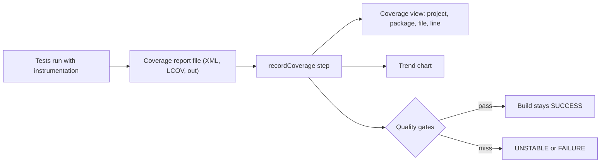

# Code Coverage

## Introduction

Test reports tell you whether your tests **passed**. Code coverage tells you how much of your code the tests **exercised**. A project with 500 green tests can still have whole modules that no test ever touches, and coverage is the cheapest way to find those blind spots.

Jenkins records coverage with the **Coverage plugin** (plugin ID `coverage`) and its `recordCoverage` step. It reads reports from many tools (JaCoCo, Cobertura, LCOV, Go, OpenCover and others), shows coverage per package, file and line, draws trend charts, and can fail or mark a build UNSTABLE with **quality gates**.

:::note
Older tutorials use the separate JaCoCo plugin (`jacoco` step), the Cobertura plugin (`cobertura` step), or the Code Coverage API plugin (`publishCoverage` step). The Coverage plugin supersedes the Code Coverage API plugin and reads JaCoCo and Cobertura formats itself. Use `recordCoverage` for new pipelines.
:::

A word of caution before we start. Coverage is like the percentage of rooms a security guard walked through: a low number means rooms were never checked, but a high number does not prove the guard looked carefully. 90% line coverage with weak assertions can still miss bugs. Use coverage to find untested code, not as a scoreboard.

This page covers:

- producing coverage reports in Java, JavaScript, Python, Go and .NET,
- the `recordCoverage` step and its parsers,
- quality gates, especially gates on **changed lines**,
- reference builds for pull requests,
- why coverage targets often backfire.

Make sure you are comfortable with [Test Reports with JUnit](./4-jenkins-test-reports.mdx) first, because coverage is usually recorded right next to test results.

## How Coverage Flows Through Jenkins



Jenkins never measures coverage itself. Your test tool does, and Jenkins only reads the report. So the first job is getting each language to write a report in a format the plugin understands.

## Producing Coverage Reports

| Language | Tool | Report format | Typical path | `recordCoverage` parser |
| --- | --- | --- | --- | --- |
| Java (Maven) | JaCoCo Maven plugin | JaCoCo XML | `target/site/jacoco/jacoco.xml` | `JACOCO` |
| Java (Gradle) | Gradle `jacoco` plugin | JaCoCo XML | `build/reports/jacoco/test/jacocoTestReport.xml` | `JACOCO` |
| JavaScript/TypeScript | Jest or Vitest (Istanbul or V8) | LCOV or Cobertura | `coverage/lcov.info` | `LCOV` or `COBERTURA` |
| Python | coverage.py / pytest-cov | Cobertura XML | `coverage.xml` | `COBERTURA` |
| Go | `go test -coverprofile` | Go cover profile | `coverage.out` | `GO_COV` |
| .NET | Coverlet | Cobertura XML | `TestResults/*/coverage.cobertura.xml` | `COBERTURA` |
| .NET | OpenCover format | OpenCover XML | `*opencover.xml` | `OPENCOVER` |

### Java with Maven and JaCoCo

Add the JaCoCo plugin to `pom.xml`. `prepare-agent` attaches the agent to the test JVM, and `report` writes the XML after tests:

```xml
<plugin>
  <groupId>org.jacoco</groupId>
  <artifactId>jacoco-maven-plugin</artifactId>
  <version>0.8.15</version>
  <executions>
    <execution>
      <goals>
        <goal>prepare-agent</goal>
      </goals>
    </execution>
    <execution>
      <id>report</id>
      <phase>verify</phase>
      <goals>
        <goal>report</goal>
      </goals>
    </execution>
  </executions>
</plugin>
```

Check Maven Central for the current JaCoCo version, especially when you move to a new Java release, because JaCoCo must understand the class file version.

### Java with Gradle

```groovy
// build.gradle
plugins {
    id 'java'
    id 'jacoco'
}

test {
    useJUnitPlatform()
    finalizedBy jacocoTestReport
}

jacocoTestReport {
    dependsOn test
    reports {
        xml.required = true
        html.required = false
    }
}
```

### JavaScript with Jest

```bash
npx jest --ci --coverage --coverageReporters=lcov --coverageReporters=text-summary
```

Example output:

```text
=============================== Coverage summary ===============================
Statements   : 87.5% ( 35/40 )
Branches     : 75% ( 9/12 )
Functions    : 90% ( 9/10 )
Lines        : 87.17% ( 34/39 )
================================================================================
```

Vitest uses `npx vitest run --coverage --coverage.reporter=lcov` with the `@vitest/coverage-v8` package installed.

### Python with pytest-cov

```bash
pytest --junitxml=reports/junit.xml --cov=greeter --cov-branch --cov-report=xml:reports/coverage.xml
```

Example output:

```text
---------- coverage: platform linux, python 3.13 ----------
Coverage XML written to file reports/coverage.xml
============================== 12 passed in 0.31s ==============================
```

coverage.py writes Cobertura-compatible XML, so you use the `COBERTURA` parser.

### Go

```bash
go test -covermode=atomic -coverprofile=coverage.out ./...
```

Example output:

```text
ok  	example.com/greeter	0.004s	coverage: 100.0% of statements
```

### .NET with Coverlet

The `dotnet new xunit` template already references `coverlet.collector`:

```bash
dotnet test --collect:"XPlat Code Coverage"
```

Example output:

```text
Attachments:
  /workspace/tests/Greeter.Tests/TestResults/3f1c.../coverage.cobertura.xml
Passed!  - Failed:     0, Passed:     1, Skipped:     0, Total:     1
```

## The recordCoverage Step

A Maven pipeline that records tests and coverage together:

```groovy
pipeline {
    agent {
        docker { image 'maven:3.9-eclipse-temurin-21' }
    }

    stages {
        stage('Test') {
            steps {
                sh 'mvn -B -ntp verify -Dmaven.test.failure.ignore=true'
            }
        }
    }

    post {
        always {
            junit 'target/surefire-reports/*.xml'
            recordCoverage(
                tools: [[parser: 'JACOCO', pattern: 'target/site/jacoco/jacoco.xml']],
                id: 'coverage',
                name: 'Coverage',
                sourceCodeRetention: 'LAST_BUILD'
            )
        }
    }
}
```

Key options:

- `tools` is a list. Each entry has a `parser` and an optional `pattern`. If you omit `pattern`, the plugin uses a default for that parser, for example `**/jacoco.xml,**/jacocoTestReport.xml` for JaCoCo and `**/lcov.info` for LCOV.
- `id` and `name` let you record several coverage results in one build (for example unit and integration) without them merging.
- `sourceCodeRetention` controls whether Jenkins stores your source files to show line-by-line highlighting: `NEVER`, `LAST_BUILD` (default), `EVERY_BUILD` or `MODIFIED`. Stored source takes disk space on the controller, and anyone who can view the build can read it.
- `sourceDirectories: [[path: 'src/main/java']]` helps the plugin find source files when report paths do not match the workspace layout.
- `ignoreParsingErrors: true` makes the step continue with partial data from broken reports instead of failing.

Example output:

```text
[Pipeline] recordCoverage
[Coverage] Recording coverage results
[Coverage] Searching for all files in '/workspace/greeter' that match the pattern 'target/site/jacoco/jacoco.xml'
[Coverage] -> found 1 file
[Coverage] Successfully parsed file '/workspace/greeter/target/site/jacoco/jacoco.xml'
[Coverage] -> found coverage: LINE: 87.50% (35/40), BRANCH: 75.00% (9/12)
[Coverage] Painting 4 source files on agent
[Coverage] Finished coverage processing - adding the action to the build...
```

The exact log lines vary by plugin version. The build page then shows a **Coverage** link with a tree view, a per-file table, and source code with covered lines in green and missed lines in red.

### Several languages in one build

A repository with a Java backend and a TypeScript front end can record both under separate ids:

```groovy
recordCoverage(
    id: 'backend', name: 'Backend Coverage',
    tools: [[parser: 'JACOCO', pattern: 'backend/target/site/jacoco/jacoco.xml']]
)
recordCoverage(
    id: 'frontend', name: 'Frontend Coverage',
    tools: [[parser: 'LCOV', pattern: 'frontend/coverage/lcov.info']]
)
```

:::tip
The Snippet Generator lists every parser, metric and option for your installed plugin version. The plugin evolves quickly, so trust the Snippet Generator over any tutorial (including this one) when they disagree.
:::

## Quality Gates

A quality gate is a rule such as "line coverage must be at least 80%". Each gate has:

- `metric`: for example `LINE`, `BRANCH`, `INSTRUCTION`, `METHOD` or `MUTATION`,
- `baseline`: what to measure, for example `PROJECT` (whole codebase) or `MODIFIED_LINES` (only lines changed compared to a reference build),
- `threshold`: the minimum percentage,
- `criticality`: `UNSTABLE` (the default) or `FAILURE`.

```groovy
recordCoverage(
    tools: [[parser: 'JACOCO']],
    qualityGates: [
        [metric: 'LINE',   baseline: 'PROJECT',        threshold: 60.0, criticality: 'UNSTABLE'],
        [metric: 'LINE',   baseline: 'MODIFIED_LINES', threshold: 80.0, criticality: 'FAILURE'],
        [metric: 'BRANCH', baseline: 'MODIFIED_LINES', threshold: 70.0, criticality: 'UNSTABLE']
    ]
)
```

Example output when a gate is missed (the wording varies by plugin version):

```text
[Coverage] Evaluating quality gates
[Coverage] -> Some quality gates have been missed: overall result is FAILURE
[Coverage] -> Details for each quality gate:
[Coverage]    - [Overall project - Line Coverage]: ≪Success≫ - (Actual value: 72.40%, Quality gate: 60.00)
[Coverage]    - [Modified code lines - Line Coverage]: ≪Failed≫ - (Actual value: 41.18%, Quality gate: 80.00)
```

### Why gate on changed lines?

A gate on the whole project ("80% overall") punishes the wrong people. A legacy codebase at 45% fails every build, so teams either disable the gate or write junk tests to raise the number. A gate on **modified lines** asks a fairer question: *is the code you just wrote tested?* Over time, coverage of the whole project rises naturally as code is touched.

To know which lines changed, the plugin compares against a **reference build**. For multibranch pipelines, point it at the target branch:

```groovy
stage('Coverage') {
    steps {
        discoverGitReferenceBuild(referenceJob: 'my-service/main')
        recordCoverage(
            tools: [[parser: 'JACOCO']],
            qualityGates: [[metric: 'LINE', baseline: 'MODIFIED_LINES', threshold: 80.0]]
        )
    }
}
```

`discoverGitReferenceBuild` comes from the Git Forensics plugin (plugin ID `git-forensics`). For a pull request job, `referenceJob` is the job of the branch you merge into. Without a reference build, change-based baselines have nothing to compare against.

## Excluding Code From Coverage

Generated code, DTOs and framework bootstrapping inflate or deflate coverage without telling you anything useful. Exclude them in the tool that *measures* coverage, so every consumer (Jenkins, SonarQube, your IDE) sees the same numbers. For JaCoCo in Maven, add excludes to the plugin configuration:

```xml
<configuration>
  <excludes>
    <exclude>com/example/generated/**</exclude>
    <exclude>**/*Application.class</exclude>
  </excludes>
</configuration>
```

For coverage.py, use the `[tool.coverage.run]` table in `pyproject.toml`:

```toml
[tool.coverage.run]
branch = true
source = ["greeter"]
omit = ["*/migrations/*", "*/_generated/*"]
```

Jest and Vitest use `coveragePathIgnorePatterns` and `coverage.exclude` respectively. Keep the exclusion list short and reviewed: an exclusion is a decision that some code does not need tests, and it should be visible in code review.

## Real-World Scenario

Your team inherited a Java payments service with 38% line coverage. Leadership wants "80% coverage by Q3". Developers worry they will spend months writing tests for stable code nobody touches, while new features keep shipping untested.

**The solution:**

1. Record coverage on every build with `recordCoverage` so the trend is visible.
2. Add a **non-blocking** project gate (`baseline: 'PROJECT'`, `threshold: 38.0`, `criticality: 'UNSTABLE'`) that only catches regressions below today's level.
3. Add a **blocking** gate on changed lines (`MODIFIED_LINES`, 80%, `FAILURE`) for pull requests, using `discoverGitReferenceBuild`.
4. Raise the project floor every few months to lock in progress.
5. Review the per-file view once a sprint and target tests at risky, frequently changed files (payment calculation, refunds), not at getters and DTOs.

**Why this approach:** it makes untested new code impossible to merge, without forcing anyone to backfill tests for code that is stable and rarely changed. It also gives leadership a trend line instead of a one-off target.

**When not to:** do not gate on coverage for prototypes and spike branches, or for generated code (exclude it from the report instead). For small libraries where every line matters, a simple project-wide gate is fine.

| Approach | Pros | Cons | Best for |
| --- | --- | --- | --- |
| No gates, trend only | Zero friction, still visible | Easy to ignore | Early-stage projects |
| Project-wide threshold | Simple to explain | Punishes legacy code, invites junk tests | Small, new codebases |
| Changed-lines threshold | Fair, improves code over time | Needs reference builds, more setup | Legacy and large codebases |
| Ratchet (raise floor periodically) | Locks in progress | Needs someone to raise it | Long-lived services |
| Mutation coverage (PIT, Stryker) | Measures test quality, not just execution | Slow, noisy at first | Critical logic |

## Common Mistakes

- **Treating coverage as a goal.** "80%" says nothing about assertion quality. Combine coverage with code review and, for critical code, mutation testing.
- **Using deprecated steps.** `publishCoverage`, `jacoco` and `cobertura` steps still appear in old blog posts. Use `recordCoverage`.
- **Recording before the report exists.** The report must be generated after tests (`verify` phase for Maven JaCoCo, `finalizedBy jacocoTestReport` in Gradle).
- **Counting generated code.** Exclude generated sources, DTOs from code generators and vendored code in the tool configuration.
- **Merging unit and integration coverage by accident.** Use different `id` values when you want them separate.
- **Gating on modified lines without a reference build.** Add `discoverGitReferenceBuild` for pull request jobs.
- **Storing source for every build forever.** `EVERY_BUILD` retention can fill the controller disk. `LAST_BUILD` or `MODIFIED` is usually enough.

## Summary

- Your test tool measures coverage. Jenkins reads the report with `recordCoverage` from the Coverage plugin.
- Supported parsers include `JACOCO`, `COBERTURA`, `LCOV`, `GO_COV` and `OPENCOVER`.
- Quality gates combine a metric, a baseline, a threshold and a criticality.
- Gates on modified lines are fairer than project-wide targets, and need a reference build.
- Coverage finds untested code. It does not prove tests are good.

## Exercises

1. Add JaCoCo to the Maven project from [Building Java Projects with Maven and Gradle](./0-jenkins-java-builds.mdx) and record coverage. Open the source view and find a red line.
2. Add a project-wide gate just above your current coverage and watch the build become UNSTABLE. Then lower it.
3. In a multibranch job, add `discoverGitReferenceBuild` and a `MODIFIED_LINES` gate. Open a pull request that adds an untested method and check the result.
4. Record coverage for a Python or Node.js project using the `COBERTURA` or `LCOV` parser.

Next: [Code Quality with SonarQube](./6-jenkins-code-quality.mdx) takes coverage data and combines it with static analysis.
