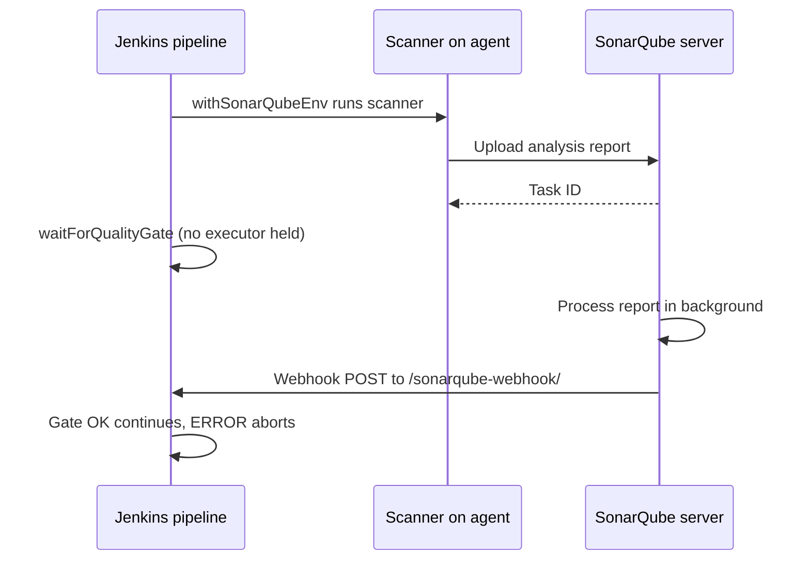

# Code Quality with SonarQube

## Introduction

Tests check that code **behaves** correctly. Static analysis checks how the code is **written**: bugs that tests miss (null dereferences, resource leaks), security hotspots (SQL built from strings, weak crypto), maintainability problems (huge methods, duplicated blocks), and style issues.

**SonarQube** is the most widely used server for this. It analyzes code in many languages, stores results over time, and evaluates a **quality gate**: a set of conditions such as "no new bugs, no new vulnerabilities, coverage on new code at least 80%". Jenkins' job is to run the analysis and then **wait for the gate result** so the pipeline can stop if quality drops.

Jenkins also has its own lightweight option: the **Warnings Next Generation** plugin (plugin ID `warnings-ng`), which collects reports from linters such as ESLint, Ruff, Checkstyle or SpotBugs and shows them in the build, with no separate server.

An analogy: linters are spell-checkers in your editor; Warnings NG prints the spell-check results on the build page; SonarQube is the editor-in-chief who keeps a history of every article and refuses to publish one with new errors.

This page covers:

- SonarQube editions and what the Jenkins integration needs,
- `withSonarQubeEnv` and `waitForQualityGate`,
- analysis for Maven, Gradle, and other languages with the scanner CLI,
- feeding coverage into SonarQube,
- Warnings Next Generation as a server-free alternative.

## How the Integration Works

The key idea: SonarQube analysis is **asynchronous**. The scanner uploads a report, the server processes it in the background, and only then is the quality gate known. The server notifies Jenkins through a **webhook**.



What you need:

1. A SonarQube server (or SonarQube Cloud) and a **user token** for analysis.
2. The **SonarQube Scanner for Jenkins** plugin (plugin ID `sonar`).
3. Under **Manage Jenkins > System > SonarQube servers**, a server entry with a name (for example `sonarqube`), its URL, and the token stored as a Secret text credential.
4. A webhook in SonarQube pointing to `https://<your-jenkins>/sonarqube-webhook/`. Without it, `waitForQualityGate` waits until its timeout.

### SonarQube editions

| Product | Hosting | Notes |
| --- | --- | --- |
| SonarQube Community Build | Self-hosted, free | Main-branch analysis. Branch and pull request analysis are not included. |
| SonarQube Server (Developer, Enterprise, Data Center) | Self-hosted, paid | Adds branch and pull request analysis, more languages, and more |
| SonarQube Cloud | SaaS | Free for public projects, paid for private ones |

Sonar renamed its products in 2024 (SonarQube Community Edition became SonarQube Community Build, and SonarCloud became SonarQube Cloud). Features and pricing change, so check [sonarsource.com](https://www.sonarsource.com/) for the current comparison.

To try it locally, run the Community Build in Docker:

```bash
docker run -d --name sonarqube -p 9000:9000 sonarqube:community
```

Example output:

```text
Unable to find image 'sonarqube:community' locally
community: Pulling from library/sonarqube
Status: Downloaded newer image for sonarqube:community
6c1f0d7a2b3e9f...
```

Open `http://localhost:9000`, log in with the default credentials, change the password, and generate a token under **My Account > Security**. For anything beyond a test, use a real database and follow Sonar's production installation guide.

## Analysis With Maven

The Maven scanner is a Maven plugin, so no extra install is needed on the agent:

```groovy
pipeline {
    agent {
        docker { image 'maven:3.9-eclipse-temurin-21' }
    }

    stages {
        stage('Build and Test') {
            steps {
                sh 'mvn -B -ntp verify'
            }
            post {
                always {
                    junit 'target/surefire-reports/*.xml'
                }
            }
        }

        stage('SonarQube Analysis') {
            steps {
                withSonarQubeEnv('sonarqube') {
                    sh 'mvn -B -ntp org.sonarsource.scanner.maven:sonar-maven-plugin:sonar -Dsonar.projectKey=greeter'
                }
            }
        }

        stage('Quality Gate') {
            steps {
                timeout(time: 10, unit: 'MINUTES') {
                    waitForQualityGate abortPipeline: true
                }
            }
        }
    }
}
```

What happens:

- `withSonarQubeEnv('sonarqube')` looks up the server named `sonarqube` and injects its URL and token as environment variables (such as `SONAR_HOST_URL`) that the scanners read. You never put the token in the Jenkinsfile.
- The Maven goal runs after `verify`, so compiled classes and the JaCoCo report already exist. The scanner picks up `target/site/jacoco/jacoco.xml` automatically for Java.
- `waitForQualityGate` pauses until the webhook arrives. It does **not** hold an executor while waiting, and it survives a controller restart.
- `abortPipeline: true` fails the pipeline if the gate status is not OK.
- `timeout` protects you if the webhook never arrives (misconfigured URL, firewall). Sonar's documentation recommends always wrapping the step in a timeout.

Example output:

```text
[Pipeline] withSonarQubeEnv
Injecting SonarQube environment variables using the configuration: sonarqube
+ mvn -B -ntp org.sonarsource.scanner.maven:sonar-maven-plugin:sonar -Dsonar.projectKey=greeter
[INFO] Analysis report uploaded in 212ms
[INFO] ANALYSIS SUCCESSFUL, you can find the results at: http://sonarqube:9000/dashboard?id=greeter
[INFO] More about the report processing at http://sonarqube:9000/api/ce/task?id=AY...
[Pipeline] waitForQualityGate
Checking status of SonarQube task 'AY...' on server 'sonarqube'
SonarQube task 'AY...' status is 'PENDING'
SonarQube task 'AY...' status is 'SUCCESS'
SonarQube task 'AY...' completed. Quality gate is 'OK'
Finished: SUCCESS
```

:::tip
You can pin the scanner version with the full coordinate, for example `org.sonarsource.scanner.maven:sonar-maven-plugin:<version>:sonar`, or declare it in `pluginManagement` in the POM. Check Sonar's documentation for the current version.
:::

## Analysis With Gradle

Apply the SonarQube Gradle plugin in `build.gradle`:

```groovy
plugins {
    id 'java'
    id 'jacoco'
    id 'org.sonarqube' version '7.5.0.8588'
}

sonar {
    properties {
        property 'sonar.projectKey', 'greeter'
    }
}
```

Then run it inside `withSonarQubeEnv`:

```groovy
stage('SonarQube Analysis') {
    steps {
        withSonarQubeEnv('sonarqube') {
            sh './gradlew --no-daemon test jacocoTestReport sonar'
        }
    }
}
```

The plugin version shown is an example. Look up the current one on the Gradle Plugin Portal.

## Other Languages: the Scanner CLI

For JavaScript, Python, Go and most other languages, use the standalone **SonarScanner CLI**. Configure the analysis in a `sonar-project.properties` file at the repository root:

```text
sonar.projectKey=greeter-api
sonar.sources=src
sonar.tests=tests
sonar.python.coverage.reportPaths=reports/coverage.xml
sonar.python.xunit.reportPath=reports/junit.xml
```

Common coverage properties per language:

| Language | Property | Report |
| --- | --- | --- |
| Java | `sonar.coverage.jacoco.xmlReportPaths` | JaCoCo XML |
| JavaScript/TypeScript | `sonar.javascript.lcov.reportPaths` | LCOV |
| Python | `sonar.python.coverage.reportPaths` | Cobertura XML from coverage.py |
| Go | `sonar.go.coverage.reportPaths` | Go cover profile |
| C# | `sonar.cs.opencover.reportsPaths` | OpenCover XML |

The simplest way to run the CLI is the official container image, used as a stage agent with `reuseNode true` so it sees the workspace:

```groovy
stage('SonarQube Analysis') {
    agent {
        docker {
            image 'sonarsource/sonar-scanner-cli:12'
            reuseNode true
        }
    }
    steps {
        withSonarQubeEnv('sonarqube') {
            sh 'sonar-scanner'
        }
    }
}
```

The tag `12` pins the major version of the image (check Docker Hub for current tags). Alternatively, install the scanner as a Jenkins tool (**Manage Jenkins > Tools > SonarQube Scanner installations**) and call it through the `tool` step:

```groovy
stage('SonarQube Analysis') {
    steps {
        script {
            def scannerHome = tool 'sonar-scanner'
            withSonarQubeEnv('sonarqube') {
                sh "${scannerHome}/bin/sonar-scanner"
            }
        }
    }
}
```

For .NET, Sonar provides a dedicated **SonarScanner for .NET** that wraps the build with `begin` and `end` commands. See Sonar's Jenkins documentation for the exact commands for your scanner version.

## Reacting to the Gate Without Aborting

Sometimes you want to know the gate result but decide yourself what to do, for example mark the build UNSTABLE on feature branches and only block on `main`. `waitForQualityGate` returns an object with a `status` field:

```groovy
stage('Quality Gate') {
    steps {
        timeout(time: 10, unit: 'MINUTES') {
            script {
                def qg = waitForQualityGate()
                echo "Quality gate status: ${qg.status}"
                if (qg.status != 'OK') {
                    if (env.BRANCH_NAME == 'main') {
                        error "Quality gate failed: ${qg.status}"
                    } else {
                        unstable "Quality gate failed: ${qg.status}"
                    }
                }
            }
        }
    }
}
```

Example output on a feature branch:

```text
Checking status of SonarQube task 'AY...' on server 'sonarqube'
SonarQube task 'AY...' completed. Quality gate is 'ERROR'
Quality gate status: ERROR
WARNING: Quality gate failed: ERROR
Finished: UNSTABLE
```

### Branches and pull requests

In a multibranch pipeline, each branch and pull request runs the same Jenkinsfile. With an edition that supports branch analysis, the scanners detect the branch or pull request from Jenkins environment variables (`BRANCH_NAME`, `CHANGE_ID`, `CHANGE_TARGET`) and report it as a separate branch or pull request in SonarQube, so the gate compares against the target branch. With Community Build, analyze only `main` to avoid every branch overwriting the same project:

```groovy
stage('SonarQube Analysis') {
    when { branch 'main' }
    steps {
        withSonarQubeEnv('sonarqube') {
            sh 'mvn -B -ntp org.sonarsource.scanner.maven:sonar-maven-plugin:sonar'
        }
    }
}
```

See [Conditional Stages with when](../3-jenkins-pipeline-basics/8-jenkins-when-conditions.mdx) for more `when` conditions.

## Warnings Next Generation: Linter Results Without a Server

If you do not want to run a SonarQube server, or you want linter results directly on the build page, use Warnings NG. Your linter writes a report, and `recordIssues` parses it:

```groovy
pipeline {
    agent { docker { image 'node:24-bookworm-slim' } }
    environment {
        npm_config_cache = "${WORKSPACE}/.npm"
    }
    stages {
        stage('Install') {
            steps { sh 'npm ci --no-audit --no-fund' }
        }
        stage('Lint') {
            steps {
                sh 'npx eslint . --format checkstyle --output-file reports/eslint.xml || true'
            }
        }
    }
    post {
        always {
            recordIssues(
                enabledForFailure: true,
                tools: [esLint(pattern: 'reports/eslint.xml')],
                qualityGates: [[threshold: 1, type: 'NEW', criticality: 'UNSTABLE']]
            )
        }
    }
}
```

Points to note:

- `|| true` keeps the lint command from failing the stage. The quality gate decides the build result instead.
- `type: 'NEW'` counts only issues that are new compared to a reference build, the same "new code" idea SonarQube uses. `TOTAL` counts all issues.
- Warnings NG has symbols for many tools, for example `checkStyle()`, `spotBugs()`, `pmdParser()`, `pyLint()`, `flake8()`, `myPy()`, `esLint()` and `msBuild()`. For tools without a symbol, use `analysisParser(pattern: '...', analysisModelId: 'ruff')` or `analysisModelId: 'golangci-lint'`. Check the Snippet Generator for the full list on your version.

## Real-World Scenario

Your company has 40 repositories in Java, TypeScript and Python. Security wants every pull request checked for vulnerabilities before merge. Developers complain that the old setup (a nightly SonarQube scan nobody looks at) is noise.

**The solution:**

1. Run SonarQube Server (Developer edition or above, for pull request analysis) or SonarQube Cloud.
2. Add a SonarQube stage and a Quality Gate stage to the shared pipeline template (see [Pipeline Templates for Many Teams](../8-jenkins-shared-libraries/7-jenkins-pipeline-templates.mdx)), so all 40 repositories get it at once.
3. Use Sonar's default "new code" gate: no new bugs or vulnerabilities, reviewed security hotspots, and coverage on new code.
4. Configure the webhook once at the global level in SonarQube.
5. Keep fast linters (ESLint, Ruff) running in the pipeline with Warnings NG for instant feedback on the build page.

**Why this approach:** blocking on the gate makes quality part of the merge decision instead of a report nobody reads. Gating on new code avoids blocking teams for old debt.

**When not to:** for a handful of small repositories, a SonarQube server is real operational overhead (database, upgrades, memory). Linters plus Warnings NG, or SonarQube Cloud, may be enough.

| Approach | Pros | Cons | Best for |
| --- | --- | --- | --- |
| Linters + Warnings NG | No server, fast, per-build view | No cross-project dashboards, limited security rules | Small teams, quick feedback |
| SonarQube Community Build | Free, self-hosted, history and gates | Main branch only, you operate it | Single-branch workflows |
| SonarQube Server (paid) | PR analysis, more languages and rules | License cost, operations | Larger organizations |
| SonarQube Cloud | No operations, PR decoration | Code analyzed off-site, subscription | Teams on GitHub, GitLab, Bitbucket or Azure DevOps cloud |

## Common Mistakes

- **No webhook.** `waitForQualityGate` waits until timeout. Configure the webhook and check its delivery log in SonarQube.
- **No timeout.** Always wrap `waitForQualityGate` in `timeout`.
- **`waitForQualityGate` outside the analysis build.** It needs the task ID that `withSonarQubeEnv` recorded in the same pipeline run.
- **Analyzing before tests.** Run tests and coverage first, otherwise SonarQube shows 0% coverage.
- **Hard-coding tokens.** Let `withSonarQubeEnv` inject them from the server configuration.
- **Gating on overall metrics in a legacy codebase.** Gate on new code.
- **Running two analyses, then two gates.** If you analyze several projects in one pipeline, wait for each gate right after its analysis.

## Summary

- SonarQube analyzes code quality and security and evaluates a quality gate on the server.
- In Jenkins, `withSonarQubeEnv` runs the scanner with injected settings, and `waitForQualityGate` waits for the webhook.
- Use the Maven or Gradle plugin for JVM projects and the Scanner CLI for others.
- Feed coverage and test reports to SonarQube through `sonar.*` properties.
- Warnings NG and `recordIssues` give linter results and gates without a server.

## Exercises

1. Start SonarQube Community Build in Docker, configure it in Jenkins, and analyze the Maven sample project.
2. Configure the webhook and add a Quality Gate stage. Introduce a bug SonarQube detects (for example an unclosed stream) and watch the pipeline abort.
3. Analyze a Python project with `sonar-project.properties` and the coverage report from [Code Coverage](./5-jenkins-code-coverage.mdx).
4. Add ESLint or Ruff with `recordIssues` and a `NEW` issues gate.

Next: [Building and Pushing Docker Images](./7-jenkins-docker-image-builds.mdx). For the full set of quality steps in one pipeline, see [Project: CI/CD for a Java Microservice](../14-jenkins-projects/0-jenkins-project-java-microservice.mdx).
