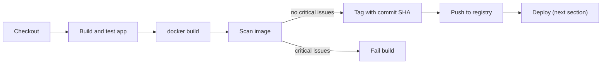

# Building and Pushing Docker Images

## Introduction

For many teams, the final artifact of a build is no longer a JAR or a ZIP file. It is a **container image** that gets deployed to Kubernetes, ECS, Cloud Run or a plain Docker host. So a typical Jenkins pipeline ends with three steps: **build** the image, **tag** it so you can trace it back to a commit, and **push** it to a registry.

That sounds simple, but it raises real questions:

- Where does the image get built? Building needs a Docker daemon or a daemonless builder, and both have security implications.
- How do you log in to the registry without leaking credentials?
- Which tags do you use so you can always tell what is running in production?
- How do you build in Kubernetes pods, where there is usually no Docker daemon?

This page answers these questions, starting with the Docker Pipeline plugin and moving to `docker buildx` and daemonless builders. It assumes you know Dockerfile basics. If not, start with the [Docker tutorial](/docs/devops/docker).

## The Image Pipeline



Deployment is covered in [Deployment Pipelines](../10-jenkins-deployment/0-jenkins-deployment-pipelines.mdx). This page stops at the push.

## A Sample Dockerfile

A multi-stage Dockerfile for the Go service from [Building Go and .NET Projects](./3-jenkins-go-and-dotnet-builds.mdx):

```dockerfile
# syntax=docker/dockerfile:1
FROM golang:1.27 AS build
WORKDIR /src
COPY go.mod go.sum* ./
RUN go mod download
COPY . .
RUN CGO_ENABLED=0 go build -trimpath -o /out/greeter ./cmd/greeter

FROM gcr.io/distroless/static-debian12:nonroot
COPY --from=build /out/greeter /greeter
USER nonroot
ENTRYPOINT ["/greeter"]
```

The build stage compiles, and the final stage contains only the static binary on a minimal, non-root base image. Multi-stage builds keep images small and reduce what a vulnerability scanner can find.

## Approach 1: The Docker Pipeline Plugin

The **Docker Pipeline** plugin (plugin ID `docker-workflow`) adds a global `docker` variable with methods to build, run and push images. The agent needs the Docker CLI and access to a Docker daemon.

```groovy
pipeline {
    agent { label 'docker' }

    environment {
        REGISTRY = 'registry.example.com'
        IMAGE = 'team/greeter'
    }

    stages {
        stage('Build Image') {
            steps {
                script {
                    def shortSha = env.GIT_COMMIT.take(7)
                    env.IMAGE_TAG = "${shortSha}-${env.BUILD_NUMBER}"
                    appImage = docker.build("${REGISTRY}/${IMAGE}:${env.IMAGE_TAG}")
                }
            }
        }

        stage('Smoke Test') {
            steps {
                script {
                    appImage.inside {
                        sh '/greeter'
                    }
                }
            }
        }

        stage('Push') {
            when { branch 'main' }
            steps {
                script {
                    docker.withRegistry("https://${REGISTRY}", 'registry-credentials') {
                        appImage.push()
                        appImage.push('latest')
                    }
                }
            }
        }
    }
}
```

How it works:

- `docker.build(name)` runs `docker build -t name .` in the workspace and returns an image object. A second argument passes extra flags, for example `docker.build("app:1", "-f docker/Dockerfile --pull .")`.
- `appImage.inside { ... }` starts a container from the image with the workspace mounted and runs steps inside it. That is handy for quick checks.
- `docker.withRegistry(url, credentialsId)` logs in using a **Username with password** credential and logs out afterwards.
- `appImage.push()` pushes the build tag. `push('latest')` adds and pushes a second tag.
- `appImage` is declared without `def` so it is visible across stages. Inside `script` blocks, that makes it a global binding variable. A cleaner alternative is to store only the tag in `env` and rebuild the image object with `docker.image(...)`.

Example output (trimmed):

```text
[Pipeline] sh
+ docker build -t registry.example.com/team/greeter:3f9c2ab-42 .
#8 [build 5/6] RUN go mod download
#10 [stage-1 2/2] COPY --from=build /out/greeter /greeter
#11 naming to registry.example.com/team/greeter:3f9c2ab-42 done
[Pipeline] withDockerRegistry
$ docker login -u ci-bot -p ******** https://registry.example.com
Login Succeeded
+ docker push registry.example.com/team/greeter:3f9c2ab-42
3f9c2ab-42: digest: sha256:7d1e... size: 739
+ docker push registry.example.com/team/greeter:latest
Finished: SUCCESS
```

:::note
The Docker Pipeline plugin is widely installed but is currently marked **up for adoption** on plugins.jenkins.io, which means it is looking for new maintainers. It still works, but many teams now prefer plain `sh` steps with the Docker CLI, which are easier to debug and do not depend on a plugin.
:::

## Approach 2: Plain Docker CLI and buildx

Calling the CLI directly gives you every `docker buildx` feature, such as multi-platform images, build cache export, and SBOM and provenance attestations:

```groovy
pipeline {
    agent { label 'docker' }

    environment {
        REGISTRY = 'registry.example.com'
        IMAGE = "${REGISTRY}/team/greeter"
        DOCKER_BUILDKIT = '1'
    }

    stages {
        stage('Build and Push') {
            steps {
                withCredentials([usernamePassword(
                    credentialsId: 'registry-credentials',
                    usernameVariable: 'REG_USER',
                    passwordVariable: 'REG_PASS'
                )]) {
                    sh '''
                        echo "$REG_PASS" | docker login "$REGISTRY" -u "$REG_USER" --password-stdin
                        TAG="$(git rev-parse --short HEAD)-${BUILD_NUMBER}"
                        docker buildx build \
                          --pull \
                          --tag "$IMAGE:$TAG" \
                          --label org.opencontainers.image.revision="$GIT_COMMIT" \
                          --label org.opencontainers.image.source="$GIT_URL" \
                          --push \
                          .
                        echo "Pushed $IMAGE:$TAG"
                    '''
                }
            }
        }
    }

    post {
        always {
            sh 'docker logout "$REGISTRY" || true'
        }
    }
}
```

Notes:

- `--password-stdin` keeps the password out of the process list and shell history. Never use `-p` with a secret in your own scripts.
- The script is in single quotes, so Groovy does not interpolate the secret. The shell reads `$REG_PASS` from the environment.
- `--pull` always fetches the newest base image, so security patches in the base flow into your image.
- OCI labels record the commit and repository inside the image, so `docker inspect` can trace it back.
- `--push` pushes directly from BuildKit without loading the image into the local daemon.

### Multi-platform images

With buildx and QEMU emulation or native ARM agents, one command builds for several CPU architectures:

```bash
docker buildx create --use --name ci-builder
docker buildx build --platform linux/amd64,linux/arm64 --tag registry.example.com/team/greeter:1.4.0 --push .
```

Example output:

```text
[+] Building 84.2s (23/23) FINISHED
 => [linux/amd64 build 6/6] RUN CGO_ENABLED=0 go build ...
 => [linux/arm64 build 6/6] RUN CGO_ENABLED=0 go build ...
 => pushing manifest for registry.example.com/team/greeter:1.4.0
```

Emulated builds are much slower than native ones. For heavy builds, use native ARM agents and merge the results with `docker buildx imagetools create`.

## Tagging Strategy

Tags are how you answer "what is running in production?". A good scheme:

| Tag | Example | Mutable? | Use |
| --- | --- | --- | --- |
| Commit SHA (+ build number) | `3f9c2ab-42` | No | Deployments, traceability |
| Semantic version | `1.4.0` | No (by policy) | Releases, customers |
| Branch name | `main`, `feature-login` | Yes | Preview environments |
| `latest` | `latest` | Yes | Local convenience only |

Deploy by **immutable** tags (or by digest, `image@sha256:...`). Never deploy `latest`: you cannot tell what it pointed to yesterday, and rollbacks become guesswork. Many registries can enforce tag immutability.

## Recording What You Pushed

Later stages (and later jobs) need to know exactly which image this build produced. The safest identifier is the **digest**, because a tag can be moved but a digest cannot. `docker buildx build` can write build metadata, including the digest, to a JSON file:

```groovy
stage('Build and Push') {
    steps {
        sh '''
            docker buildx build --push \
              --tag "$IMAGE:$IMAGE_TAG" \
              --metadata-file build-metadata.json .
        '''
        script {
            def meta = readJSON file: 'build-metadata.json'
            env.IMAGE_DIGEST = meta['containerimage.digest']
            currentBuild.description = "${env.IMAGE_TAG} (${env.IMAGE_DIGEST.take(19)})"
        }
        archiveArtifacts artifacts: 'build-metadata.json', fingerprint: true
    }
}
```

`readJSON` comes from the Pipeline Utility Steps plugin (plugin ID `pipeline-utility-steps`). A deployment stage can now deploy `$IMAGE@$IMAGE_DIGEST`, which is guaranteed to be the exact image this build tested and scanned. The build description shows the tag on the build history page.

Example output:

```text
+ docker buildx build --push --tag registry.example.com/team/greeter:3f9c2ab-42 --metadata-file build-metadata.json .
 => pushing registry.example.com/team/greeter:3f9c2ab-42 with docker
[Pipeline] readJSON
[Pipeline] archiveArtifacts
Archiving artifacts
```

## Scanning Images Before Pushing

Scanning catches known vulnerabilities in the base image and dependencies. Trivy is a popular open-source scanner and has an official image:

```groovy
stage('Scan Image') {
    steps {
        sh '''
            docker run --rm \
              -v /var/run/docker.sock:/var/run/docker.sock \
              aquasec/trivy:latest image \
              --exit-code 1 --severity CRITICAL --ignore-unfixed \
              "$IMAGE:$IMAGE_TAG"
        '''
    }
}
```

Example output:

```text
registry.example.com/team/greeter:3f9c2ab-42 (debian 12.x)
Total: 0 (CRITICAL: 0)
```

`--exit-code 1` fails the stage when critical vulnerabilities are found, and `--ignore-unfixed` skips issues that have no patch yet, which reduces noise. Pin the scanner image tag in real pipelines. Grype and Docker Scout are alternatives, and many registries scan on push.

To scan *before* the image leaves the agent, build with `docker buildx build --load` (or the Docker Pipeline plugin), scan the local image, and push only if the scan passes. If you build with `--push` directly, scan the pushed tag and block the deployment stage instead.

## Building Images on Kubernetes Agents

On [Kubernetes Pod Agents](../6-jenkins-agents/4-jenkins-kubernetes-agents.mdx) there is usually no Docker daemon, and mounting the node's `/var/run/docker.sock` into a pod gives that pod root-equivalent access to the node. Options:

- **Docker-in-Docker (`docker:dind` sidecar)**: works, but needs a **privileged** container.
- **BuildKit rootless**: the `moby/buildkit` project publishes a rootless image and a daemonless mode (`buildctl-daemonless.sh`). It needs some relaxed security settings (such as unconfined seccomp and AppArmor) but not full privileged mode.
- **Buildah**: a daemonless OCI image builder from the Podman ecosystem that can run rootless with suitable configuration.
- **Kaniko**: builds images in user space without a daemon. Google archived the original project in June 2025. Chainguard maintains a fork, but does not publish public images, and the old `gcr.io/kaniko-project/executor` images are no longer updated. Avoid starting new pipelines on the old images.

A pod template with a rootless BuildKit container could look like this (simplified; check the BuildKit documentation for the security settings your cluster needs):

```yaml
apiVersion: v1
kind: Pod
spec:
  containers:
    - name: buildkit
      image: moby/buildkit:rootless
      command: ["sleep"]
      args: ["infinity"]
      env:
        - name: BUILDKITD_FLAGS
          value: --oci-worker-no-process-sandbox
      securityContext:
        runAsUser: 1000
        runAsGroup: 1000
        seccompProfile:
          type: Unconfined
        appArmorProfile:
          type: Unconfined
```

```groovy
stage('Build Image') {
    steps {
        container('buildkit') {
            sh '''
                buildctl-daemonless.sh build \
                  --frontend dockerfile.v0 \
                  --local context=. --local dockerfile=. \
                  --output type=image,name=registry.example.com/team/greeter:${GIT_COMMIT},push=true
            '''
        }
    }
}
```

Registry credentials for `buildctl` come from a Docker `config.json`, typically mounted from a Kubernetes secret. These setups vary by cluster policy, so treat this as a starting point and test it with your platform team.

## Real-World Scenario

Your team deploys eight services to Kubernetes. Jenkins runs on Kubernetes with pod agents. Today, one static VM with Docker builds all images, it is a bottleneck, and last month someone pushed a `latest` tag that broke production because nobody knew which commit it was.

**The solution:**

- Tag every image with the short commit SHA plus build number, and deploy by that tag. Keep `latest` only for local use.
- Push only from `main` (and release tags), so pull request builds never overwrite deployable images.
- Scan before pushing and fail on critical, fixable vulnerabilities.
- Move image builds into pod agents with rootless BuildKit, so builds scale with the cluster and no pod needs the host Docker socket.

**Why this approach:** immutable tags make deployments and rollbacks traceable. Daemonless, rootless builders remove the shared VM bottleneck without giving build pods root on the node.

**When not to:** if you have one or two services and a well-maintained Docker VM agent, the Docker Pipeline plugin or plain `docker buildx` is simpler and perfectly fine. Rootless builders add configuration work that pays off at scale.

| Approach | Pros | Cons | Best for |
| --- | --- | --- | --- |
| Docker Pipeline plugin | Concise Groovy API, `withRegistry` login | Plugin up for adoption, hides CLI flags | Simple VM-based builds |
| `sh` + `docker buildx` | Full BuildKit features, easy to debug | Needs Docker daemon on agent | Most VM or Docker agents |
| Docker socket mount in pods | Easy | Root-equivalent access to node | Avoid in shared clusters |
| Docker-in-Docker sidecar | Real Docker in a pod | Privileged container | Isolated, trusted clusters |
| Rootless BuildKit or Buildah | No daemon on node, no privileged mode | More setup, cluster policy work | Kubernetes agents at scale |

## Common Mistakes

- **Deploying `latest`.** Use immutable tags or digests.
- **`docker login -p $PASS` in Groovy double quotes.** That interpolates the secret into the command and may leak it. Use `--password-stdin` and single quotes.
- **Mounting `/var/run/docker.sock` into untrusted builds.** Anyone who controls the Jenkinsfile then controls the host.
- **Pushing from every branch.** Restrict pushes with `when { branch 'main' }` or tag events.
- **Large images.** Use multi-stage builds and minimal base images to speed up pushes and reduce vulnerabilities.
- **Never pruning.** Docker agents fill their disks with old images and build cache. Schedule `docker system prune` or use ephemeral agents.
- **Starting new work on the archived Kaniko images.** Choose a maintained builder.

## Summary

- A container pipeline builds, tests, scans, tags and pushes the image.
- The Docker Pipeline plugin offers `docker.build`, `inside`, `withRegistry` and `push`. Plain `docker buildx` gives more control.
- Log in with `--password-stdin` and keep secrets out of Groovy strings.
- Tag with commit SHAs and deploy immutable tags.
- On Kubernetes, prefer rootless, daemonless builders over socket mounts or privileged containers.

## Exercises

1. Build and push the Go service image to a local registry (`docker run -d -p 5000:5000 registry:2`) using the Docker Pipeline plugin.
2. Rewrite the pipeline with `docker buildx build --push` and `--password-stdin`. Compare the console logs.
3. Add a Trivy scan stage and make it fail by using an old base image on purpose.
4. Add OCI labels and confirm them with `docker inspect`.

Next: [Build Caching and Speed](./8-jenkins-build-caching.mdx) shows how to make image and dependency builds faster. Then continue to [Deploying to Kubernetes](../10-jenkins-deployment/2-jenkins-deploy-to-kubernetes.mdx).
