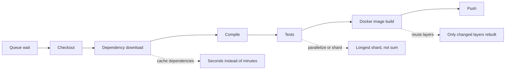

# Build Caching and Speed

## Introduction

Slow builds are expensive in a way that does not show up on an invoice. A developer who waits 25 minutes for feedback switches to another task, loses context, and batches up bigger, riskier changes. Fast pipelines encourage small commits and quick fixes.

Most slow Jenkins builds are slow for the same few reasons:

1. **Downloading the same things again**: dependencies, base images, the full Git history.
2. **Rebuilding what did not change**: compiling untouched modules, rebuilding every Docker layer.
3. **Doing things one after another** that could run at the same time.
4. **Waiting for an executor** because the agent pool is too small.

Caching addresses the first two. [Parallel Stages](../4-jenkins-pipeline-advanced/0-jenkins-parallel-stages.mdx) and capacity planning address the last two.

An analogy: a cache is a pantry. Without it, you go to the store for flour every time you bake. With it, you bake faster, but you must check expiry dates (cache invalidation) and make sure two cooks do not grab the same bag at once (concurrent writes). This page is about stocking the pantry sensibly.

## Step 1: Measure Before You Optimize

Before adding caches, find out where the time goes. Pipeline Graph View (plugin ID `pipeline-graph-view`) shows the duration of each stage, and the stage view on the job page shows averages over recent builds. A quick way to time individual commands in the log:

```groovy
pipeline {
    agent any
    options {
        timestamps()
    }
    stages {
        stage('Install') {
            steps {
                sh 'time npm ci --no-audit --no-fund'
            }
        }
    }
}
```

Example output:

```text
[2026-10-11T09:14:02.118Z] + npm ci --no-audit --no-fund
[2026-10-11T09:15:49.540Z] added 1243 packages in 107s
[2026-10-11T09:15:49.552Z] real	1m47.412s
```

The `timestamps()` option comes from the Timestamper plugin. Note the biggest costs, then attack them in order. A typical breakdown for an un-tuned build looks like this:



## Step 2: Cache Dependencies

Every ecosystem has a local download cache. The trick is keeping it alive between builds.

| Ecosystem | Cache location | Environment variable or flag |
| --- | --- | --- |
| Maven | `~/.m2/repository` | `-Dmaven.repo.local=/cache/m2` |
| Gradle | `~/.gradle` | `GRADLE_USER_HOME=/cache/gradle` |
| npm | `~/.npm` | `npm_config_cache=/cache/npm` |
| pip | `~/.cache/pip` | `PIP_CACHE_DIR=/cache/pip` |
| uv | `~/.cache/uv` | `UV_CACHE_DIR=/cache/uv` |
| Go | `~/go/pkg/mod`, `~/.cache/go-build` | `GOMODCACHE`, `GOCACHE` |
| NuGet | `~/.nuget/packages` | `NUGET_PACKAGES=/cache/nuget` |

### Option A: Static agent, Docker volume

On long-lived Docker agents, mount a named volume into the build container. The volume survives between builds on that agent:

```groovy
pipeline {
    agent {
        docker {
            image 'maven:3.9-eclipse-temurin-21'
            args '-v m2-cache:/cache/m2'
        }
    }
    stages {
        stage('Build') {
            steps {
                sh 'mvn -B -ntp -Dmaven.repo.local=/cache/m2 verify'
            }
        }
    }
}
```

Example output, first and second build:

```text
Build #1: [INFO] Total time:  02:41 min
Build #2: [INFO] Total time:  00:38 min
```

The numbers are illustrative. Your gains depend on how many dependencies you have and how fast your network is.

Caveats:

- The cache is **per agent**. A build that lands on a different agent starts cold.
- **Concurrent builds** share the volume. Maven and Gradle tolerate concurrent reads, but concurrent writes of the same SNAPSHOT can collide. Avoid `mvn install` with shared caches, or give each job its own volume (`-v m2-${JOB_BASE_NAME}:/cache/m2`, at the cost of more disk).
- Volumes grow forever. Prune them on a schedule.

### Option B: Kubernetes agent, persistent volume

On [Kubernetes Pod Agents](../6-jenkins-agents/4-jenkins-kubernetes-agents.mdx), mount a PersistentVolumeClaim in the pod template:

```yaml
apiVersion: v1
kind: Pod
spec:
  containers:
    - name: maven
      image: maven:3.9-eclipse-temurin-21
      command: ["sleep"]
      args: ["infinity"]
      volumeMounts:
        - name: m2-cache
          mountPath: /cache/m2
  volumes:
    - name: m2-cache
      persistentVolumeClaim:
        claimName: jenkins-m2-cache
```

To share one PVC across many pods at the same time, it needs the `ReadWriteMany` access mode, which only some storage classes support (NFS, EFS, Azure Files and similar). Network file systems can also be slower than downloading from a nearby proxy, so measure.

### Option C: The Job Cacher plugin

The **Job Cacher** plugin (plugin ID `jobcacher`) adds a `cache` step. It restores a cache archive before the block runs and saves it afterwards. By default it stores caches on the controller, and storage plugins can put them in S3-compatible storage, Azure, GCS, Artifactory or an OCI registry instead. This works well for ephemeral agents.

```groovy
pipeline {
    agent {
        kubernetes {
            yaml '''
apiVersion: v1
kind: Pod
spec:
  containers:
    - name: node
      image: node:24-bookworm-slim
      command: ["sleep"]
      args: ["infinity"]
'''
            defaultContainer 'node'
        }
    }
    environment {
        npm_config_cache = "${WORKSPACE}/.npm"
    }
    stages {
        stage('Install') {
            steps {
                cache(maxCacheSize: 500, defaultBranch: 'main', caches: [
                    arbitraryFileCache(
                        path: '.npm',
                        cacheValidityDecidingFile: 'package-lock.json',
                        compressionMethod: 'TAR_ZSTD'
                    )
                ]) {
                    sh 'npm ci --prefer-offline --no-audit --no-fund'
                }
            }
        }
    }
}
```

How it behaves:

- `cacheValidityDecidingFile` works like a cache key: when `package-lock.json` changes, the old cache is not restored.
- `defaultBranch: 'main'` seeds a brand-new branch's cache from `main`, so the first pull request build is not cold.
- `maxCacheSize` is in megabytes. Oversized caches are not saved.
- `compressionMethod` can be `ZIP`, `TARGZ` (default), `TARGZ_BEST_SPEED`, `TAR_ZSTD` or `TAR`.

:::caution
Storing caches on the controller puts large files in `JENKINS_HOME` and moves them through the controller on every build. For more than a few jobs, configure an external storage backend. See [Performance Tuning](../12-jenkins-administration/4-jenkins-performance-tuning.mdx).
:::

### Option D: A repository proxy

A **repository manager** (Nexus, Artifactory, or a pull-through registry cache) inside your network caches dependencies for every agent at once. Builds still "download", but from a server a few milliseconds away. This is often the best single investment for large Jenkins installations, because it helps every job, survives agent churn, and protects you from public registry outages and rate limits (for example Docker Hub pull limits).

## Step 3: Reuse Docker Layers

Docker builds are cached layer by layer. Order the Dockerfile so that rarely changing layers come first:

```dockerfile
FROM node:24-bookworm-slim
WORKDIR /app
# Changes rarely: cached unless the lockfile changes
COPY package.json package-lock.json ./
RUN npm ci --omit=dev
# Changes on every commit
COPY . .
CMD ["node", "src/server.js"]
```

On ephemeral agents, the local layer cache is empty every time. BuildKit can export and import the cache through your registry:

```bash
docker buildx build \
  --cache-from type=registry,ref=registry.example.com/team/web:buildcache \
  --cache-to type=registry,ref=registry.example.com/team/web:buildcache,mode=max \
  --tag registry.example.com/team/web:3f9c2ab-42 \
  --push .
```

Example output on a warm cache:

```text
 => importing cache manifest from registry.example.com/team/web:buildcache
 => CACHED [2/5] WORKDIR /app
 => CACHED [3/5] COPY package.json package-lock.json ./
 => CACHED [4/5] RUN npm ci --omit=dev
 => [5/5] COPY . .
 => exporting cache to registry.example.com/team/web:buildcache
```

`mode=max` caches intermediate stages of multi-stage builds too, which matters when the expensive work happens in a build stage. The registry cache export may need the `docker-container` buildx driver (`docker buildx create --use`). See [Building and Pushing Docker Images](./7-jenkins-docker-image-builds.mdx).

## Step 4: Avoid Redoing Work

### Build tool caches

- **Gradle build cache** (`--build-cache`) reuses task outputs. A shared remote build cache lets CI populate outputs that developers' machines reuse, and the other way around if you allow it.
- **Incremental compilation** in Go (`GOCACHE`), .NET and TypeScript (`tsc --incremental`) only helps when the cache directory survives between builds.
- **Monorepo tools** such as Nx, Turborepo, Bazel and Pants skip unchanged packages entirely. See [Building Monorepos](../5-jenkins-scm-integration/6-jenkins-monorepo-builds.mdx).

### Faster checkouts

Large repositories with years of history are slow to clone. A shallow clone fetches only recent commits:

```groovy
pipeline {
    agent any
    options {
        skipDefaultCheckout()
    }
    stages {
        stage('Checkout') {
            steps {
                checkout scmGit(
                    branches: [[name: '*/main']],
                    userRemoteConfigs: [[url: 'https://github.com/example/big-repo.git']],
                    extensions: [cloneOption(shallow: true, depth: 1, noTags: true, reference: '')]
                )
            }
        }
    }
}
```

For multibranch pipelines, add the equivalent "Advanced clone behaviours" trait in the branch source configuration instead. Trade-off: tools that need history (`git describe`, changelog generators, SonarQube blame data, coverage on modified lines) may break or lose accuracy with depth 1. See [Git Integration](../5-jenkins-scm-integration/0-jenkins-git-integration.mdx).

### Pipeline durability

By default, Jenkins writes pipeline state to disk very often so builds can survive a controller restart. For many short builds, the `PERFORMANCE_OPTIMIZED` durability setting reduces that disk I/O on the controller:

```groovy
options {
    durabilityHint('PERFORMANCE_OPTIMIZED')
}
```

The cost: if the controller crashes mid-build, the running build may not resume. It speeds up the controller, not your compiler, so use it when the controller is the bottleneck.

## Step 5: Run Less, and Run It in Parallel

The fastest stage is the one that does not run. Two built-in tools help:

- `when` conditions skip stages that do not apply, for example documentation-only changes or image pushes on pull requests.
- `parallel` runs independent stages at the same time, as long as there are enough executors.

```groovy
pipeline {
    agent none
    stages {
        stage('Checks') {
            parallel {
                stage('Backend Tests') {
                    agent { docker { image 'maven:3.9-eclipse-temurin-21' } }
                    when { changeset 'backend/**' }
                    steps { sh 'cd backend && mvn -B -ntp verify' }
                }
                stage('Frontend Tests') {
                    agent { docker { image 'node:24-bookworm-slim' } }
                    when { changeset 'frontend/**' }
                    steps { sh 'cd frontend && npm ci && npm test' }
                }
            }
        }
    }
}
```

Example output for a commit that only touched `frontend/`:

```text
Stage "Backend Tests" skipped due to when conditional
[Frontend Tests] + npm ci
[Frontend Tests] added 512 packages in 14s
Finished: SUCCESS
```

Be careful with `changeset`: it compares against the previous build of the same branch, so the first build of a new branch or a rebuild can skip stages unexpectedly. For pull requests, many teams add `changeRequest()` logic or always run everything on `main`. Details are in [Conditional Stages with when](../3-jenkins-pipeline-basics/8-jenkins-when-conditions.mdx).

## Real-World Scenario

Your 60-developer team uses Jenkins on Kubernetes with ephemeral pod agents. A typical pull request build of the main Java and React application takes 24 minutes. Developers have started to push less often. Measuring shows: 3 minutes waiting for a pod, 1.5 minutes cloning, 7 minutes downloading Maven and npm dependencies, 9 minutes of tests, and 3.5 minutes building the Docker image.

**The solution, in order of payoff:**

1. Put Nexus (or Artifactory) in the cluster as a Maven, npm and Docker proxy. Dependency time drops sharply for every job.
2. Add the `cache` step for `~/.m2` and the npm cache with lockfile-based validity, stored in S3-compatible storage.
3. Use BuildKit registry cache (`--cache-from` and `--cache-to`) for the Docker image.
4. Run front-end and back-end tests in parallel stages, and shard the slow back-end suite (see [Test Reports with JUnit](./4-jenkins-test-reports.mdx)).
5. Use a shallow clone for pull request builds, but keep full history on `main`, where SonarQube needs blame data.
6. Keep a small pool of warm pods or raise cluster capacity to cut queue wait.

**Why this approach:** it targets the measured bottlenecks, starting with the change that helps every job. Caches keyed on lockfiles stay correct when dependencies change.

**When not to cache:** release builds that must be fully reproducible from scratch, and security-sensitive builds where a poisoned cache is a risk. There, build clean and accept the cost, or verify checksums (Go's `go.sum`, npm's lockfile integrity hashes, Gradle dependency verification).

| Technique | Pros | Cons | Best for |
| --- | --- | --- | --- |
| Docker volume on static agents | Simple, fast | Per-agent, concurrency and growth issues | Few static agents |
| PVC on Kubernetes | Shared across pods | Needs ReadWriteMany, network FS speed | Kubernetes with good storage |
| Job Cacher `cache` step | Works with ephemeral agents, lockfile keys | Upload and download of archives each build | Ephemeral agents |
| Repository proxy | Helps every job, outage protection | Another service to run | Medium and large installations |
| BuildKit registry cache | Layer reuse on ephemeral agents | Registry storage, buildx driver setup | Container builds |
| Shallow clone | Fast checkout | Breaks history-based tools | Large repositories, PR builds |

## Common Mistakes

- **Caching without measuring.** You may optimize a 20-second step while a 10-minute one remains.
- **Caching `node_modules` or build outputs without a key.** Stale caches cause "works only after clearing the cache" bugs. Key caches on lockfiles.
- **Sharing writable caches across concurrent builds** without checking that the tool supports it.
- **Letting caches grow forever.** Set `maxCacheSize`, prune volumes, and expire registry cache tags.
- **Caching secrets.** Make sure `.npmrc` with tokens, `settings.xml` with passwords, or cloud credentials never end up in a cache archive.
- **Shallow clones everywhere.** Keep full history where tools need it.
- **Ignoring queue time.** If builds wait 5 minutes for an executor, caching cannot fix it. Add agents or reduce concurrency.

## Summary

- Measure stage durations first, then fix the biggest costs.
- Keep dependency caches alive with volumes, PVCs, the Job Cacher plugin or a repository proxy.
- Order Dockerfiles for layer reuse, and use BuildKit registry caches on ephemeral agents.
- Use build tool caches, shallow clones and parallelism to avoid redoing work.
- Every cache needs a key, a size limit and an owner.

## Exercises

1. Add `timestamps()` to one of your pipelines and list the three slowest steps.
2. Add a Docker volume or `cache` step for your dependency cache and compare build times for three runs.
3. Reorder a Dockerfile so dependency installation is cached, change one source file, and confirm that only the last layers rebuild.
4. Try `cloneOption(shallow: true, depth: 1)` on a large repository and measure the checkout time. Then check whether `git describe` still works.

This ends the Building and Testing section. Continue with [Deployment Pipelines](../10-jenkins-deployment/0-jenkins-deployment-pipelines.mdx), or read [Performance Tuning](../12-jenkins-administration/4-jenkins-performance-tuning.mdx) for controller-side speed.
