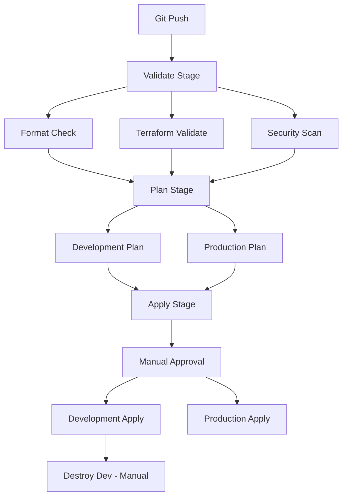

# Terraform with GitLab CI

## Introduction

Integrating Terraform with GitLab CI provides a powerful way to automate your infrastructure deployments. This combination enables you to apply infrastructure as code (IaC) principles while leveraging GitLab's robust CI/CD capabilities. By the end of this tutorial, you'll understand how to set up a GitLab CI pipeline that automatically plans and applies your Terraform configurations, bringing version control and automation to your infrastructure management.

Terraform allows you to define infrastructure in a declarative way, while GitLab CI provides the automation engine to validate, plan, and apply those changes in a controlled manner. This integration creates a consistent workflow for infrastructure changes that improves collaboration, reduces errors, and increases deployment speed.

## Prerequisites

Before getting started, make sure you have:

- A GitLab account
- Basic knowledge of Terraform
- A project with Terraform code
- Access to a cloud provider (AWS, Azure, GCP, etc.)

## Setting Up GitLab CI for Terraform

### Step 1: Create a `.gitlab-ci.yml` File

First, let's create a basic GitLab CI configuration in your repository. Create a file named `.gitlab-ci.yml` in the root of your repository:

```yaml
stages:
  - validate
  - plan
  - apply

image:
  name: hashicorp/terraform:latest
  entrypoint:
    - '/usr/bin/env'
    - 'PATH=/usr/local/sbin:/usr/local/bin:/usr/sbin:/usr/bin:/sbin:/bin'

variables:
  TF_ROOT: ${CI_PROJECT_DIR}
  # If you're using a custom module, you can specify it here
  # TF_ROOT: ${CI_PROJECT_DIR}/environments/production

cache:
  key: ${CI_COMMIT_REF_SLUG}
  paths:
    - .terraform

before_script:
  - cd ${TF_ROOT}
  - terraform --version
  - terraform init
```

This configuration sets up a pipeline with three stages: validate, plan, and apply. It uses the official Terraform Docker image and initializes Terraform before each job.

### Step 2: Add Validation Stage

Now, let's add a job for validating Terraform configurations:

```yaml
validate:
  stage: validate
  script:
    - terraform validate
  only:
    - merge_requests
    - main
```

The validation job checks your Terraform code syntax and configuration without accessing any remote services.

### Step 3: Add Planning Stage

Next, add a job for creating Terraform plans:

```yaml
plan:
  stage: plan
  script:
    - terraform plan -out=tfplan
  artifacts:
    paths:
      - tfplan
    expire_in: 1 week
  only:
    - merge_requests
    - main
```

This job creates an execution plan and saves it as an artifact. The plan shows what infrastructure changes Terraform will make based on your configuration.

### Step 4: Add Apply Stage

Finally, add a job for applying the Terraform plan:

```yaml
apply:
  stage: apply
  script:
    - terraform apply -auto-approve tfplan
  dependencies:
    - plan
  only:
    - main
  when: manual
```

The apply job executes the plan to create, update, or delete the specified infrastructure. We've added `when: manual` to make this a manual step that requires approval before execution.

### Complete `.gitlab-ci.yml` Example

Here's the complete CI configuration:

```yaml
stages:
  - validate
  - plan
  - apply

image:
  name: hashicorp/terraform:latest
  entrypoint:
    - '/usr/bin/env'
    - 'PATH=/usr/local/sbin:/usr/local/bin:/usr/sbin:/usr/bin:/sbin:/bin'

variables:
  TF_ROOT: ${CI_PROJECT_DIR}

cache:
  key: ${CI_COMMIT_REF_SLUG}
  paths:
    - .terraform

before_script:
  - cd ${TF_ROOT}
  - terraform --version
  - terraform init

validate:
  stage: validate
  script:
    - terraform validate
  only:
    - merge_requests
    - main

plan:
  stage: plan
  script:
    - terraform plan -out=tfplan
  artifacts:
    paths:
      - tfplan
    expire_in: 1 week
  only:
    - merge_requests
    - main

apply:
  stage: apply
  script:
    - terraform apply -auto-approve tfplan
  dependencies:
    - plan
  only:
    - main
  when: manual
```

## Managing Terraform State in GitLab CI

One crucial aspect of using Terraform in CI/CD is state management. Let's explore how to configure remote state storage for GitLab CI pipelines.

### Using GitLab-managed Terraform State

GitLab offers built-in Terraform state management. To use it:

1. Add the following to your `.gitlab-ci.yml`:

```yaml
variables:
  TF_STATE_NAME: default
  TF_ADDRESS: ${CI_API_V4_URL}/projects/${CI_PROJECT_ID}/terraform/state/${TF_STATE_NAME}
```

2. Configure the GitLab backend in your Terraform code:

```hcl
terraform {
  backend "http" {}
}
```

3. Add a GitLab access token:

```yaml
variables:
  TF_ADDRESS: ${CI_API_V4_URL}/projects/${CI_PROJECT_ID}/terraform/state/${TF_STATE_NAME}
  TF_HTTP_USERNAME: gitlab-ci-token
  TF_HTTP_PASSWORD: ${CI_JOB_TOKEN}
```

### Alternative: Using Cloud Storage for State

You can also use cloud provider storage for maintaining state:

For AWS S3:

```hcl
terraform {
  backend "s3" {
    bucket = "my-terraform-state"
    key    = "my-project/terraform.tfstate"
    region = "us-east-1"
  }
}
```

For Azure Storage:

```hcl
terraform {
  backend "azurerm" {
    resource_group_name  = "terraform-storage-rg"
    storage_account_name = "terraformstate"
    container_name       = "tfstate"
    key                  = "terraform.tfstate"
  }
}
```

For Google Cloud Storage:

```hcl
terraform {
  backend "gcs" {
    bucket = "my-terraform-state-bucket"
    prefix = "terraform/state"
  }
}
```

## Advanced GitLab CI Configuration for Terraform

### Environment-specific Deployments

For multiple environments (dev, staging, production), you can structure your pipeline like this:

```yaml
plan:dev:
  stage: plan
  script:
    - terraform plan -out=tfplan -var-file=environments/dev.tfvars
  artifacts:
    paths:
      - tfplan
  only:
    - branches
  except:
    - main

apply:dev:
  stage: apply
  script:
    - terraform apply -auto-approve tfplan
  dependencies:
    - plan:dev
  only:
    - branches
  except:
    - main
  when: manual

plan:prod:
  stage: plan
  script:
    - terraform plan -out=tfplan -var-file=environments/prod.tfvars
  artifacts:
    paths:
      - tfplan
  only:
    - main

apply:prod:
  stage: apply
  script:
    - terraform apply -auto-approve tfplan
  dependencies:
    - plan:prod
  only:
    - main
  when: manual
```

### Adding Terraform Format Check

You can add a formatting check to ensure consistent code style:

```yaml
fmt:
  stage: validate
  script:
    - terraform fmt -check=true
  allow_failure: true
```

### Security Scanning with tfsec

Integrate security scanning into your pipeline:

```yaml
tfsec:
  stage: validate
  image:
    name: aquasec/tfsec:latest
    entrypoint: [""]
  script:
    - tfsec .
  allow_failure: true
```

## Real-world Example: Deploying a Web Application Infrastructure

Let's look at a complete example of deploying infrastructure for a web application using Terraform and GitLab CI.

### Directory Structure

```
├── .gitlab-ci.yml
├── main.tf
├── variables.tf
├── outputs.tf
├── environments/
│   ├── dev.tfvars
│   └── prod.tfvars
```

### Terraform Configuration (main.tf)

```hcl
provider "aws" {
  region = var.region
}

terraform {
  backend "http" {}
}

# Create VPC
resource "aws_vpc" "main" {
  cidr_block = var.vpc_cidr
  tags = {
    Name        = "${var.environment}-vpc"
    Environment = var.environment
  }
}

# Create subnets
resource "aws_subnet" "public" {
  count             = length(var.public_subnet_cidrs)
  vpc_id            = aws_vpc.main.id
  cidr_block        = var.public_subnet_cidrs[count.index]
  availability_zone = var.availability_zones[count.index]
  
  tags = {
    Name        = "${var.environment}-public-subnet-${count.index}"
    Environment = var.environment
  }
}

# Create security group
resource "aws_security_group" "web" {
  name        = "${var.environment}-web-sg"
  description = "Security group for web servers"
  vpc_id      = aws_vpc.main.id

  ingress {
    from_port   = 80
    to_port     = 80
    protocol    = "tcp"
    cidr_blocks = ["0.0.0.0/0"]
  }

  ingress {
    from_port   = 443
    to_port     = 443
    protocol    = "tcp"
    cidr_blocks = ["0.0.0.0/0"]
  }

  egress {
    from_port   = 0
    to_port     = 0
    protocol    = "-1"
    cidr_blocks = ["0.0.0.0/0"]
  }

  tags = {
    Name        = "${var.environment}-web-sg"
    Environment = var.environment
  }
}

# Create EC2 instances
resource "aws_instance" "web" {
  count         = var.instance_count
  ami           = var.ami_id
  instance_type = var.instance_type
  subnet_id     = aws_subnet.public[count.index % length(aws_subnet.public)].id
  vpc_security_group_ids = [aws_security_group.web.id]
  
  tags = {
    Name        = "${var.environment}-web-server-${count.index}"
    Environment = var.environment
  }
}
```

### Variables Configuration (variables.tf)

```hcl
variable "region" {
  description = "AWS region"
  type        = string
  default     = "us-east-1"
}

variable "environment" {
  description = "Environment name"
  type        = string
}

variable "vpc_cidr" {
  description = "CIDR block for VPC"
  type        = string
}

variable "public_subnet_cidrs" {
  description = "CIDR blocks for public subnets"
  type        = list(string)
}

variable "availability_zones" {
  description = "AWS availability zones"
  type        = list(string)
}

variable "instance_count" {
  description = "Number of EC2 instances"
  type        = number
  default     = 2
}

variable "ami_id" {
  description = "AMI ID for EC2 instances"
  type        = string
}

variable "instance_type" {
  description = "EC2 instance type"
  type        = string
  default     = "t3.micro"
}
```

### Environment Variables (dev.tfvars)

```hcl
environment         = "dev"
vpc_cidr            = "10.0.0.0/16"
public_subnet_cidrs = ["10.0.1.0/24", "10.0.2.0/24"]
availability_zones  = ["us-east-1a", "us-east-1b"]
instance_count      = 1
ami_id              = "ami-0123456789abcdef0"  # Amazon Linux 2 AMI
instance_type       = "t3.micro"
```

### GitLab CI Configuration

```yaml
stages:
  - validate
  - plan
  - apply
  - destroy

image:
  name: hashicorp/terraform:latest
  entrypoint:
    - '/usr/bin/env'
    - 'PATH=/usr/local/sbin:/usr/local/bin:/usr/sbin:/usr/bin:/sbin:/bin'

variables:
  TF_ROOT: ${CI_PROJECT_DIR}
  TF_STATE_NAME: ${CI_COMMIT_REF_SLUG}
  TF_ADDRESS: ${CI_API_V4_URL}/projects/${CI_PROJECT_ID}/terraform/state/${TF_STATE_NAME}
  TF_HTTP_USERNAME: gitlab-ci-token
  TF_HTTP_PASSWORD: ${CI_JOB_TOKEN}
  AWS_ACCESS_KEY_ID: ${AWS_ACCESS_KEY_ID}
  AWS_SECRET_ACCESS_KEY: ${AWS_SECRET_ACCESS_KEY}

cache:
  key: ${CI_COMMIT_REF_SLUG}
  paths:
    - .terraform

before_script:
  - cd ${TF_ROOT}
  - terraform --version
  - terraform init -backend-config="address=${TF_ADDRESS}" -backend-config="username=${TF_HTTP_USERNAME}" -backend-config="password=${TF_HTTP_PASSWORD}"

fmt:
  stage: validate
  script:
    - terraform fmt -check=true
  allow_failure: true

validate:
  stage: validate
  script:
    - terraform validate
  only:
    - merge_requests
    - main
    - develop

tfsec:
  stage: validate
  image:
    name: aquasec/tfsec:latest
    entrypoint: [""]
  script:
    - tfsec .
  allow_failure: true

plan:dev:
  stage: plan
  script:
    - terraform plan -out=tfplan -var-file=environments/dev.tfvars
  artifacts:
    paths:
      - tfplan
    expire_in: 1 week
  only:
    - develop

apply:dev:
  stage: apply
  script:
    - terraform apply -auto-approve tfplan
  dependencies:
    - plan:dev
  only:
    - develop
  when: manual

plan:prod:
  stage: plan
  script:
    - terraform plan -out=tfplan -var-file=environments/prod.tfvars
  artifacts:
    paths:
      - tfplan
    expire_in: 1 week
  only:
    - main

apply:prod:
  stage: apply
  script:
    - terraform apply -auto-approve tfplan
  dependencies:
    - plan:prod
  only:
    - main
  when: manual

destroy:dev:
  stage: destroy
  script:
    - terraform destroy -auto-approve -var-file=environments/dev.tfvars
  only:
    - develop
  when: manual
  environment:
    name: development
    action: stop
```

## Pipeline Visualization

Let's visualize the GitLab CI/CD pipeline for Terraform:



Each push runs the validation jobs in parallel. If they succeed, the plan job for the matching branch runs, and the apply job waits for someone to start it manually after reviewing the plan.

## Best Practices

1. **Pin the Terraform version** - Use a specific image tag such as `hashicorp/terraform:1.6` instead of `latest` so that pipeline runs are reproducible.
2. **Protect your variables** - Store cloud credentials as masked and protected CI/CD variables in GitLab, never in the repository.
3. **Apply saved plans** - Always apply the `tfplan` artifact produced by the plan job so the reviewed changes are exactly what gets deployed.
4. **Use manual gates for production** - Keep `when: manual` on production apply jobs and restrict who can run them with protected branches and environments.
5. **Keep state remote and locked** - Use GitLab-managed state or a cloud backend with locking to prevent concurrent runs from corrupting state.
6. **Review plans in merge requests** - Run plans on merge requests so reviewers can see the infrastructure impact before merging.

## Troubleshooting Common Issues

| Problem | Likely Cause | Solution |
|---------|--------------|----------|
| `Error acquiring the state lock` | A previous job was cancelled while holding the lock | Wait for the other job to finish, or run `terraform force-unlock LOCK_ID` carefully |
| `Saved plan is stale` | State changed after the plan was created | Re-run the plan job, then apply the new plan |
| `No valid credential sources found` | Cloud credentials are not available in the job | Check that the CI/CD variables are defined and available to the branch |
| `Backend configuration changed` | Backend settings differ from the cached `.terraform` directory | Run `terraform init -reconfigure` |

## Summary

In this tutorial, you learned how to integrate Terraform with GitLab CI to automate infrastructure deployments. We covered:

- Creating a `.gitlab-ci.yml` file with validate, plan, and apply stages
- Managing Terraform state with GitLab-managed state or cloud storage backends
- Deploying to multiple environments with separate plan and apply jobs
- Adding format checks and security scanning with tfsec
- Building a complete pipeline for a web application infrastructure

With this setup, every infrastructure change goes through version control, automated checks, and a review step before it reaches your cloud environment.

## Exercises

1. Set up a GitLab project with a simple Terraform configuration that creates an S3 bucket, and add a pipeline with validate, plan, and apply stages.
2. Switch the project to GitLab-managed Terraform state and confirm the state appears under **Operate > Terraform states**.
3. Add a staging environment with its own `staging.tfvars` file and plan/apply jobs.
4. Add a scheduled pipeline that runs `terraform plan -detailed-exitcode` to detect configuration drift.

## Additional Resources

- [GitLab Infrastructure as Code with Terraform](https://docs.gitlab.com/ee/user/infrastructure/iac/)
- [GitLab-managed Terraform State](https://docs.gitlab.com/ee/user/infrastructure/iac/terraform_state.html)
- [GitLab CI/CD YAML Reference](https://docs.gitlab.com/ee/ci/yaml/)
- [Terraform CLI Documentation](https://developer.hashicorp.com/terraform/cli)
