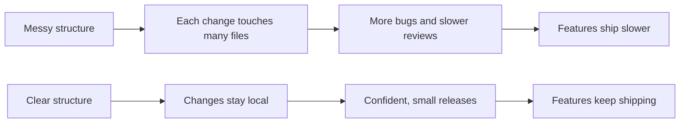
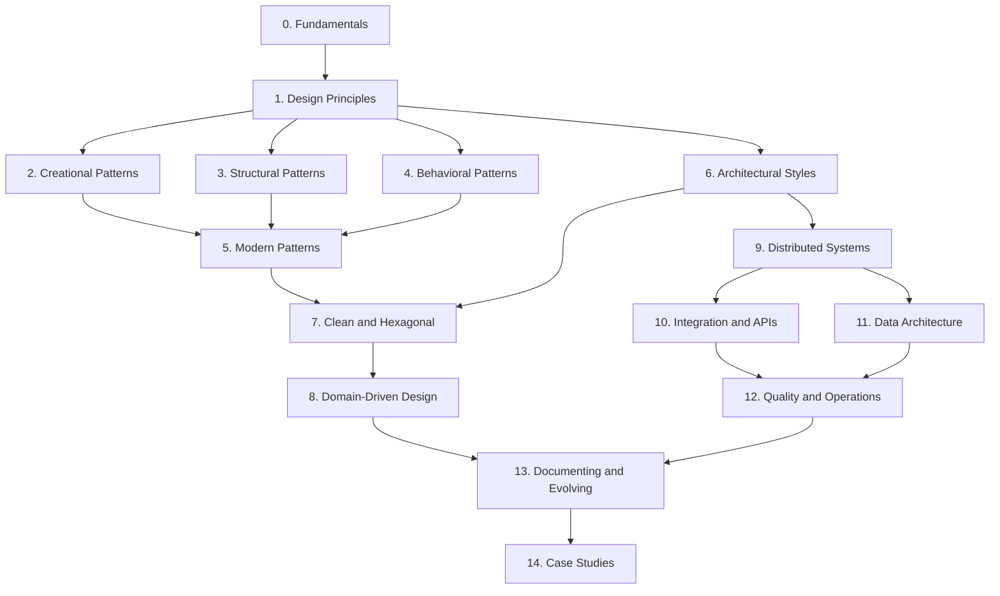
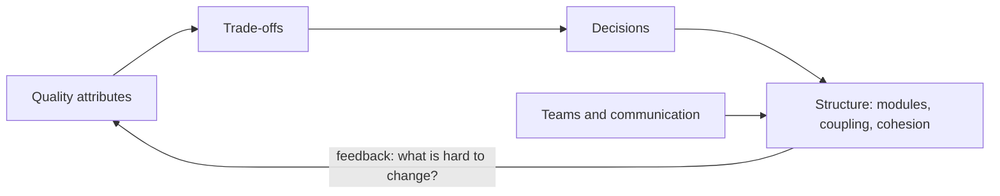
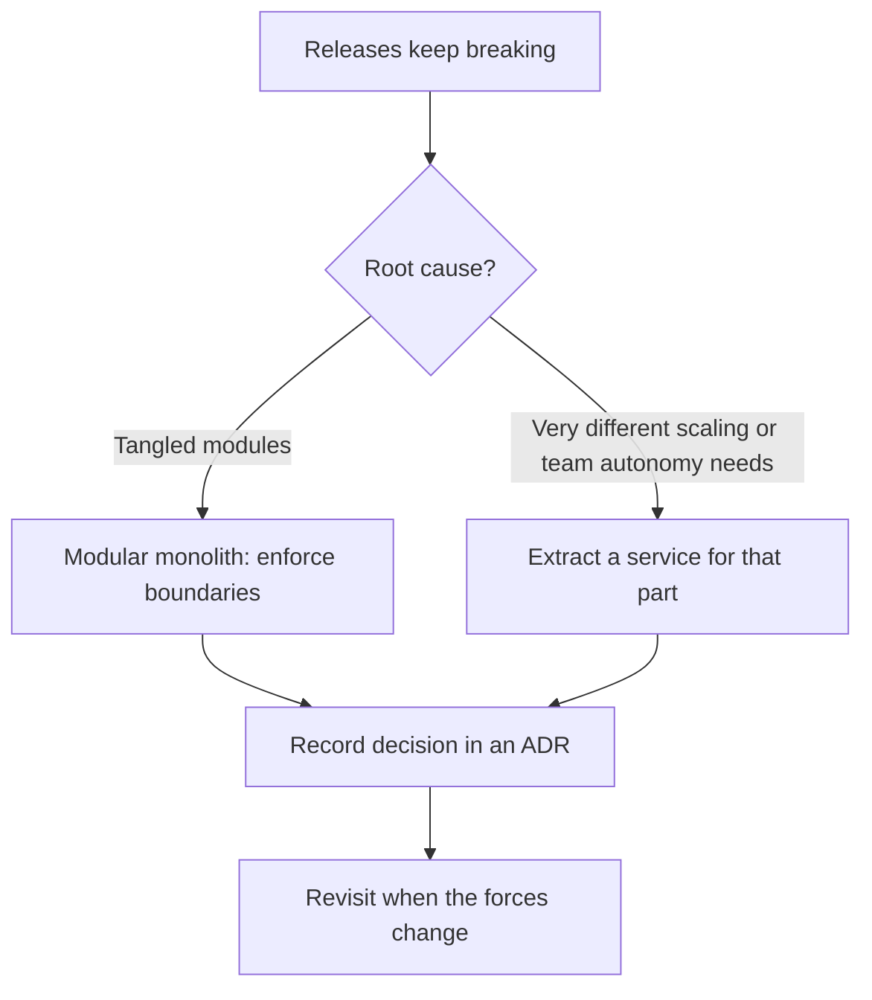

# Software Architecture Introduction

<div style={{
    "width": "30%",
    "margin": "0 auto",
    "text-align": "center"
}}>
    
</div>

## Introduction

You can already write code. You know loops, functions, classes, and maybe a web framework or two. Yet when you open a large codebase at work, or start a project that has to live for years, a different set of questions appears:

- Where should this new feature go?
- Why does a one-line change break three unrelated screens?
- Should we split this app into microservices, or is that a trap?
- How do I explain to my manager why we need two weeks to "clean things up"?

**Software architecture** is the discipline that answers those questions. **Design patterns** are the reusable solutions that experienced developers reach for when the same design problems come up again and again. Together they bridge the gap between "I know the syntax" and "I can design a system that a team can change safely for years."

Think of it like building houses:

- **Syntax** is knowing how to use a hammer, a saw, and a drill.
- **Design patterns** are proven building techniques: how to frame a doorway, how to run plumbing through a wall.
- **Architecture** is deciding where the kitchen goes, how many floors there are, and how the house will be extended when the family grows. These decisions are expensive to change later.

This tutorial teaches all three levels with practical, scenario-based examples. Every page explains not only *how* to apply an idea, but *why* it fits a situation, *when* it does not, and what the alternatives cost.

## Why Architecture Matters

Users never see your architecture directly. They see features, speed, and bugs. So why spend effort on it?

Martin Fowler's essay [Is High Quality Software Worth the Cost?](https://martinfowler.com/articles/is-quality-worth-cost.html) makes the economic argument. Poor internal structure (he calls the mess "cruft") lets a team move fast for a short while, then slows every later change. Good internal structure keeps the cost of change low, so the team keeps shipping. In other words, architecture is not gold-plating. It is what keeps feature delivery fast after the first few months.



:::note
Good architecture is not the same as *a lot of* architecture. Many of the worst systems are over-designed: layers nobody needs, services split too early, patterns applied for their own sake. A recurring theme in this tutorial is choosing the *simplest* structure that handles your real forces.
:::

## A First Look: The Same Feature, Two Designs

Here is a tiny example of what "design" means in code. An online bookstore needs to confirm an order: save it and tell the customer. The first version mixes everything together.

```python
# before.py: everything in one function
import sqlite3


def confirm_order(order_id: int, email: str) -> None:
    conn = sqlite3.connect(":memory:")
    conn.execute("CREATE TABLE IF NOT EXISTS orders (id INTEGER, status TEXT)")
    conn.execute("INSERT INTO orders VALUES (?, ?)", (order_id, "confirmed"))
    conn.commit()
    # Pretend this is an SMTP call
    print(f"EMAIL to {email}: Order {order_id} confirmed")


confirm_order(42, "ana@example.com")
```

Output:

```text
EMAIL to ana@example.com: Order 42 confirmed
```

It works. But try to answer these questions: How do you test it without a database? How do you send an SMS instead of an email? How do you reuse the confirmation logic from a mobile API? Every answer requires editing this one function.

The second version separates *what* happens from *how* it is done, using small interfaces.

```python
# after.py: business logic depends on small abstractions
from dataclasses import dataclass, field
from typing import Protocol


class OrderStore(Protocol):
    def save_status(self, order_id: int, status: str) -> None: ...


class Notifier(Protocol):
    def send(self, to: str, message: str) -> None: ...


@dataclass
class InMemoryOrderStore:
    rows: dict[int, str] = field(default_factory=dict)

    def save_status(self, order_id: int, status: str) -> None:
        self.rows[order_id] = status


class ConsoleNotifier:
    def send(self, to: str, message: str) -> None:
        print(f"NOTIFY {to}: {message}")


@dataclass
class OrderService:
    store: OrderStore
    notifier: Notifier

    def confirm(self, order_id: int, contact: str) -> None:
        self.store.save_status(order_id, "confirmed")
        self.notifier.send(contact, f"Order {order_id} confirmed")


store = InMemoryOrderStore()
service = OrderService(store=store, notifier=ConsoleNotifier())
service.confirm(42, "ana@example.com")
print(store.rows)
```

Output:

```text
NOTIFY ana@example.com: Order 42 confirmed
{42: 'confirmed'}
```

The second version is longer. That is a real cost, and for a 50-line script the first version is perfectly fine. The second version pays off when the code must be tested, changed, and extended by several people over time: you can swap the store for PostgreSQL or the notifier for SMS without touching `OrderService`. This trade-off, extra structure now versus cheaper change later, is the heart of the whole tutorial. You will meet the ideas behind it in [Dependency Inversion Principle](../1-arch-design-principles/5-arch-dependency-inversion.mdx) and [Hexagonal Architecture](../7-arch-clean-architecture/0-arch-hexagonal.mdx).

## What You'll Learn

The tutorial has 15 sections. The early sections build vocabulary and judgment; the later ones apply them to bigger systems.

| # | Section | What it covers | Start here |
|---|---------|----------------|------------|
| 0 | Architecture Fundamentals | What architecture is, the architect's role, quality attributes, trade-offs, coupling, complexity, technical debt, Conway's law | [What Is Software Architecture?](./1-arch-what-is-architecture.mdx) |
| 1 | Design Principles | SOLID, DRY, KISS, YAGNI, composition over inheritance, separation of concerns, dependency injection | [SOLID Principles Overview](../1-arch-design-principles/0-arch-solid-overview.mdx) |
| 2 | Creational Patterns | Singleton, Factory Method, Abstract Factory, Builder, Prototype, Object Pool | [Design Patterns Introduction](../2-arch-creational-patterns/0-arch-design-patterns-introduction.mdx) |
| 3 | Structural Patterns | Adapter, Bridge, Composite, Decorator, Facade, Flyweight, Proxy | [Adapter Pattern](../3-arch-structural-patterns/0-arch-adapter.mdx) |
| 4 | Behavioral Patterns | Strategy, Observer, Command, State, Template Method, Chain of Responsibility, and more | [Strategy Pattern](../4-arch-behavioral-patterns/0-arch-strategy.mdx) |
| 5 | Modern and Functional Patterns | Repository, Unit of Work, Specification, Result types, functional patterns, anti-patterns | [Design Patterns in Modern Languages](../5-arch-modern-patterns/0-arch-patterns-in-modern-languages.mdx) |
| 6 | Architectural Styles | Layered, monolith, modular monolith, microservices, event-driven, serverless, and how to choose | [Architectural Styles Overview](../6-arch-architectural-styles/0-arch-styles-overview.mdx) |
| 7 | Clean, Hexagonal and Onion | Ports and adapters, Clean Architecture, vertical slices, MVC/MVVM, structuring a codebase | [Hexagonal Architecture](../7-arch-clean-architecture/0-arch-hexagonal.mdx) |
| 8 | Domain-Driven Design | Ubiquitous language, bounded contexts, aggregates, domain events, Event Storming | [Domain-Driven Design Introduction](../8-arch-domain-driven-design/0-arch-ddd-introduction.mdx) |
| 9 | Distributed Systems Patterns | CAP, consistency, CQRS, event sourcing, sagas, outbox, idempotency, circuit breakers | [Distributed Systems Fundamentals](../9-arch-distributed-systems/0-arch-distributed-fundamentals.mdx) |
| 10 | Integration and API Design | Sync vs async, REST, GraphQL, gRPC, gateways, messaging, versioning, webhooks | [Synchronous vs Asynchronous Communication](../10-arch-integration-and-apis/0-arch-communication-styles.mdx) |
| 11 | Data Architecture | Database per service, SQL vs NoSQL, caching, sharding, CDC, migrations | [Database per Service vs Shared Database](../11-arch-data-architecture/0-arch-database-per-service.mdx) |
| 12 | Scalability, Reliability and Security | Designing for scale, performance, resilience, observability, security, testability, cost | [Designing for Scalability](../12-arch-quality-and-operations/0-arch-scalability.mdx) |
| 13 | Documenting and Evolving | ADRs, the C4 model, diagrams as code, fitness functions, reviews, legacy modernization | [Architecture Decision Records](../13-arch-documenting-and-evolving/0-arch-decision-records.mdx) |
| 14 | Case Studies and Projects | URL shortener, checkout, chat, payments, multi-tenant SaaS, a ride-sharing capstone | [Case Study: URL Shortener](../14-arch-case-studies/0-arch-case-url-shortener.mdx) |

### Section highlights

- **Fundamentals and principles (sections 0 and 1)** give you the vocabulary: coupling, cohesion, quality attributes, trade-offs, SOLID. Everything else builds on these words.
- **Design patterns (sections 2 to 5)** work at the class and module level. Each pattern page shows painful "before" code, the pattern applied, where you already use it in real libraries, and when *not* to use it.
- **Architectural styles (sections 6 and 7)** zoom out to the shape of a whole application or system.
- **DDD, distributed systems, integration and data (sections 8 to 11)** cover what changes when a system is split across teams, processes, and databases.
- **Quality, documentation and case studies (sections 12 to 14)** turn the ideas into decisions you can defend and designs you can sketch in an interview or a design review.

## Learning Path



### Suggested routes

| Your goal | Suggested route |
|-----------|-----------------|
| Write cleaner classes and modules at work this month | Sections 0, 1, then 2 to 4 as needed |
| Prepare for system design interviews | Sections 0, 6, 9, 10, 11, then [System Design Interview Approach](../13-arch-documenting-and-evolving/6-arch-system-design-interviews.mdx) and section 14 |
| Decide whether to adopt microservices | [Thinking in Trade-offs](./4-arch-trade-offs.mdx), [Modular Monolith](../6-arch-architectural-styles/3-arch-modular-monolith.mdx), [Microservices Architecture](../6-arch-architectural-styles/4-arch-microservices.mdx), section 9 |
| Untangle a legacy codebase | Sections 0, 1, [Refactoring to Patterns](../5-arch-modern-patterns/8-arch-refactoring-to-patterns.mdx), [Strangler Fig Migration](../9-arch-distributed-systems/11-arch-strangler-fig.mdx) |
| Grow into a tech lead or architect role | Section 0, then 13, then the case studies |

## Prerequisites

:::info Prerequisites
You will get the most from this tutorial if you have:

- **Comfortable Python**: functions, classes, modules, and ideally type hints. Most examples use Python 3.12 or later with `dataclasses`, `abc.ABC`, and `typing.Protocol`.
- **Some experience on a real project**, even a small one. Architecture makes much more sense once you have felt the pain of changing code you wrote three months ago.
- **Basic web and database ideas**: what an HTTP API is, what a SQL table is.

Some pattern pages also show short **Java** or **TypeScript** versions, because explicit interfaces make certain classic patterns easier to see. You do not need to be fluent in those languages to follow along.
:::

If you need a refresher on related topics, the site also has tutorials on [algorithms](/docs/fundamental/algorithm), [databases](/docs/fundamental/database), [networking](/docs/fundamental/network), [Kubernetes](/docs/devops/kubernetes), [RabbitMQ](/docs/middleware/rabbitmq) and [Redis](/docs/middleware/redis).

To run the examples, any recent Python works:

```bash
python3 --version
python3 after.py
```

Example output (your version will differ):

```text
Python 3.12.7
NOTIFY ana@example.com: Order 42 confirmed
{42: 'confirmed'}
```

## Five Ideas You Will Use Everywhere

Before diving into the sections, here are five ideas that come up on almost every page. Each has its own page in this section.

1. **Architecture is about decisions that are hard to change.** Choosing a database for core data is architecture; naming a helper function is not. See [What Is Software Architecture?](./1-arch-what-is-architecture.mdx).
2. **Quality attributes drive structure.** Features can be built almost any way. Requirements like "handles the holiday sale" or "a new payment method takes days, not months" are what force structural choices. See [Quality Attributes and Non-Functional Requirements](./3-arch-quality-attributes.mdx).
3. **Everything is a trade-off.** Every pattern and style has costs. If you cannot name the downsides of an option, you have not finished analyzing it. See [Thinking in Trade-offs](./4-arch-trade-offs.mdx).
4. **Low coupling, high cohesion.** Most principles and patterns are ways of keeping related things together and unrelated things apart. See [Coupling and Cohesion](./5-arch-coupling-and-cohesion.mdx).
5. **People shape systems.** Team boundaries and communication paths end up reflected in the software. See [Conway's Law and Team Topologies](./9-arch-conways-law.mdx).



## Patterns, Principles and Styles: What Is the Difference?

Beginners often mix up these three words. They describe different levels of the same activity.

| Term | Level | Example | Question it answers |
|------|-------|---------|---------------------|
| Principle | Guideline for any design choice | "Depend on abstractions, not concrete classes" | How should I generally think about this? |
| Design pattern | A named solution inside the code | Strategy, Adapter, Observer | How do I solve this specific recurring problem in my classes? |
| Architectural pattern | A named solution at system level | CQRS, Saga, API Gateway | How do I solve this problem across services or data stores? |
| Architectural style | The overall shape of a system | Layered, microservices, event-driven | What does the whole system look like? |

A system has one dominant style (sometimes a mix), uses a handful of architectural patterns where they fit, applies many design patterns in its code, and is guided by principles throughout. The full glossary is in the [Architecture Terminology Cheat Sheet](./10-arch-terminology.mdx).

## How Each Page Is Organized

| Part | What you get |
|------|--------------|
| Introduction | The idea in plain language, usually with an analogy |
| Concept sections | The idea built up step by step, with diagrams |
| Code examples | Small, runnable Python (sometimes Java or TypeScript) with output |
| Real-World Scenario | A concrete situation, the solution, **why** it fits, **when** to use it or not, and a table of **alternatives and trade-offs** |
| Common Mistakes or Best Practices | Pitfalls that catch real teams |
| Summary | A short recap |
| Further Learning | Exercises and links to related pages |

Many architecture pages reuse one running example, an **online bookstore**, so you can watch the same system evolve: from a single app, to a modular monolith, to a few services with events between them.

## Frequently Asked Questions

**Do I need to be a senior developer to learn architecture?**
No. Many architecture ideas, such as coupling, cohesion and trade-offs, help you write better code from your first year. You will understand some topics more deeply once you have worked on a larger system, but you do not need to wait.

**Is this tutorial only about microservices?**
No. Microservices are one style among many, and for most small teams they are not the best starting point. The tutorial covers monoliths, modular monoliths, event-driven systems and serverless, and explains how to choose.

**Do I need to memorize all the design patterns?**
No. Learn the problems each pattern solves. When you meet the problem, you will remember that a solution exists and can look up the details. The "Choosing a pattern" pages at the end of sections 2 to 4 help with this.

**Why Python, when many pattern books use Java?**
Python is readable and widely known, and modern Python has `Protocol`, `dataclass` and type hints that express designs clearly. Where explicit interfaces make a classic pattern easier to see, the page adds a short Java or TypeScript version.

**How long does the tutorial take?**
Section 0 takes a few evenings. The whole tutorial is a multi-week journey. Use the suggested routes to focus on what you need now.

## Real-World Scenario

You join a five-person startup building an online bookstore. The app is a single Django project that has grown for two years. Pages load fine, but every release breaks something, and the founders have heard that "Netflix uses microservices." The CTO asks you: "Should we rewrite this as microservices?"

Here is how the material in this tutorial helps you give a grounded answer instead of a fashionable one.

**Step 1: Name the real problem (section 0).** You look at recent bugs and find that the checkout code imports from the catalog, the catalog imports from user accounts, and the account code imports from checkout. The problem is **coupling and low cohesion**, not the deployment model. See [Coupling and Cohesion](./5-arch-coupling-and-cohesion.mdx).

**Step 2: List the quality attributes that matter (section 0).** For this business, *modifiability* and *correctness of payments* matter most. Massive scalability does not yet: traffic fits comfortably on one server. See [Quality Attributes and Non-Functional Requirements](./3-arch-quality-attributes.mdx).

**Step 3: Weigh the options (sections 6 and 9).** Microservices would add network calls, distributed transactions, and more infrastructure for a team of five. A **modular monolith** with clear module boundaries attacks the actual problem at a fraction of the cost.

**Step 4: Record the decision (section 13).** You write a short Architecture Decision Record explaining why you chose a modular monolith now and what signals (team growth, very different scaling needs) would make you revisit it.



### Why this approach

It fixes the cause (tangled dependencies) instead of a symptom. It keeps one deployment, one database, and in-process calls, which a small team can operate. It also keeps the door open: well-separated modules are much easier to extract into services later, which is the argument in Martin Fowler's [MonolithFirst](https://martinfowler.com/bliki/MonolithFirst.html).

### When to use it and when not to

Use this "modular monolith first" approach when the team is small, the domain is still being discovered, and scaling needs are uniform. It is a weaker fit when separate teams already own clearly independent business areas, when one part of the system needs very different scaling or technology, or when regulation requires strong isolation. Stefan Tilkov's counterpoint, [Don't start with a monolith](https://martinfowler.com/articles/dont-start-monolith.html), argues that some teams with well-understood domains benefit from starting split.

### Alternatives and trade-offs

| Approach | Pros | Cons | Best for |
|----------|------|------|----------|
| Leave it as is | No effort now | Release pain keeps growing | Short-lived products |
| Big-bang rewrite | Clean slate | Very risky, slow, often repeats old mistakes | Rarely a good idea |
| Modular monolith | Fixes coupling, simple to run | Needs discipline to keep boundaries | Small and mid-size teams |
| Microservices | Independent deploys and scaling per team | Network failures, data consistency, ops cost | Many teams, clear domain boundaries |
| Extract one service | Targets a real hotspot | Partial complexity of both worlds | One component with distinct needs |

## Best Practices for Learning This Material

- **Start from problems, not patterns.** Before you learn a pattern, look at the "before" code and feel why it hurts.
- **Type the examples and break them.** Change one requirement and see how much code you must touch. That count is a direct measure of coupling.
- **Keep a decision journal.** Write down one design decision per week with its trade-offs. It is excellent practice for ADRs.
- **Read real code.** Look for patterns in libraries you already use: Python's `functools`, Django middleware, Spring, React.
- **Prefer boring solutions.** The best architecture is often the least surprising one.

## Common Mistakes

- **Pattern hunting.** Adding a Factory or a Strategy because you just learned it, not because the code needs it. The result is indirection without benefit.
- **Copying big-company architecture.** What works for thousands of engineers is often harmful for five.
- **Treating architecture as a phase.** Architecture is not done once at the start. It evolves with the system, as section 13 shows.
- **Ignoring people.** Team structure shapes software structure. See [Conway's Law and Team Topologies](./9-arch-conways-law.mdx).

## Summary

- Software architecture is about the important, hard-to-change decisions in a system. Design patterns are reusable solutions to recurring design problems.
- Good internal structure keeps the cost of change low, which keeps feature delivery fast over time.
- More structure is not always better. Every abstraction has a cost, and this tutorial always discusses when *not* to use an idea.
- The tutorial has 15 sections, from fundamentals and principles, through patterns and architectural styles, to distributed systems and case studies.
- You need comfortable Python and some project experience.

## Further Learning

Exercises:

1. Run `before.py` and `after.py`. Add an `SmsNotifier` class to `after.py` and use it without changing `OrderService`. How many lines did you change in each version to do the same in `before.py`?
2. Think of the largest codebase you have worked on. Write down one change that was much harder than it should have been. Keep it; you will diagnose it in [Coupling and Cohesion](./5-arch-coupling-and-cohesion.mdx).
3. Pick one route from the "Suggested routes" table and plan which pages you will read this week.

Next pages in this section:

- [What Is Software Architecture?](./1-arch-what-is-architecture.mdx)
- [The Role of a Software Architect](./2-arch-architect-role.mdx)
- [Quality Attributes and Non-Functional Requirements](./3-arch-quality-attributes.mdx)
- [Thinking in Trade-offs](./4-arch-trade-offs.mdx)

External reading:

- [Software Architecture Guide](https://martinfowler.com/architecture/) (Martin Fowler)
- [Is High Quality Software Worth the Cost?](https://martinfowler.com/articles/is-quality-worth-cost.html) (Martin Fowler)
- [The C4 model](https://c4model.com/) (Simon Brown)
