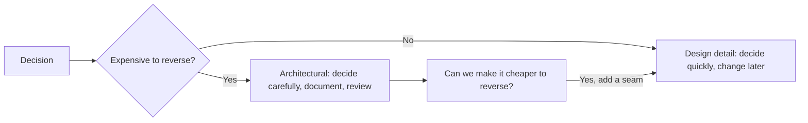
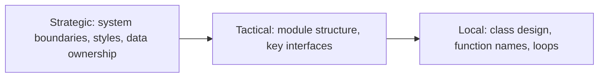
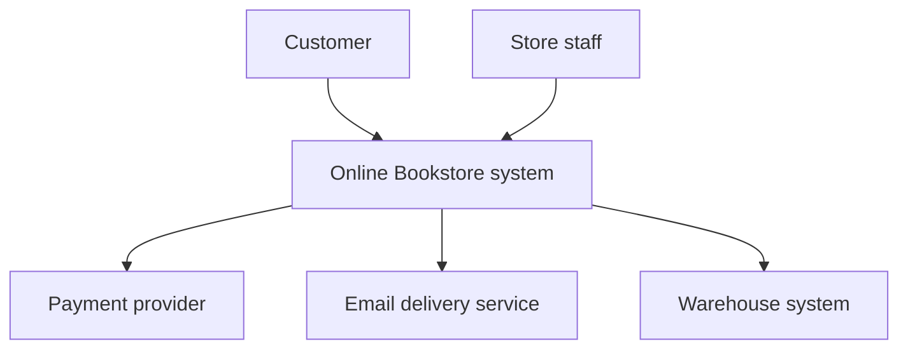
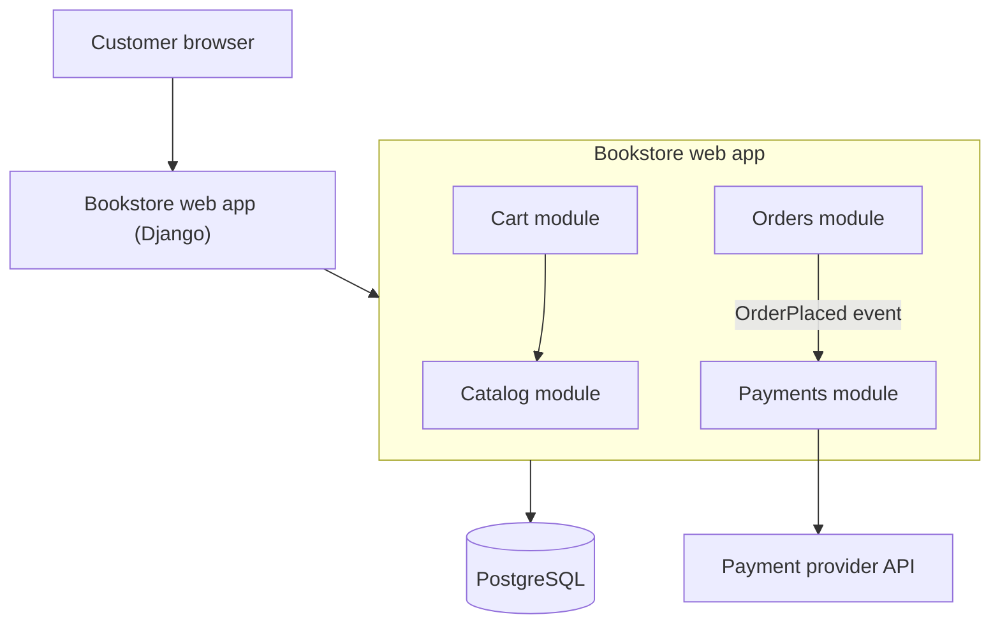

# What Is Software Architecture?

## Introduction

Ask ten developers to define "software architecture" and you will get ten answers. Some will draw boxes and arrows. Some will name technologies ("React, Spring Boot, PostgreSQL"). Some will say "the stuff the architect decides." None of these is wrong, but none is complete either.

A useful working definition is:

> Software architecture is the set of **significant decisions** about how a system is structured, how its parts interact, and which qualities it must have, where "significant" means **expensive to change later**.

An analogy helps. In a city, the street grid, the water mains, and the zoning laws are "architecture": they shape everything built afterward, and changing them means digging up roads. The color of a shop's front door is "design": it matters, but you can repaint it next week. Software is the same, except that the line between the two is fuzzier and moves over time.

This page looks at the main definitions, the four dimensions of architecture, the difference between architecture and design, and how to see a system's real architecture in its code.

## Three Classic Definitions

### 1. Elements and relationships

The formal standards view, found in ISO/IEC/IEEE 42010 (the international standard for describing architectures), treats architecture as the fundamental concepts or properties of a system in its environment, expressed through its **elements**, their **relationships**, and the **principles** that guide its design and evolution. The standard also separates the *architecture itself* from an *architecture description* (the diagrams and documents that try to capture it).

This definition is good for one reason: it reminds you that architecture exists whether or not anyone wrote it down. Every system has an architecture. The only question is whether it was chosen on purpose.

### 2. "The important stuff"

In his IEEE Software column [Who Needs an Architect?](https://martinfowler.com/ieeeSoftware/whoNeedsArchitect.pdf) (2003), Martin Fowler quotes Ralph Johnson's pushback against the formal definition. Johnson argues that architecture is the **shared understanding** that the expert developers on a project have of the system's design, and ends up with a memorable summary: architecture is about the important stuff, whatever that is.

This view is social. A database choice may be architectural in a CRUD business app and a minor detail in an image-analysis system, because what is "important" depends on where the hard problems are.

### 3. "Hard to change"

Johnson also offers a second definition: the decisions you wish you could get right early in a project. Fowler rephrases it as the things people perceive as hard to change. That leads to an interesting conclusion: one of an architect's jobs is to **remove architecture**, by making decisions easier to reverse. Database migration tools, feature flags, and well-defined interfaces all turn "architectural" decisions into ordinary ones.



## The Four Dimensions of Architecture

Mark Richards and Neal Ford, in *Fundamentals of Software Architecture* (O'Reilly, second edition 2025), describe architecture as a combination of four things. This is a practical checklist when you need to explain a system.

| Dimension | Question it answers | Bookstore example |
|-----------|--------------------|-------------------|
| **Structure** (architectural style) | What is the overall shape? | A modular monolith with catalog, cart, orders and payments modules |
| **Architecture characteristics** | Which qualities must it have? | Payment correctness, availability during sales, modifiability |
| **Architecture decisions** | What rules constrain the parts? | "Only the payments module may call the payment provider" |
| **Design principles** | What guidelines are preferred but not strict? | "Prefer asynchronous events between modules" |

Notice that naming the style ("it's microservices") covers only the first row. Two systems with the same style can be very different if their characteristics and decisions differ.

:::tip
When someone says "our architecture is React plus Node plus Postgres," they are describing the **technology stack**, which is one input to architecture. Ask the follow-up questions: How are the parts divided? Which qualities drive the design? What rules keep it that way?
:::

## Architecture vs Design

There is no sharp line, but there is a useful spectrum.



| Aspect | Closer to architecture | Closer to design |
|--------|------------------------|------------------|
| Scope | Many modules or the whole system | One module or class |
| Cost of change | High (weeks, migrations, coordination) | Low (one pull request) |
| Who is affected | Several teams | One developer or team |
| Driven by | Quality attributes, business goals | Functional requirements, readability |
| Example | "Orders and inventory each own their data" | "Use a dataclass for `OrderLine`" |

A good rule of thumb: if a decision is hard to reverse, affects several teams, or determines a quality attribute such as scalability or security, treat it as architecture. Write it down (see [Architecture Decision Records](../13-arch-documenting-and-evolving/0-arch-decision-records.mdx)) and review it with others.


:::tip
A quick test for whether something is architectural: imagine changing it one year from now. If you would need a migration plan, coordination across teams, or a rewrite, it is architectural today.
:::
## Seeing Architecture in Code

Diagrams describe *intended* architecture. The code contains the *actual* architecture. A simple way to see it is to extract the dependency graph between modules.

The script below parses a few tiny Python modules (stored as strings so the example is self-contained) and prints which module imports which.

```python
# see_structure.py: extract a module dependency graph with the ast module
import ast

SOURCES = {
    "catalog": "import db\n",
    "cart": "import catalog\nimport db\n",
    "orders": "import cart\nimport payments\nimport db\n",
    "payments": "import orders\n",   # suspicious: payments depends back on orders
    "db": "",
}


def imports_of(code: str) -> set[str]:
    found: set[str] = set()
    for node in ast.walk(ast.parse(code)):
        if isinstance(node, ast.Import):
            found.update(alias.name for alias in node.names)
        elif isinstance(node, ast.ImportFrom) and node.module:
            found.add(node.module)
    return found


graph = {name: imports_of(code) for name, code in SOURCES.items()}
for module, deps in graph.items():
    print(f"{module:9} -> {', '.join(sorted(deps)) or '(nothing)'}")
```

Output:

```text
catalog   -> db
cart      -> catalog, db
orders    -> cart, db, payments
payments  -> orders
db        -> (nothing)
```

Already you can see something an architect cares about: `orders` and `payments` depend on each other. That is a **dependency cycle**. Neither module can be understood, tested, or extracted on its own.

### Turning a decision into a check

Architecture decisions are more durable when they are checked automatically. Here is a small cycle detector you could run in CI.

```python
# check_cycles.py: fail if modules depend on each other in a cycle
graph = {
    "catalog": {"db"},
    "cart": {"catalog", "db"},
    "orders": {"cart", "payments", "db"},
    "payments": {"orders"},
    "db": set(),
}


def find_cycle(graph: dict[str, set[str]]) -> list[str] | None:
    visiting: set[str] = set()
    done: set[str] = set()

    def visit(node: str, path: list[str]) -> list[str] | None:
        if node in visiting:
            return path[path.index(node):] + [node]
        if node in done:
            return None
        visiting.add(node)
        for dep in sorted(graph.get(node, set())):
            cycle = visit(dep, path + [node])
            if cycle:
                return cycle
        visiting.discard(node)
        done.add(node)
        return None

    for start in sorted(graph):
        cycle = visit(start, [])
        if cycle:
            return cycle
    return None


cycle = find_cycle(graph)
print("Cycle found:" if cycle else "No cycles", " -> ".join(cycle or []))
```

Output:

```text
Cycle found: orders -> payments -> orders
```

In a real project you would not write this yourself. Tools such as `import-linter` for Python, ArchUnit for Java, or `dependency-cruiser` for JavaScript express these rules as configuration. The idea is covered fully in [Fitness Functions and Evolutionary Architecture](../13-arch-documenting-and-evolving/3-arch-fitness-functions.mdx).

## Architecture at Different Zoom Levels

A system's architecture looks different depending on how far you zoom out. Simon Brown's [C4 model](https://c4model.com/) gives a practical set of four zoom levels, like the zoom levels of an online map:

| Level | What you see | Bookstore example | Typical audience |
|-------|--------------|-------------------|------------------|
| 1. System context | The system as one box, its users and the external systems it talks to | Bookstore, customers, payment provider, email service | Everyone, including non-technical people |
| 2. Containers | Separately runnable or deployable parts | Web app, mobile app, API, PostgreSQL, Redis | Developers and operations |
| 3. Components | Major building blocks inside one container | Catalog, cart, orders and payments modules in the API | Developers on that container |
| 4. Code | Classes and functions | `OrderService`, `Isbn13` | Usually generated from code, rarely drawn by hand |

Here is a level 1 (system context) view of the bookstore:



Most architectural decisions live at levels 1 to 3. Level 4 is normally "design." The full treatment is in [The C4 Model](../13-arch-documenting-and-evolving/1-arch-c4-model.mdx).

:::note
"Container" in C4 means any separately running thing, such as a web server, a database or a mobile app. It is not specifically a Docker container, although a C4 container is often deployed as one.
:::

## Questions to Ask About Any System

When you join a project, or review a design, these questions uncover the architecture quickly. They map to the four dimensions above.

| Dimension | Questions |
|-----------|-----------|
| Structure | What are the main deployable parts? How do they communicate (calls, events, shared database)? Where does each piece of data live, and who owns it? |
| Characteristics | Which three qualities matter most? What happens if a dependency is down? What load is expected at peak? |
| Decisions | What rules must every developer follow? Where are they written down? Which are checked automatically? |
| Principles | What does the team prefer when there is no hard rule (sync vs async, libraries vs in-house)? |
| Evolution | What is hardest to change today? What changed most in the last six months? What is likely to change next? |

The "evolution" questions matter more than they appear. A system's architecture is not just its current shape; it is also how well it can **move** to the next shape. Neal Ford, Rebecca Parsons and Patrick Kua call this **evolutionary architecture**: designing systems so they support guided, incremental change. You will see the tools for it in [Fitness Functions and Evolutionary Architecture](../13-arch-documenting-and-evolving/3-arch-fitness-functions.mdx).

## What Architecture Is Not

- **Not just diagrams.** A diagram that disagrees with the code is fiction. Diagrams are useful for communication, but the code is the source of truth.
- **Not just technology choices.** Picking Kafka does not give you an event-driven architecture. How you use it does.
- **Not a one-time phase.** Requirements, teams, and traffic change. Architecture has to evolve, which is why Fowler describes good architecture as something that supports its own evolution in his [Software Architecture Guide](https://martinfowler.com/architecture/).
- **Not only the architect's job.** Every developer who adds an import makes a small architectural decision.

## Real-World Scenario

Your online bookstore has grown to 12 developers in two teams. New hires keep asking "what's the architecture here?" and get a different answer from each person. Last month a new developer added a direct call from the payments code into the orders code, creating the cycle shown above, and a refund bug took three days to fix because nobody could change one module without the other.

You are asked to make the architecture explicit.

**Step 1: Describe the four dimensions on one page.**

```text
Structure:        Modular monolith (Django), one PostgreSQL database
Characteristics:  1) payment correctness  2) availability during sales  3) modifiability
Decisions:        - Modules talk through each module's public service functions only
                  - payments never imports orders; orders publishes an OrderPlaced event
                  - Each module owns its tables; no cross-module SQL joins
Principles:       Prefer events between modules; keep modules deployable as one unit
```

**Step 2: Draw a container-level picture** so people share one mental model.



**Step 3: Enforce the key decision in CI** with an import rule (like the cycle checker above), so the cycle cannot come back silently.

**Step 4: Record the "why"** of each decision as a short ADR, so future developers can tell a deliberate constraint from an accident.

### Why this approach

It makes the architecture visible at the level people actually need, it focuses on the few decisions that caused real pain, and it turns the most important rule into an automated check. The written document stays small enough that people read it.

### When to use it and when not to

Do this as soon as more than a handful of people work on a codebase, or when onboarding takes weeks. For a solo project or a short prototype, a README paragraph is enough. Do not attempt to document every class; document the decisions that are hard to change.

### Alternatives and trade-offs

| Approach | Pros | Cons | Best for |
|----------|------|------|----------|
| No documentation, "read the code" | Zero effort, never out of date | Slow onboarding; intent is invisible | Tiny teams, prototypes |
| Large architecture document | Thorough | Rarely read, quickly outdated | Regulated environments that require it |
| One-page overview plus C4 diagrams and ADRs | Light, focused on decisions | Needs someone to keep it current | Most product teams |
| Automated architecture rules in CI | Cannot drift silently | Covers only what can be checked mechanically | Rules that matter and are easy to break |

## Best Practices

- **Name the top few quality attributes** before choosing a style or technology.
- **Write down the decisions that are hard to reverse**, with their reasons, and skip the ones that are easy to reverse.
- **Compare intended and actual architecture regularly** by extracting dependencies from code.
- **Automate the most important rules** so they survive staff changes and deadlines.
- **Keep one or two diagrams current** rather than many diagrams that are all a little wrong.

## Common Mistakes

- **Confusing the stack with the architecture.** "We use Kubernetes" says nothing about how responsibilities are divided.
- **Documenting intent, never checking reality.** Run a dependency graph occasionally; you will often be surprised.
- **Treating every decision as architectural.** That leads to slow, committee-driven design for things that could be changed in an afternoon.
- **Making early decisions irreversible for no reason.** If you are unsure, prefer the option that keeps future choices open.
- **Drawing boxes without arrows.** The relationships (who calls whom, who owns which data) carry most of the architectural information.
- **Assuming the architecture is "done."** New features, teams and traffic change the forces; plan to revisit key decisions.

## Frequently Asked Questions

**Does a small project have an architecture?**
Yes. Every system has one, even a 500-line script: it has parts, dependencies between them, and qualities it does or does not have. Small projects simply have fewer decisions that are expensive to change, so they need less deliberate architecture work.

**Is choosing a framework an architecture decision?**
Often, yes, because frameworks shape structure (Django's apps, Spring's dependency injection, Next.js routing) and are expensive to replace. It becomes less architectural when you isolate the framework at the edges of your code, as described in [Clean Architecture](../7-arch-clean-architecture/2-arch-clean-architecture.mdx).

**Who owns the architecture?**
The whole team owns the actual architecture, because every change shapes it. Someone should own keeping it coherent and explained; that is the architect role, covered on the next page.

**How much should be designed up front?**
Enough to make the one-way decisions consciously: the style, data ownership and the key quality attributes. Leave reversible details to emerge during development. Too little up-front design leads to accidental architecture; too much leads to designs built for imagined requirements.

## Summary

- Architecture is the set of significant, hard-to-change decisions about a system's structure, interactions and qualities.
- Three classic views: elements and relationships (ISO/IEC/IEEE 42010), "the important stuff" (Ralph Johnson), and "hard to change" (Fowler).
- Richards and Ford's four dimensions are structure, architecture characteristics, architecture decisions and design principles.
- Architecture and design lie on one spectrum; the difference is mostly scope and cost of change.
- The real architecture lives in the code. Extract it, compare it with your intent, and automate the rules that matter.

## Further Learning

Exercises:

1. Extend `see_structure.py` to read real files from a project directory (use `pathlib.Path.rglob("*.py")`). Run it on a project you know. Any surprises?
2. Write a four-dimension description (like the one in the scenario) for an app you use daily, such as a food delivery app. Guess the characteristics that matter most.
3. List five decisions from a past project. Mark each as "architecture" or "design" using the cost-of-change test. Which architectural ones could have been made cheaper to reverse?
4. Draw a C4 system context diagram (level 1) for a project you know, using a mermaid flowchart. Include every external system it talks to. Did you discover any dependency you had forgotten?

Related pages:

- [The Role of a Software Architect](./2-arch-architect-role.mdx)
- [Quality Attributes and Non-Functional Requirements](./3-arch-quality-attributes.mdx)
- [Coupling and Cohesion](./5-arch-coupling-and-cohesion.mdx)
- [The C4 Model](../13-arch-documenting-and-evolving/1-arch-c4-model.mdx)
- [Architecture Decision Records](../13-arch-documenting-and-evolving/0-arch-decision-records.mdx)
- [Architectural Styles Overview](../6-arch-architectural-styles/0-arch-styles-overview.mdx)

External reading:

- [Software Architecture Guide](https://martinfowler.com/architecture/) (Martin Fowler)
- [Who Needs an Architect?](https://martinfowler.com/ieeeSoftware/whoNeedsArchitect.pdf) (Martin Fowler, IEEE Software, 2003)
- [ISO/IEC/IEEE 42010:2022](https://www.iso.org/standard/74393.html) (architecture description standard)
