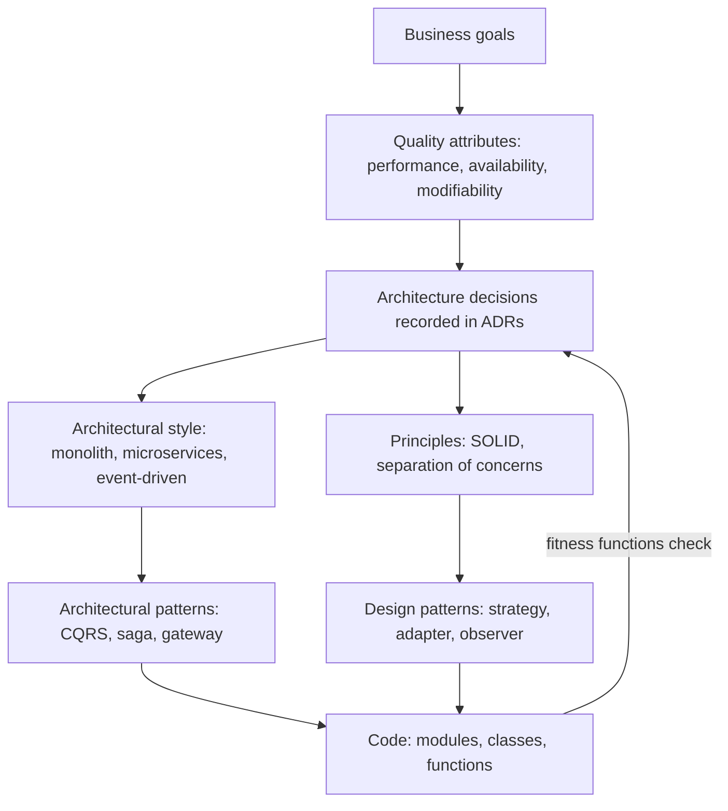

# Architecture Terminology Cheat Sheet

## Introduction

Architecture discussions go wrong surprisingly often because people use the same word for different things. One developer says "component" and means a React component; another means a deployable service. A manager says "scalable" and means "won't crash on launch day"; an engineer hears "must handle a million users." Thirty minutes later, everyone is frustrated and nobody has disagreed about anything real.

This page is a **reference** you can return to throughout the tutorial. It collects the key terms, defines them in plain language, points to where each is covered in depth, and highlights pairs of terms that are commonly confused.

Think of it as the shared dictionary for a team. Eric Evans calls the domain version of this idea a [Ubiquitous Language](../8-arch-domain-driven-design/1-arch-ubiquitous-language.mdx): when everyone uses words the same way, a whole category of misunderstandings disappears.

## How the Terms Fit Together



Read it top to bottom: business goals set quality attributes, which drive decisions, which select styles, patterns and principles, which shape code. Fitness functions close the loop by checking that the code still follows the decisions.

## Core Concepts

| Term | Plain-language meaning | Covered in |
|------|------------------------|------------|
| Software architecture | The significant, hard-to-change decisions about a system's structure, interactions and qualities | [What Is Software Architecture?](./1-arch-what-is-architecture.mdx) |
| Architecture characteristic | A quality the system must have; Richards and Ford's term for a quality attribute | [Quality Attributes](./3-arch-quality-attributes.mdx) |
| Quality attribute / NFR | How well a system performs a function (speed, availability, security...) rather than what it does | [Quality Attributes](./3-arch-quality-attributes.mdx) |
| Functional requirement | What the system must do ("customers can apply a discount code") | [Quality Attributes](./3-arch-quality-attributes.mdx) |
| Architecturally significant requirement | A requirement with a measurable effect on the architecture | [Architecture Decision Records](../13-arch-documenting-and-evolving/0-arch-decision-records.mdx) |
| Trade-off | Gaining one quality at the expense of another | [Thinking in Trade-offs](./4-arch-trade-offs.mdx) |
| Coupling | How much one part depends on another | [Coupling and Cohesion](./5-arch-coupling-and-cohesion.mdx) |
| Cohesion | How well the contents of one part belong together | [Coupling and Cohesion](./5-arch-coupling-and-cohesion.mdx) |
| Connascence | A precise vocabulary for kinds of coupling (name, position, timing...) | [Coupling and Cohesion](./5-arch-coupling-and-cohesion.mdx) |
| Abstraction | Showing what matters and hiding the rest | [Abstraction and Modularity](./6-arch-abstraction-and-modularity.mdx) |
| Encapsulation | Keeping data and the rules that protect it together | [Abstraction and Modularity](./6-arch-abstraction-and-modularity.mdx) |
| Information hiding | Putting each likely-to-change decision inside one module (Parnas) | [Abstraction and Modularity](./6-arch-abstraction-and-modularity.mdx) |
| Essential complexity | Complexity inherent in the problem | [Managing Complexity](./7-arch-complexity.mdx) |
| Accidental complexity | Complexity introduced by our solution | [Managing Complexity](./7-arch-complexity.mdx) |
| Technical debt | Future cost of shortcuts: principal to fix, interest on every change | [Technical Debt](./8-arch-technical-debt.mdx) |
| Conway's law | Systems mirror the communication structure of the organization | [Conway's Law and Team Topologies](./9-arch-conways-law.mdx) |
| Cognitive load | How much a person or team must know to do their work | [Conway's Law and Team Topologies](./9-arch-conways-law.mdx) |

## Structural Terms

These words describe the parts of a system. They are the most frequently confused.

| Term | Meaning in this tutorial |
|------|--------------------------|
| Module | A unit of code with a defined public interface, such as a Python package. Not separately deployed. |
| Component | A larger grouping of related functionality behind an interface. In the C4 model, a component lives inside a container. |
| Container (C4 sense) | A separately runnable or deployable thing: a web app, an API, a database, a mobile app. **Not** necessarily a Docker container. |
| Service | A component that runs in its own process and is reached over a network. |
| Layer | A logical grouping by technical responsibility (presentation, business, data access). |
| Tier | A physical deployment boundary (browser, app server, database server). |
| Interface / contract | What one part promises to others: function signatures, API schemas, event formats. |
| Port and adapter | In hexagonal architecture, a port is an interface the core defines; an adapter implements it for a technology. |
| Bounded context | In DDD, a boundary within which a model and its words have one consistent meaning. |
| Deployable unit | Whatever you release as one piece: a monolith, a service, a function. |

## Styles, Patterns and Principles

| Term | Scope | Examples | Covered in |
|------|-------|----------|------------|
| Architectural style | Overall shape of a whole system | Layered, monolith, microservices, event-driven, serverless | [Architectural Styles Overview](../6-arch-architectural-styles/0-arch-styles-overview.mdx) |
| Architectural pattern | A reusable solution to a system-level problem | CQRS, saga, API gateway, circuit breaker, strangler fig | Sections 9 and 10 |
| Design pattern | A reusable solution to a recurring problem in code design | Strategy, Adapter, Observer, Builder | [Design Patterns Introduction](../2-arch-creational-patterns/0-arch-design-patterns-introduction.mdx) |
| Idiom | A language-specific way of doing something | Python context managers, Java try-with-resources | [Design Patterns in Modern Languages](../5-arch-modern-patterns/0-arch-patterns-in-modern-languages.mdx) |
| Principle | A guideline for making design choices | SOLID, DRY, KISS, YAGNI, separation of concerns | [SOLID Principles Overview](../1-arch-design-principles/0-arch-solid-overview.mdx) |
| Anti-pattern | A common solution that causes more problems than it solves | God object, big ball of mud, distributed monolith | [Common Anti-Patterns](../5-arch-modern-patterns/7-arch-anti-patterns.mdx) |
| GoF | "Gang of Four": Gamma, Helm, Johnson and Vlissides, authors of *Design Patterns* (1994) | The 23 classic patterns | Sections 2 to 4 |

## Quality Attribute Vocabulary

| Term | Meaning |
|------|---------|
| Latency | Time to handle one request. Report as percentiles (p50, p95, p99). |
| Throughput | Requests or jobs handled per unit of time. |
| Percentile (p95) | The value below which 95 percent of measurements fall. |
| Availability | Fraction of time the system is usable, often written as "nines" (99.9 percent). |
| Reliability | Ability to keep working correctly over time and under faults. |
| Resilience | Ability to recover from failures and degrade gracefully. |
| Scalability | Ability to handle more load by adding resources. |
| Elasticity | Ability to add **and remove** resources automatically as load changes. |
| Vertical scaling | Bigger machine. |
| Horizontal scaling | More machines. |
| Modifiability / maintainability | How cheaply the system can be changed. |
| Observability | How well you can understand internal state from external outputs (logs, metrics, traces). |
| SLI / SLO / SLA | Indicator (what you measure), objective (your target), agreement (a contract with consequences). |
| RTO / RPO | Recovery time objective (how long to restore), recovery point objective (how much data you may lose). |

## Distributed Systems Vocabulary

| Term | Meaning | Covered in |
|------|---------|------------|
| Synchronous call | Caller waits for the response | [Synchronous vs Asynchronous Communication](../10-arch-integration-and-apis/0-arch-communication-styles.mdx) |
| Asynchronous messaging | Caller sends a message and continues | [Messaging Patterns](../10-arch-integration-and-apis/5-arch-messaging-patterns.mdx) |
| Event | A fact that happened ("OrderPlaced"); anyone may react | [Domain Events](../8-arch-domain-driven-design/5-arch-domain-events.mdx) |
| Command | A request for something to happen ("PlaceOrder"); one handler | [Command Pattern](../4-arch-behavioral-patterns/2-arch-command.mdx) |
| Eventual consistency | Replicas or services agree after some delay | [Consistency Models](../9-arch-distributed-systems/2-arch-consistency-models.mdx) |
| CAP / PACELC | Trade-offs between consistency, availability and latency under partitions and normal operation | [CAP and PACELC](../9-arch-distributed-systems/1-arch-cap-and-pacelc.mdx) |
| Idempotency | Repeating an operation has the same effect as doing it once | [Idempotency](../9-arch-distributed-systems/7-arch-idempotency.mdx) |
| Saga | A sequence of local transactions with compensating actions | [Saga Pattern](../9-arch-distributed-systems/5-arch-saga.mdx) |
| Orchestration | A central coordinator tells each participant what to do | [Saga Pattern](../9-arch-distributed-systems/5-arch-saga.mdx) |
| Choreography | Participants react to each other's events with no coordinator | [Event-Driven Architecture](../6-arch-architectural-styles/5-arch-event-driven.mdx) |
| Circuit breaker | Stops calling a failing dependency for a while | [Circuit Breaker, Retry and Timeout](../9-arch-distributed-systems/8-arch-circuit-breaker.mdx) |
| Backpressure | Signaling producers to slow down when consumers cannot keep up | [Bulkheads, Rate Limiting and Backpressure](../9-arch-distributed-systems/9-arch-bulkhead-and-rate-limiting.mdx) |

## Documentation and Process Vocabulary

| Term | Meaning | Covered in |
|------|---------|------------|
| ADR | Architecture Decision Record: one decision, its context and consequences | [Architecture Decision Records](../13-arch-documenting-and-evolving/0-arch-decision-records.mdx) |
| C4 model | Simon Brown's four levels of diagrams: context, containers, components, code | [The C4 Model](../13-arch-documenting-and-evolving/1-arch-c4-model.mdx) |
| Fitness function | An automated check that the system keeps an architectural property | [Fitness Functions](../13-arch-documenting-and-evolving/3-arch-fitness-functions.mdx) |
| ATAM | Architecture Tradeoff Analysis Method, a structured review from the SEI | [Architecture Reviews and ATAM](../13-arch-documenting-and-evolving/4-arch-reviews.mdx) |
| Quality attribute scenario | Six-part measurable requirement: source, stimulus, artifact, environment, response, measure | [Quality Attributes](./3-arch-quality-attributes.mdx) |
| Stream-aligned team | A team owning a flow of business work end to end (Team Topologies) | [Conway's Law and Team Topologies](./9-arch-conways-law.mdx) |
| Inverse Conway maneuver | Shaping teams to get the architecture you want | [Conway's Law and Team Topologies](./9-arch-conways-law.mdx) |

## Design Principles at a Glance

| Principle | One-line meaning | Covered in |
|-----------|------------------|------------|
| Single Responsibility (S) | A module should have one reason to change | [Single Responsibility Principle](../1-arch-design-principles/1-arch-single-responsibility.mdx) |
| Open/Closed (O) | Extend behavior by adding code, not editing stable code | [Open/Closed Principle](../1-arch-design-principles/2-arch-open-closed.mdx) |
| Liskov Substitution (L) | Subtypes must work wherever the base type is expected | [Liskov Substitution Principle](../1-arch-design-principles/3-arch-liskov-substitution.mdx) |
| Interface Segregation (I) | Clients should not depend on methods they do not use | [Interface Segregation Principle](../1-arch-design-principles/4-arch-interface-segregation.mdx) |
| Dependency Inversion (D) | High-level policy should not depend on low-level details; both depend on abstractions | [Dependency Inversion Principle](../1-arch-design-principles/5-arch-dependency-inversion.mdx) |
| DRY | Every piece of knowledge has one authoritative place | [DRY, KISS and YAGNI](../1-arch-design-principles/6-arch-dry-kiss-yagni.mdx) |
| KISS | Prefer the simplest design that works | [DRY, KISS and YAGNI](../1-arch-design-principles/6-arch-dry-kiss-yagni.mdx) |
| YAGNI | Do not build features or flexibility until they are needed | [DRY, KISS and YAGNI](../1-arch-design-principles/6-arch-dry-kiss-yagni.mdx) |
| Composition over inheritance | Build behavior by combining objects rather than deep class hierarchies | [Composition over Inheritance](../1-arch-design-principles/7-arch-composition-over-inheritance.mdx) |
| Law of Demeter | Talk only to your immediate collaborators, not their internals | [Law of Demeter and Tell, Don't Ask](../1-arch-design-principles/8-arch-law-of-demeter.mdx) |
| Separation of concerns | Keep different responsibilities in different parts | [Separation of Concerns](../1-arch-design-principles/9-arch-separation-of-concerns.mdx) |

## Domain-Driven Design Vocabulary

| Term | Meaning | Covered in |
|------|---------|------------|
| Domain | The business area the software serves (bookselling, payments) | [Domain-Driven Design Introduction](../8-arch-domain-driven-design/0-arch-ddd-introduction.mdx) |
| Subdomain | A part of the domain: core (your advantage), supporting, or generic | [Strategic vs Tactical DDD](../8-arch-domain-driven-design/8-arch-strategic-vs-tactical-ddd.mdx) |
| Ubiquitous language | Shared vocabulary used by developers and domain experts, and in the code | [Ubiquitous Language](../8-arch-domain-driven-design/1-arch-ubiquitous-language.mdx) |
| Bounded context | A boundary where one model applies consistently | [Bounded Contexts and Context Mapping](../8-arch-domain-driven-design/2-arch-bounded-contexts.mdx) |
| Entity | An object defined by identity that persists over time (an Order) | [Entities and Value Objects](../8-arch-domain-driven-design/3-arch-entities-and-value-objects.mdx) |
| Value object | An immutable object defined only by its values (Money, ISBN) | [Entities and Value Objects](../8-arch-domain-driven-design/3-arch-entities-and-value-objects.mdx) |
| Aggregate | A cluster of objects changed together as one consistency unit | [Aggregates and Consistency Boundaries](../8-arch-domain-driven-design/4-arch-aggregates.mdx) |
| Domain event | Something meaningful that happened in the domain | [Domain Events](../8-arch-domain-driven-design/5-arch-domain-events.mdx) |
| Repository | A collection-like interface for loading and saving aggregates | [Repository Pattern](../5-arch-modern-patterns/1-arch-repository-pattern.mdx) |
| Anti-corruption layer | A translation layer that protects your model from another system's model | [Bounded Contexts and Context Mapping](../8-arch-domain-driven-design/2-arch-bounded-contexts.mdx) |

## Data Vocabulary

| Term | Meaning | Covered in |
|------|---------|------------|
| Database per service | Each service owns its data and exposes it only through its API | [Database per Service vs Shared Database](../11-arch-data-architecture/0-arch-database-per-service.mdx) |
| Replication | Keeping copies of data on several nodes | [Replication and Sharding](../11-arch-data-architecture/3-arch-replication-and-sharding.mdx) |
| Sharding / partitioning | Splitting data across nodes by a key | [Replication and Sharding](../11-arch-data-architecture/3-arch-replication-and-sharding.mdx) |
| Cache-aside | The application reads the cache first and loads from the database on a miss | [Caching Strategies](../11-arch-data-architecture/2-arch-caching-strategies.mdx) |
| CDC | Change data capture: streaming row changes out of a database | [Change Data Capture](../11-arch-data-architecture/5-arch-change-data-capture.mdx) |
| CQRS | Separate models for writes (commands) and reads (queries) | [CQRS](../9-arch-distributed-systems/3-arch-cqrs.mdx) |
| Event sourcing | Storing state as the sequence of events that produced it | [Event Sourcing](../9-arch-distributed-systems/4-arch-event-sourcing.mdx) |
| Outbox | Writing events to a table in the same transaction as the data, then publishing them | [Transactional Outbox](../9-arch-distributed-systems/6-arch-outbox.mdx) |
| Polyglot persistence | Using different storage technologies for different needs | [Polyglot Persistence](../11-arch-data-architecture/4-arch-polyglot-persistence.mdx) |

## Delivery and Operations Vocabulary

| Term | Meaning | Covered in |
|------|---------|------------|
| CI / CD | Continuous integration (merge and test often) and continuous delivery or deployment | [Designing for Deployability](../12-arch-quality-and-operations/6-arch-deployability.mdx) |
| Feature flag | A runtime switch that turns behavior on or off without a deploy | [Designing for Deployability](../12-arch-quality-and-operations/6-arch-deployability.mdx) |
| Blue-green / canary | Release strategies that shift traffic gradually or switch between two environments | [Designing for Deployability](../12-arch-quality-and-operations/6-arch-deployability.mdx) |
| Sidecar | A helper process deployed next to a service (proxy, log shipper) | [Service Mesh and Sidecars](../10-arch-integration-and-apis/8-arch-service-mesh.mdx) |
| API gateway | A single entry point that routes, authenticates and rate-limits API traffic | [API Gateway and Backend for Frontend](../10-arch-integration-and-apis/4-arch-api-gateway.mdx) |
| Strangler fig | Replacing a legacy system piece by piece behind a routing layer | [Strangler Fig Migration](../9-arch-distributed-systems/11-arch-strangler-fig.mdx) |
| Multi-tenancy | One system serving many customers (tenants) with isolated data | [Case Study: Multi-Tenant SaaS](../14-arch-case-studies/6-arch-case-saas-multitenancy.mdx) |

## Acronyms

| Acronym | Stands for |
|---------|------------|
| ADR | Architecture Decision Record |
| ASR | Architecturally Significant Requirement |
| ATAM | Architecture Tradeoff Analysis Method |
| BFF | Backend for Frontend |
| C4 | Context, Containers, Components, Code |
| CAP | Consistency, Availability, Partition tolerance |
| CDC | Change Data Capture |
| CQRS | Command Query Responsibility Segregation |
| DDD | Domain-Driven Design |
| DI | Dependency Injection |
| DIP | Dependency Inversion Principle |
| DORA | DevOps Research and Assessment |
| DRY | Don't Repeat Yourself |
| GoF | Gang of Four |
| IaC | Infrastructure as Code |
| KISS | Keep It Simple, Stupid |
| NFR | Non-Functional Requirement |
| PACELC | If Partition: Availability or Consistency; Else: Latency or Consistency |
| RPO / RTO | Recovery Point Objective / Recovery Time Objective |
| SLA / SLI / SLO | Service Level Agreement / Indicator / Objective |
| SOA | Service-Oriented Architecture |
| SOLID | Single responsibility, Open/closed, Liskov substitution, Interface segregation, Dependency inversion |
| SPOF | Single Point of Failure |
| TVP | Thinnest Viable Platform |
| YAGNI | You Aren't Gonna Need It |

## Commonly Confused Pairs

| Pair | The difference |
|------|----------------|
| Architecture vs design | Same spectrum; architecture is the expensive-to-change, wide-scope end |
| Layer vs tier | Layers are logical code groupings; tiers are physical deployment locations. Three layers can run in one tier. |
| Style vs pattern | A style shapes a whole system; a pattern solves a specific recurring problem within it |
| Performance vs scalability | Performance is speed at a given load; scalability is keeping performance as load grows |
| Availability vs reliability | Available means it responds; reliable means it responds **correctly**. A system can be up and returning wrong data. |
| Latency vs throughput | One request's time vs how many requests per second; improving one can hurt the other |
| ACID consistency vs CAP consistency | ACID: data obeys rules and constraints. CAP: every read sees the latest write. |
| Event vs command | Event: "this happened" (past tense, many listeners). Command: "do this" (imperative, one handler). |
| Library vs framework | You call a library; a framework calls you (inversion of control) |
| Dependency injection vs dependency inversion | DI is a technique for supplying dependencies; DIP is a principle about which direction dependencies point |
| Monolith vs big ball of mud | A monolith is a deployment choice and can be well structured; a big ball of mud is a lack of structure |
| Microservices vs SOA | Both use services; microservices favor small, independently deployable services with their own data, while classic SOA often relied on shared enterprise middleware |
| Orchestration vs choreography | Central coordinator vs reacting to events |
| Coupling vs cohesion | Between parts vs within a part |

## A Vagueness Linter for Design Docs

A practical way to use this vocabulary is to catch vague words in design documents before they cause confusion. Here is a tiny linter that flags words that need a measurable definition.

```python
# vague_words.py: flag vague quality words that need a measurable definition
import re

SUGGESTIONS = {
    "fast": "state a latency percentile, e.g. p95 < 300 ms at N requests/s",
    "scalable": "state the load to handle, e.g. 10x current peak with linear cost",
    "highly available": "state an availability target, e.g. 99.9% monthly",
    "secure": "name the threats and controls, e.g. OWASP Top 10, encryption at rest",
    "real-time": "state the maximum delay, e.g. updates visible within 2 s",
    "robust": "describe which failures it survives and how",
    "flexible": "name the expected changes, e.g. add a payment provider in < 3 days",
}


def lint(text: str) -> list[str]:
    findings = []
    for number, line in enumerate(text.splitlines(), start=1):
        for word, hint in SUGGESTIONS.items():
            if re.search(rf"\b{re.escape(word)}\b", line, re.IGNORECASE):
                findings.append(f"line {number}: '{word}' -> {hint}")
    return findings


doc = """The new checkout must be fast and highly available.
It should be scalable for the holiday sale.
Payment data is stored in PostgreSQL."""

for finding in lint(doc):
    print(finding)
```

Output:

```text
line 1: 'fast' -> state a latency percentile, e.g. p95 < 300 ms at N requests/s
line 1: 'highly available' -> state an availability target, e.g. 99.9% monthly
line 2: 'scalable' -> state the load to handle, e.g. 10x current peak with linear cost
```

You could run this in CI on a `docs/` folder or as a pre-commit hook. It will not understand meaning, but it reliably prompts people to replace adjectives with numbers.

## Real-World Scenario

Your bookstore team is in a design review for a new recommendations feature. Within ten minutes, three arguments break out:

- One engineer says the recommendations "component" should be its own service. Another says it already is a component (a React component on the product page). They are using different meanings.
- The product manager wants it "real-time." The data engineer hears "streaming pipeline with sub-second latency." The product manager meant "updated daily is fine, as long as it reflects purchases from yesterday."
- Someone says the design should be "consistent." One person means ACID transactions, another means visual consistency with the rest of the site.

**Step 1: Agree on terms.** You share this cheat sheet and add a short glossary section at the top of the design doc: "Component means a C4 component inside the web app. Service means a separately deployed process."

**Step 2: Replace adjectives with scenarios.** "Real-time" becomes "recommendations reflect purchases within 24 hours; page adds less than 50 ms at p95."

**Step 3: Lint the doc.** The vagueness linter flags two remaining adjectives, which the author replaces with numbers.

**Step 4: Record the decision.** With shared terms, the actual decision is quick: a nightly batch job writes recommendations into a table that the existing web app reads. No new service is needed. An ADR records it.

### Why this approach

Most of the disagreement was vocabulary, not substance. A shared glossary and measurable scenarios removed it, and the remaining decision turned out to be simple. Lightweight automation keeps the habit going without a "terminology police" role.

### When to use it and when not to

Use a shared glossary whenever more than one team, or people with different backgrounds (product, data, operations), take part in design discussions. A solo developer does not need one. Do not let it become a bureaucratic exercise; a short list of the ten terms your team argues about most is better than a hundred-entry document nobody reads.

### Alternatives and trade-offs

| Approach | Pros | Cons | Best for |
|----------|------|------|----------|
| No glossary, clarify in meetings | No upfront effort | Same misunderstandings recur | Small, long-standing teams |
| Shared team glossary | Fewer misunderstandings | Needs occasional upkeep | Multi-team or cross-functional work |
| Glossary plus measurable scenarios in every design doc | Precise and testable | More writing effort | Important or risky designs |
| DDD ubiquitous language | Aligns code and business vocabulary | Requires ongoing collaboration with domain experts | Complex business domains |
| Automated linting of docs | Consistent, cheap reminders | Shallow; cannot judge meaning | Teams that write many design docs |

## Common Mistakes

- **Assuming shared meaning.** "Service," "component," "event" and "consistent" mean different things to different people. Ask.
- **Mixing levels.** Calling a class a "service" and a deployment a "module" in the same document confuses readers.
- **Using quality adjectives without numbers.** "Fast" and "scalable" are not requirements.
- **Treating "container" as Docker only.** In the C4 model it means any separately runnable or deployable unit.
- **Using pattern names loosely.** Calling any wrapper a "facade" or any callback an "observer" makes pattern names useless.

## Summary

- Shared vocabulary prevents many architecture arguments; a lot of "disagreement" is just different meanings for the same word.
- Core concepts include architecture, quality attributes, trade-offs, coupling, cohesion, abstraction, complexity, technical debt and Conway's law.
- Distinguish structural terms carefully: module, component, container, service, layer and tier.
- Styles shape whole systems, patterns solve specific problems, principles guide choices.
- Watch the commonly confused pairs, and replace vague adjectives with measurable scenarios.

## Further Learning

Exercises:

1. Add three more vague words to `vague_words.py` that you have seen in real design documents, with suggestions. Run it on a document from your own work.
2. Pick five terms from the "Commonly Confused Pairs" table and explain each difference to a colleague using an example from your codebase.
3. Write a ten-term glossary for a project you work on. Which terms did people disagree on?

You have finished the fundamentals. Continue with:

- [SOLID Principles Overview](../1-arch-design-principles/0-arch-solid-overview.mdx) to start the design principles section
- [Design Patterns Introduction](../2-arch-creational-patterns/0-arch-design-patterns-introduction.mdx) if you want to jump to patterns
- [Architectural Styles Overview](../6-arch-architectural-styles/0-arch-styles-overview.mdx) if you are mostly interested in system-level design

External reading:

- [Software Architecture Guide](https://martinfowler.com/architecture/) (Martin Fowler)
- [The C4 model](https://c4model.com/) (Simon Brown)
- [Architectural Decision Records](https://adr.github.io/)
