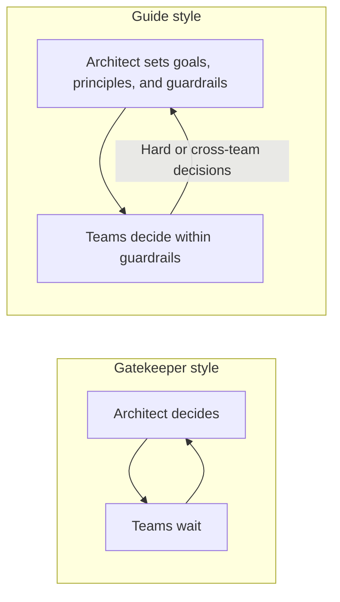
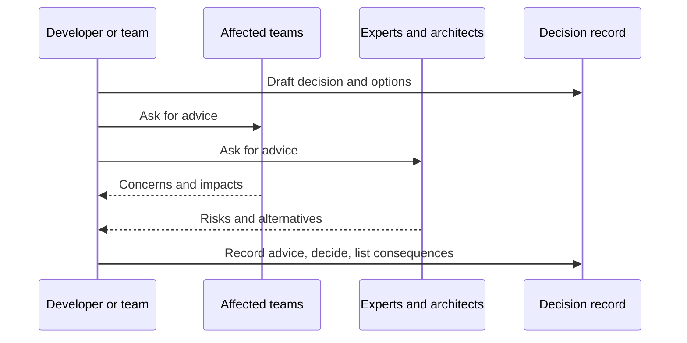

# The Role of a Software Architect

## Introduction

"Architect" is one of the most overloaded job titles in software. In one company the architect writes code every day with the team. In another, the architect draws diagrams in a separate department and never sees a pull request. Some companies have no architects at all, yet their systems are well designed, because senior engineers do the architectural work as part of their jobs.

This page is about the **role**, not the title. Somebody on every non-trivial project has to:

- notice which decisions are expensive to change,
- weigh the trade-offs and make those decisions (or make sure someone does),
- explain them so the team can work independently,
- and keep checking that the system still fits its goals.

An analogy: think of a film director. The director does not operate every camera or act in every scene, but they hold the overall vision, make the calls that affect the whole film, and make sure hundreds of people's work fits together. A director who refuses to talk to the crew produces a mess. A good one spends most of their time communicating.

## Two Kinds of Architect

Martin Fowler's column [Who Needs an Architect?](https://martinfowler.com/ieeeSoftware/whoNeedsArchitect.pdf) (IEEE Software, 2003) describes two contrasting species, with tongue-in-cheek Latin names:

- **Architectus Reloadus** makes all the important decisions personally, because they believe a single mind is needed for conceptual integrity and that the team is not skilled enough to decide.
- **Architectus Oryzus** is deeply involved with the team: pairing on tricky code in the morning, explaining technical consequences to business stakeholders in the afternoon. Their most important activity is **mentoring** the team so it can handle harder problems on its own.

Fowler's rule of thumb from that column is worth remembering: an architect's value is inversely proportional to the number of decisions they make. An architect who decides everything becomes a bottleneck. An architect who raises the whole team's skill multiplies their impact.



## What Architects Actually Do

Richards and Ford, in *Fundamentals of Software Architecture*, list eight expectations of an architect. Here they are with what each looks like in practice.

| Expectation | What it looks like day to day |
|-------------|-------------------------------|
| Make architecture decisions | Choose structures and guiding rules that let teams make good technical choices |
| Continually analyze the architecture | Revisit whether the design still fits as traffic, features and teams change |
| Keep current with trends | Know what new tools and techniques can and cannot do |
| Ensure compliance with decisions | Check that the code still follows the agreed rules, ideally automatically |
| Have diverse exposure and experience | Know several languages, platforms and styles well enough to compare them |
| Have business domain knowledge | Understand the business so technical choices serve real goals |
| Have interpersonal skills | Facilitate, negotiate, mentor and explain |
| Understand and navigate politics | Get decisions accepted across teams with different incentives |

Notice how many of these are about people and communication. Most architecture failures are not caused by picking the wrong database; they come from decisions that were never explained, never agreed on, or never checked.

### Technical breadth over depth

A senior developer is usually valued for **depth**: knowing one stack extremely well. An architect needs **breadth**: knowing that a problem could be solved with a message queue, a cache, a batch job, or a change in the data model, and roughly what each option costs. Richards and Ford describe this as growing the area of "things you know you don't know" so you can recognize options, even if you would need to research the details.

### Riding the architect elevator

Gregor Hohpe's book [The Software Architect Elevator](https://architectelevator.com/book/) pictures an organization as a tall building: business strategy is decided in the penthouse, and technology is built and run in the engine room. An architect rides the elevator between them, translating business goals into technical decisions and explaining technical constraints in business terms. An architect who stays only in the penthouse loses touch with reality; one who stays only in the engine room cannot influence strategy.

## Architect Titles You Will Meet

| Title | Typical scope | Focus |
|-------|---------------|-------|
| Software or application architect | One system or product | Structure, patterns, quality attributes |
| Solution architect | A business solution spanning several systems | Integration, vendor choices, delivery |
| Enterprise architect | The whole organization | Standards, portfolio, long-term direction |
| Staff or principal engineer | Varies; often cross-team | Technical direction while still coding |
| Tech lead | One team | Day-to-day technical decisions and delivery |

Will Larson's book *Staff Engineer* describes several staff-level archetypes, including the **Architect** archetype, which owns the direction and quality of a critical area. In many modern companies, "architect" work is done by staff engineers and tech leads rather than people with the architect title.

## Making the Work Visible: A Decision Log

The core output of architectural work is **decisions**, and decisions are worthless if nobody remembers why they were made. The usual tool is an Architecture Decision Record (ADR): a short document describing one decision, its context and its consequences. The page [Architecture Decision Records](../13-arch-documenting-and-evolving/0-arch-decision-records.mdx) covers the format in depth. Here is a small Python model of a decision log that shows the essential fields.

```python
# decision_log.py: a tiny model of architecture decision records
from dataclasses import dataclass, field
from datetime import date
from enum import Enum


class Status(Enum):
    PROPOSED = "Proposed"
    ACCEPTED = "Accepted"
    SUPERSEDED = "Superseded"


@dataclass
class Decision:
    number: int
    title: str
    context: str
    decision: str
    consequences: list[str]
    status: Status = Status.PROPOSED
    decided_on: date | None = None
    superseded_by: int | None = None

    def to_markdown(self) -> str:
        lines = [f"# ADR-{self.number:03d}: {self.title}", f"Status: {self.status.value}"]
        if self.superseded_by:
            lines[-1] += f" by ADR-{self.superseded_by:03d}"
        lines += ["", "## Context", self.context, "", "## Decision", self.decision,
                  "", "## Consequences"]
        lines += [f"- {c}" for c in self.consequences]
        return "\n".join(lines)


@dataclass
class DecisionLog:
    decisions: list[Decision] = field(default_factory=list)

    def add(self, d: Decision) -> None:
        self.decisions.append(d)

    def supersede(self, old: int, new: Decision) -> None:
        for d in self.decisions:
            if d.number == old:
                d.status, d.superseded_by = Status.SUPERSEDED, new.number
        self.add(new)

    def current(self) -> list[str]:
        return [f"ADR-{d.number:03d} {d.title}" for d in self.decisions
                if d.status is Status.ACCEPTED]


log = DecisionLog()
log.add(Decision(1, "Use a single PostgreSQL database",
                 "Small team, one deployable app.",
                 "All modules share one PostgreSQL instance.",
                 ["Simple operations", "Modules may couple through tables"],
                 Status.ACCEPTED, date(2025, 3, 1)))
log.supersede(1, Decision(2, "Each module owns its own schema",
                          "Cross-module SQL joins caused breaking changes.",
                          "One PostgreSQL instance, one schema per module, no cross-schema joins.",
                          ["Clear data ownership", "Some data duplication"],
                          Status.ACCEPTED, date(2026, 2, 10)))
print(log.current())
print(log.decisions[0].to_markdown())
```

Output:

```text
['ADR-002 Each module owns its own schema']
# ADR-001: Use a single PostgreSQL database
Status: Superseded by ADR-002

## Context
Small team, one deployable app.

## Decision
All modules share one PostgreSQL instance.

## Consequences
- Simple operations
- Modules may couple through tables
```

Two details matter here. First, old decisions are **superseded, not deleted**, so the history of reasoning survives. Second, each record states **consequences**, including the negative ones. A decision with no listed downsides was probably not analyzed.

## Decentralized Decision-Making

As organizations grow, a single architect cannot make every decision. Andrew Harmel-Law's article [Scaling the Practice of Architecture, Conversationally](https://martinfowler.com/articles/scaling-architecture-conversationally.html) (2021) describes the **advice process**: anyone can make an architectural decision, but before doing so they must seek advice from everyone meaningfully affected and from people with relevant expertise. They do not have to follow the advice, but they must record it. It is supported by ADRs, a regular open architecture advisory forum, team-sourced principles, and an internal technology radar.



In this model the architect's role shifts from deciding to coaching, facilitating, and giving advice.

## A Week in the Life

What does a hands-on architect actually spend time on? Every organization differs, but a typical week for a product-team architect might look like this:

| Activity | Example | Why it matters |
|----------|---------|----------------|
| Coding and pairing | Pair on a tricky concurrency bug in Checkout | Keeps advice grounded in the real code |
| Design reviews | Review a proposal to add a search engine | Catch costly mistakes before they are built |
| Writing | Draft an ADR on event versioning | Makes reasoning durable and shareable |
| Stakeholder conversations | Explain to product why a sale-day load test is needed | Connects technical risk to business goals |
| Architecture fitness checks | Look at dependency-rule violations from CI | Ensures decisions are actually followed |
| Learning and scouting | Try a new feature of the database in a spike | Keeps technical breadth current |
| Mentoring | Help a mid-level developer write their first ADR | Multiplies decision-making capacity |

If most of the week is spent in meetings deciding things for other people, the role has drifted toward the gatekeeper style.

## Communicating Decisions

Because so much of the job is communication, it helps to have a standard way of explaining a decision. A simple structure that works in chat messages, meetings and ADRs:

```text
In the context of <situation>,
facing <the concern or quality attribute at stake>,
we decided <option chosen>
and rejected <alternatives>,
to achieve <benefit>,
accepting <downside>.
```

This structure is based on Olaf Zimmermann's "Y-statement" format for decisions, listed among the templates at [adr.github.io](https://adr.github.io/). A filled-in example for the bookstore:

```text
In the context of order notifications,
facing slow checkout when the email provider is degraded,
we decided to send emails asynchronously through a queue
and rejected synchronous calls with longer timeouts,
to keep checkout available during provider outages,
accepting that confirmation emails may arrive a few minutes late.
```

The last line is the most important one. A decision explained without its downside sounds like salesmanship; with it, it sounds like engineering.

### Explaining the same decision at different floors

Using Hohpe's elevator idea, here is how the same decision might be explained to different audiences:

| Audience | Message |
|----------|---------|
| Executives | "Checkout will keep working when our email vendor has problems. Emails may be delayed by minutes during an outage." |
| Product manager | "Customers can complete purchases even if email fails. We will show the order confirmation on screen immediately." |
| Developers | "Publish `OrderPlaced` to the queue after commit using the outbox table; the email worker consumes it with retries and a dead-letter queue." |

## Growing Into the Role

You do not need the title to start doing architectural work. Practical ways to grow:

- **Write ADRs for your own decisions**, even small ones. Writing forces clear thinking.
- **Volunteer for design reviews** and ask "what are the downsides?" and "how will we know it works?"
- **Practice on katas.** Architectural katas (an idea popularized by Ted Neward) are short, made-up problems that small groups design in an hour and then critique. They build trade-off thinking quickly.
- **Broaden on purpose.** If you know relational databases well, spend a weekend with a document store or a message broker, enough to know what it is good and bad at.
- **Learn the business.** Sit with support or sales for a day. Many good architecture decisions start with understanding how the business makes money.
- **Read real-world write-ups.** Engineering blogs and incident postmortems show trade-offs in context, including the ones that went wrong.

## Real-World Scenario

Your online bookstore now has three teams (Catalog, Checkout, and Platform) and about 20 engineers. You have been asked to take on the architect role while remaining a senior engineer on the Checkout team. Last quarter there were two painful incidents: the Catalog team added a direct database read of the Checkout tables, and the Platform team changed a shared library without telling anyone.

Here is how you might shape the role:

1. **Pick the few decisions that matter most.** You write three ADRs: module data ownership, how teams communicate (events and published APIs only), and how shared libraries are versioned.
2. **Introduce the advice process.** Any team can propose a decision; they must consult affected teams and record the advice. You host a weekly 45-minute advisory forum.
3. **Automate compliance.** You add an import rule in CI that blocks cross-module database access, so you are not the human gatekeeper.
4. **Stay in the code.** You keep roughly half your time on Checkout work and pair with other teams on their hardest problems.
5. **Ride the elevator.** You present a one-page summary to leadership that ties the changes to fewer incidents and faster releases, in business terms.

### Why this approach

It focuses your limited time on the decisions with the most leverage, spreads decision-making to the teams who have the context, and replaces "ask the architect" gatekeeping with automated checks and written reasoning. Staying hands-on keeps your advice grounded in the real code.

### When to use it and when not to

A hands-on, advisory architect role works well for product organizations with several autonomous teams. It is less suitable when teams lack experience and need more direction, in which case a more directive approach for a while may be necessary, or in highly regulated settings where formal sign-off is required. Even then, keep the reasoning written and visible.

### Alternatives and trade-offs

| Approach | Pros | Cons | Best for |
|----------|------|------|----------|
| Central architect decides everything | Consistent, clear authority | Bottleneck; decisions far from the code | Small orgs with inexperienced teams, short term |
| Architecture review board | Formal oversight, compliance | Slow; teams route around it | Regulated industries |
| Hands-on architect plus advice process | Fast, decisions made with context | Requires trust and good writing habits | Product companies with several teams |
| No explicit architecture role | No overhead | Cross-team issues fall through the cracks | Single small team |
| Staff engineers per area | Deep context, still coding | Can fragment overall direction | Larger engineering orgs |

## Common Mistakes

- **The ivory tower.** Designing without writing or reading production code leads to decisions that do not survive contact with reality.
- **Deciding everything.** You become a bottleneck, and the team never learns to decide.
- **Not writing decisions down.** Six months later nobody remembers why, and the decision gets reversed by accident.
- **Ignoring the business.** Choosing technology because it is interesting, rather than because it serves a quality attribute the business needs.
- **Skipping the politics.** A technically perfect decision that the affected teams were never consulted on will be resisted.
- **Technology tourism.** Introducing a new language or database for every project because it is interesting, leaving a zoo of technologies nobody can operate.
- **Never revisiting decisions.** Context changes; a decision that was right two years ago may be wrong now. Supersede it explicitly rather than letting it rot.

## Best Practices

- Spend time on the **few decisions that are expensive to reverse** and let teams own the rest.
- Make every decision **explicit, written, and justified**, with its negative consequences.
- **Automate** the rules that matter so that compliance does not depend on you.
- **Mentor** more than you dictate. Raise the team's ability to make good decisions.
- Keep **coding** regularly, at least on prototypes, reviews, and hard bugs.

## Frequently Asked Questions

**Do architects still write code?**
In most modern product teams, yes, at least part of the time. Writing and reviewing code keeps an architect's advice realistic and earns the team's trust. In large enterprises, enterprise architects may code rarely, but they still need to understand the systems they influence.

**Is "architect" a promotion from "senior developer"?**
It is often presented that way, but it is better thought of as a change of focus: from depth in one stack to breadth across many, and from writing solutions to enabling others to write them. Many companies offer a staff or principal engineer track as an alternative that keeps more coding.

**What if my team has no architect?**
Then the role is shared. Agree on who facilitates cross-cutting decisions, write ADRs for significant ones, and use the advice process so affected people are consulted. A team of five rarely needs a dedicated architect.

**How do I disagree with an architect's decision?**
Ask for the reasoning and the trade-offs first; there may be context you lack. If you still disagree, write down your alternative with its own downsides and propose it through whatever decision process the team uses. Good architects welcome this, because it improves the decision.

## Summary

- Architecture is a role that someone must fill, whether or not they have the title.
- Fowler contrasts the controlling *Architectus Reloadus* with the collaborative *Architectus Oryzus*; the latter mentors and multiplies the team.
- Richards and Ford list eight expectations, many of which are about communication, business knowledge and politics.
- Architects need technical breadth and the ability to move between business strategy and engineering detail (Hohpe's architect elevator).
- Decision logs (ADRs) and the advice process scale architectural work across teams.

## Further Learning

Exercises:

1. Extend `decision_log.py` with a `deprecated` status and a method that lists all decisions that mention a given keyword in their context.
2. Write an ADR for a real decision from a project you know. Include at least two negative consequences.
3. List the decisions you made last week. Which ones would have benefited from advice from another team? Who would you have asked?
4. Rewrite one of your past technical decisions as a Y-statement. Was it easy to name what you were accepting?

Related pages:

- [What Is Software Architecture?](./1-arch-what-is-architecture.mdx)
- [Thinking in Trade-offs](./4-arch-trade-offs.mdx)
- [Conway's Law and Team Topologies](./9-arch-conways-law.mdx)
- [Architecture Reviews and ATAM](../13-arch-documenting-and-evolving/4-arch-reviews.mdx)
- [Architecture Decision Records](../13-arch-documenting-and-evolving/0-arch-decision-records.mdx)
- [System Design Interview Approach](../13-arch-documenting-and-evolving/6-arch-system-design-interviews.mdx)
- [Quality Attributes and Non-Functional Requirements](./3-arch-quality-attributes.mdx)
- [Technical Debt](./8-arch-technical-debt.mdx)
- [Architecture Terminology Cheat Sheet](./10-arch-terminology.mdx)
- [Coupling and Cohesion](./5-arch-coupling-and-cohesion.mdx)

External reading:

- [Who Needs an Architect?](https://martinfowler.com/ieeeSoftware/whoNeedsArchitect.pdf) (Martin Fowler)
- [Scaling the Practice of Architecture, Conversationally](https://martinfowler.com/articles/scaling-architecture-conversationally.html) (Andrew Harmel-Law)
- [The Software Architect Elevator](https://architectelevator.com/book/) (Gregor Hohpe)
- [ADR resources](https://adr.github.io/)
