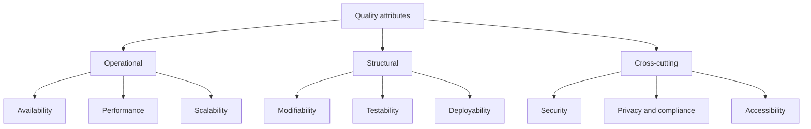
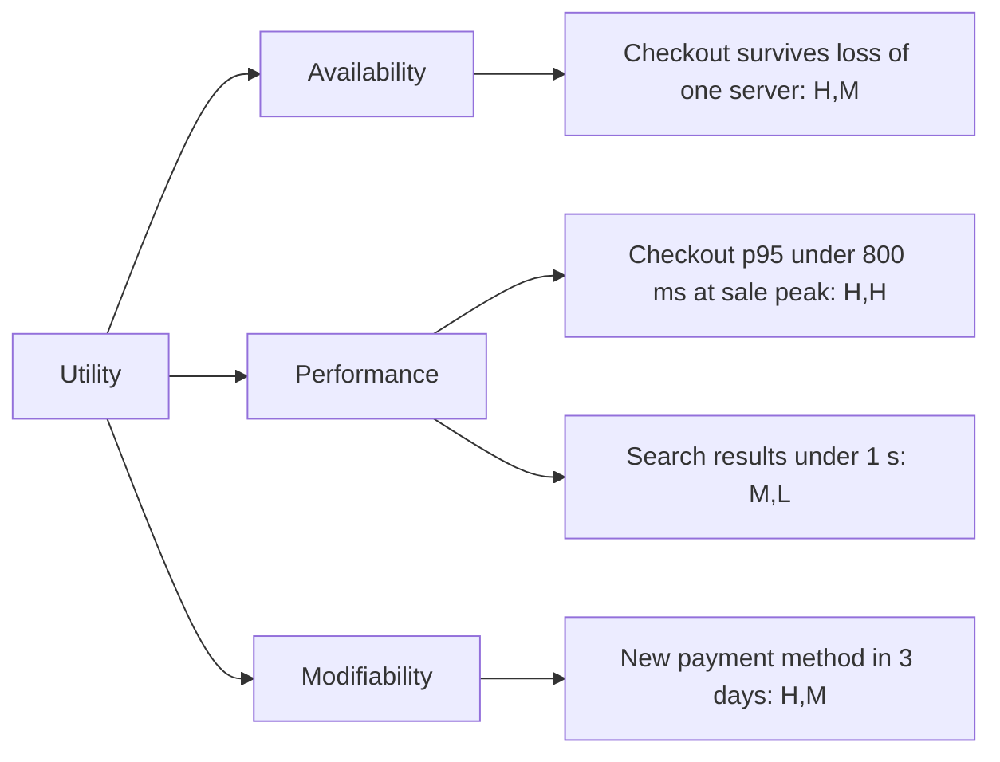
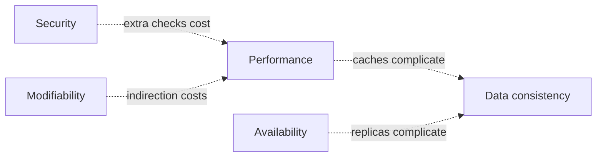

# Quality Attributes and Non-Functional Requirements

## Introduction

Two teams build an online bookstore with exactly the same features: search, cart, checkout, order history. One version handles a holiday sale smoothly, can be changed safely every day, and has never leaked a password. The other falls over at 500 users, takes a week to change a tax rule, and stores card numbers in log files.

The features are identical. What differs are the **quality attributes**: how well the system does what it does. These are also called **non-functional requirements (NFRs)**, "-ilities", or, in Richards and Ford's terminology, **architecture characteristics**.

Functional requirements say *what* the system does ("a customer can apply a discount code"). Quality attributes say *how well* ("checkout responds within 1 second for 95 percent of requests during a sale"). Functional requirements can usually be satisfied by almost any structure. Quality attributes are what actually **drive architecture**: you choose caching, replication, modules, or queues because of them.

An analogy: a family car and a race car both "drive people from A to B." Their designs are wildly different because they optimize for different qualities: comfort, cost, and safety versus speed and handling.

## Common Quality Attributes

There are dozens of "-ilities." These are the ones that most often shape software architecture.

| Attribute | Question it answers | Typical tactics |
|-----------|--------------------|-----------------|
| Performance | How fast does it respond, and how much does it use? | Caching, indexing, async processing |
| Scalability | Can it handle more load by adding resources? | Statelessness, horizontal scaling, sharding |
| Availability | What fraction of the time is it usable? | Redundancy, failover, health checks |
| Reliability | Does it behave correctly over time and under faults? | Retries, idempotency, validation |
| Security | Does it resist misuse and protect data? | Authentication, least privilege, encryption |
| Modifiability | How cheaply can it be changed? | Modularity, low coupling, tests |
| Testability | How easily can we show it works? | Dependency injection, deterministic design |
| Deployability | How safely and often can we release? | CI/CD, small deployable units, feature flags |
| Observability | Can we tell what it is doing in production? | Logs, metrics, traces |
| Interoperability | Can it work with other systems? | Standard protocols, versioned APIs |
| Usability | Can people use it effectively? | UX research, accessibility |
| Cost efficiency | Does it deliver value at reasonable cost? | Right-sizing, managed services, autoscaling |

Section 12 has a dedicated page for the big ones, starting with [Designing for Scalability](../12-arch-quality-and-operations/0-arch-scalability.mdx).

## The ISO/IEC 25010 Quality Model

If you need a standard vocabulary, for example in a contract or a regulated project, use **ISO/IEC 25010**, the product quality model in the ISO "SQuaRE" family. The current edition, **ISO/IEC 25010:2023**, has nine top-level characteristics:

1. Functional suitability
2. Performance efficiency
3. Compatibility
4. Interaction capability (renamed from "usability" in the 2011 edition)
5. Reliability
6. Security
7. Maintainability
8. Flexibility (renamed from "portability")
9. Safety (new in 2023)

The 2023 revision also added sub-characteristics such as **scalability** (under flexibility), **resistance** (under security), and **inclusivity** and **self-descriptiveness** (under interaction capability). A good summary of the changes is at [arc42 Quality: ISO 25010 update 2023](https://quality.arc42.org/articles/iso-25010-update-2023).

:::note
Older books and courses still use the 2011 model with eight characteristics, "usability" and "portability." The ideas are the same; just be aware of the renamed terms. Check the official [ISO page](https://www.iso.org/standard/78176.html) if exact wording matters for your project.
:::

### Three useful groupings

Richards and Ford group architecture characteristics into three kinds, which helps you think about where each is addressed:

- **Operational**: availability, performance, scalability, reliability, recoverability. Mostly about runtime behavior.
- **Structural**: modifiability, extensibility, maintainability, portability. Mostly about code structure.
- **Cross-cutting**: security, accessibility, legal and privacy compliance, usability. Touch everything.



## From Vague to Measurable: Quality Attribute Scenarios

"The system must be fast and scalable" is not a requirement. Nobody can test it, and nobody can tell when it is done. The Software Engineering Institute (SEI) at Carnegie Mellon popularized a better format: the **quality attribute scenario**, with six parts.

| Part | Meaning | Example |
|------|---------|---------|
| Source | Who or what triggers it | Shoppers during the holiday sale |
| Stimulus | The event | 2,000 checkout requests per minute |
| Artifact | What part of the system is affected | Checkout API |
| Environment | Conditions at the time | Peak load, one database replica down |
| Response | What the system should do | Process orders without errors |
| Response measure | How we know it succeeded | 95th percentile latency under 800 ms; error rate under 0.1 percent |

Now the requirement is testable. You can run a load test and get a clear pass or fail.

Here is the same idea in code. The scenario becomes a dataclass, and a small check evaluates measured latencies against the response measure.

```python
# qa_scenario.py: a measurable quality attribute scenario
from dataclasses import dataclass
import math


@dataclass(frozen=True)
class Scenario:
    name: str
    source: str
    stimulus: str
    artifact: str
    environment: str
    response: str
    percentile: float      # e.g. 95.0
    max_latency_ms: float
    max_error_rate: float  # 0.001 means 0.1 percent


def percentile(values: list[float], p: float) -> float:
    """Nearest-rank percentile: simple and easy to explain."""
    ordered = sorted(values)
    rank = math.ceil(p / 100 * len(ordered))
    return ordered[rank - 1]


def evaluate(s: Scenario, latencies_ms: list[float], errors: int) -> str:
    p = percentile(latencies_ms, s.percentile)
    error_rate = errors / len(latencies_ms)
    ok = p <= s.max_latency_ms and error_rate <= s.max_error_rate
    return (f"{s.name}: p{s.percentile:.0f}={p:.0f} ms (limit {s.max_latency_ms:.0f}), "
            f"errors={error_rate:.2%} (limit {s.max_error_rate:.2%}) -> "
            f"{'PASS' if ok else 'FAIL'}")


checkout_peak = Scenario(
    name="Checkout at peak",
    source="Shoppers in holiday sale",
    stimulus="2,000 checkout requests per minute",
    artifact="Checkout API",
    environment="Peak load, one DB replica down",
    response="Orders processed",
    percentile=95, max_latency_ms=800, max_error_rate=0.001,
)

# Pretend these came from a load test: 1,000 requests
fast = [120.0 + (i % 50) * 10 for i in range(900)]   # 120..610 ms
slow = [900.0 + i * 5 for i in range(100)]           # 900..1395 ms
print(evaluate(checkout_peak, fast + slow, errors=0))

# After caching catalog lookups, the slow tail shrinks
slow_fixed = [650.0 + i * 2 for i in range(100)]     # 650..848 ms
print(evaluate(checkout_peak, fast + slow_fixed, errors=1))
```

Output:

```text
Checkout at peak: p95=1145 ms (limit 800), errors=0.00% (limit 0.10%) -> FAIL
Checkout at peak: p95=748 ms (limit 800), errors=0.10% (limit 0.10%) -> PASS
```

The first load test fails: one request in ten is slow, which pushes the 95th percentile above the limit. After the fix, it passes. But look closely: the slowest requests still take up to 848 ms, over the limit. That is exactly what "p95" means: it ignores the slowest 5 percent. If those slow requests are the biggest orders, you might want a **p99** target too. Change `percentile=95` to `99` and run it again, and the second test fails. Choosing the response measure is itself an architectural decision.

:::tip
Use percentiles, not averages, for latency. An average of 200 ms can hide a long tail where one request in twenty takes 3 seconds. Section 12's [Designing for Performance](../12-arch-quality-and-operations/1-arch-performance.mdx) goes deeper.
:::

### Turning a scenario into an automated check

A scenario becomes far more valuable once it runs automatically. Here is the same check as a `pytest` test that could run after a nightly load test, reading results from a file your load-testing tool produces (tools such as k6, Locust, Gatling and JMeter can all export per-request timings).

```python
# test_checkout_slo.py: run with `pytest -q` after a load test
import json
import math
from pathlib import Path

RESULTS = Path("load_results.json")   # e.g. {"latencies_ms": [...], "errors": 0}


def p(values: list[float], pct: float) -> float:
    ordered = sorted(values)
    return ordered[math.ceil(pct / 100 * len(ordered)) - 1]


def test_checkout_p95_under_800ms() -> None:
    data = json.loads(RESULTS.read_text())
    assert p(data["latencies_ms"], 95) <= 800


def test_checkout_error_rate_under_point_1_percent() -> None:
    data = json.loads(RESULTS.read_text())
    assert data["errors"] / len(data["latencies_ms"]) <= 0.001
```

Example output, with a passing results file:

```text
..                                                                       [100%]
2 passed in 0.02s
```

Checks like these are an example of a **fitness function**: an automated test of an architectural property rather than a feature. See [Fitness Functions and Evolutionary Architecture](../13-arch-documenting-and-evolving/3-arch-fitness-functions.mdx).

## Discovering the Attributes That Matter

Stakeholders rarely say "modifiability is our top quality attribute." They describe goals and worries in business language, and part of the architect's job is to translate. Some typical translations:

| What you hear | Likely quality attribute |
|---------------|--------------------------|
| "We plan to double our customers every year." | Scalability, elasticity |
| "Our competitors ship features every week." | Modifiability, deployability, testability |
| "Last outage cost us a day of sales." | Availability, recoverability |
| "We are entering the EU market." | Privacy and compliance (for example GDPR), data residency |
| "We are being acquired next year." | Interoperability, documentation, maintainability |
| "Our budget is fixed and small." | Cost efficiency, simplicity |
| "Customers complain the app feels slow." | Performance (find out which part and how slow) |

A good way to organize what you learn is a **utility tree**, a technique from the SEI's Architecture Tradeoff Analysis Method (ATAM). The root is "utility" (overall goodness), the branches are quality attributes, and the leaves are concrete scenarios ranked by business importance and technical difficulty.



The pairs (H for high, M for medium, L for low) rate importance to the business and difficulty to achieve. Scenarios rated high on both deserve the most architectural attention. ATAM is covered in [Architecture Reviews and ATAM](../13-arch-documenting-and-evolving/4-arch-reviews.mdx).

## Explicit, Implicit, and Conflicting Attributes

- **Explicit** attributes appear in requirements: "must support 10,000 concurrent users."
- **Implicit** attributes are rarely written down but always expected: security, basic availability, not losing data. Nobody writes "do not store passwords in plain text," yet it is a requirement.
- **Conflicting** attributes pull in opposite directions. More security checks add latency. More caching improves performance but makes data consistency harder. More modularity adds indirection.



Because attributes conflict, you **cannot maximize all of them**. You must prioritize. Richards and Ford recommend picking a small number, often the top three, that matter most for the business, rather than a long list where everything is "critical." This is the subject of the next page, [Thinking in Trade-offs](./4-arch-trade-offs.mdx).

## Quality Attributes and Architectural Styles

Different architectural styles favor different attributes. This is why you pick quality attributes first and a style second. The table below is a rough guide only; implementation quality matters more than the label.

| Style | Tends to help | Tends to cost |
|-------|---------------|---------------|
| Layered monolith | Simplicity, low cost, easy debugging | Scalability per part, deployability as it grows |
| Modular monolith | Modifiability, simplicity of operations | Independent scaling, team autonomy at large scale |
| Microservices | Independent deployability, scaling per service, team autonomy | Simplicity, data consistency, operational cost |
| Event-driven | Extensibility, responsiveness, decoupling | Observability, reasoning about end-to-end flow |
| Serverless | Elasticity, low cost at low or spiky load | Cold-start latency, vendor coupling, local testing |

Each style has its own page in section 6, ending with [Choosing an Architectural Style](../6-arch-architectural-styles/10-arch-choosing-a-style.mdx).

## Real-World Scenario

Your online bookstore's product manager writes in the planning doc: "The new checkout must be fast, scalable, secure and highly available." You are asked to design it.

**Step 1: Ask what each word means for this business.** After talking to the business:

- The holiday sale brings about 10 times normal traffic for three days.
- A failed payment loses a sale; a slow product page is annoying but survivable.
- The company is a small team with a modest cloud budget.

**Step 2: Write scenarios with measures.**

| Attribute | Scenario (short) | Measure |
|-----------|------------------|---------|
| Availability | Checkout during sale, one server lost | 99.9 percent of checkout attempts succeed |
| Performance | 2,000 checkouts per minute | p95 under 800 ms, p99 under 2 s |
| Security | Attacker attempts card testing | Rate-limited after 5 failed attempts per card per hour |
| Modifiability | New payment method added | Under 3 days, touching only the payments module |

**Step 3: Prioritize.** You agree the top three are availability of checkout, payment correctness (a reliability concern), and modifiability. Raw scalability beyond 10 times normal is explicitly **not** a goal this year.

**Step 4: Let the scenarios drive design.** Availability leads to two app instances behind a load balancer and idempotent payment calls. Performance leads to caching the catalog, not the cart. Modifiability leads to a payments module behind a small interface.

### Why this approach

Measurable scenarios end arguments based on opinion ("I think it's fast enough") and make every design choice traceable to a business need. Prioritizing stops the team from over-building for scale it does not need.

### When to use it and when not to

Write scenarios for the attributes that drive decisions, especially before choosing an architectural style or making a large investment. You do not need a formal scenario for every minor attribute of an internal tool; a sentence is enough. Avoid inventing precise numbers without data: start with rough targets and refine them with real measurements.

### Alternatives and trade-offs

| Approach | Pros | Cons | Best for |
|----------|------|------|----------|
| Informal adjectives ("fast", "secure") | Quick | Untestable; endless debate | Early brainstorming only |
| Quality attribute scenarios | Testable, traceable to design | Takes effort to define and agree | Key attributes of important systems |
| SLOs with error budgets | Operational, continuously measured | Needs monitoring in place | Running production services |
| Full ISO/IEC 25010 checklist | Complete, standard vocabulary | Heavy; easy to treat as box-ticking | Contracts, regulated and safety-critical work |

## Common Mistakes

- **"Everything is a top priority."** If every attribute is critical, none is. Rank them.
- **Unmeasurable requirements.** "Scalable" without a number and a scenario cannot guide design or testing.
- **Averages instead of percentiles** for latency.
- **Forgetting implicit attributes**, especially security, privacy and data durability.
- **Designing for imaginary scale.** Planning for millions of users when you have hundreds costs real money and complexity now.
- **Setting targets once and never checking.** Turn key scenarios into automated tests or production SLOs.

## Best Practices

- **Start from business goals** and translate them into attributes, not the other way around.
- **Rank the attributes** and agree on the top three with stakeholders.
- **Write six-part scenarios** for the top attributes, with numbers you can test.
- **Use percentiles** for latency and state the load at which they apply.
- **Automate the checks** as load tests, fitness functions or production SLOs.
- **Revisit the list** when the business changes: a new market, a big customer or a new regulation can reorder priorities overnight.

## Summary

- Quality attributes (non-functional requirements, architecture characteristics) describe *how well* a system works, and they drive architecture far more than features do.
- ISO/IEC 25010:2023 defines nine product quality characteristics, including the new **safety** and the renamed **interaction capability** and **flexibility**.
- Group attributes as operational, structural and cross-cutting.
- Write quality attribute scenarios with source, stimulus, artifact, environment, response and response measure, so requirements become testable.
- Attributes conflict, so you must prioritize a few that matter most.

## Further Learning

Exercises:

1. Change the scenario in `qa_scenario.py` to use `percentile=99`. Why does the second test now fail? Then add an availability scenario that checks the fraction of successful requests.
2. Pick an app you use (a banking app, a video service, a messaging app). Guess its top three quality attributes and write one six-part scenario for each.
3. Find a requirement in a project you know that uses words like "fast" or "user-friendly." Rewrite it as a measurable scenario.
4. Build a small utility tree (like the mermaid example above) for a system you work on, with at least four leaf scenarios rated for importance and difficulty.

Related pages:

- [Thinking in Trade-offs](./4-arch-trade-offs.mdx)
- [Designing for Reliability and Resilience](../12-arch-quality-and-operations/2-arch-reliability.mdx)
- [Designing for Observability](../12-arch-quality-and-operations/3-arch-observability.mdx)
- [Architecture Reviews and ATAM](../13-arch-documenting-and-evolving/4-arch-reviews.mdx)
- [Fitness Functions and Evolutionary Architecture](../13-arch-documenting-and-evolving/3-arch-fitness-functions.mdx)

External reading:

- [arc42 Quality Model](https://quality.arc42.org/) (examples of quality requirements)
- [ISO/IEC 25010:2023](https://www.iso.org/standard/78176.html)
