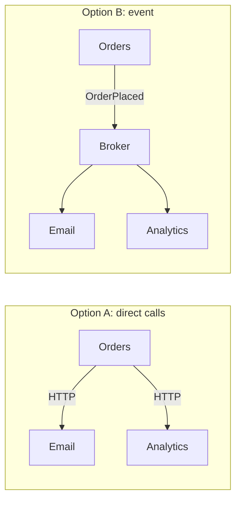
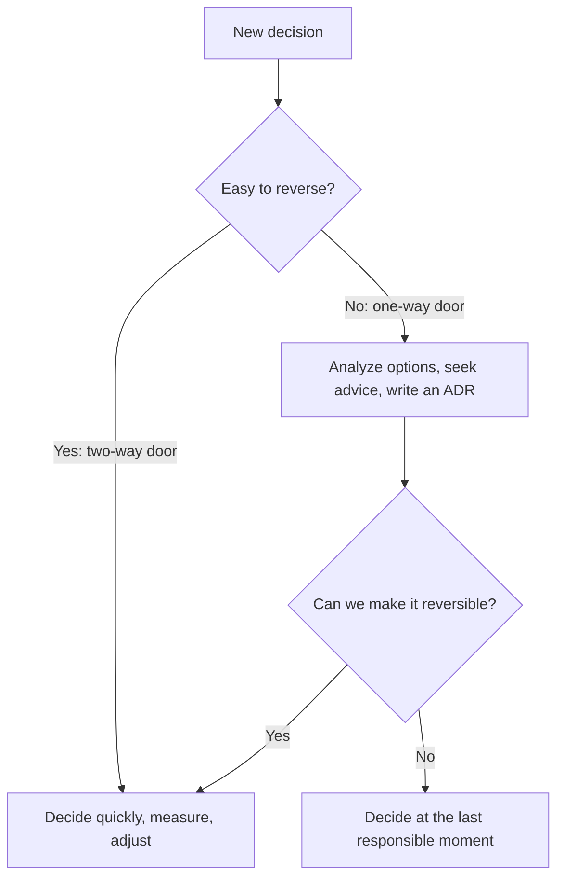
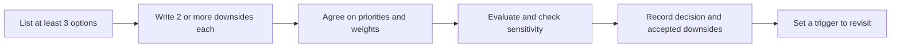

# Thinking in Trade-offs

## Introduction

Ask an experienced architect almost any design question and the first answer is usually "it depends." That can sound like a dodge, but it is the most honest answer in software design. Every option gives you something and costs you something. The skill is knowing **what it depends on**, and being able to explain the trade-off clearly enough that others can agree or disagree with good reasons.

Mark Richards and Neal Ford put this at the center of *Fundamentals of Software Architecture*. Their **first law of software architecture** says that everything in software architecture is a trade-off; if you think you have found something that is not, you probably have not identified the trade-off yet. Their **second law** says that *why* is more important than *how*: a diagram shows how a system is built, but the reasons behind it are what let future developers change it safely. The second edition (2025) adds a **third law**: most architecture decisions are not binary, but sit somewhere on a spectrum between extremes.

An everyday analogy: choosing where to live. A city apartment gives a short commute and costs space. A house in the suburbs gives space and costs commute time. There is no "best" home, only the one that fits your priorities. If your priorities change (a new job, a new baby), the best choice changes too.

## Every Option Has a Cost

Consider a classic decision: when an order is placed in the online bookstore, how should the order service tell the email service and the analytics service?

**Option A: Call them directly over HTTP (synchronous).**

**Option B: Publish an `OrderPlaced` event to a message broker (asynchronous).**



Neither is "the right way." Here is what each gives and takes:

| Concern | Direct calls | Event via broker |
|---------|--------------|------------------|
| Simplicity | Simple to build and debug | Extra infrastructure to run and monitor |
| Coupling | Orders knows every consumer | Orders does not know who listens |
| Adding a consumer | Change and redeploy Orders | Subscribe a new service, Orders unchanged |
| Availability | If Email is down, checkout may fail or slow | Checkout succeeds; email is sent later |
| Consistency and feedback | Immediate result, easy error handling | Eventual; harder to know if processing failed |
| Tracing a request | One call stack | Needs correlation IDs and tracing |

The event option looks better for flexibility and availability, and worse for simplicity and observability. Whether it is the better choice depends on which of those qualities matters more **for this system, now**. That is the link back to [Quality Attributes](./3-arch-quality-attributes.mdx): you cannot evaluate a trade-off without knowing your priorities.

:::tip
A useful habit is to write every option with at least two downsides. If you cannot name any downsides of the option you prefer, you have not analyzed it yet.
:::

## Making Trade-offs Explicit: A Weighted Decision Matrix

A **weighted decision matrix** is a simple tool to make the reasoning visible. You list the criteria (usually quality attributes), give each a weight that reflects its priority, score each option, and multiply.

```python
# decision_matrix.py: compare options against weighted criteria
from dataclasses import dataclass


@dataclass(frozen=True)
class Option:
    name: str
    scores: dict[str, int]  # 1 (poor) to 5 (excellent)


def rank(options: list[Option], weights: dict[str, float]) -> list[tuple[str, float]]:
    total_weight = sum(weights.values())
    results = []
    for opt in options:
        score = sum(opt.scores[c] * w for c, w in weights.items()) / total_weight
        results.append((opt.name, round(score, 2)))
    return sorted(results, key=lambda r: r[1], reverse=True)


options = [
    Option("Direct HTTP calls", {"simplicity": 5, "availability": 2, "extensibility": 2, "observability": 5}),
    Option("Event via broker",  {"simplicity": 2, "availability": 5, "extensibility": 5, "observability": 3}),
]

# Priorities for a small team launching a first version
startup = {"simplicity": 5, "availability": 2, "extensibility": 2, "observability": 3}
# Priorities for the same store two years later, with frequent sales and new consumers
growth = {"simplicity": 2, "availability": 5, "extensibility": 4, "observability": 3}

print("Launch priorities:", rank(options, startup))
print("Growth priorities:", rank(options, growth))
```

Output:

```text
Launch priorities: [('Direct HTTP calls', 4.0), ('Event via broker', 3.25)]
Growth priorities: [('Event via broker', 4.14), ('Direct HTTP calls', 3.07)]
```

The scores for each option never changed. Only the **weights** did, and the winner flipped. That is the real lesson: the weights are the decision. Arguments about architecture are usually disagreements about priorities in disguise, so make the priorities explicit first.

### Checking how sensitive the decision is

If a small change in weights flips the result, the decision is fragile and deserves more discussion. If the winner stays the same across reasonable weights, you can decide quickly. Here is a quick sensitivity check.

```python
# sensitivity.py: does the winner change as one priority changes?
def score(s: dict[str, int], w: dict[str, float]) -> float:
    return sum(s[c] * w[c] for c in w) / sum(w.values())


direct = {"simplicity": 5, "availability": 2, "extensibility": 2, "observability": 5}
event = {"simplicity": 2, "availability": 5, "extensibility": 5, "observability": 3}

base = {"simplicity": 3, "availability": 3, "extensibility": 3, "observability": 3}
for availability_weight in range(1, 6):
    w = {**base, "availability": availability_weight}
    winner = "event" if score(event, w) > score(direct, w) else "direct"
    print(f"availability weight {availability_weight}: {winner}")
```

Output:

```text
availability weight 1: direct
availability weight 2: direct
availability weight 3: event
availability weight 4: event
availability weight 5: event
```

With every other priority equal, the decision hinges on how much availability matters. That is the question to take to the business: "How bad is it if checkout fails because the email service is down?"

:::caution
A decision matrix is a thinking tool, not an oracle. The numbers are subjective, and it is easy to tweak them until your favorite wins. Its value is that it forces the team to state and discuss priorities openly.
:::

### Enforcing honest analysis

A team can make "name the downsides" a habit by building it into the tooling they use for decisions. Here is a small trade-off record that refuses to render a recommendation unless every option lists at least two downsides and the chosen option's downsides are explicitly accepted.

```python
# tradeoff_record.py: no recommendation without stated downsides
from dataclasses import dataclass, field


@dataclass
class Choice:
    name: str
    upsides: list[str]
    downsides: list[str]


@dataclass
class TradeoffRecord:
    question: str
    priorities: list[str]
    options: list[Choice] = field(default_factory=list)

    def recommend(self, chosen: str) -> str:
        problems = [o.name for o in self.options if len(o.downsides) < 2]
        if problems:
            raise ValueError(f"list at least two downsides for: {', '.join(problems)}")
        pick = next(o for o in self.options if o.name == chosen)
        rejected = [o.name for o in self.options if o is not pick]
        return "\n".join([
            f"Question:   {self.question}",
            f"Priorities: {' > '.join(self.priorities)}",
            f"Chosen:     {pick.name}",
            f"Rejected:   {', '.join(rejected)}",
            f"Accepting:  {'; '.join(pick.downsides)}",
        ])


record = TradeoffRecord(
    question="How should Orders notify Email and Analytics?",
    priorities=["checkout availability", "extensibility", "simplicity"],
    options=[
        Choice("Direct HTTP calls", ["simple", "easy to trace"],
               ["checkout fails when Email is down", "Orders must know every consumer"]),
        Choice("Event via managed broker", ["decoupled", "new consumers without changes"],
               ["eventual delivery", "new component to operate"]),
    ],
)
print(record.recommend("Event via managed broker"))
```

Output:

```text
Question:   How should Orders notify Email and Analytics?
Priorities: checkout availability > extensibility > simplicity
Chosen:     Event via managed broker
Rejected:   Direct HTTP calls
Accepting:  eventual delivery; new component to operate
```

Remove one downside from either option and `recommend` raises an error. It is a tiny guardrail, but it encodes the first law in a form the team cannot skip.

## Reversible and Irreversible Decisions

Not every trade-off deserves the same amount of analysis. Amazon's well-known framing (from Jeff Bezos's 2015 letter to shareholders) separates **one-way doors**, decisions that are hard or impossible to reverse, from **two-way doors**, which you can walk back through if they turn out wrong.



| Decision | Door type | Why |
|----------|-----------|-----|
| Name of an internal function | Two-way | One refactoring away |
| Choice of logging library behind a wrapper | Two-way | The wrapper limits the blast radius |
| Public API shape used by partners | One-way | External clients depend on it |
| Primary database for core data | Mostly one-way | Data migration is expensive and risky |
| Splitting into microservices | Mostly one-way | Merging services back is costly |

Two practical consequences:

1. **Spend analysis effort on one-way doors.** Do not hold a two-hour meeting about a two-way door.
2. **Turn one-way doors into two-way doors when you can.** Put an interface in front of a vendor, use database migrations, hide a new feature behind a flag. This is what Fowler means when he says one architect's job is to make things easier to change.

The **last responsible moment**, an idea from Lean software development (Mary and Tom Poppendieck), suggests delaying irreversible decisions until the cost of not deciding becomes greater than the cost of deciding. By then you have more information. "Last responsible" is not "never": delaying too long creates its own costs.

## A Second Worked Example: Adding a Cache

Trade-offs hide even in decisions that look like pure wins. The bookstore's product page is slow because every view queries price, stock and reviews. "Just add a cache" sounds obviously good. Here is the analysis:

| What you gain | What you pay |
|---------------|--------------|
| Faster product pages (lower p95 latency) | Stale data: a price change may take minutes to appear |
| Less load on the database | A new component (for example Redis) to run, monitor and secure |
| Better behavior under traffic spikes | Cache invalidation logic, a classic source of bugs |
| Possible lower database cost | Cold-cache behavior after restarts can cause load spikes |

The useful question is not "cache or no cache" but "what may be stale, and for how long?" Stock levels shown on a product page can be 60 seconds old; the stock check at checkout cannot. That leads to a nuanced decision: cache product pages with a short expiry, but always read stock from the database during checkout. It is a point on a spectrum, exactly as the third law says, not a yes-or-no answer. See [Caching Strategies](../11-arch-data-architecture/2-arch-caching-strategies.mdx) and the site's [Redis tutorial](/docs/middleware/redis).

## Aim for the "Least Worst" Option

Richards and Ford make a point that relieves a lot of pressure: architects rarely find the *best* architecture. Because every option has drawbacks, the realistic goal is the **least worst** set of trade-offs for your situation. This mindset has two practical benefits:

- It stops endless searching for a perfect option that does not exist.
- It encourages designs that are **easy to change**, because you accept you will probably need to adjust them.

## Biases That Distort Trade-offs

Trade-off analysis is only as good as the honesty behind it. Watch for these common biases in yourself and in design discussions:

| Bias | What it sounds like | Antidote |
|------|---------------------|----------|
| Golden hammer | "We use Kafka for everything." | Ask what problem this specific case has |
| Resume-driven development | "Let's try this new framework on the billing system." | Experiment on low-risk parts first |
| Cargo culting | "Big tech companies do it this way." | Compare their scale and constraints with yours |
| Sunk cost | "We already spent three months on it." | Judge options by future cost, not past spend |
| Novelty bias | "The old way is boring." | Boring is often a feature: known failure modes, easy hiring |
| Status quo bias | "We've always done it this way." | Re-run the analysis with today's priorities |
| Anchoring | The first option proposed becomes the default | Write down several options before discussing any |



## Common Trade-offs You Will Meet Again

| Trade-off | One side | Other side | Where in this tutorial |
|-----------|----------|------------|------------------------|
| Consistency vs availability | Always correct data | Always responding | [CAP and PACELC](../9-arch-distributed-systems/1-arch-cap-and-pacelc.mdx) |
| Simplicity vs flexibility | Fewer moving parts | Easier to extend later | [DRY, KISS and YAGNI](../1-arch-design-principles/6-arch-dry-kiss-yagni.mdx) |
| Monolith vs services | Simple operations | Independent deployment and scaling | [Choosing an Architectural Style](../6-arch-architectural-styles/10-arch-choosing-a-style.mdx) |
| Sync vs async | Immediate feedback | Decoupling and resilience | [Synchronous vs Asynchronous Communication](../10-arch-integration-and-apis/0-arch-communication-styles.mdx) |
| Reuse vs coupling | Less duplicated code | Shared code couples teams | [Coupling and Cohesion](./5-arch-coupling-and-cohesion.mdx) |
| Build vs buy | Exact fit, full control | Faster, someone else maintains it | [Cost-Aware Architecture](../12-arch-quality-and-operations/7-arch-cost-awareness.mdx) |

## Real-World Scenario

The bookstore's checkout currently calls the email service over HTTP. During last year's holiday sale the email provider slowed down, checkout requests piled up waiting for it, and the site lost orders for 40 minutes. The marketing team also wants to add two new consumers of order data next quarter: a loyalty-points service and a fraud-scoring service.

A senior developer proposes moving everything to an event-driven design with Kafka. Another says "just add a timeout." You are asked to recommend a path.

**Step 1: State the priorities.** With product and operations, you agree: (1) checkout availability during sales, (2) ability to add consumers without changing checkout, (3) keep operations manageable for a team with no streaming platform experience.

**Step 2: List options with their downsides.**

- *Add a timeout and a fallback.* Cheap and immediate, but does not help with new consumers.
- *Self-hosted Kafka.* Powerful, but the team has no experience operating it; it is a large one-way door.
- *A managed queue or broker (for example a hosted RabbitMQ or a cloud queue service) plus an outbox table.* Decouples checkout, supports new consumers, and the team can learn incrementally.

**Step 3: Decide in stages.** Add the timeout this week (a two-way door). Then introduce a managed broker for `OrderPlaced` events, using the [Transactional Outbox](../9-arch-distributed-systems/6-arch-outbox.mdx) so no event is lost. Reassess a streaming platform only if event volume or replay needs grow.

**Step 4: Record it.** An ADR captures the priorities, the options, the decision, and the downsides accepted: eventual email delivery and a new component to monitor.

### Why this approach

It addresses the most painful problem immediately, matches the solution to the team's ability to operate it, and avoids a large irreversible commitment before it is justified. Each step is small enough to evaluate.

### When to use it and when not to

Staged, priority-driven decisions work well when the problem is real but the long-term needs are uncertain. If you already know the long-term requirements well, for example a regulatory need to replay every event for seven years, it can be cheaper to make the larger decision once.

### Alternatives and trade-offs

| Approach | Pros | Cons | Best for |
|----------|------|------|----------|
| Gut feeling or the loudest voice | Fast | Unexplained, hard to revisit | Trivial two-way doors |
| Weighted decision matrix | Makes priorities explicit | Numbers are subjective | Comparing a few clear options |
| ADR with options and consequences | Durable reasoning | Requires writing discipline | Any significant decision |
| Prototype or spike | Real evidence | Costs time; may not reflect production | Uncertain technical feasibility |
| Architecture review (for example ATAM) | Thorough, multi-stakeholder | Heavy | Large, high-risk systems |

## Common Mistakes

- **Looking for the "best practice."** There are good practices in a context, not universal best ones.
- **Ignoring the downsides of the option you like.** Write them down, especially for your favorite.
- **Treating every decision as one-way.** Endless analysis on reversible choices wastes time.
- **Treating one-way decisions casually.** Splitting a database or publishing an API deserves real analysis.
- **Arguing about solutions before agreeing on priorities.** Most heated debates disappear when the weights are agreed.
- **Forgetting that context changes.** A good decision can become a bad one as the team, load, or business changes. Revisit important decisions.

## Best Practices

- **Agree on priorities before comparing solutions.** Rank the top three quality attributes with the people who own the business outcome.
- **Write at least three options**, including "do nothing" and "the simplest thing that could work."
- **Name at least two downsides per option**, and state which ones you accept.
- **Match analysis effort to reversibility.** Minutes for two-way doors, days for one-way doors.
- **Prefer options that keep future choices open** when uncertainty is high.
- **Record the decision and a trigger to revisit it**, such as "if traffic exceeds 10 times today's peak" or "when a second team needs this data."

## Summary

- Everything in architecture is a trade-off (Richards and Ford's first law); *why* matters more than *how* (second law); most decisions sit on a spectrum, not a yes/no choice (third law, second edition).
- Evaluate options against prioritized quality attributes; name the downsides of every option.
- A weighted decision matrix and a quick sensitivity check make priorities explicit and show how fragile a decision is.
- Distinguish one-way from two-way doors; invest analysis in the former and try to convert them into the latter.
- Decide irreversible things at the last responsible moment, and record the reasoning.

## Further Learning

Exercises:

1. Add a third option to `decision_matrix.py`: "Direct calls with timeout and retry queue." Score it and see where it ranks under both sets of priorities.
2. Extend `sensitivity.py` to vary the `simplicity` weight instead. At what weight does the winner flip?
3. List five decisions from a recent project and classify each as a one-way or two-way door. For one of the one-way doors, describe how it could have been made more reversible.

Related pages:

- [Quality Attributes and Non-Functional Requirements](./3-arch-quality-attributes.mdx)
- [Coupling and Cohesion](./5-arch-coupling-and-cohesion.mdx)
- [Architecture Decision Records](../13-arch-documenting-and-evolving/0-arch-decision-records.mdx)
- [Architecture Reviews and ATAM](../13-arch-documenting-and-evolving/4-arch-reviews.mdx)

External reading:

- [Software Architecture Guide](https://martinfowler.com/architecture/) (Martin Fowler)
- [Fundamentals of Software Architecture, 2nd edition](https://www.oreilly.com/library/view/-/9781098175504/) (Richards and Ford, O'Reilly)
