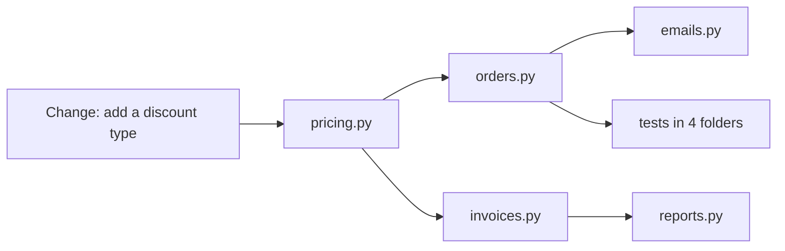
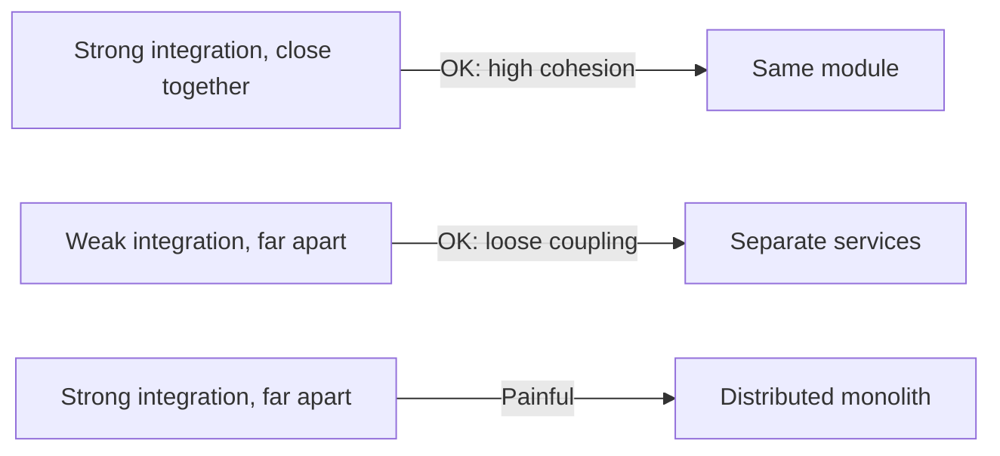
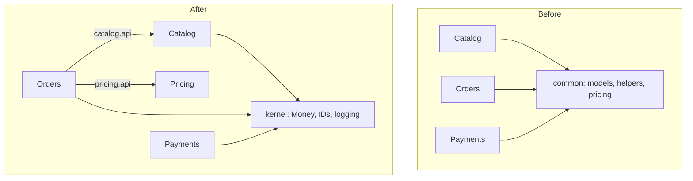

# Coupling and Cohesion

## Introduction

If you remember only two words from architecture, make them **coupling** and **cohesion**. Almost every principle and pattern in this tutorial, from SOLID to microservices, is ultimately a technique for getting these two right.

- **Coupling** is how much one module depends on another. If changing module A forces you to change module B, they are coupled.
- **Cohesion** is how closely the things inside one module belong together. A cohesive module has one clear purpose; everything in it changes for the same reasons.

The goal is usually summarized as **low coupling, high cohesion**: modules that are focused inside and loosely connected outside.

An analogy: a well-organized kitchen. Knives, cutting boards and peelers live together at the prep station (high cohesion). The prep station does not need to know how the dishwasher works; you just put dirty things in the sink (low coupling). Now imagine a kitchen where the spoons are spread across five drawers mixed with batteries and tape (low cohesion), and you cannot open the oven without first moving the fridge (high coupling). That kitchen still "works," but every task is slow and annoying. Many codebases feel exactly like that.

These ideas are old. They were described by Larry Constantine and Edward Yourdon in *Structured Design* in the 1970s, and they remain just as relevant for classes, modules, and microservices today.

## Why It Matters: The Ripple Effect

The cost of coupling shows up when you change something. In a tightly coupled system, a small change ripples outward.



In a well-structured system, the same change touches one module and its tests. That difference is the difference between a 30-minute change and a two-day change with a nervous release.

## Coupling: A Before and After

Here is a pricing function from the online bookstore. Its caller passes a flag telling it *how* to behave. This is called **control coupling**: the caller must understand the callee's internals.

```python
# before_coupling.py: control coupling through a mode flag
def calculate_price(items: list[tuple[str, float, int]], mode: str) -> float:
    subtotal = sum(price * qty for _, price, qty in items)
    if mode == "member":
        return round(subtotal * 0.9, 2)
    if mode == "black_friday":
        return round(subtotal * 0.7, 2)
    if mode == "member_black_friday":
        return round(subtotal * 0.9 * 0.7, 2)
    return round(subtotal, 2)


cart = [("Dune", 12.0, 1), ("Neuromancer", 9.5, 2)]
print(calculate_price(cart, "member"))
print(calculate_price(cart, "member_black_friday"))
```

Output:

```text
27.9
19.53
```

Problems:

- Every caller must know the magic strings.
- Every new discount means editing this function **and** every caller that chooses modes.
- Combinations explode (`member_black_friday`).

Here is a version where pricing depends on a small abstraction, and callers pass in the rules they want.

```python
# after_coupling.py: callers pass behavior, not flags
from dataclasses import dataclass
from typing import Protocol


@dataclass(frozen=True)
class Line:
    title: str
    price: float
    qty: int


class Discount(Protocol):
    def apply(self, amount: float) -> float: ...


@dataclass(frozen=True)
class Percent:
    percent: float

    def apply(self, amount: float) -> float:
        return amount * (1 - self.percent / 100)


def calculate_price(lines: list[Line], discounts: list[Discount]) -> float:
    total = sum(line.price * line.qty for line in lines)
    for d in discounts:
        total = d.apply(total)
    return round(total, 2)


cart = [Line("Dune", 12.0, 1), Line("Neuromancer", 9.5, 2)]
member, black_friday = Percent(10), Percent(30)
print(calculate_price(cart, [member]))
print(calculate_price(cart, [member, black_friday]))
```

Output:

```text
27.9
19.53
```

The behavior is identical, but the coupling is different. `calculate_price` no longer knows which discounts exist; new discounts are new classes; combinations come for free. This is the [Strategy Pattern](../4-arch-behavioral-patterns/0-arch-strategy.mdx) and the [Open/Closed Principle](../1-arch-design-principles/2-arch-open-closed.mdx) in action.

:::note
The "after" version is not free. It has more types and one more concept to learn. For a script with two fixed discounts, the "before" version is fine. The refactoring pays off once discounts change often or several people work on them.
:::

### Classic types of coupling

From tightest (worst) to loosest (best), the classic structured-design list is:

| Type | What it means | Example |
|------|---------------|---------|
| Content | One module reaches into another's internals | Changing a private attribute of another class, or SQL against another module's tables |
| Common | Modules share global mutable data | A global `CONFIG` dict that several modules write to |
| External | Modules share an externally imposed format or protocol | Two modules both parsing the same vendor file format |
| Control | One module tells another *how* to behave | The `mode` flag above |
| Stamp | Passing a whole structure when only part is used | Passing the full `User` object to a function that needs only the email |
| Data | Passing only the simple data that is needed | `send_receipt(email, order_total)` |

You cannot remove all coupling (modules must talk to each other), but you can choose the loosest kind that works.

## Cohesion: Does This Belong Together?

Cohesion asks whether the contents of a module have one reason to exist. A common smell is the `utils.py` or `helpers` module that grows forever.

```python
# low cohesion: unrelated things in one module
def format_isbn(isbn: str) -> str: ...
def send_slack_alert(text: str) -> None: ...
def calculate_shipping(weight_kg: float) -> float: ...
def parse_csv_report(path: str) -> list[dict[str, str]]: ...
```

Everything that imports `utils` now depends on Slack, CSV parsing, and shipping rules, even if it only wanted ISBN formatting. Each function changes for a different reason, so the module changes constantly and conflicts in every merge.

The fix is to group by **reason to change**: `catalog/isbn.py`, `notifications/slack.py`, `shipping/rates.py`, `reports/csv_import.py`. This is the [Single Responsibility Principle](../1-arch-design-principles/1-arch-single-responsibility.mdx) applied at module level.

| Cohesion level | Elements are grouped because... | Quality |
|----------------|--------------------------------|---------|
| Coincidental | No real reason (`utils.py`) | Worst |
| Logical | They are the same "kind" of thing (all validators) | Weak |
| Temporal | They run at the same time (startup tasks) | Weak |
| Procedural or communicational | They are steps on the same data or process | Moderate |
| Sequential | Output of one is input of the next | Good |
| Functional | Together they do exactly one well-defined job | Best |

### Package by feature, not by layer

At the architecture level, cohesion strongly influences folder structure. Compare:

```text
by layer (low cohesion per feature)      by feature (high cohesion per feature)
controllers/                             catalog/
    catalog.py  orders.py  ...               api.py  service.py  repository.py
services/                                orders/
    catalog.py  orders.py  ...               api.py  service.py  repository.py
repositories/                            payments/
    catalog.py  orders.py  ...               api.py  service.py  gateway.py
```

With the layered layout, one feature change touches three folders. With the feature layout, it touches one. See [Structuring a Codebase](../7-arch-clean-architecture/6-arch-structuring-a-codebase.mdx) and [Vertical Slice Architecture](../7-arch-clean-architecture/3-arch-vertical-slice.mdx).

## Measuring Coupling: Afferent, Efferent and Instability

Robert C. Martin popularized simple package metrics:

- **Afferent coupling (Ca):** how many modules depend *on* this one (incoming).
- **Efferent coupling (Ce):** how many modules this one depends *on* (outgoing).
- **Instability (I) = Ce / (Ca + Ce)**, from 0 (stable: many depend on it, it depends on nothing) to 1 (unstable: it depends on others, nobody depends on it).

The rule of thumb is that dependencies should point toward **stable** modules: things that change often should depend on things that change rarely.

```python
# coupling_metrics.py: compute Ca, Ce and instability for a module graph
graph: dict[str, set[str]] = {
    "web": {"catalog", "cart", "orders"},
    "catalog": {"shared"},
    "cart": {"catalog", "shared"},
    "orders": {"cart", "payments", "shared"},
    "payments": {"shared"},
    "shared": set(),
}

afferent = {m: 0 for m in graph}
for module, deps in graph.items():
    for dep in deps:
        afferent[dep] += 1

print(f"{'module':9} {'Ca':>3} {'Ce':>3} {'I':>5}")
for module, deps in graph.items():
    ca, ce = afferent[module], len(deps)
    instability = ce / (ca + ce) if (ca + ce) else 0.0
    print(f"{module:9} {ca:>3} {ce:>3} {instability:>5.2f}")
```

Output:

```text
module     Ca  Ce     I
web         0   3  1.00
catalog     2   1  0.33
cart        2   2  0.50
orders      1   3  0.75
payments    1   1  0.50
shared      4   0  0.00
```

`shared` has four dependents and is fully stable (I = 0). That is fine **if** it really is stable. If `shared` is a junk drawer that changes every week, it is the riskiest module in the system: every change ripples to four others. `web` is fully unstable, which is fine for a top-level entry point.

## Connascence: A Finer Vocabulary

"Coupled" is a blunt word. **Connascence**, introduced by Meilir Page-Jones and popularized for modern developers by Jim Weirich and the site [connascence.io](https://connascence.io/), describes *how* two pieces of code are coupled. Two elements are connascent if changing one requires changing the other.

| Kind | Example | Strength |
|------|---------|----------|
| Name | Callers must use the method name `apply` | Weakest (static) |
| Type | Callers must pass a `float` | Static |
| Meaning | `mode == "member"` magic strings | Static |
| Position | `Line("Dune", 12.0, 1)` argument order matters | Static |
| Algorithm | Two places must use the same hashing scheme | Static |
| Execution | `connect()` must be called before `send()` | Dynamic |
| Timing | Two services must respond within a timeout | Dynamic |
| Value | Two values must stay consistent (prices in two tables) | Dynamic |
| Identity | Two parts must reference the same object instance | Strongest (dynamic) |

Three properties guide refactoring: **strength** (weaker is better, so prefer name over meaning), **locality** (strong connascence is acceptable inside one function, dangerous across services), and **degree** (connascence with 2 places is better than with 20). For example, replacing magic strings (meaning) with an `Enum` (name) is a cheap, direct improvement, as is replacing positional arguments with keyword arguments.

## Coupling Between Services

The same ideas apply when parts of a system run as separate services, but new kinds of coupling appear.

| Kind | What couples the services | Example | Loosen it with |
|------|---------------------------|---------|----------------|
| Temporal | Both must be up at the same time | Checkout calls Email synchronously | Asynchronous messaging, queues |
| Deployment | They must be released together | A shared schema change needs both services redeployed | Backward-compatible changes, versioned APIs |
| Data | They read or write the same tables | Catalog queries order tables | Database per service, published APIs |
| Semantic | They must agree on what a field means | Both interpret `status = 3` as "shipped" | Explicit schemas and contracts |
| Platform | They depend on the same library version or runtime | A shared client library upgrade forces all teams to move | Thin, stable shared libraries; standards over shared code |

Vlad Khononov's book *Balancing Coupling in Software Design* (Addison-Wesley, 2024) offers a useful lens: coupling is not inherently bad; the cost depends on three things together.

- **Integration strength**: how much knowledge the parts share (sharing database tables shares a lot; calling a small, stable API shares little).
- **Distance**: how far apart the parts are (same class, same module, different service, different company).
- **Volatility**: how often the shared knowledge changes.

The heuristic is to keep strongly integrated parts **close together** (same module or service) and allow distant parts only **weak** integration. High strength plus high distance is the painful combination, unless the shared knowledge almost never changes.



## Real-World Scenario

Your bookstore has three teams. Over two years they created a `common` Python package used by all of them. It contains database models for every table, helper functions, and pricing rules. Releases now require all three teams to coordinate, because any change to `common` might break someone. The Catalog team waited two weeks to add a single column.

**Step 1: Measure.** You run the coupling metrics: `common` has a Ca of 14 (every module depends on it) and changes in 60 percent of pull requests. That is the worst combination: heavily depended upon *and* unstable.

**Step 2: Split by reason to change.** You move each team's models into that team's own package (catalog models into `catalog`, order models into `orders`). Pricing rules move to `pricing`, owned by Checkout. What remains in `common` is genuinely stable: logging setup, a `Money` value type, and an ID generator.

**Step 3: Replace content coupling with published interfaces.** The Orders module used to query catalog tables directly. Now it calls `catalog.api.get_book(isbn)`, which returns a small dataclass. Catalog can change its tables freely.

**Step 4: Prevent regression.** An [import-linter](https://import-linter.readthedocs.io/) rule in CI forbids `orders` from importing `catalog.models`:

```ini
# .importlinter
[importlinter]
root_package = bookstore

[importlinter:contract:orders-uses-catalog-api-only]
name = Orders must use the catalog API, not its models
type = forbidden
source_modules = bookstore.orders
forbidden_modules = bookstore.catalog.models
```

Running `lint-imports` in CI fails the build if anyone adds the forbidden import.



### Why this approach

It aims at the specific source of coordination cost: one unstable module with many dependents. It replaces the strongest coupling (shared tables) with the weakest practical one (a small published interface) and keeps the genuinely shared, stable code shared.

### When to use it and when not to

Use this when a module is both heavily depended on and frequently changed, or when teams are blocked on each other. Do not split a small, stable shared library just because it has many dependents. Stable shared code is good reuse. Also avoid splitting so aggressively that you create dozens of tiny modules with chatty interfaces; that trades coupling for complexity.

### Alternatives and trade-offs

| Approach | Pros | Cons | Best for |
|----------|------|------|----------|
| Keep the shared package | No migration effort | Coordination cost keeps growing | Small team, stable shared code |
| Split by owner and reason to change | Teams change independently | Some code duplication, migration work | Multi-team codebases |
| Version the shared library strictly | Teams upgrade at their own pace | Version drift, diamond dependency issues | Libraries used across repositories |
| Duplicate small helpers | Zero coupling | Fixes must be copied | Tiny, rarely changing helpers |
| Extract a separate service | Strong isolation | Network calls, operational cost | Parts with very different scaling or ownership |

## Common Mistakes

- **DRY at all costs.** Merging two similar-looking pieces of code that change for different reasons creates coupling. Some duplication is cheaper than the wrong abstraction.
- **The `utils` junk drawer.** Coincidental cohesion grows quietly. Split by purpose early.
- **Sharing database tables between modules or services.** This is content coupling at the largest scale. See [Database per Service vs Shared Database](../11-arch-data-architecture/0-arch-database-per-service.mdx).
- **Hidden temporal coupling.** Synchronous calls across services mean that if one is slow, all are slow.
- **Thinking microservices remove coupling.** They move it to the network, where it is harder to see and to change. A tangled monolith split into services becomes a "distributed monolith."

## Summary

- Coupling is dependency between modules; cohesion is how well a module's contents belong together. Aim for low coupling and high cohesion.
- Prefer the loosest kind of coupling that works: data coupling over control, common or content coupling.
- Group code by reason to change; package by feature when features change independently.
- Afferent and efferent coupling and instability give a quick, numeric view of risky modules.
- Connascence gives a finer vocabulary: prefer weaker kinds, keep strong kinds local, and reduce their degree.

## Further Learning

Exercises:

1. Add a `FixedAmount` discount class to `after_coupling.py` (for example 5 off). Did you need to change `calculate_price`? Try the same in `before_coupling.py`.
2. Add a dependency from `shared` to `orders` in `coupling_metrics.py`. What happens to the instability numbers, and why is this a problem?
3. Find a function in your own code that takes a boolean or string flag that changes its behavior. Refactor it into two functions or a strategy, and note which kind of connascence you removed.

Related pages:

- [Abstraction, Encapsulation and Modularity](./6-arch-abstraction-and-modularity.mdx)
- [Single Responsibility Principle](../1-arch-design-principles/1-arch-single-responsibility.mdx)
- [Law of Demeter and Tell, Don't Ask](../1-arch-design-principles/8-arch-law-of-demeter.mdx)
- [Modular Monolith](../6-arch-architectural-styles/3-arch-modular-monolith.mdx)

External reading:

- [connascence.io](https://connascence.io/)
- [Software Architecture Guide](https://martinfowler.com/architecture/) (Martin Fowler)
