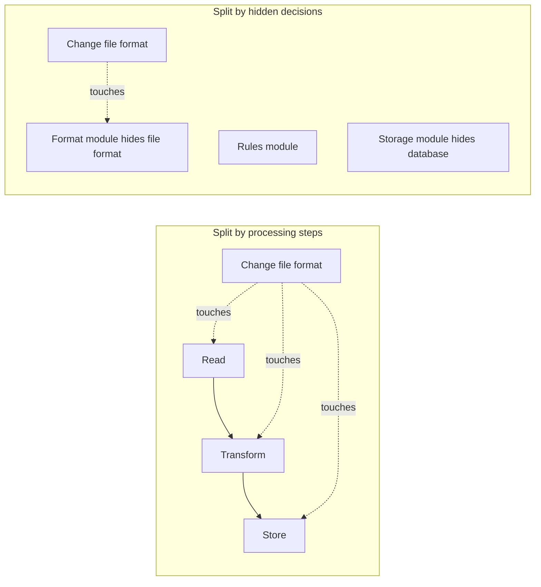
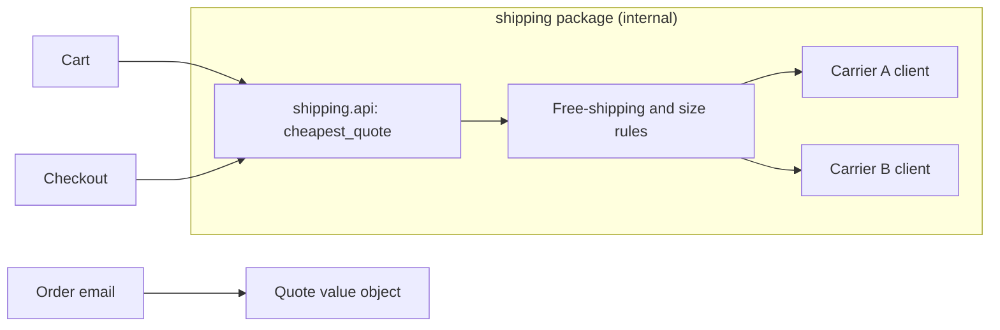

# Abstraction, Encapsulation and Modularity

## Introduction

Large software is too big for any one person to hold in their head. Three closely related ideas make it manageable:

- **Abstraction**: showing only what matters for a purpose and hiding the rest. A `send_email(to, subject, body)` function is an abstraction over SMTP, TLS and retries.
- **Encapsulation**: bundling data with the operations that keep it valid, and preventing outside code from breaking those rules. An `Order` that will not let you add a negative quantity is encapsulated.
- **Modularity**: dividing a system into parts with clear boundaries and interfaces, so each part can be understood, changed and tested on its own.

An analogy: driving a car. The pedals and steering wheel are the **abstraction**: a small interface for a complex machine. The sealed engine compartment is **encapsulation**: you cannot accidentally set the fuel mixture while driving. The fact that the car is built from separately replaceable parts (tires, battery, brakes) is **modularity**: a mechanic can swap the battery without touching the gearbox.

These ideas are the foundation for almost everything in later sections, from [Dependency Inversion](../1-arch-design-principles/5-arch-dependency-inversion.mdx) to [Hexagonal Architecture](../7-arch-clean-architecture/0-arch-hexagonal.mdx).

## Information Hiding: The Big Idea

In 1972, David Parnas published "On the Criteria To Be Used in Decomposing Systems into Modules" in *Communications of the ACM*. He compared two ways of splitting the same program:

1. By **processing steps** (read input, shift lines, sort, print), which is what most people do intuitively.
2. By **design decisions that are likely to change**, with each module hiding one such decision behind an interface.

The second decomposition was far easier to change, because each likely change was contained in one module. This is **information hiding**, and it is still the best single criterion for drawing module boundaries:

> Put each design decision that is likely to change inside one module, and hide it from everyone else.



## Encapsulation: Before and After

Here is an inventory for the bookstore that exposes its internal dictionary. Any code can modify the stock directly.

```python
# before_encapsulation.py: internal state is public
class Inventory:
    def __init__(self) -> None:
        self.stock: dict[str, int] = {}


inv = Inventory()
inv.stock["978-0441013593"] = 3            # receive stock
inv.stock["978-0441013593"] -= 5           # someone sells more than we have
print(inv.stock)
```

Output:

```text
{'978-0441013593': -2}
```

Negative stock is now possible, and the rule "you cannot sell what you do not have" must be re-implemented (or forgotten) by every caller. Worse, if you later want to store stock in a database instead of a dict, every caller must change, because they all depend on the internal representation.

The encapsulated version keeps the data private and exposes operations that protect the invariant.

```python
# after_encapsulation.py: operations protect the invariants
class OutOfStock(Exception):
    pass


class Inventory:
    def __init__(self) -> None:
        self._stock: dict[str, int] = {}   # leading underscore: internal

    def receive(self, isbn: str, qty: int) -> None:
        if qty <= 0:
            raise ValueError("qty must be positive")
        self._stock[isbn] = self._stock.get(isbn, 0) + qty

    def sell(self, isbn: str, qty: int) -> None:
        available = self._stock.get(isbn, 0)
        if qty > available:
            raise OutOfStock(f"{isbn}: wanted {qty}, have {available}")
        self._stock[isbn] = available - qty

    def available(self, isbn: str) -> int:
        return self._stock.get(isbn, 0)


inv = Inventory()
inv.receive("978-0441013593", 3)
try:
    inv.sell("978-0441013593", 5)
except OutOfStock as e:
    print("Refused:", e)
inv.sell("978-0441013593", 2)
print("Left:", inv.available("978-0441013593"))
```

Output:

```text
Refused: 978-0441013593: wanted 5, have 3
Left: 1
```

Now the rule lives in one place, and the storage could change to Redis or PostgreSQL without changing a single caller.

:::note
Python does not enforce privacy. A leading underscore (`_stock`) is a **convention** that says "internal, do not depend on this." Linters and code review enforce it. Double underscores trigger name mangling, but they are mainly for avoiding name clashes in subclasses, not for security. The real protection is a clear, small public interface that makes the right thing easy.
:::

### Value objects encapsulate rules too

Encapsulation is not only about hiding state. Immutable value objects can make invalid data impossible to create.

```python
# isbn_value.py: an immutable value object that validates itself
from dataclasses import dataclass


@dataclass(frozen=True)
class Isbn13:
    value: str

    def __post_init__(self) -> None:
        digits = self.value.replace("-", "")
        if len(digits) != 13 or not digits.isdigit():
            raise ValueError(f"not an ISBN-13: {self.value}")
        total = sum(int(d) * (1 if i % 2 == 0 else 3) for i, d in enumerate(digits[:12]))
        if (10 - total % 10) % 10 != int(digits[12]):
            raise ValueError(f"bad check digit: {self.value}")
        object.__setattr__(self, "value", digits)


print(Isbn13("978-0-441-01359-3"))
try:
    Isbn13("978-0-441-01359-4")
except ValueError as e:
    print("Rejected:", e)
```

Output:

```text
Isbn13(value='9780441013593')
Rejected: bad check digit: 978-0-441-01359-4
```

Every function that receives an `Isbn13` can trust it. That removes a whole category of defensive checks scattered across the codebase. You will see this idea again in [Entities and Value Objects](../8-arch-domain-driven-design/3-arch-entities-and-value-objects.mdx).

## Abstraction: Deep vs Shallow Modules

John Ousterhout's book *A Philosophy of Software Design* offers a sharp test for abstractions. Picture a module as a rectangle: the top edge is the **interface** (what callers must learn) and the area is the **functionality** it provides.

- A **deep module** has a small interface and a lot of functionality. Python's built-in `open()` is a good example: one call hides buffering, encodings, file descriptors and operating system differences.
- A **shallow module** has an interface almost as complex as what it does. It adds a concept for callers to learn without saving them much work.

```python
# shallow: a wrapper that hides nothing
class ShallowCache:
    def __init__(self) -> None:
        self.data: dict[str, str] = {}

    def get_from_dict(self, key: str) -> str | None:
        return self.data.get(key)

    def put_into_dict(self, key: str, value: str) -> None:
        self.data[key] = value
```

This class gives callers a new name to learn but hides no decision. The "after" version is deeper: callers ask for a value, and the module hides expiry, size limits and the loader.

```python
# deep_cache.py: a small interface hiding real decisions
import time
from collections import OrderedDict
from collections.abc import Callable


class TtlCache:
    """get(key) returns a fresh value; expiry, eviction and loading are hidden."""

    def __init__(self, loader: Callable[[str], str], ttl_s: float = 60, max_items: int = 2,
                 clock: Callable[[], float] = time.monotonic) -> None:
        self._loader, self._ttl, self._max, self._clock = loader, ttl_s, max_items, clock
        self._items: OrderedDict[str, tuple[float, str]] = OrderedDict()

    def get(self, key: str) -> str:
        now = self._clock()
        hit = self._items.get(key)
        if hit and now - hit[0] < self._ttl:
            self._items.move_to_end(key)
            return hit[1]
        value = self._loader(key)
        self._items[key] = (now, value)
        self._items.move_to_end(key)
        if len(self._items) > self._max:
            self._items.popitem(last=False)   # evict least recently used
        return value


calls: list[str] = []


def load_title(isbn: str) -> str:
    calls.append(isbn)
    return f"title-for-{isbn[-4:]}"


fake_now = [0.0]
cache = TtlCache(load_title, ttl_s=60, max_items=2, clock=lambda: fake_now[0])
cache.get("9780441013593"); cache.get("9780441013593")
fake_now[0] = 61
cache.get("9780441013593")
print("loader called for:", calls)
```

Output:

```text
loader called for: ['9780441013593', '9780441013593']
```

The second call was served from cache; the third reloaded because the entry expired. Callers know none of this. They only call `get`.

Ousterhout also warns about **"classitis"**: splitting code into many tiny classes with thin interfaces. Lots of small, shallow pieces can make a system *more* complex, because a reader must learn many interfaces to understand one behavior.

### Leaky abstractions

Joel Spolsky's 2002 essay "The Law of Leaky Abstractions" observes that all non-trivial abstractions leak to some degree. An ORM hides SQL until a page makes 500 queries. A remote procedure call looks like a local function until the network times out. Good abstractions are honest about what can leak: they document performance characteristics and failure modes, and they expose escape hatches (raw SQL, timeouts) when needed.

## Modularity at Every Scale

The same principles apply at every size. What changes is how strong the boundary is and how much it costs to cross.

| Level | Boundary | Enforcement | Cost to cross |
|-------|----------|-------------|---------------|
| Function | Parameters and return value | Language | Almost zero |
| Class | Public methods | Convention, type checker | Almost zero |
| Module or package | `__init__.py` exports, `__all__` | Linters, import rules | Very low |
| Deployable component | Published API, versioned library | Build and release process | Low to medium |
| Service | Network API, events | Network, separate deployments | High: latency, partial failure |

A key insight from the modular monolith movement is that you can get most of the **design** benefits of modularity (clear ownership, hidden internals, independent reasoning) without paying the **runtime** cost of network boundaries. See [Modular Monolith](../6-arch-architectural-styles/3-arch-modular-monolith.mdx).

In Python, a module's public interface can be made explicit:

```python
# catalog/__init__.py: the only things other modules should import
from catalog.service import find_book, search_books
from catalog.models import BookSummary

__all__ = ["find_book", "search_books", "BookSummary"]
```

Everything else in the `catalog` package is internal. Tools like `import-linter` can then forbid `from catalog.repository import ...` outside the package.

## Real-World Scenario

The bookstore calculates shipping costs by calling a carrier's rate API. The HTTP calls, the carrier's JSON format, and the business rules ("free shipping over 35 dollars", "no express for oversized items") are spread across the cart, the checkout, and the order confirmation email. Now the company wants to add a second carrier and choose the cheaper one per order.

**Step 1: Find the hidden decision.** "Which carrier and how we talk to it" is a design decision likely to change. Following Parnas, it should live in one module.

**Step 2: Design a deep interface.** The rest of the system needs one thing: a quote.

```python
# shipping/api.py: the module's whole public surface
from dataclasses import dataclass
from typing import Protocol


@dataclass(frozen=True)
class Parcel:
    weight_kg: float
    oversized: bool
    destination_postcode: str


@dataclass(frozen=True)
class Quote:
    carrier: str
    service: str
    price_cents: int


class ShippingQuoter(Protocol):
    def cheapest_quote(self, parcel: Parcel, order_total_cents: int) -> Quote: ...
```

**Step 3: Hide the details inside.** Carrier clients, JSON mapping, retries, the free-shipping rule and the "pick cheapest" logic all live inside the `shipping` package. Cart, checkout and email only depend on `ShippingQuoter`, `Parcel` and `Quote`.



**Step 4: Test the boundary.** A fake `ShippingQuoter` makes cart and checkout tests fast and deterministic.

### Why this approach

The change that triggered the work (a second carrier) now touches one package. The next likely changes (a third carrier, new rules, a pricing outage fallback) will too. Callers became simpler, not more complex, which is the sign of a deep module.

### When to use it and when not to

Use this when a decision is likely to change, especially integrations with external vendors, storage technologies, and volatile business rules. Do not wrap everything "just in case." Wrapping a stable standard library function in your own interface usually adds a shallow layer with no benefit.

### Alternatives and trade-offs

| Approach | Pros | Cons | Best for |
|----------|------|------|----------|
| Call the carrier API directly everywhere | Least code today | Every change spreads across the system | Throwaway prototypes |
| Thin wrapper per vendor | Some isolation | Still leaks vendor concepts to callers | One vendor, stable needs |
| Deep module with domain-shaped interface | Changes stay local, callers stay simple | Upfront design effort | Volatile integrations and rules |
| Separate shipping microservice | Independent deploy and scaling | Network calls, ops cost | Separate team or very different scaling |
| Third-party aggregator service | Many carriers out of the box | Vendor lock-in, fees | When carriers are not a differentiator |

## Common Mistakes

- **Getters and setters for everything.** Exposing every field through accessors is not encapsulation; the internal representation still leaks.
- **Shallow wrappers.** An interface that mirrors the implementation adds cost without hiding anything.
- **Interfaces shaped like the vendor.** `CarrierXRateRequest` in your checkout code means you have not hidden the vendor decision.
- **Abstracting too early.** Abstractions built for imagined futures are usually wrong. Wait until you see the second or third variation.
- **Ignoring leaks.** Pretending a remote call is local leads to missing timeouts, retries and error handling.

## Summary

- Abstraction shows what matters and hides the rest; encapsulation protects invariants; modularity divides a system into independently understandable parts.
- Parnas's information hiding: draw module boundaries around design decisions likely to change.
- Prefer deep modules with small interfaces and real hidden functionality over shallow wrappers.
- All non-trivial abstractions leak a little; document failure modes and provide escape hatches.
- Modularity applies at every scale; a modular monolith gets many benefits without network costs.

## Further Learning

Exercises:

1. Add a `reserve(isbn, qty)` operation to the encapsulated `Inventory` that holds stock for 15 minutes. Did any caller need to change?
2. Give `TtlCache` a `stats()` method that reports hits and misses. Is the interface still small?
3. Look at a module in your own code. List its public names. Which could be made internal? Which design decision does the module hide, if any?

Related pages:

- [Coupling and Cohesion](./5-arch-coupling-and-cohesion.mdx)
- [Managing Complexity](./7-arch-complexity.mdx)
- [Facade Pattern](../3-arch-structural-patterns/4-arch-facade.mdx)
- [Separation of Concerns](../1-arch-design-principles/9-arch-separation-of-concerns.mdx)

External reading:

- [On the Criteria To Be Used in Decomposing Systems into Modules](https://dl.acm.org/doi/10.1145/361598.361623) (David Parnas, 1972)
- [The Law of Leaky Abstractions](https://www.joelonsoftware.com/2002/11/11/the-law-of-leaky-abstractions/) (Joel Spolsky)
