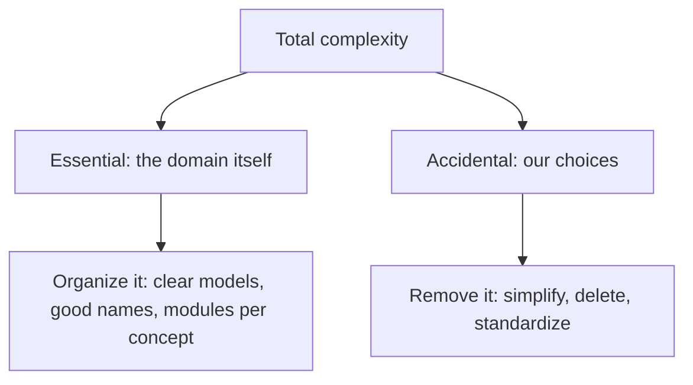
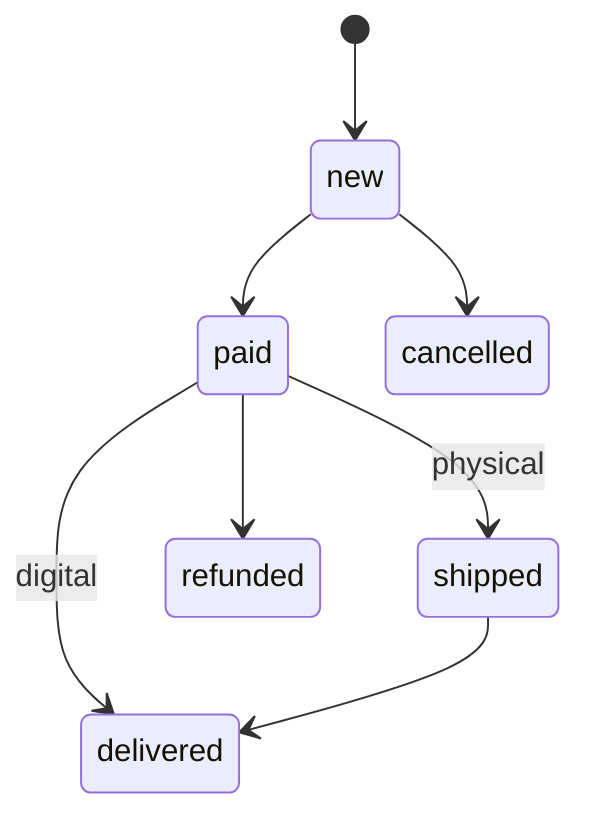

# Managing Complexity

## Introduction

Most software does not fail because a problem was impossible. It fails because the code became so complicated that nobody could change it safely anymore. Every feature took longer, every fix caused two new bugs, and eventually someone proposed a rewrite.

John Ousterhout, in *A Philosophy of Software Design*, defines complexity in a very practical way: anything related to the structure of a software system that makes it **hard to understand and modify**. Complexity is not about how many lines of code there are or how clever the algorithms are. A large system can be simple to work in, and a 200-line script can be a nightmare.

An analogy: a library. A big, well-organized library with a catalog and clear sections is easy to use, even with a million books. A small room with 2,000 books in random piles is not. The difference is not size; it is organization, and whether you can find what you need without knowing everything.

Managing complexity is arguably the core job of software architecture. This page covers where complexity comes from, how to spot it, how to measure it roughly, and the techniques that keep it under control.

## Essential vs Accidental Complexity

In his 1986 essay "No Silver Bullet," Fred Brooks distinguished two kinds of difficulty:

- **Essential complexity** comes from the problem itself. Tax rules, payment regulations, and shipping across 40 countries are complicated because the real world is. You cannot remove it; you can only organize it well.
- **Accidental complexity** comes from our solutions: tangled dependencies, unclear names, needless layers, inconsistent conventions, a framework fighting the problem. This is the complexity we create, and the part architecture can remove.



A useful question during design review: "Is this complexity coming from the business, or from us?"

## Symptoms and Causes

Ousterhout identifies three **symptoms** of complexity:

1. **Change amplification**: a simple change requires edits in many places. (Changing a tax rate means editing six files.)
2. **Cognitive load**: how much a developer needs to know to complete a task. (To add a field, you must understand the ORM, two caches and a custom serializer.)
3. **Unknown unknowns**: it is not obvious which code must change, or what information you need. This is the worst symptom, because you cannot even tell you are missing something until production tells you.

And two main **causes**:

- **Dependencies**: code that cannot be understood or changed in isolation. See [Coupling and Cohesion](./5-arch-coupling-and-cohesion.mdx).
- **Obscurity**: important information is not obvious, because of vague names, hidden side effects, or undocumented assumptions.

Complexity is also **incremental**. No single change makes a system complex; hundreds of small "just this once" shortcuts do. That is why it needs continuous attention rather than an occasional cleanup project.

## A Before and After: Nested Conditions

Here is the bookstore's order-transition logic. It decides whether an order can move to a new status.

```python
# before_complexity.py: nested conditions grow with every new rule
def can_transition(current: str, target: str, paid: bool, is_digital: bool) -> bool:
    if current == "new":
        if target == "paid":
            return paid
        elif target == "cancelled":
            return True
        else:
            return False
    elif current == "paid":
        if target == "shipped":
            if is_digital:
                return False
            else:
                return True
        elif target == "delivered":
            if is_digital:
                return True
            else:
                return False
        elif target == "refunded":
            return True
        else:
            return False
    elif current == "shipped":
        if target == "delivered":
            return True
        else:
            return False
    else:
        return False


print(can_transition("paid", "shipped", paid=True, is_digital=False))
print(can_transition("paid", "shipped", paid=True, is_digital=True))
```

Output:

```text
True
False
```

It works, but to answer "what can happen after `paid`?" you must trace branches. Adding a status means finding the right place among nested `if` statements.

The same rules expressed as **data**:

```python
# after_complexity.py: rules as a table, logic as one small function
from enum import Enum


class Status(Enum):
    NEW = "new"
    PAID = "paid"
    SHIPPED = "shipped"
    DELIVERED = "delivered"
    CANCELLED = "cancelled"
    REFUNDED = "refunded"


# (from, to) -> extra condition, given (paid, is_digital)
RULES = {
    (Status.NEW, Status.PAID): lambda paid, digital: paid,
    (Status.NEW, Status.CANCELLED): lambda paid, digital: True,
    (Status.PAID, Status.SHIPPED): lambda paid, digital: not digital,
    (Status.PAID, Status.DELIVERED): lambda paid, digital: digital,
    (Status.PAID, Status.REFUNDED): lambda paid, digital: True,
    (Status.SHIPPED, Status.DELIVERED): lambda paid, digital: True,
}


def can_transition(current: Status, target: Status, paid: bool, is_digital: bool) -> bool:
    rule = RULES.get((current, target))
    return bool(rule and rule(paid, is_digital))


print(can_transition(Status.PAID, Status.SHIPPED, paid=True, is_digital=False))
print(can_transition(Status.PAID, Status.SHIPPED, paid=True, is_digital=True))
print("After PAID:", sorted(t.value for (f, t) in RULES if f is Status.PAID))
```

Output:

```text
True
False
After PAID: ['delivered', 'refunded', 'shipped']
```

The essential complexity (the business rules) is unchanged. The accidental complexity (nested control flow, magic strings) is gone. The rules are now visible in one table, the `Enum` prevents typos, and you can ask questions of the data, like "what comes after PAID?" For richer behavior per state, the [State Pattern](../4-arch-behavioral-patterns/3-arch-state.mdx) takes this further.



## Measuring Complexity (Roughly)

No single number captures complexity, but a few metrics help you find where to look.

- **Cyclomatic complexity** (Thomas McCabe, 1976) counts independent paths through a function: roughly 1 plus the number of decision points.
- **Size and nesting depth**: long functions and deep nesting correlate with confusion.
- **Change frequency** from version control: code that changes often is where complexity hurts most.

Here is a small cyclomatic complexity counter using Python's `ast` module.

```python
# cyclomatic.py: approximate McCabe complexity per function
import ast

SOURCE = '''
def simple(x):
    return x * 2

def nested(a, b, c):
    if a:
        if b:
            return 1
        elif c:
            return 2
    for i in range(3):
        if i and a or b:
            return 3
    return 0
'''

DECISIONS = (ast.If, ast.For, ast.While, ast.ExceptHandler, ast.IfExp, ast.comprehension)


def complexity(func: ast.FunctionDef) -> int:
    score = 1
    for node in ast.walk(func):
        if isinstance(node, DECISIONS):
            score += 1
        elif isinstance(node, ast.BoolOp):          # each extra and/or adds a path
            score += len(node.values) - 1
    return score


tree = ast.parse(SOURCE)
for fn in [n for n in tree.body if isinstance(n, ast.FunctionDef)]:
    print(f"{fn.name}: {complexity(fn)}")
```

Output:

```text
simple: 1
nested: 8
```

Real tools do this better: `radon` and `ruff` (rule `C901`) for Python, ESLint's `complexity` rule for JavaScript, and SonarQube's "cognitive complexity" metric for many languages.

### Hotspots: complexity times change

Adam Tornhill's work (*Your Code as a Crime Scene*, and the CodeScene tool) popularized **hotspot analysis**: complex code that rarely changes is a low priority, but complex code that changes every week is where the cost is. You can approximate it by combining a complexity score with commit counts from `git log`.

```python
# hotspots.py: rank files by complexity x change frequency
# In practice, get change counts with:
#   git log --since=6.months --name-only --format= | sort | uniq -c
changes = {"orders/service.py": 48, "catalog/search.py": 6, "payments/gateway.py": 22,
           "reports/legacy_export.py": 1}
complexity = {"orders/service.py": 64, "catalog/search.py": 80, "payments/gateway.py": 15,
              "reports/legacy_export.py": 120}

ranked = sorted(changes, key=lambda f: changes[f] * complexity[f], reverse=True)
for f in ranked:
    print(f"{changes[f] * complexity[f]:>6}  {f}  (changes={changes[f]}, complexity={complexity[f]})")
```

Output:

```text
  3072  orders/service.py  (changes=48, complexity=64)
   480  catalog/search.py  (changes=6, complexity=80)
   330  payments/gateway.py  (changes=22, complexity=15)
   120  reports/legacy_export.py  (changes=1, complexity=120)
```

The most complex file, `legacy_export.py`, is the *least* urgent: nobody touches it. `orders/service.py` is where simplification will pay off.

## Techniques That Reduce Complexity

| Technique | What it does | Example |
|-----------|--------------|---------|
| Deep modules | Hide decisions behind small interfaces | A `ShippingQuoter` with one method ([Abstraction and Modularity](./6-arch-abstraction-and-modularity.mdx)) |
| Rules as data | Replace branching with tables | The transition table above |
| Guard clauses | Return early instead of nesting | `if not order: return None` |
| Pure functions | No hidden state; same input, same output | Price calculation that takes all inputs as parameters |
| Make illegal states unrepresentable | Use types so bad data cannot exist | `Enum` statuses, validated value objects |
| Define errors out of existence | Design APIs so error cases cannot happen | Ousterhout's example: deleting a missing key is a no-op rather than an error |
| Consistent conventions | One way to do common things | Same error handling and logging everywhere |
| Delete code | Remove unused features and flags | Old feature flags are pure accidental complexity |
| Fewer technologies | Each tool adds learning and operations load | One database until there is a clear reason for two |

A principle worth knowing is **Gall's Law**, from John Gall's book *Systemantics* (1975): a complex system that works is invariably found to have evolved from a simple system that worked. Start simple, get it working, and let complexity grow only when needed.

## Complexity at the Architecture Level

Complexity is not only inside functions. At system level, it hides in the number of moving parts and how they interact.

| Source | Example | Question to ask |
|--------|---------|-----------------|
| Number of technologies | Three databases, two message brokers, four languages | Does each one earn its place? |
| Number of deployable units | 40 services for a team of 8 | Can one team hold all of this in their heads? |
| Communication paths | Every service calls every other | Could some paths become events or disappear? |
| Hidden flows | Behavior triggered by database triggers or cron jobs nobody remembers | Is every important flow visible in code or docs? |
| Configuration | Hundreds of feature flags and environment variables | Which flags are dead? |
| Inconsistency | Each service handles errors and logging differently | Can we agree on one way? |

A simple heuristic for system-level complexity is to ask how many **things a new developer must learn** before they can safely ship a change to one feature. If the answer includes four technologies, six services and an undocumented batch job, the architecture is carrying a lot of accidental complexity, whatever the individual code looks like. This connects directly to team cognitive load in [Conway's Law and Team Topologies](./9-arch-conways-law.mdx).

## A Complexity Checklist for Code Review

Code review is where most complexity enters a system, one pull request at a time. These questions catch it early:

- **Could a teammate understand this change without asking me?** If not, what is obscure: names, hidden side effects, missing context?
- **Does this change make another change harder?** For example, a new dependency between modules that were independent.
- **Did the interface grow?** New parameters, flags or methods increase the learning cost for every caller.
- **Is there a new special case?** Special cases are where bugs breed. Can the general case handle it?
- **Is this abstraction pulling its weight?** A new layer, base class or wrapper must hide something real.
- **Is anything now unused?** Delete it in the same change.

:::tip
Ousterhout recommends a "strategic" rather than purely "tactical" mindset: spend a small, steady fraction of each change improving the design, instead of only doing the quickest thing that works. Small, continuous investments keep complexity from compounding.
:::

## Real-World Scenario

The bookstore's Orders team complains that every change to order handling takes days and often breaks something. The team lead asks you to propose a plan, but there is no time for a rewrite.

**Step 1: Find the hotspots.** You combine six months of `git log` change counts with `radon` complexity scores. `orders/service.py` stands out: 48 changes, one function with cyclomatic complexity 31, and four nested levels of `if` statements on status, payment type and product type.

**Step 2: Separate essential from accidental.** Talking to the business, you list the real rules: about 12 transitions with three conditions. The rest of the complexity is accidental: string statuses compared in 30 places, duplicated checks, and a "temporary" flag from a 2023 promotion.

**Step 3: Simplify incrementally.** Over three sprints, each change ships independently:

1. Introduce a `Status` enum and replace string comparisons (connascence of meaning becomes connascence of name).
2. Move transition rules into a table, with tests that list every allowed transition.
3. Delete the dead promotion flag.
4. Add a CI complexity limit (for example `ruff` rule `C901` with a maximum) for the `orders` package so it does not regress.

### Why this approach

Hotspot analysis directs limited time to where complexity actually costs money. Separating essential from accidental complexity prevents "simplifying" away real business rules. Small, independently shippable steps keep risk low and show progress quickly.

### When to use it and when not to

Use this when a specific area slows the team down and you can see it in change history. Do not run complexity cleanup on stable code that nobody touches; the payoff is near zero. Also avoid chasing metric targets for their own sake; a function with complexity 12 that is clear and well tested may be fine.

### Alternatives and trade-offs

| Approach | Pros | Cons | Best for |
|----------|------|------|----------|
| Leave it alone | No effort now | Each change stays slow and risky | Rarely changed code |
| Incremental refactoring of hotspots | Low risk, continuous value | Requires steady discipline | Most teams, most of the time |
| Rewrite the module | Clean design | High risk, feature freeze, may lose hidden rules | Small modules with good test coverage |
| Replace with a library or service | Removes code you maintain | Integration effort, less control | Non-differentiating functionality |
| Add complexity limits in CI only | Stops things getting worse | Does not fix existing complexity | Combined with refactoring |

## Common Mistakes

- **Mistaking cleverness for quality.** A dense one-liner can raise cognitive load more than a clear five-line loop.
- **Adding layers to "reduce complexity."** Each layer must hide something real, or it adds complexity.
- **Treating metrics as goals.** Splitting a function into three to satisfy a linter can make things harder to follow.
- **Big-bang rewrites.** They usually reproduce the essential complexity and lose undocumented rules.
- **Ignoring tactical shortcuts.** Complexity is incremental; small "temporary" hacks add up. See [Technical Debt](./8-arch-technical-debt.mdx).

## Summary

- Complexity is whatever makes a system hard to understand and modify; it is about structure, not size.
- Essential complexity comes from the problem; accidental complexity comes from our choices and is the part we can remove.
- Watch for change amplification, cognitive load and unknown unknowns; the main causes are dependencies and obscurity.
- Use metrics (cyclomatic complexity, hotspots) to decide where to look, not as goals.
- Reduce complexity with deep modules, rules as data, illegal states made unrepresentable, consistent conventions, and deleting code. Start simple and evolve (Gall's Law).

## Further Learning

Exercises:

1. Add a `RETURNED` status that is allowed after `DELIVERED` only for physical products. Make the change in both `before_complexity.py` and `after_complexity.py`. Which was easier?
2. Run `cyclomatic.py` on a file from your own project by replacing `SOURCE` with `open("yourfile.py").read()`. Which function scores highest? Is it really the hardest to understand?
3. Run `git log --since=6.months --name-only --format= | sort | uniq -c | sort -rn | head` on a repository you work on. Do the most-changed files match where your team feels the most pain?

Related pages:

- [Abstraction, Encapsulation and Modularity](./6-arch-abstraction-and-modularity.mdx)
- [Technical Debt](./8-arch-technical-debt.mdx)
- [DRY, KISS and YAGNI](../1-arch-design-principles/6-arch-dry-kiss-yagni.mdx)
- [Refactoring to Patterns](../5-arch-modern-patterns/8-arch-refactoring-to-patterns.mdx)

External reading:

- [Is High Quality Software Worth the Cost?](https://martinfowler.com/articles/is-quality-worth-cost.html) (Martin Fowler)
- [A Philosophy of Software Design](https://web.stanford.edu/~ouster/cgi-bin/book.php) (John Ousterhout)
