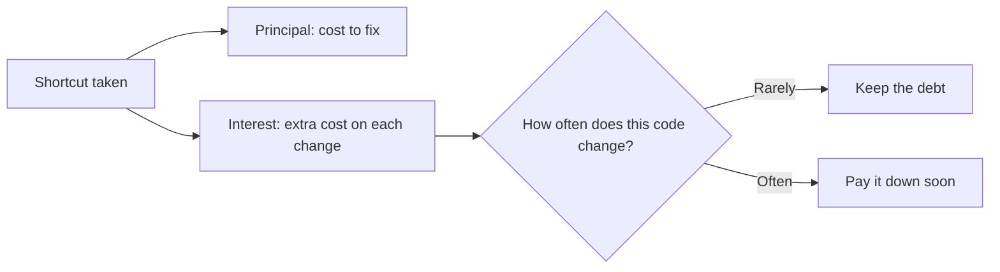
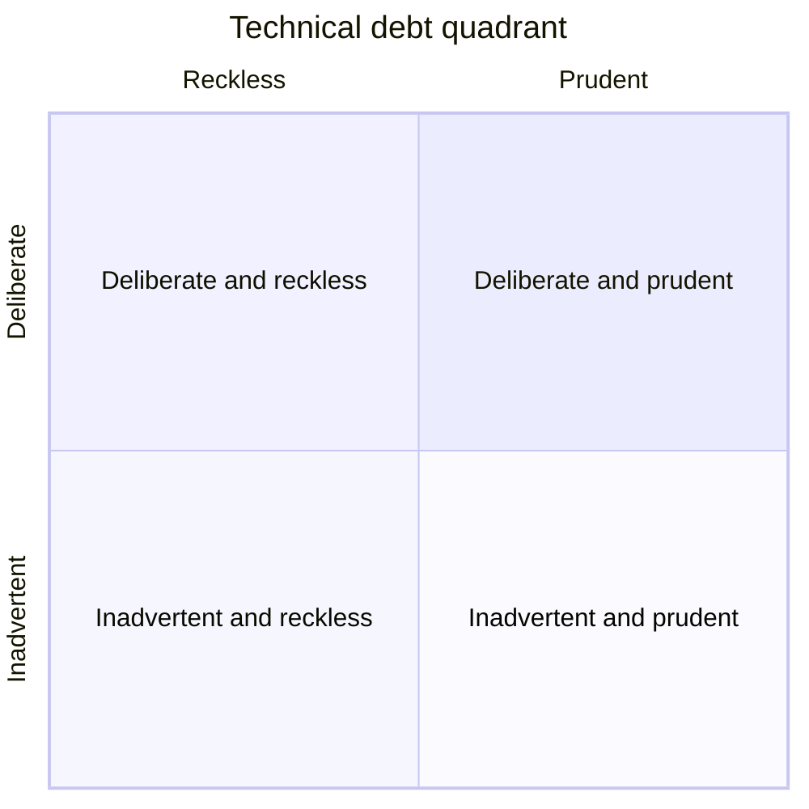
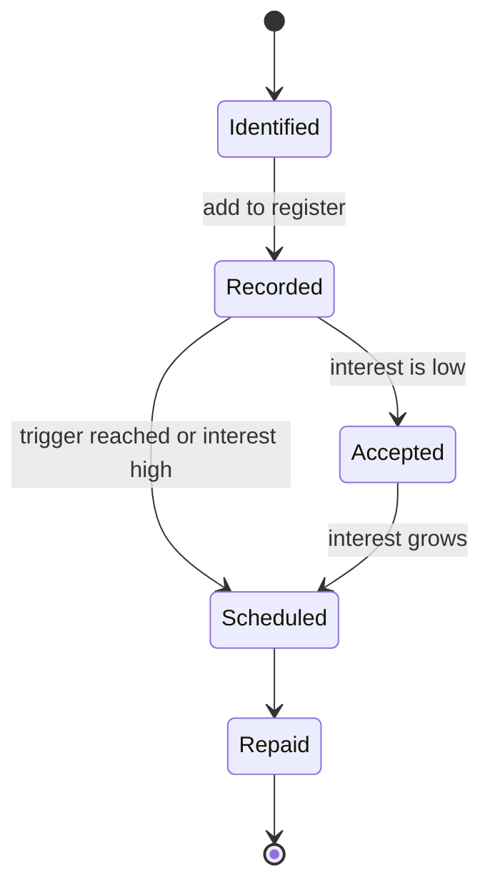

# Technical Debt

## Introduction

Every team has heard someone say "we'll clean it up later." Sometimes that is a smart business decision. Sometimes it is the start of a codebase nobody wants to touch. **Technical debt** is the metaphor that helps you tell the difference, and helps you explain the cost to people who never read code.

Ward Cunningham introduced the metaphor in an experience report at the OOPSLA conference in 1992, describing work on a financial software product. The idea maps neatly onto money:

- **Principal**: the work needed to fix a shortcut, for example the days needed to restructure a messy module.
- **Interest**: the extra effort you pay on *every* change while the shortcut stays, for example each new feature in that module takes two extra days.

Like financial debt, technical debt is not automatically bad. A mortgage lets you live in a house years before you could pay cash. Taking on technical debt can let you ship before a competitor or validate an idea before investing in it. The danger is debt you did not choose, cannot see, or never pay down, because the interest compounds.

## Principal and Interest in Numbers

Martin Fowler's [TechnicalDebt](https://martinfowler.com/bliki/TechnicalDebt.html) article uses a clear example: a feature that would take four days in clean code takes six days because of cruft. The two extra days are the **interest**. If cleaning up the cruft (the **principal**) would take five days, is it worth it?

It depends on how many future changes will touch that code. Here is the arithmetic.

```python
# debt_breakeven.py: when does paying off debt pay off?
def total_cost(features: int, clean_days: float, interest_days: float,
               principal_days: float, pay_off_first: bool) -> float:
    if pay_off_first:
        return principal_days + features * clean_days
    return features * (clean_days + interest_days)


for n in [1, 2, 3, 4, 6]:
    keep = total_cost(n, clean_days=4, interest_days=2, principal_days=5, pay_off_first=False)
    fix = total_cost(n, clean_days=4, interest_days=2, principal_days=5, pay_off_first=True)
    better = "pay off" if fix < keep else ("equal" if fix == keep else "keep debt")
    print(f"{n} features: keep={keep:>4.0f} days, pay off={fix:>4.0f} days -> {better}")
```

Output:

```text
1 features: keep=   6 days, pay off=   9 days -> keep debt
2 features: keep=  12 days, pay off=  13 days -> keep debt
3 features: keep=  18 days, pay off=  17 days -> pay off
4 features: keep=  24 days, pay off=  21 days -> pay off
6 features: keep=  36 days, pay off=  29 days -> pay off
```

Two lessons fall out of this simple model:

1. **Debt in code that rarely changes is cheap.** If you will touch it once more, keep the debt.
2. **Debt in code that changes often is expensive**, and paying it off wins quickly. This is why Fowler recommends paying debt down where you are actively working, and why [hotspot analysis](./7-arch-complexity.mdx) is such a good guide.



## The Technical Debt Quadrant

Not all debt is the same. Fowler's [TechnicalDebtQuadrant](https://martinfowler.com/bliki/TechnicalDebtQuadrant.html) classifies debt along two axes: **deliberate vs inadvertent** (did you know you were taking it?) and **prudent vs reckless** (was it a sensible trade-off?).

| | Reckless | Prudent |
|---|---|---|
| **Deliberate** | "We don't have time for design." Skipping good practices knowingly and underestimating the cost. | "We must ship now and will deal with the consequences." A conscious trade-off with a plan. |
| **Inadvertent** | "What's layering?" A team that does not know good practices creates a mess without realizing it. | "Now we know how we should have done it." Learning while building; normal and unavoidable. |



Each quadrant needs a different response:

- **Deliberate and prudent**: record it, with a repayment trigger ("after the launch", "before we add a second payment provider").
- **Deliberate and reckless**: push back. Show the interest cost.
- **Inadvertent and reckless**: a skills problem. Invest in reviews, pairing and training.
- **Inadvertent and prudent**: refactor as you learn. The fact that you can now see a better design means the team has grown.

## Kinds of Technical Debt

Debt is not only messy code.

| Kind | Example | Typical interest |
|------|---------|------------------|
| Code debt | Duplicated logic, long functions | Slower changes, more bugs |
| Design and architecture debt | Modules sharing tables, a dependency cycle | Changes ripple across teams |
| Test debt | No automated tests for checkout | Fear of changing anything; manual testing |
| Dependency debt | Framework three major versions behind | Security risk, painful big-bang upgrades |
| Infrastructure debt | Hand-configured servers | Slow, error-prone deployments |
| Documentation debt | No record of why decisions were made | Decisions get reversed by accident |
| Knowledge debt | Only one person understands billing | Bus-factor risk; that person becomes a bottleneck |

**Architecture debt** deserves special attention. Code debt is usually local and can be paid off in a pull request. Architecture debt, such as the wrong service boundaries or a shared database, can take months to repay and often requires coordination across teams. That is why architecture decisions deserve more care up front (see [Thinking in Trade-offs](./4-arch-trade-offs.mdx)).

## Making Debt Visible: A Debt Register

Debt that lives only in developers' heads cannot be prioritized against features. A lightweight **debt register** (often just tickets with a label) makes it visible. Here is a minimal model that ranks items by how much they cost per month versus how much they cost to fix.

```python
# debt_register.py: rank technical debt by return on investment
from dataclasses import dataclass
from enum import Enum


class Quadrant(Enum):
    DELIBERATE_PRUDENT = "deliberate/prudent"
    DELIBERATE_RECKLESS = "deliberate/reckless"
    INADVERTENT_RECKLESS = "inadvertent/reckless"
    INADVERTENT_PRUDENT = "inadvertent/prudent"


@dataclass(frozen=True)
class DebtItem:
    title: str
    area: str
    quadrant: Quadrant
    principal_days: float          # estimated cost to fix
    interest_days_per_change: float
    changes_per_month: float       # from git history

    @property
    def monthly_interest(self) -> float:
        return self.interest_days_per_change * self.changes_per_month

    @property
    def payback_months(self) -> float:
        return self.principal_days / self.monthly_interest if self.monthly_interest else float("inf")


register = [
    DebtItem("Order status as strings", "orders", Quadrant.INADVERTENT_PRUDENT, 3, 0.5, 8),
    DebtItem("No tests for refunds", "payments", Quadrant.DELIBERATE_RECKLESS, 6, 1.0, 3),
    DebtItem("Legacy CSV export", "reports", Quadrant.DELIBERATE_PRUDENT, 10, 2.0, 0.2),
    DebtItem("Catalog reads order tables", "catalog", Quadrant.DELIBERATE_PRUDENT, 15, 1.5, 4),
]

print(f"{'payback':>8}  {'interest/mo':>11}  item")
for d in sorted(register, key=lambda d: d.payback_months):
    print(f"{d.payback_months:>7.1f}m  {d.monthly_interest:>10.1f}d  {d.title} [{d.quadrant.value}]")
```

Output:

```text
 payback  interest/mo  item
    0.8m         4.0d  Order status as strings [inadvertent/prudent]
    2.0m         3.0d  No tests for refunds [deliberate/reckless]
    2.5m         6.0d  Catalog reads order tables [deliberate/prudent]
   25.0m         0.4d  Legacy CSV export [deliberate/prudent]
```

The ranking turns a vague feeling ("the code is bad") into a business case: fixing the string statuses pays for itself in under a month. The legacy CSV export is ugly but costs almost nothing in interest, so it can wait.

:::caution
These estimates are rough, and that is fine. The goal is to compare items and start a conversation with the product owner, not to produce precise accounting. Do not let estimation become a project of its own.
:::

### Recording a debt item

A debt item is most useful when it has the same few fields every time. A template for your issue tracker:

```text
Title:        Catalog reads order tables directly
Area/owner:   catalog (Catalog team)
Type:         Architecture debt (data coupling)
Quadrant:     Deliberate / prudent (taken for the 2025 holiday launch)
Interest:     Every schema change in orders needs a Catalog review and joint release;
              about 1.5 dev-days per change, ~4 changes per month
Principal:    About 15 dev-days: add orders.api.get_order_summary, migrate 6 queries
Trigger:      Before Orders moves to its own database, or by end of Q2
Evidence:     Incident 2026-03-14; PRs #412, #436, #451 needed cross-team releases
```

The **evidence** field is what makes the item credible. Link to incidents, pull requests and lead-time data rather than describing feelings.

### The life of a debt item



Accepting debt is a legitimate outcome. Some debt is cheap enough to keep forever.

## Spotting Debt Before It Hurts

Debt often announces itself through symptoms long before anyone names it:

- **Estimates for similar features keep growing.** The same kind of change took two days last year and five now.
- **"Don't touch that file."** Areas that people avoid or that only one person can change.
- **Shotgun surgery.** One logical change requires edits in many files or services.
- **Recurring incidents in one area.** The same module keeps appearing in postmortems.
- **Workarounds on workarounds.** Comments like `# TODO: hack, remove after launch` from years ago.
- **Slow, flaky test suites.** People stop running tests, so problems are caught later.
- **Dependency warnings.** Security advisories and end-of-life notices for frameworks you depend on.

Several of these can be measured: lead time per change, change failure rate, and time to restore service are among the delivery metrics that the [DORA](https://dora.dev/) research program tracks. Rising lead time in one area is often the first hard number that shows debt interest.

## Talking to Stakeholders About Debt

Product owners and managers decide how time is spent, so debt has to be explained in their terms: time, money, risk and opportunity. Compare these two messages:

```text
Weak:   "The orders code is a mess and we need to refactor it."

Strong: "Every change to order handling currently takes about 2 extra days because
         status rules are scattered across 30 places. We change this area about
         8 times a month. A 3-day cleanup would pay for itself within the first
         month and reduce the refund bugs we saw in March. We'd like to do it
         alongside the gift-card feature, which touches the same code."
```

The strong version quantifies interest, states the principal, shows the payback period, links to a business pain, and proposes doing it **alongside** feature work rather than as a separate task. That last part matters: debt work that rides along with features is far easier to approve than a separate "refactoring project."

## Strategies for Paying Down Debt

| Strategy | How it works | Watch out for |
|----------|--------------|---------------|
| Boy Scout Rule | Leave code a little cleaner than you found it, in every change | Keep cleanups small and in the same area |
| Pay where you work | Repay debt in code you are already changing for a feature | Fowler's preferred approach; needs trust from product |
| Fixed capacity | Reserve a share of each sprint for debt | The share is a negotiation; make results visible |
| Dedicated cleanup sprint | Stop features to clean up | Often deprioritized; tends to recur if habits do not change |
| Strangler fig | Replace a legacy component piece by piece | See [Strangler Fig Migration](../9-arch-distributed-systems/11-arch-strangler-fig.mdx) |
| Rewrite | Start over | Highest risk; usually a last resort |

## Real-World Scenario

The bookstore wants to launch e-book sales before a major publishing event in six weeks. The engineering estimate for a "proper" design, with a separate digital fulfillment module, full test coverage and a clean integration with the e-book DRM vendor, is ten weeks. The product owner asks: "Can we cut corners?"

**Step 1: Make the debt deliberate and prudent.** The team proposes a six-week plan that takes on specific, named debt:

- E-book fulfillment lives inside the existing `orders` module instead of its own module.
- The DRM vendor is called directly instead of through an adapter.
- Only the happy path and refund path are covered by automated tests.

**Step 2: Agree on repayment triggers, not vague promises.** The debt items go into the register with triggers: "before adding a second DRM vendor," "before audiobooks," and "within two sprints after launch."

**Step 3: Protect the parts that are expensive to fix.** The team refuses to take debt on two things: payment correctness (tests are mandatory) and data ownership (e-book licenses get their own table, not extra columns in orders). Those are one-way doors.

**Step 4: Pay it down.** After launch, the team repays the `orders` coupling first, because the register shows it has the highest interest: every e-book change now touches order code.

### Why this approach

It turns a vague "cut corners" into explicit, bounded debt with visible interest and a repayment plan. It separates cheap-to-repay shortcuts (code structure) from expensive ones (data model, payment correctness), and only accepts the cheap ones.

### When to use it and when not to

Deliberate debt makes sense when there is a real deadline with real business value, and when the team has the discipline to repay. Avoid it when there is no clear payoff ("it'd be nice to ship sooner"), when previous debt was never repaid, or for decisions that are one-way doors, such as data formats exposed to partners.

### Alternatives and trade-offs

| Approach | Pros | Cons | Best for |
|----------|------|------|----------|
| Build it properly, miss the date | No new debt | Lose the business opportunity | When the deadline is not real |
| Cut corners silently | Ships fast | Hidden, compounding interest; erodes trust | Never |
| Deliberate debt with register and triggers | Ships fast, cost stays visible | Requires discipline to repay | Real deadlines with clear value |
| Reduce scope instead | No debt, ships on time | Fewer features at launch | When a smaller launch is acceptable |
| Throwaway prototype | Learn fast, then rebuild | Prototypes tend to become production | Validating uncertain ideas |

Often the best option is a mix: reduce scope **and** take a little deliberate debt.

## Common Mistakes

- **Calling all bad code "debt."** Reckless, inadvertent mess is a skills problem; labeling it debt can hide that.
- **Invisible debt.** If it is not written down, it cannot be prioritized against features.
- **Promising repayment without a trigger.** "Later" never comes. Tie repayment to a specific event.
- **Paying off debt nobody pays interest on.** Clean up hot code, not code that never changes.
- **Using the metaphor as a moral argument.** Product owners respond better to "this costs us about four developer-days a month" than to "this code is terrible."
- **Taking debt on one-way doors.** Data models, public APIs and security are expensive to fix later.
- **Repaying debt in a big-bang rewrite.** Rewrites often recreate the same problems and lose undocumented behavior; prefer incremental repayment.

## Preventing Reckless Debt

Paying down debt is only half the job. The cheaper half is not taking on reckless debt in the first place:

| Practice | How it prevents debt |
|----------|----------------------|
| Code review with design questions | Catches new coupling and shortcuts before they merge |
| Automated tests in CI | Makes refactoring safe, so cleanup actually happens |
| Linters and complexity limits | Stop the slow, unnoticed growth of complexity |
| Architecture rules in CI (import contracts, fitness functions) | Prevent violations of key decisions, such as forbidden dependencies |
| Dependency update automation | Keeps frameworks current in small steps instead of painful big jumps |
| A clear definition of done | "Done" includes tests, docs and removal of temporary flags |
| Pairing and knowledge sharing | Reduces knowledge debt and spreads good practices |

None of these require permission from a product owner; they are part of how a professional team works. Fowler's [Is High Quality Software Worth the Cost?](https://martinfowler.com/articles/is-quality-worth-cost.html) argues that teams with high internal quality deliver faster over time, so these practices are an investment in speed, not a tax on it.

## Frequently Asked Questions

**Is all legacy code technical debt?**
No. Old code that works, rarely changes and is reasonably understood may have very little interest. Debt is about the extra cost it adds to changes you actually need to make.

**Should we aim for zero technical debt?**
No. Some debt is a sensible trade-off, and some (the prudent, inadvertent kind) is the natural result of learning. Aim for debt that is visible, deliberate where possible, and kept low in the areas that change most.

**Who decides when to pay debt down?**
Ideally, engineers and product decide together, using estimates of interest and principal. Engineers bring the cost data; product brings the business priorities.

## Summary

- Technical debt (Ward Cunningham, 1992) is the future cost of shortcuts: principal is the cost to fix, interest is the extra cost on every change.
- Debt is only expensive where code changes often; pay it down in hotspots and leave stable code alone.
- Fowler's quadrant separates deliberate from inadvertent and prudent from reckless debt; each needs a different response.
- Debt comes in many forms, and architecture debt is the most expensive to repay.
- Keep a debt register with rough principal and interest estimates, and tie repayment to concrete triggers.

## Further Learning

Exercises:

1. In `debt_breakeven.py`, change the interest to 0.5 days. How many features does it take before paying off the debt wins?
2. Add three debt items from a project you know to `debt_register.py`. Estimate principal, interest and change frequency. Does the ranking match your intuition?
3. Write a one-paragraph message to a product owner proposing to pay down your top debt item, framed only in time and money.
4. Search a codebase you know for `TODO`, `FIXME` and `HACK` comments (for example with `grep -rn "TODO\|FIXME\|HACK" .`). How old are they? Which ones are real debt items that belong in a register?

Related pages:

- [Managing Complexity](./7-arch-complexity.mdx)
- [Thinking in Trade-offs](./4-arch-trade-offs.mdx)
- [Common Anti-Patterns](../5-arch-modern-patterns/7-arch-anti-patterns.mdx)
- [Legacy System Modernization](../13-arch-documenting-and-evolving/5-arch-legacy-modernization.mdx)
- [Refactoring to Patterns](../5-arch-modern-patterns/8-arch-refactoring-to-patterns.mdx)
- [Strangler Fig Migration](../9-arch-distributed-systems/11-arch-strangler-fig.mdx)
- [Fitness Functions and Evolutionary Architecture](../13-arch-documenting-and-evolving/3-arch-fitness-functions.mdx)
- [Coupling and Cohesion](./5-arch-coupling-and-cohesion.mdx)
- [Conway's Law and Team Topologies](./9-arch-conways-law.mdx)

External reading:

- [TechnicalDebt](https://martinfowler.com/bliki/TechnicalDebt.html) and [TechnicalDebtQuadrant](https://martinfowler.com/bliki/TechnicalDebtQuadrant.html) (Martin Fowler)
- [Is High Quality Software Worth the Cost?](https://martinfowler.com/articles/is-quality-worth-cost.html) (Martin Fowler)
