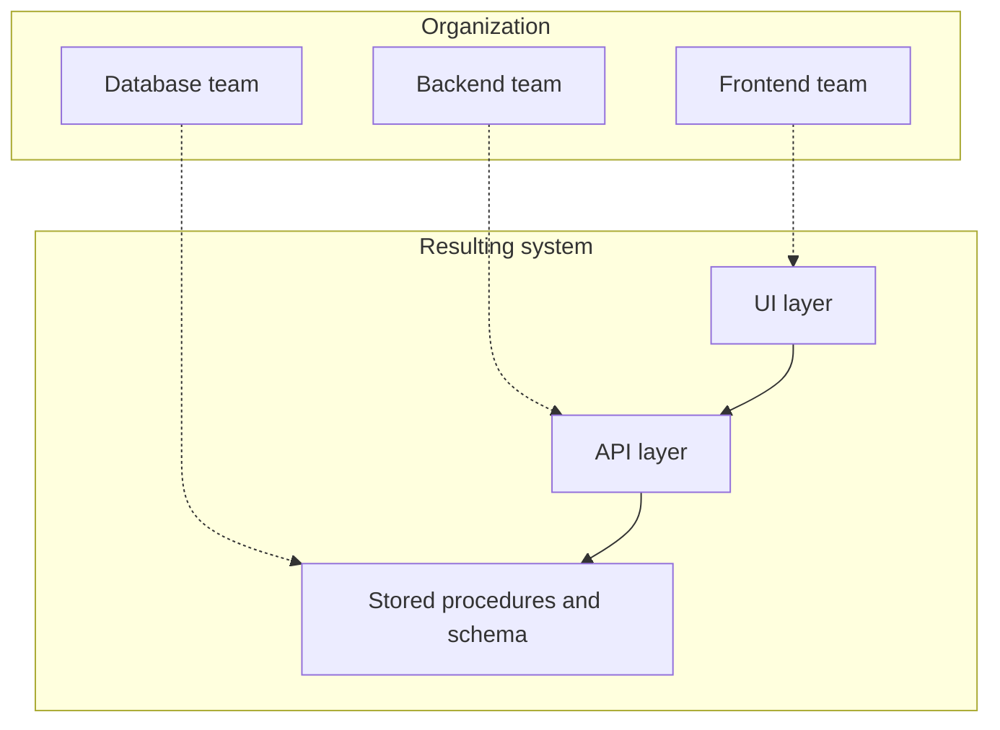
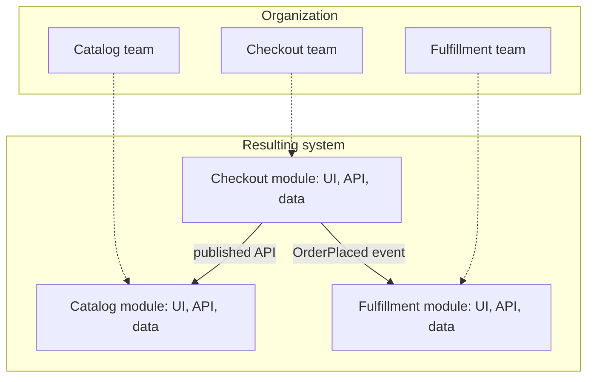
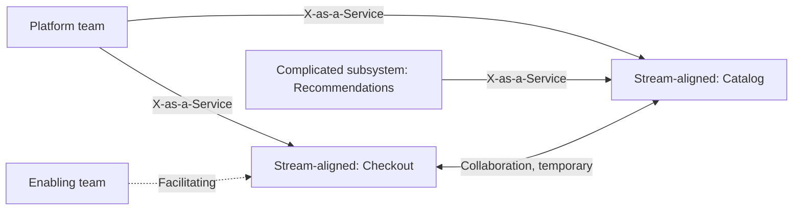

# Conway's Law and Team Topologies

## Introduction

Here is a pattern you may have seen. A company has a frontend team, a backend team and a database team. Every feature needs all three, so every feature needs meetings, tickets and hand-offs. Over time the software develops exactly three layers with thick, carefully negotiated interfaces between them, and adding one field to a form takes two sprints.

Nobody designed it that way on purpose. The **organization** designed it.

In 1968, Melvin Conway published a paper called "How Do Committees Invent?" in *Datamation*. Its central observation became known as **Conway's law**: any organization that designs a system will produce a design whose structure is a copy of the organization's communication structure (see Conway's own page, [Conway's Law](https://www.melconway.com/Home/Conways_Law.html)).

The reason is practical. Designing an interface between two components requires the people who own them to communicate. Where communication is easy (same team, same room, same chat channel), components become tightly integrated. Where it is hard (different departments, time zones, managers), people define narrow interfaces and stick to them.

An analogy: road networks often follow old footpaths and property lines rather than the ideal route. Software boundaries similarly follow team lines rather than the ideal design, unless you plan for it.

## Conway's Law in Action



Every feature (say, "add a gift message to orders") crosses all three layers, so it needs all three teams. That is the expensive part: not the code, but the **coordination**.

Compare a structure where each team owns a business capability end to end:



Now "add a gift message" is one team's work, in one module.

Neither structure is universally right. Layer teams build deep expertise and consistency in their layer. Capability teams deliver features faster with fewer hand-offs. Conway's law simply says: **you will get the architecture that matches your teams**, so choose both together.

## Three Responses to Conway's Law

In his article [Conway's Law](https://martinfowler.com/bliki/ConwaysLaw.html), Martin Fowler describes three ways organizations respond:

1. **Ignore it.** Design the architecture without considering teams. Fowler calls this a mistake, because the law applies whether you notice it or not.
2. **Accept it.** Design the architecture so that it does not clash with the existing communication structure.
3. **The inverse Conway maneuver.** Change the team structure deliberately to encourage the architecture you want. Thoughtworks put this on its [Technology Radar](https://www.thoughtworks.com/radar/techniques/inverse-conway-maneuver) in 2014. It is common in microservices adoption, where small, long-lived teams each own a business capability.

:::caution
The inverse Conway maneuver is not magic. Reorganizing teams does not instantly change an existing tangled codebase. The new teams still have to untangle the code they inherit. Fowler suggests changing gradually and using feedback, not a single big reorganization.
:::

## Measuring Alignment Between Teams and Code

You can check how well your teams and your architecture align by counting dependencies that cross team boundaries. Each cross-team dependency is a place where changes need coordination.

```python
# conway_check.py: how many module dependencies cross team boundaries?
from collections import Counter

depends_on = {
    "web_ui": {"api"},
    "api": {"catalog_db", "orders_db", "payments"},
    "payments": {"orders_db"},
    "catalog_db": set(),
    "orders_db": set(),
}


def cross_team(owner: dict[str, str]) -> Counter[tuple[str, str]]:
    edges: Counter[tuple[str, str]] = Counter()
    for module, deps in depends_on.items():
        for dep in deps:
            if owner[module] != owner[dep]:
                edges[(owner[module], owner[dep])] += 1
    return edges


by_layer = {"web_ui": "frontend", "api": "backend", "payments": "backend",
            "catalog_db": "dba", "orders_db": "dba"}
by_capability = {"web_ui": "storefront", "api": "storefront", "catalog_db": "storefront",
                 "payments": "checkout", "orders_db": "checkout"}

for name, owner in [("Teams by layer", by_layer), ("Teams by capability", by_capability)]:
    edges = cross_team(owner)
    print(f"{name}: {sum(edges.values())} cross-team dependencies {dict(edges)}")
```

Output:

```text
Teams by layer: 4 cross-team dependencies {('frontend', 'backend'): 1, ('backend', 'dba'): 3}
Teams by capability: 2 cross-team dependencies {('storefront', 'checkout'): 2}
```

Same code, different team boundaries, different coordination cost. In practice you can extract real dependency data with the tools from [What Is Software Architecture?](./1-arch-what-is-architecture.mdx), and ownership data from a `CODEOWNERS` file. If two teams appear in each other's dependencies constantly, either the code boundary or the team boundary is in the wrong place.

## Team Topologies

The book *Team Topologies* by Matthew Skelton and Manuel Pais (IT Revolution, 2019; second edition September 2025) turns Conway's law into a practical model for designing teams. Its core ideas, summarized on [teamtopologies.com](https://teamtopologies.com/key-concepts):

### Four fundamental team types

| Team type | Purpose | Bookstore example |
|-----------|---------|-------------------|
| **Stream-aligned** | Owns a flow of work for a business area end to end | Checkout team, Catalog team |
| **Platform** | Provides internal services that make stream-aligned teams faster | Team running CI/CD, Kubernetes, observability as self-service |
| **Enabling** | Helps other teams adopt new skills or remove obstacles, temporarily | Two engineers coaching teams on performance testing |
| **Complicated subsystem** | Owns a part that needs deep specialist knowledge | Recommendations engine built by ML specialists |

Most teams in a healthy organization are stream-aligned. The other three types exist to reduce the load on stream-aligned teams.

### Three interaction modes

| Mode | What it looks like | When to use it |
|------|-------------------|----------------|
| **Collaboration** | Two teams work closely together for a period | Discovering something new, such as a new API |
| **X-as-a-Service** | One team consumes what another provides, with little interaction | Stable, well-defined capabilities |
| **Facilitating** | One team helps and mentors another | Spreading skills; typical for enabling teams |



Interaction modes should be **deliberate and temporary where appropriate**. Long-running "collaboration" between two teams often means a boundary is in the wrong place.

### Cognitive load

A central idea of Team Topologies is **team cognitive load**: a team can only own as much software as it can understand well. If one team owns too many services, domains or technologies, quality and speed drop. This gives a concrete, human limit for sizing modules and services: a service boundary should fit a team, not the other way around. It connects directly to [Managing Complexity](./7-arch-complexity.mdx).

### Fracture planes

To decide where to split a system between teams, Team Topologies suggests looking for natural **fracture planes**: business domain boundaries (the strongest, and the same idea as DDD's [Bounded Contexts](../8-arch-domain-driven-design/2-arch-bounded-contexts.mdx)), regulatory compliance needs, different change cadences, team location, risk profiles, performance isolation needs, technology, and user personas.

### Thinnest viable platform

Team Topologies also warns against building a huge internal platform up front. The **thinnest viable platform** (TVP) is the smallest platform that actually speeds up stream-aligned teams. As the [Team Topologies site](https://teamtopologies.com/key-concepts-content/what-is-a-thinnest-viable-platform-tvp) puts it, at its simplest it can be a wiki page saying which cloud services to use and how. The platform grows only when stream-aligned teams, treated as its customers, need more.

## Everyday Examples of Conway's Law

Once you know the law, you see it everywhere:

| Organization | Resulting architecture |
|--------------|------------------------|
| Separate web and mobile teams | Two different backends or APIs for the same features, with subtly different rules |
| An outsourced vendor builds one part | A thick, formal interface (often file transfers or a rigid API) at exactly that boundary |
| A merger of two companies | Two customer databases synchronized by a nightly job for years |
| A central DBA team approves all schema changes | Teams avoid schema changes and stuff data into JSON columns or generic "attributes" tables |
| One team owns a shared library used by everyone | Every change to it needs cross-team coordination; teams copy code to avoid waiting |
| Teams in different time zones | Asynchronous interfaces (queues, events, documented APIs) between their components |

None of these outcomes were designed. They are what communication structures naturally produce.

## Reading Ownership From the Repository

Many repositories already record ownership in a `CODEOWNERS` file (supported by GitHub, GitLab and others). You can combine it with change history to find files whose changes regularly need several teams, which are candidates for a boundary problem.

```python
# ownership.py: which recent changes needed more than one team?
import fnmatch

CODEOWNERS = """
/catalog/      @bookstore/catalog-team
/checkout/     @bookstore/checkout-team
/fulfillment/  @bookstore/fulfillment-team
/shared/       @bookstore/platform-team
"""

# Each commit lists the files it touched (in practice: git log --name-only)
commits = {
    "a1": ["catalog/search.py"],
    "b2": ["checkout/cart.py", "catalog/prices.py"],
    "c3": ["checkout/payment.py", "shared/money.py", "fulfillment/ship.py"],
    "d4": ["fulfillment/ship.py"],
    "e5": ["checkout/cart.py", "catalog/prices.py"],
}


def parse(text: str) -> list[tuple[str, str]]:
    rules = []
    for line in text.strip().splitlines():
        pattern, owner = line.split()
        rules.append((pattern.strip("/") + "/*", owner))
    return rules


def owner_of(path: str, rules: list[tuple[str, str]]) -> str:
    owner = "unowned"
    for pattern, team in rules:          # later rules win, as in CODEOWNERS
        if fnmatch.fnmatch(path, pattern):
            owner = team
    return owner


rules = parse(CODEOWNERS)
for sha, files in commits.items():
    teams = sorted({owner_of(f, rules).split("/")[-1] for f in files})
    flag = "  <-- cross-team" if len(teams) > 1 else ""
    print(f"{sha}: {', '.join(teams)}{flag}")
```

Output:

```text
a1: catalog-team
b2: catalog-team, checkout-team  <-- cross-team
c3: checkout-team, fulfillment-team, platform-team  <-- cross-team
d4: fulfillment-team
e5: catalog-team, checkout-team  <-- cross-team
```

Commits `b2` and `e5` both touch `checkout/cart.py` and `catalog/prices.py` together. That suggests pricing logic is split across two teams' code. Either pricing should move to one owner, or the interface between catalog and checkout needs to carry what checkout needs. This simplified matcher handles only directory rules; real `CODEOWNERS` syntax supports more patterns.

## Signs That Teams and Architecture Are Misaligned

- Most features need two or more teams to ship.
- Teams frequently wait on another team's release or review.
- The same component is modified by many teams, and nobody feels responsible for its quality.
- A team owns components that have nothing to do with each other ("we got it in the last reorg").
- Teams build workarounds (copying code, adding caches, duplicating data) to avoid depending on another team.
- Meetings to "align" on interfaces are a regular, permanent part of the calendar.

## Real-World Scenario

The bookstore has grown to 30 engineers organized as a Frontend team, a Backend team, a Mobile team and an Ops team. Lead time from idea to production is about six weeks, and most of it is waiting: tickets queue between teams, and releases require all four teams to coordinate. The CTO wants to "move to microservices" to speed things up.

**Step 1: Diagnose with Conway's law.** Every feature crosses all four teams. Splitting the code into microservices without changing teams would produce services that mirror the layers (a "frontend service," a "backend service"), keeping all the hand-offs. The bottleneck is team structure, not deployment.

**Step 2: Find fracture planes.** Event Storming with the business reveals three areas that change independently: Catalog and search, Checkout and payments, and Fulfillment and delivery.

**Step 3: Design teams first.** Three stream-aligned teams, each with frontend, backend and mobile skills. The former Ops team becomes a platform team offering CI/CD, environments and monitoring as self-service (X-as-a-Service). Two senior engineers form a temporary enabling team to help with the transition.

**Step 4: Let the architecture follow, gradually.** The monolith is first restructured into three modules matching the teams, with `CODEOWNERS` per module. Only Checkout, which has different scaling and compliance needs, is later extracted into a separate service.

### Why this approach

It attacks the real cause of slow delivery (cross-team hand-offs) instead of a symptom. Aligning teams with business capabilities makes most changes single-team changes, and the architecture can then follow at a sustainable pace. Starting with modules rather than services keeps operational cost low while the boundaries are validated.

### When to use it and when not to

Team-first design pays off when several teams work on one product and coordination dominates lead time. For a single team of six, Conway's law barely matters; one team means one communication structure. Be careful in organizations where deep specialization is essential (for example, a hardware-heavy product) or where reorganizations are politically costly; there, accepting the current structure and designing interfaces around it may be wiser.

### Alternatives and trade-offs

| Approach | Pros | Cons | Best for |
|----------|------|------|----------|
| Teams by technical layer | Deep expertise, consistent layers | Every feature needs hand-offs | Small orgs, specialist-heavy work |
| Stream-aligned teams by capability | Fast flow, clear ownership | Duplicated skills, risk of inconsistency | Product orgs with several teams |
| Accept current teams, design interfaces to fit | No reorganization | Architecture constrained by org chart | When reorgs are not possible |
| Microservices without team changes | Feels like progress | Distributed monolith, same hand-offs | Rarely a good idea |
| Platform plus stream-aligned teams | Teams self-serve infrastructure | Platform must be run as a product | Orgs above roughly 3 to 4 teams |

## Common Mistakes

- **Reorganizing without changing the code.** New team names on top of a tangled codebase still require cross-team coordination.
- **Splitting services before teams.** You get many services and the same hand-offs, plus network failures.
- **Overloading teams.** Giving one team 15 services exceeds its cognitive load, whatever the architecture diagram says.
- **Permanent "collaboration."** Two teams that must always work together probably belong in one team or need a better interface.
- **Treating the platform team as a ticket queue.** A platform should be self-service, run like an internal product.
- **Forgetting remote communication.** Fowler notes that in remote-first organizations, Conway's law follows online communication patterns, and time zones still matter.

## Conway's Law in Remote and Hybrid Teams

Conway's law is about **communication**, not office layout. In a remote-first company, communication follows chat channels, meeting invites and time zones rather than desks. Fowler notes that the law still applies in remote work, and that time zones still matter.

Practical consequences:

- Teams that share a chat channel and overlapping hours tend to build tightly integrated components. Make sure that is where you want tight integration.
- Teams with little time-zone overlap work best with **asynchronous, well-documented interfaces**: versioned APIs, events with schemas, and written design docs.
- If two teams need a daily call to keep their components working, consider whether they should be one team or whether their interface is too chatty.

## Best Practices

- **Design teams and architecture together.** When proposing a new service or module, ask which team will own it and whether they can carry the cognitive load.
- **Align boundaries with business capabilities** where change happens independently; these are usually the strongest fracture planes.
- **Make ownership explicit** with `CODEOWNERS` and a service catalog, so every component has exactly one owning team.
- **Choose interaction modes deliberately**, and set an end date for collaboration phases.
- **Run the platform as a product**, starting with the thinnest viable platform and growing it based on stream-aligned teams' needs.
- **Watch cross-team change data** (like `ownership.py` above) to spot boundaries in the wrong place.
- **Change gradually.** Restructure teams and code in steps, measuring lead time and cross-team dependencies as you go.

## Summary

- Conway's law (1968): systems mirror the communication structure of the organization that builds them.
- You can ignore it (a mistake), accept it, or use the inverse Conway maneuver and shape teams to get the architecture you want.
- Team Topologies defines four team types (stream-aligned, platform, enabling, complicated subsystem) and three interaction modes (collaboration, X-as-a-Service, facilitating).
- Team cognitive load is a practical limit on how much software one team should own.
- Design teams and architecture together, and change both gradually.

## Further Learning

Exercises:

1. Add a fourth team, "fulfillment," to `conway_check.py` and a `shipping` module that depends on `orders_db`. Which ownership assignment minimizes cross-team dependencies?
2. Draw your current organization's teams and the main components they own. Where do the most cross-team dependencies occur?
3. Classify each team you work with as one of the four Team Topologies types. Which interaction mode do you use with each? Is it the right one?
4. Extend `ownership.py` to count, for each pair of teams, how many commits they shared. Which pair would benefit most from a better interface?

Related pages:

- [The Role of a Software Architect](./2-arch-architect-role.mdx)
- [Bounded Contexts and Context Mapping](../8-arch-domain-driven-design/2-arch-bounded-contexts.mdx)
- [Microservices Architecture](../6-arch-architectural-styles/4-arch-microservices.mdx)
- [Case Study: Breaking Up a Monolith](../14-arch-case-studies/7-arch-case-monolith-to-microservices.mdx)
- [Modular Monolith](../6-arch-architectural-styles/3-arch-modular-monolith.mdx)
- [Event Storming](../8-arch-domain-driven-design/7-arch-event-storming.mdx)
- [Managing Complexity](./7-arch-complexity.mdx)
- [Architecture Terminology Cheat Sheet](./10-arch-terminology.mdx)

External reading:

- [Conway's Law](https://www.melconway.com/Home/Conways_Law.html) (Melvin Conway)
- [Conway's Law](https://martinfowler.com/bliki/ConwaysLaw.html) (Martin Fowler)
- [Team Topologies key concepts](https://teamtopologies.com/key-concepts)
