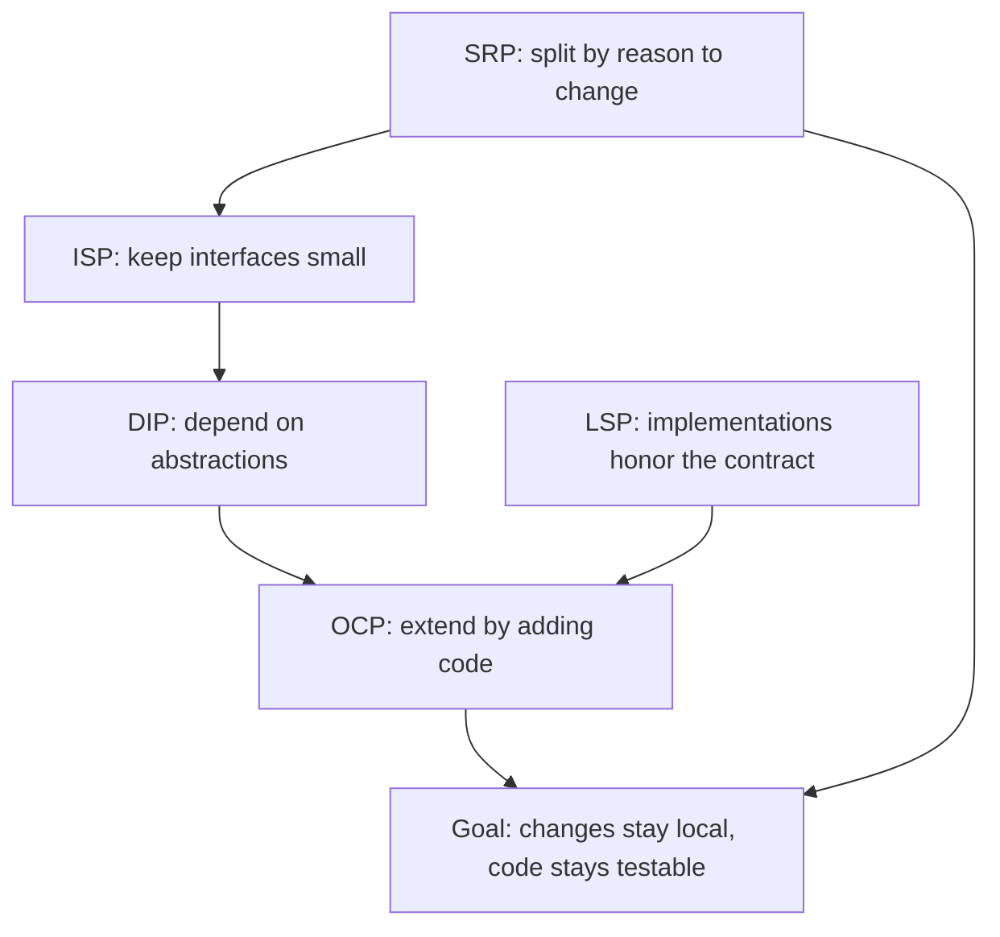
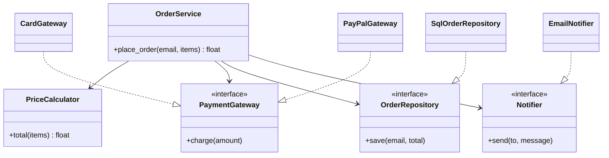

# SOLID Principles Overview

## Introduction

You can write code that works and still dread changing it. A new payment provider means editing a 400-line class. A small tweak to an invoice format breaks the email feature. A unit test needs a real database, a real SMTP server and twenty minutes of setup. None of these are syntax problems. They are **design** problems, and the SOLID principles are one of the best-known toolkits for spotting and fixing them.

SOLID is an acronym for five object-oriented design principles:

| Letter | Principle | One-line idea |
| --- | --- | --- |
| **S** | [Single Responsibility](./1-arch-single-responsibility.mdx) | A module should have one reason to change. |
| **O** | [Open/Closed](./2-arch-open-closed.mdx) | Add new behavior by adding code, not by editing working code. |
| **L** | [Liskov Substitution](./3-arch-liskov-substitution.mdx) | A subtype must be usable anywhere its parent type is expected. |
| **I** | [Interface Segregation](./4-arch-interface-segregation.mdx) | Don't force clients to depend on methods they don't use. |
| **D** | [Dependency Inversion](./5-arch-dependency-inversion.mdx) | Business rules should depend on abstractions, not on details. |

Think of SOLID as the building code for a house. A building code doesn't design the house for you, and you can build a garden shed without consulting most of it. But when the house gets big, has many occupants and needs renovating every year, those rules are what stop a change in the kitchen from bringing down the bathroom ceiling.

This page gives you the map. Each following page goes deep on one principle with "before" and "after" code, a real-world scenario and the trade-offs.

## Where SOLID Came From

The principles are older than the acronym:

- **Open/Closed** comes from Bertrand Meyer's *Object-Oriented Software Construction* (1988). Robert C. Martin reinterpreted it in the 1990s around polymorphism and abstract interfaces.
- **Liskov Substitution** comes from Barbara Liskov's 1987 keynote "Data Abstraction and Hierarchy", later formalized by Liskov and Jeannette Wing in 1994.
- Robert C. Martin ("Uncle Bob") collected these and his own principles (SRP, ISP, DIP) in articles in the late 1990s and the 2000 paper "Design Principles and Design Patterns".
- **Michael Feathers** noticed the first letters spelled SOLID, around 2004, and the name stuck.

So SOLID is not a single theory designed in one go. It is a set of lessons learned from large C++ and Java codebases, given a memorable name. That history matters: the principles were written for long-lived, team-maintained, object-oriented systems. They translate well to Python, TypeScript and Go, but you should apply them with the same judgment their authors intended, not as laws.

## The Five Principles in One Example

The easiest way to see what SOLID is about is one class that breaks all five rules. Imagine an online bookstore with this order-processing code:

```python
# order_service_before.py
import sqlite3
import smtplib


class OrderService:
    def place_order(self, customer_email: str, items: list[dict], payment_type: str) -> float:
        # 1. Calculate the total, with discount rules hard-coded
        total = sum(item["price"] * item["qty"] for item in items)
        if total > 100:
            total *= 0.9

        # 2. Charge the customer: a new provider means editing this method
        if payment_type == "card":
            print(f"Charging card {total:.2f}")
        elif payment_type == "paypal":
            print(f"Charging PayPal {total:.2f}")
        else:
            raise ValueError(f"Unknown payment type: {payment_type}")

        # 3. Save the order to a specific database
        conn = sqlite3.connect("shop.db")
        conn.execute("CREATE TABLE IF NOT EXISTS orders (email TEXT, total REAL)")
        conn.execute("INSERT INTO orders VALUES (?, ?)", (customer_email, total))
        conn.commit()

        # 4. Send a confirmation email through a real SMTP server
        with smtplib.SMTP("localhost") as smtp:
            smtp.sendmail("shop@example.com", customer_email, f"Total: {total:.2f}")

        return total
```

It works. Here is what each principle would say about it:

| Principle | Symptom in `OrderService` |
| --- | --- |
| SRP | Pricing, payments, persistence and email all live in one class. The marketing team (discounts), finance (payments) and ops (database) all edit the same file. |
| OCP | Adding Apple Pay means editing the `if/elif` chain inside a working method. |
| LSP | Nothing to substitute yet, because there are no abstractions. Once we add them, we'll need every payment class to honor the same contract. |
| ISP | Not visible here, but the obvious next step, a single giant `ShopBackend` interface with 30 methods, would violate it. |
| DIP | The high-level policy ("place an order") depends directly on `sqlite3` and `smtplib`. You cannot test it without a database file and a mail server. |

Here is the same feature after applying SOLID, kept small on purpose:

```python
# order_service_after.py
from dataclasses import dataclass
from typing import Protocol


@dataclass(frozen=True)
class Item:
    price: float
    qty: int


class PaymentGateway(Protocol):          # DIP + OCP: policy depends on an abstraction
    def charge(self, amount: float) -> None: ...


class OrderRepository(Protocol):         # ISP: small, focused interface
    def save(self, email: str, total: float) -> None: ...


class Notifier(Protocol):
    def send(self, to: str, message: str) -> None: ...


class PriceCalculator:                    # SRP: pricing rules only
    def total(self, items: list[Item]) -> float:
        subtotal = sum(i.price * i.qty for i in items)
        return subtotal * 0.9 if subtotal > 100 else subtotal


class OrderService:                       # SRP: coordinates the use case only
    def __init__(self, pricing: PriceCalculator, payments: PaymentGateway,
                 orders: OrderRepository, notifier: Notifier) -> None:
        self.pricing = pricing
        self.payments = payments
        self.orders = orders
        self.notifier = notifier

    def place_order(self, email: str, items: list[Item]) -> float:
        total = self.pricing.total(items)
        self.payments.charge(total)
        self.orders.save(email, total)
        self.notifier.send(email, f"Total: {total:.2f}")
        return total


# --- Details live at the edges. Adding Apple Pay = adding a class (OCP). ---
class CardGateway:
    def charge(self, amount: float) -> None:
        print(f"Charging card {amount:.2f}")


class InMemoryOrders:
    def __init__(self) -> None:
        self.rows: list[tuple[str, float]] = []

    def save(self, email: str, total: float) -> None:
        self.rows.append((email, total))


class ConsoleNotifier:
    def send(self, to: str, message: str) -> None:
        print(f"Email to {to}: {message}")


if __name__ == "__main__":
    service = OrderService(PriceCalculator(), CardGateway(), InMemoryOrders(), ConsoleNotifier())
    service.place_order("ana@example.com", [Item(60.0, 1), Item(25.0, 2)])
```

Output:

```text
Charging card 99.00
Email to ana@example.com: Total: 99.00
```

The second version has more classes and more lines. That is the honest cost of SOLID. What you get in return:

- Each piece can change for one reason without touching the others.
- Adding a payment method means adding a class rather than editing `place_order`.
- `OrderService` can be unit-tested with in-memory fakes in milliseconds.
- The SQLite-to-PostgreSQL migration, if it ever happens, touches one class.

## How the Principles Fit Together

The five principles are not independent rules. They reinforce each other, and most of them serve one goal: **managing dependencies so that change stays local.**



Read it like this:

1. **SRP** tells you where to cut: separate code that changes for different reasons.
2. **ISP** tells you how big the seams should be: small interfaces shaped around what each client needs.
3. **DIP** tells you which way the arrows point: high-level policy owns the interface, low-level details implement it.
4. **LSP** makes those seams trustworthy: any implementation can be plugged in without surprises.
5. **OCP** is the payoff: new behavior arrives as new implementations, not as edits to tested code.

Here is the "after" design as a class diagram. Notice that every arrow from `OrderService` points at an interface, never at a concrete detail:



## SOLID in Python, TypeScript and Beyond

SOLID was born in statically typed class-based languages. In Python you have lighter tools for the same ideas:

| Idea | Java / C# tool | Python tool |
| --- | --- | --- |
| An abstraction to depend on | `interface` | `typing.Protocol` (structural) or `abc.ABC` (nominal) |
| A one-method strategy | interface + class | a plain function or `Callable[[float], None]` |
| Immutable data | records, `final` fields | `@dataclass(frozen=True)` |
| Wiring dependencies | Spring, .NET DI container | constructor arguments, a composition root, or FastAPI `Depends` |

`Protocol` is especially useful. A class satisfies a protocol just by having the right methods, with no inheritance needed. That keeps your domain code free of imports from infrastructure code, which is exactly what DIP asks for. Static checkers like mypy and pyright verify it.

:::tip
In Python, a function is often the smallest possible interface. If your "strategy" has one method and no state, a `Callable` type hint is usually clearer than a class hierarchy. The [Strategy Pattern](../4-arch-behavioral-patterns/0-arch-strategy.mdx) page shows both styles.
:::

## The Payoff: A Fast Unit Test

The clearest everyday benefit of SOLID is testing. Because `OrderService` only knows about protocols, a test can hand it fakes that record what happened:

```python
# test_order_service.py
from order_service_after import Item, OrderService, PriceCalculator


class FakeGateway:
    def __init__(self) -> None:
        self.charged: list[float] = []

    def charge(self, amount: float) -> None:
        self.charged.append(amount)


class FakeOrders:
    def __init__(self) -> None:
        self.saved: list[tuple[str, float]] = []

    def save(self, email: str, total: float) -> None:
        self.saved.append((email, total))


class FakeNotifier:
    def __init__(self) -> None:
        self.sent: list[tuple[str, str]] = []

    def send(self, to: str, message: str) -> None:
        self.sent.append((to, message))


def test_discount_applied_and_customer_notified() -> None:
    gateway, orders, notifier = FakeGateway(), FakeOrders(), FakeNotifier()
    service = OrderService(PriceCalculator(), gateway, orders, notifier)

    total = service.place_order("bo@example.com", [Item(80.0, 2)])

    assert total == 144.0                      # 160 minus 10%
    assert gateway.charged == [144.0]
    assert orders.saved == [("bo@example.com", 144.0)]
    assert notifier.sent == [("bo@example.com", "Total: 144.00")]
```

Example output:

```text
$ pytest -q test_order_service.py
.                                                                        [100%]
1 passed in 0.01s
```

No database, no mail server, no network. The "before" version could only be tested end to end.

## Spotting SOLID Problems: A Smell Guide

You rarely start a design by thinking "now I'll apply ISP". More often you notice a smell and reach for the principle that cures it:

| Smell you notice | Principle to reach for | Typical fix |
| --- | --- | --- |
| A file everyone edits, merge conflicts on every release | SRP | Split by reason to change |
| A growing `if/elif` or `match` on a type code | OCP | Strategy, polymorphism or a registry |
| `isinstance` checks before calling a method, or subclasses raising `NotImplementedError` | LSP | Fix the hierarchy, or stop inheriting |
| Test fakes that must stub ten methods to use one | ISP | Split the interface per client |
| Business logic importing `requests`, `boto3` or an ORM directly | DIP | Introduce a port owned by the business code |

:::info
The smells come first. Robert C. Martin's own framing was that bad designs show **rigidity**, **fragility**, **immobility** and **viscosity**, and the principles are cures for those diseases. If you can't name the disease, you probably don't need the cure yet.
:::

## Real-World Scenario

Your team runs a small online bookstore. The codebase is three years old, and three things keep hurting:

- Every checkout bug fix needs a running PostgreSQL instance and an SMTP server to test.
- The business wants gift cards and "buy now, pay later" as payment options next quarter.
- Two developers broke each other's work last month because both edited `checkout.py`, one for discount rules and one for a new email template.

**The solution, applied gradually:**

1. **Week 1, SRP:** split `checkout.py` into `pricing.py`, `payments.py` and `notifications.py`. The discount developer and the email developer now work in different files.
2. **Week 2, DIP + ISP:** introduce small `PaymentGateway`, `OrderRepository` and `Notifier` protocols, owned by the checkout module. The checkout service takes them through its constructor.
3. **Week 3, tests:** write fast unit tests with in-memory fakes. Keep a few integration tests against the real database.
4. **Next quarter, OCP + LSP:** add `GiftCardGateway` and `PayLaterGateway` as new classes, plus a shared contract test that every gateway must pass.

**Why this approach:** the pain points map directly onto SOLID symptoms. Shared edits are an SRP problem, slow tests are a DIP problem, and a growing `if/elif` chain is an OCP problem. You fix the parts that hurt, in order.

**When to use SOLID / when not to:**

- **Use it** for code that will live for years, that several people change, that has real variation (several payment providers), or that needs fast tests.
- **Go light** on scripts, prototypes, notebooks, one-off migrations and small CRUD apps where the framework already gives you structure. Introducing four interfaces for a 50-line script is over-engineering.

**Alternatives and trade-offs:**

| Approach | Pros | Cons | Best for |
| --- | --- | --- | --- |
| Strict SOLID everywhere | Very flexible, very testable | Many small files, indirection, slower onboarding | Large, long-lived domain cores |
| SOLID at the seams only (I/O, external services) | Most of the testability benefit, little ceremony | Interior code may still need refactoring later | Most business applications |
| Framework conventions (Django, Rails) | Fast to build, familiar layout | Business logic can get tangled with the ORM | CRUD-heavy apps, MVPs |
| Functional core, imperative shell | Pure functions are trivially testable | Unfamiliar to some OO teams | Data transformation, pricing rules |
| No explicit design | Fastest to start | Change cost grows quickly | Throwaway prototypes |

## Common Mistakes

1. **Treating SOLID as a checklist.** The principles are heuristics for managing change. If a class has never changed and never will, splitting it buys nothing. Apply a principle when you feel the pain it addresses, or when you can clearly predict it.
2. **Interface for everything.** Creating an `IUserService` for every `UserService` with exactly one implementation adds files without adding flexibility. Introduce abstractions at real seams: I/O, external systems, and points of genuine variation.
3. **Confusing SRP with "one method per class".** SRP is about reasons to change, not size. A cohesive `Money` class with twenty methods can be perfectly fine.
4. **Ignoring the cost of indirection.** Every abstraction is a jump a reader must follow. Five layers of delegation to save one `if` statement is a bad trade.
5. **Applying SOLID only to classes.** The same ideas apply to modules, packages and services. A microservice that owns billing and email has an SRP problem too.
6. **Forgetting LSP once you have abstractions.** An abstraction is only useful if every implementation behaves as promised. Contract tests catch this.

:::note
Critics such as Dan North have argued that SOLID is vague and that "write simple code" is a better guide. That critique is worth hearing: the principles describe properties of good designs, but they don't tell you how much design is enough. Combine them with [DRY, KISS and YAGNI](./6-arch-dry-kiss-yagni.mdx) to keep yourself honest.
:::

## Summary

- SOLID is five principles: Single Responsibility, Open/Closed, Liskov Substitution, Interface Segregation and Dependency Inversion.
- They come from Meyer, Liskov and Robert C. Martin. Michael Feathers coined the acronym around 2004.
- Together they manage **dependencies** so that changes stay local and code stays testable.
- SRP decides where to cut, ISP sizes the interfaces, DIP points the arrows, LSP keeps implementations honest, and OCP is the payoff.
- In Python, use `Protocol`, `ABC`, dataclasses and plain functions rather than copying Java ceremony.
- They are heuristics, not laws. Apply them where change, variation or testing pain is real.

## Exercises

1. Take the `order_service_before.py` example and list every external system it touches. For each, write the smallest `Protocol` that `OrderService` would need.
2. Add an `ApplePayGateway` to `order_service_after.py` without editing `OrderService`. Which principle did you just benefit from?
3. Write a unit test for `OrderService.place_order` that uses only in-memory fakes and asserts that the notifier received the right message.
4. Find a class in a project you work on that has more than one reason to change. Name the people or teams who would request each kind of change.

**Next steps in this tutorial:**

- Start the deep dives with the [Single Responsibility Principle](./1-arch-single-responsibility.mdx).
- Revisit [Coupling and Cohesion](../0-arch-fundamentals/5-arch-coupling-and-cohesion.mdx), the underlying ideas behind SOLID.
- See how SOLID shows up at the architecture level in [Clean Architecture](../7-arch-clean-architecture/2-arch-clean-architecture.mdx).
