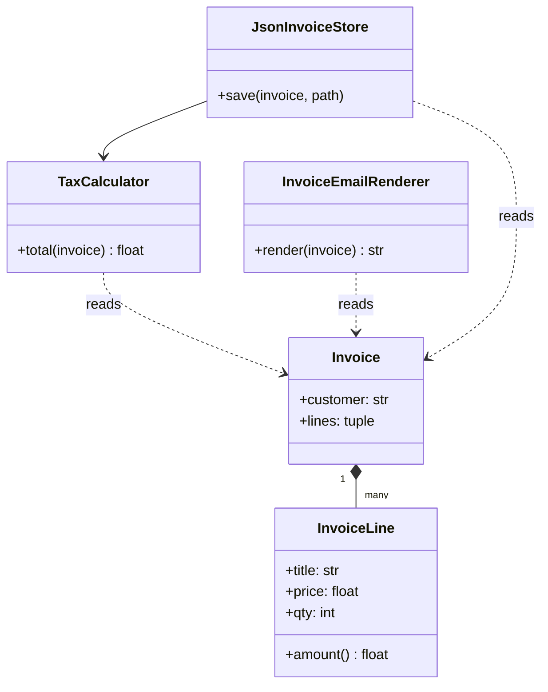
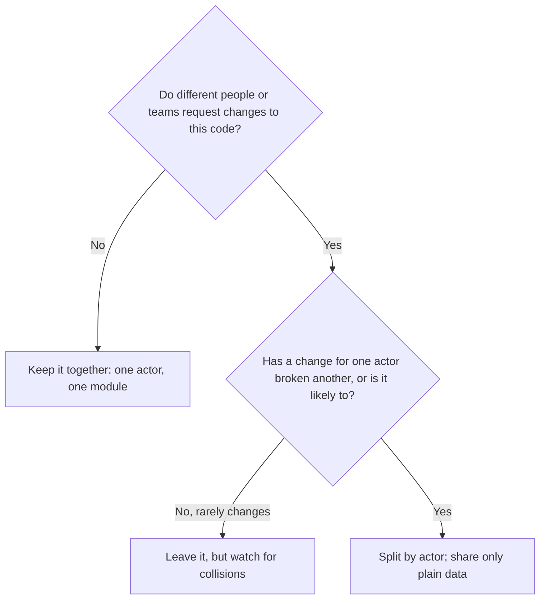

# Single Responsibility Principle

## Introduction

The **Single Responsibility Principle (SRP)** is the "S" in [SOLID](./0-arch-solid-overview.mdx), and it is probably the most quoted and most misunderstood of the five. Its classic wording is:

> A module should have one, and only one, reason to change.

Many developers read that as "a class should do only one thing", and then split code into dozens of tiny classes with one method each. That is not what the principle asks. Robert C. Martin, who named it, clarified in a [2014 blog post](https://blog.cleancoder.com/uncle-bob/2014/05/08/SingleReponsibilityPrinciple.html) and again in *Clean Architecture* (2017) that a "reason to change" is really a **person or group of people** who request changes. His later wording is that a module should be responsible to one, and only one, **actor**.

An analogy: a restaurant menu is printed by the marketing team, priced by the owner and checked for allergens by the head chef. If all three edit the same Word document, the chef's allergen fix can accidentally revert the owner's new prices. Give each actor their own document (or at least their own section with clear ownership) and those collisions stop.

SRP is about keeping things that change together in one place, and keeping things that change for different reasons apart. It is the code-level form of high **cohesion**, which you met in [Coupling and Cohesion](../0-arch-fundamentals/5-arch-coupling-and-cohesion.mdx).

## The Problem: One Class, Three Masters

Here is an `Invoice` class from an online bookstore. It looks tidy. It is short and everything about invoices is in one place:

```python
# invoice_before.py
import json
from dataclasses import dataclass, field


@dataclass
class Invoice:
    customer: str
    lines: list[tuple[str, float, int]] = field(default_factory=list)  # (title, price, qty)

    def _subtotal(self) -> float:
        # Shared helper used by both total() and to_html()
        return sum(price * qty for _, price, qty in self.lines)

    # Finance team: tax rules
    def total(self) -> float:
        return round(self._subtotal() * 1.08, 2)

    # Marketing team: the look of the invoice email
    def to_html(self) -> str:
        rows = "".join(f"<li>{t} x{q}: {p * q:.2f}</li>" for t, p, q in self.lines)
        return f"<h1>Thanks, {self.customer}!</h1><ul>{rows}</ul><p>Items: {self._subtotal():.2f}</p>"

    # Platform team: storage format
    def save(self, path: str) -> None:
        with open(path, "w") as f:
            json.dump({"customer": self.customer, "lines": self.lines, "total": self.total()}, f)


if __name__ == "__main__":
    inv = Invoice("Ana", [("Dune", 12.5, 2), ("Emma", 8.0, 1)])
    print(inv.total())
    print(inv.to_html())
```

Output:

```text
35.64
<h1>Thanks, Ana!</h1><ul><li>Dune x2: 25.00</li><li>Emma x1: 8.00</li></ul><p>Items: 33.00</p>
```

Three different actors ask for changes to this one class:

| Method | Actor | Typical change request |
| --- | --- | --- |
| `total()` | Finance | "Shipping is now taxable in some states." |
| `to_html()` | Marketing | "Show the items subtotal including the loyalty discount." |
| `save()` | Platform | "Move invoices to the object store and add a schema version." |

Now watch the failure mode SRP warns about. Marketing asks for the loyalty discount to appear in the email. A developer changes the shared helper:

```python
    def _subtotal(self) -> float:
        # Marketing wanted the discount shown in the email...
        return sum(price * qty for _, price, qty in self.lines) * 0.95
```

The email now looks right. But `total()` also calls `_subtotal()`, so **every customer is now charged 5% less**, and finance finds out at month-end. Nobody on the marketing ticket thought to test tax totals, because "we only touched the email".

That is the core harm of mixing actors: a change for one actor silently breaks behavior another actor depends on. The code was not long or messy. It was **coupled across reasons to change**.

## The Fix: Separate by Actor

Split the class so each actor's code lives in its own unit, and keep the shared data as a simple value:

```python
# invoice_after.py
import json
from dataclasses import dataclass


@dataclass(frozen=True)
class InvoiceLine:
    title: str
    price: float
    qty: int

    @property
    def amount(self) -> float:
        return self.price * self.qty


@dataclass(frozen=True)
class Invoice:                     # Plain data: changes only if the invoice concept changes
    customer: str
    lines: tuple[InvoiceLine, ...]


class TaxCalculator:               # Finance owns this
    RATE = 0.08

    def total(self, invoice: Invoice) -> float:
        subtotal = sum(line.amount for line in invoice.lines)
        return round(subtotal * (1 + self.RATE), 2)


class InvoiceEmailRenderer:        # Marketing owns this
    LOYALTY_DISCOUNT = 0.05

    def render(self, invoice: Invoice) -> str:
        rows = "".join(f"<li>{l.title} x{l.qty}: {l.amount:.2f}</li>" for l in invoice.lines)
        shown = sum(l.amount for l in invoice.lines) * (1 - self.LOYALTY_DISCOUNT)
        return f"<h1>Thanks, {invoice.customer}!</h1><ul>{rows}</ul><p>Items: {shown:.2f}</p>"


class JsonInvoiceStore:            # Platform owns this
    def __init__(self, tax: TaxCalculator) -> None:
        self.tax = tax

    def save(self, invoice: Invoice, path: str) -> None:
        data = {
            "schema": 2,
            "customer": invoice.customer,
            "lines": [vars(l) for l in invoice.lines],
            "total": self.tax.total(invoice),
        }
        with open(path, "w") as f:
            json.dump(data, f)


if __name__ == "__main__":
    inv = Invoice("Ana", (InvoiceLine("Dune", 12.5, 2), InvoiceLine("Emma", 8.0, 1)))
    print(TaxCalculator().total(inv))
    print(InvoiceEmailRenderer().render(inv))
```

Output:

```text
35.64
<h1>Thanks, Ana!</h1><ul><li>Dune x2: 25.00</li><li>Emma x1: 8.00</li></ul><p>Items: 31.35</p>
```

Marketing got their discounted subtotal, and the tax total is unchanged. The duplication of `sum(l.amount ...)` is deliberate: the two sums look the same today but answer different questions for different actors. Merging them is exactly what caused the bug. (See [DRY, KISS and YAGNI](./6-arch-dry-kiss-yagni.mdx) for why "accidental duplication" is not a DRY violation.)



## Finding the Reasons to Change

"Responsibility" is fuzzy, so use concrete questions:

1. **Who would ask for this to change?** List the roles: finance, legal, marketing, ops, a specific customer segment. Different names suggest different modules.
2. **Does the description need "and"?** "This class calculates tax **and** renders emails **and** saves files" is a hint. "This class represents money" is fine even if `Money` has many methods.
3. **What changes together in the commit history?** If the same files always change together for one kind of ticket, they belong together. If one file changes for every kind of ticket, it is a hotspot. Running `git log --format= --name-only | sort | uniq -c | sort -rn | head` gives a quick list of the most-edited files.
4. **What would you need to mock to test it?** A class whose test needs a fake database, a fake clock, a fake HTTP client and a template engine is probably serving several masters.



## SRP for Functions: A Small Worked Example

SRP pays off just as much at the function level. Here is an import job that reads customer rows, validates them and writes them to storage, all in one function:

```python
# import_before.py
import csv
import io


def import_customers(raw_csv: str, db: list[dict]) -> int:
    count = 0
    for row in csv.DictReader(io.StringIO(raw_csv)):
        email = row["email"].strip().lower()
        if "@" not in email:                 # business rule (from the support team)
            continue
        db.append({"email": email, "name": row["name"].title()})  # storage (platform team)
        count += 1
    return count
```

Testing the email rule requires building a CSV string and a fake database. Changing the storage format means re-reading validation logic. Split it into a parser, a pure rule and a writer:

```python
# import_after.py
import csv
import io
from collections.abc import Iterable, Iterator
from dataclasses import dataclass


@dataclass(frozen=True)
class Customer:
    email: str
    name: str


def parse(raw_csv: str) -> Iterator[Customer]:                 # format concerns
    for row in csv.DictReader(io.StringIO(raw_csv)):
        yield Customer(row["email"].strip().lower(), row["name"].title())


def is_valid(c: Customer) -> bool:                              # business rule, pure
    return "@" in c.email


def save_all(customers: Iterable[Customer], db: list[dict]) -> int:   # storage concerns
    n = 0
    for c in customers:
        db.append({"email": c.email, "name": c.name})
        n += 1
    return n


def import_customers(raw_csv: str, db: list[dict]) -> int:      # the use case: wiring only
    return save_all((c for c in parse(raw_csv) if is_valid(c)), db)


if __name__ == "__main__":
    db: list[dict] = []
    data = "email,name\nANA@Example.com,ana lee\nnot-an-email,bob\n"
    print(import_customers(data, db), db)
    print(is_valid(Customer("x@y.z", "X")), is_valid(Customer("nope", "N")))
```

Output:

```text
1 [{'email': 'ana@example.com', 'name': 'Ana Lee'}]
True False
```

Now the support team's rule (`is_valid`) can be tested with one line, and switching the storage to a real database only touches `save_all`.

## SRP at Other Scales

SRP is not just about classes:

- **Functions:** a function that parses input, validates it, saves it and logs a metric is hard to test and reuse. Splitting into `parse`, `validate` and `save` helps, especially when validation rules come from the business and storage comes from ops.
- **Modules and packages:** `billing/` and `notifications/` as separate packages, each with an owner in your `CODEOWNERS` file.
- **Services:** a microservice should be owned by one team and change for one business capability. A "user service" that handles login, profiles, billing addresses and marketing preferences has four actors. See [Microservices Architecture](../6-arch-architectural-styles/4-arch-microservices.mdx).

At the architecture level this idea becomes **Conway's Law** territory: boundaries in code that match boundaries between teams reduce coordination. See [Conway's Law and Team Topologies](../0-arch-fundamentals/9-arch-conways-law.mdx).

## Where You Have Already Seen SRP

- **Python's `logging` module** splits one job into four roles: `Logger` (the API your code calls), `Handler` (where records go: file, stream, socket), `Formatter` (how a record looks) and `Filter` (which records pass). Ops can switch from files to JSON on stdout by changing handlers and formatters without touching any code that calls `logger.info`.
- **Django** separates models (data), views (request handling), templates (presentation) and forms (input validation). Each changes for different reasons.
- **Unix tools** such as `grep`, `sort` and `uniq` each do one job and compose through pipes. That is SRP plus composition, covered in [Pipes and Filters Architecture](../6-arch-architectural-styles/9-arch-pipes-and-filters.mdx).

```python
# logging_srp.py
import logging
import sys

logger = logging.getLogger("shop.checkout")         # what the app code talks to
handler = logging.StreamHandler(sys.stdout)          # where records go
handler.setFormatter(logging.Formatter("%(levelname)s %(name)s: %(message)s"))  # how they look
logger.addHandler(handler)
logger.setLevel(logging.INFO)

logger.info("order placed")
```

Output:

```text
INFO shop.checkout: order placed
```

## Real-World Scenario

Your team runs a SaaS helpdesk. The `TicketService` class has grown to 1,200 lines. It handles creating tickets, SLA deadline calculation, assignment rules, email notifications, and CSV exports for the reporting team. Last sprint:

- A change to business-hours logic for SLAs (requested by the support managers) broke the CSV export (used by the analytics team), because both used a shared `_working_minutes()` helper.
- Three developers had merge conflicts in `ticket_service.py` on the same day.

**The solution:**

1. List the actors: support managers (SLA and assignment rules), customers (notification content), analytics (exports), platform (persistence).
2. Extract one module per actor: `sla_policy.py`, `assignment_rules.py`, `ticket_notifications.py`, `ticket_exports.py`. Keep `TicketService` as a thin coordinator for the "create ticket" use case.
3. Where two modules used the shared helper, **copy it** into each and let them diverge. Analytics wanted wall-clock minutes anyway.
4. Add a `CODEOWNERS` entry per module so reviews route to the right people.

**Why this approach:** the pain came from two actors sharing code, not from the class being long. Splitting by actor removes the collision directly. Splitting by technical layer ("all the helpers in `utils.py`") would have kept the collision.

**When to use SRP / when not to:**

- **Use it** when different people request changes to the same code, when changes for one feature break another, or when a hotspot file appears in most commits.
- **Don't push it** on small scripts, on cohesive value types, or by splitting a single actor's logic into ten classes just to keep them short. That raises coupling between the fragments and makes the code harder to follow.

**Alternatives and trade-offs:**

| Approach | Pros | Cons | Best for |
| --- | --- | --- | --- |
| Split by actor (SRP) | Changes stay local, fewer conflicts, clear ownership | More files, some deliberate duplication | Code with several stakeholders |
| Split by technical layer (controllers, services, repos) | Familiar, framework-friendly | One feature change touches every layer; actors still collide in "services" | Small CRUD apps |
| Split by feature or vertical slice | Each feature fully isolated | Possible duplication across slices | Feature-heavy apps; see [Vertical Slice Architecture](../7-arch-clean-architecture/3-arch-vertical-slice.mdx) |
| Keep one class, add tests | No restructuring cost | Collisions remain; tests catch them late | Stable code that rarely changes |

## Common Mistakes

1. **"One method per class."** SRP is about reasons to change, not size. Over-splitting creates *shotgun surgery*: one change request touches six tiny classes.
2. **Splitting by verb instead of actor.** `InvoiceCalculator`, `InvoiceValidator` and `InvoiceProcessor` might all still serve finance. If one actor owns them, they may belong together.
3. **Merging look-alike code across actors.** Two functions that compute the same number today may need to diverge tomorrow. Sharing them couples the actors again.
4. **"Manager", "Helper" and "Utils" classes.** Names like these usually mean the responsibility was never defined, and they attract unrelated code.
5. **Forgetting the data.** If every module needs to poke at the internals of a shared mutable object, they are still coupled. Share immutable values or narrow interfaces.

## Summary

- SRP: a module should have one reason to change, meaning it is responsible to **one actor**.
- The harm it prevents is a change for one stakeholder silently breaking another stakeholder's behavior.
- Find responsibilities by asking who requests changes, by reading commit history and by looking at what a test must mock.
- Split by actor. Share plain immutable data. Accept some duplication between actors.
- SRP applies to functions, modules, packages and services, and connects to Conway's Law at the team level.
- Don't over-split. Cohesion matters as much as separation.

## Exercises

1. Take a class from your own code and list every role (person or team) who has requested a change to it in the last six months. Does it serve more than one actor?
2. Refactor this function so pricing and formatting can change independently, and write a test for each part:
   `def receipt(items): total = sum(i.price for i in items) * 1.08; return f"TOTAL: ${total:.2f}"`
3. Run the `git log` hotspot command on a repository you know. Pick the top file and decide whether it is a hotspot because of mixed actors or because it is simply central.
4. Find one place where two actors share a helper function. Would duplicating it be safer?

**Related pages:**

- Next: [Open/Closed Principle](./2-arch-open-closed.mdx)
- [Separation of Concerns](./9-arch-separation-of-concerns.mdx), the broader idea SRP comes from
- [Coupling and Cohesion](../0-arch-fundamentals/5-arch-coupling-and-cohesion.mdx)
