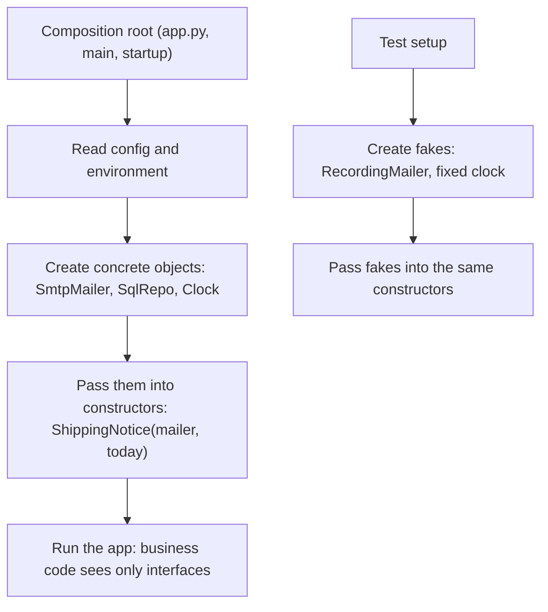

# Dependency Injection

## Introduction

**Dependency Injection (DI)** is a simple technique with an intimidating name: instead of an object creating the things it needs, **someone else hands them to it**, usually through its constructor.

```python
# Without DI: the class picks its own dependency
class OrderService:
    def __init__(self) -> None:
        self.payments = StripeGateway(api_key="sk_live_...")

# With DI: the dependency is passed in
class OrderService:
    def __init__(self, payments: PaymentGateway) -> None:
        self.payments = payments
```

That's it. Everything else on this page (containers, lifetimes, frameworks) is about doing this conveniently at scale.

An analogy: a chef who has to grow their own vegetables, raise chickens and forge their own knives before cooking can't be moved to a different kitchen and can't be tested with practice ingredients. A chef who is **given** ingredients and tools can cook anywhere, and you can hand them plastic vegetables for a training session.

DI is the most common way to implement the [Dependency Inversion Principle](./5-arch-dependency-inversion.mdx): DIP says business code should depend on abstractions, and DI is how a concrete implementation of that abstraction reaches the business code at runtime. The term itself was popularized by Martin Fowler's 2004 article [Inversion of Control Containers and the Dependency Injection pattern](https://martinfowler.com/articles/injection.html).

## The Problem: Hidden, Hard-Wired Dependencies

An online bookstore sends a "your order shipped" email. Here is a typical first version:

```python
# shipping_notice_before.py
import datetime
import smtplib


class ShippingNotice:
    def send(self, order_id: str, email: str) -> None:
        today = datetime.date.today()                          # hidden dependency: the clock
        body = f"Order {order_id} shipped on {today:%d %b %Y}."
        if today.weekday() >= 5:
            body += " Weekend shipments arrive a day later."
        with smtplib.SMTP("mail.internal", 25) as smtp:        # hidden dependency: SMTP server
            smtp.sendmail("shop@example.com", email, body)
```

Problems:

- **Untestable without tricks.** Testing the weekend message requires either waiting for Saturday or `unittest.mock.patch("datetime.date")`, which is awkward because `date` is a built-in type. Every test also needs to stop a real SMTP connection.
- **Hidden.** The constructor takes no arguments, so nothing tells a reader that this class talks to a mail server.
- **Inflexible.** Switching to an email API, or to a "log only" mode in staging, means editing this class.

## Constructor Injection

The fix is to make the dependencies explicit parameters:

```python
# shipping_notice_di.py
import datetime
from collections.abc import Callable
from typing import Protocol


class Mailer(Protocol):
    def send(self, to: str, body: str) -> None: ...


class ShippingNotice:
    def __init__(self, mailer: Mailer, today: Callable[[], datetime.date] = datetime.date.today) -> None:
        self.mailer = mailer
        self.today = today

    def send(self, order_id: str, email: str) -> None:
        day = self.today()
        body = f"Order {order_id} shipped on {day:%d %b %Y}."
        if day.weekday() >= 5:
            body += " Weekend shipments arrive a day later."
        self.mailer.send(email, body)


class ConsoleMailer:
    def send(self, to: str, body: str) -> None:
        print(f"to={to}: {body}")


if __name__ == "__main__":
    saturday = lambda: datetime.date(2026, 10, 10)
    ShippingNotice(ConsoleMailer(), today=saturday).send("A-1001", "ana@example.com")
```

Output:

```text
to=ana@example.com: Order A-1001 shipped on 10 Oct 2026. Weekend shipments arrive a day later.
```

Notice two things:

1. **The clock is a dependency too.** Anything non-deterministic (time, randomness, UUIDs, environment variables) is worth injecting when logic depends on it.
2. **Python-friendly style.** A one-method dependency like the clock can just be a `Callable`, with a sensible default. You don't need a `Clock` interface and class unless several methods are involved.

### Three forms of injection

Fowler's article describes three forms:

| Form | How | Verdict |
| --- | --- | --- |
| **Constructor injection** | Dependencies are `__init__` parameters | The default choice. Objects are complete and valid after construction; dependencies are visible in one place. |
| **Setter (property) injection** | `service.mailer = SmtpMailer()` after construction | Only for genuinely optional dependencies with a sensible default. Risk of half-configured objects. |
| **Interface (method) injection** | The dependency is passed to each method call: `notice.send(order, mailer)` | Good when the dependency varies per call (for example, the current request or user). |

Both Fowler and the Spring team recommend constructor injection for required dependencies. The [Spring documentation](https://docs.spring.io/spring-framework/reference/core/beans/dependencies/factory-collaborators.html) says the team "generally advocates constructor injection", because it allows immutable components and guarantees required dependencies are not null.

## The Composition Root

If classes don't create their dependencies, **something** must. That something should be one place, as close to the program's entry point as possible, called the **composition root** (a term from Mark Seemann's book on DI). It's the only place that knows which concrete classes are used.

```python
# app.py: the composition root
import datetime
import os

from shipping_notice_di import ConsoleMailer, Mailer, ShippingNotice


class SmtpMailer:
    def __init__(self, host: str) -> None:
        self.host = host

    def send(self, to: str, body: str) -> None:
        import smtplib
        with smtplib.SMTP(self.host, 25) as smtp:
            smtp.sendmail("shop@example.com", to, body)


def build_shipping_notice() -> ShippingNotice:
    mailer: Mailer
    if os.environ.get("APP_ENV") == "production":
        mailer = SmtpMailer(os.environ["SMTP_HOST"])
    else:
        mailer = ConsoleMailer()
    return ShippingNotice(mailer, today=datetime.date.today)


if __name__ == "__main__":
    build_shipping_notice().send("A-1002", "bo@example.com")
```

Example output (outside production, run on a weekday):

```text
to=bo@example.com: Order A-1002 shipped on 13 Oct 2026.
```

Wiring dependencies by hand like this is sometimes called **pure DI** or manual DI. For small and medium Python apps it is often all you need: it is plain code, easy to debug, and your editor can follow every reference.



## Testing with DI

The main daily payoff of DI is that tests don't need patching:

```python
# test_shipping_notice.py
import datetime

from shipping_notice_di import ShippingNotice


class RecordingMailer:
    def __init__(self) -> None:
        self.sent: list[tuple[str, str]] = []

    def send(self, to: str, body: str) -> None:
        self.sent.append((to, body))


def test_weekend_note_added_on_saturday() -> None:
    mailer = RecordingMailer()
    ShippingNotice(mailer, today=lambda: datetime.date(2026, 10, 10)).send("A-1", "x@y.z")
    assert mailer.sent[0][1].endswith("arrive a day later.")


def test_no_weekend_note_on_monday() -> None:
    mailer = RecordingMailer()
    ShippingNotice(mailer, today=lambda: datetime.date(2026, 10, 12)).send("A-1", "x@y.z")
    assert "Weekend" not in mailer.sent[0][1]
```

Example output:

```text
$ pytest -q test_shipping_notice.py
..                                                                       [100%]
2 passed in 0.01s
```

## Service Locator: The Alternative

Instead of injection, a class can **ask a registry** for its dependencies:

```python
# locator.py
class Locator:
    _services: dict[str, object] = {}

    @classmethod
    def register(cls, name: str, svc: object) -> None:
        cls._services[name] = svc

    @classmethod
    def get(cls, name: str) -> object:
        return cls._services[name]


class ShippingNotice:
    def send(self, order_id: str, email: str) -> None:
        mailer = Locator.get("mailer")             # dependency fetched, not given
        mailer.send(email, f"Order {order_id} shipped.")  # type: ignore[attr-defined]
```

Fowler's 2004 article is balanced: both patterns decouple code from concrete classes, and a locator is acceptable inside one application. But the dependency is hidden in method bodies rather than visible in the constructor, so you only discover a missing registration at runtime, and every class depends on the locator itself. Mark Seemann later argued it is an anti-pattern for those reasons. Most modern guidance prefers constructor injection, with a locator only at framework boundaries.

## DI Containers and Lifetimes

In large applications, manual wiring can grow to hundreds of lines. A **DI container** (also called an IoC container) automates it: you register which implementation to use for each abstraction, and the container builds object graphs for you by inspecting constructors.

Containers also manage **lifetimes**. The [.NET documentation](https://learn.microsoft.com/en-us/dotnet/core/extensions/dependency-injection) defines three, and most containers have equivalents:

| Lifetime | Meaning | Typical use |
| --- | --- | --- |
| **Singleton** | One instance for the whole application | Configuration, HTTP client pools, caches |
| **Scoped** | One instance per scope, usually per web request | Database sessions, unit of work, current user |
| **Transient** | A new instance every time it's requested | Lightweight, stateless services |

:::warning
**Captive dependencies.** If a singleton holds a reference to a scoped service (for example a database session), that session lives forever and gets shared across requests. This causes data leaks between users and stale connections. .NET checks for this in development; in other ecosystems you need to watch for it yourself.
:::

### What it looks like in popular frameworks

**FastAPI** has DI built in. Dependencies are functions declared with `Depends`, and the [current docs](https://fastapi.tiangolo.com/tutorial/dependencies/) recommend the `Annotated` form. Tests can swap any dependency with `app.dependency_overrides`:

```python
# fastapi_di.py
from typing import Annotated, Protocol

from fastapi import Depends, FastAPI
from fastapi.testclient import TestClient


class Mailer(Protocol):
    def send(self, to: str, body: str) -> None: ...


class ConsoleMailer:
    def send(self, to: str, body: str) -> None:
        print(f"to={to}: {body}")


def get_mailer() -> Mailer:
    return ConsoleMailer()


MailerDep = Annotated[Mailer, Depends(get_mailer)]
app = FastAPI()


@app.post("/orders/{order_id}/shipped")
def mark_shipped(order_id: str, email: str, mailer: MailerDep) -> dict:
    mailer.send(email, f"Order {order_id} shipped.")
    return {"order_id": order_id, "notified": True}


# --- in a test: replace the real dependency ---
class RecordingMailer:
    def __init__(self) -> None:
        self.sent: list[str] = []

    def send(self, to: str, body: str) -> None:
        self.sent.append(body)


recorder = RecordingMailer()
app.dependency_overrides[get_mailer] = lambda: recorder
client = TestClient(app)
print(client.post("/orders/A-7/shipped", params={"email": "ana@example.com"}).json())
print(recorder.sent)
app.dependency_overrides.clear()
```

Output:

```text
{'order_id': 'A-7', 'notified': True}
['Order A-7 shipped.']
```

:::note
`TestClient` needs an HTTP client package installed alongside FastAPI, and recent Starlette releases may print a deprecation warning about which one to use. Follow the message and the [FastAPI testing docs](https://fastapi.tiangolo.com/tutorial/testing/), since this has been changing.
:::

**Spring (Java)** wires beans through constructors. Since Spring Framework 4.3, a class with a single constructor doesn't need `@Autowired`:

```java
// ShippingNotice.java
import org.springframework.stereotype.Service;

@Service
public class ShippingNotice {
    private final Mailer mailer;

    public ShippingNotice(Mailer mailer) {   // Spring injects the Mailer bean
        this.mailer = mailer;
    }

    public void send(String orderId, String email) {
        mailer.send(email, "Order " + orderId + " shipped.");
    }
}
```

**.NET** registers services with `AddSingleton`, `AddScoped` and `AddTransient`, for example `builder.Services.AddSingleton<IMailer, SmtpMailer>();`, and injects them through constructors.

**Python containers** such as [dependency-injector](https://pypi.org/project/dependency-injector/) offer declarative containers with `Singleton` and `Factory` providers. They can help in large apps, but many Python teams find manual wiring plus their web framework's DI (FastAPI, Django settings) sufficient. Check each project's docs for current versions and APIs.

## Real-World Scenario

Your team runs a SaaS helpdesk on FastAPI. Today, services create their own SQLAlchemy sessions, Redis clients and email clients at import time. The test suite needs a running PostgreSQL, Redis and a fake SMTP container, takes 15 minutes, and sometimes fails because tests share a Redis instance.

**The solution:**

1. Change each service to receive its collaborators through `__init__` (`TicketService(repo, cache, mailer, clock)`).
2. Create a `dependencies.py` module as the composition root for the web app: functions like `get_session()` (scoped per request with `yield`), `get_ticket_service(session=Depends(get_session))`.
3. Create clients like the Redis pool once at startup (singleton lifetime) and the session per request (scoped).
4. Unit-test services by passing in-memory fakes directly. API tests use `app.dependency_overrides` for the few external services. Keep a smaller integration suite against real PostgreSQL and Redis.

**Why this approach:** the slow, flaky part of the test suite was caused by hidden, hard-wired dependencies. Injecting them makes most tests fast and isolated, and puts all environment decisions (real vs fake, which host) in one place.

**When to use DI / when not to:**

- **Use it** for anything that does I/O or is non-deterministic, for code with business rules worth unit-testing, and in apps with several environments (dev, test, staging, production).
- **Skip or keep it minimal** in scripts, notebooks, small CLIs and pure functions. A function that only computes a value from its arguments is already perfectly injectable.
- **Be careful with containers** in small apps: auto-wiring by type hints or decorators adds magic that makes "where does this object come from?" harder to answer.

**Alternatives and trade-offs:**

| Approach | Pros | Cons | Best for |
| --- | --- | --- | --- |
| Create dependencies inside classes | Least code | Hidden coupling, hard tests | Scripts, prototypes |
| Module-level globals + `mock.patch` in tests | No design change | Tests coupled to import paths; global state | Legacy code, short term |
| Manual (pure) DI with a composition root | Explicit, no magic, IDE-friendly | Wiring code grows with the app | Most Python apps |
| Framework DI (FastAPI, Spring, .NET, Angular) | Integrated lifetimes and request scopes | Ties wiring to the framework | Apps already on that framework |
| Standalone DI container | Automates large graphs | Learning curve, runtime errors on bad config | Large apps with many services |
| Service locator | Easy to retrofit | Hidden dependencies, runtime failures | Framework boundaries only |

## Common Mistakes

1. **Injecting the container.** Passing the container into classes so they can pull what they need turns DI back into a service locator.
2. **Constructor parameter bloat.** A constructor with eight dependencies isn't a DI problem; it's an [SRP](./1-arch-single-responsibility.mdx) signal. Split the class.
3. **Lifetime mismatches.** A singleton holding a request-scoped session, or a new HTTP client created for every call, both cause production bugs.
4. **Injecting everything.** Value objects, dataclasses and the standard library don't need injection. Inject services with side effects or variation.
5. **Wiring scattered through the code.** If `SmtpMailer(...)` is constructed in five places, you don't have a composition root. Centralize it.

## Summary

- Dependency Injection means a component receives its dependencies instead of creating them.
- Prefer **constructor injection**; use method injection for per-call dependencies and setters only for optional ones.
- Build the object graph in one **composition root** at the program's edge; in Python, manual wiring is often enough.
- DI makes tests simple: pass fakes, no patching. Inject clocks and randomness too.
- Containers automate wiring and manage **singleton, scoped and transient** lifetimes; watch for captive dependencies.
- FastAPI (`Depends`, `dependency_overrides`), Spring (constructor injection) and .NET (`AddSingleton` and friends) all build on the same idea.
- Prefer DI over a service locator, and don't use DI as an excuse for classes with too many responsibilities.

## Exercises

1. Inject a `new_id: Callable[[], str]` into an order factory that currently calls `uuid.uuid4()`, and write a test that asserts on a predictable ID.
2. Extend the FastAPI example with a request-scoped dependency that uses `yield` to open and close a fake database session. Print when it opens and closes.
3. Take a class in your codebase that creates its own HTTP client or database connection. Move the creation to a composition root and write one test with a fake.
4. Explain, with an example, why a singleton `ReportService` that receives a scoped `Session` in its constructor is a bug.

**Related pages:**

- Previous: [Separation of Concerns](./9-arch-separation-of-concerns.mdx)
- Back to the start: [SOLID Principles Overview](./0-arch-solid-overview.mdx)
- Next section: [Design Patterns Introduction](../2-arch-creational-patterns/0-arch-design-patterns-introduction.mdx)
- [Designing for Testability](../12-arch-quality-and-operations/5-arch-testability.mdx)
- [Hexagonal Architecture (Ports and Adapters)](../7-arch-clean-architecture/0-arch-hexagonal.mdx)
