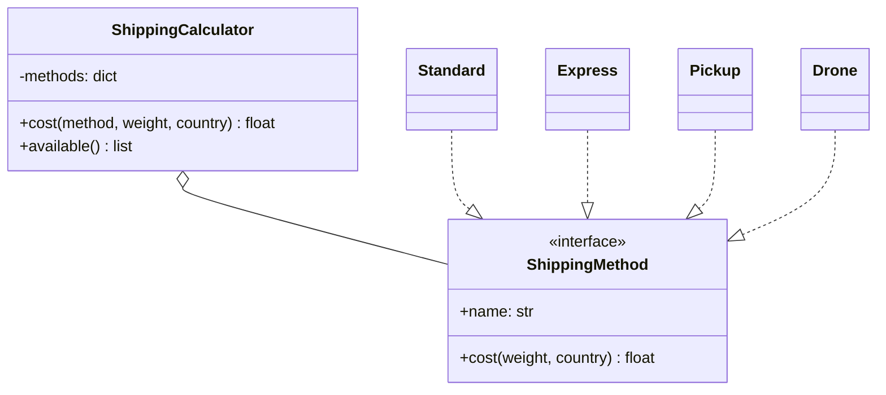
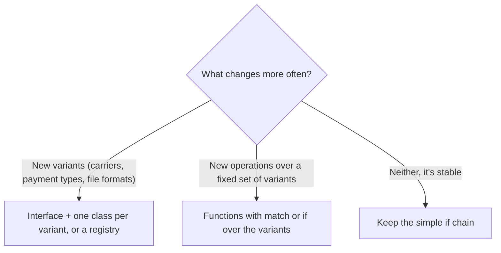

# Open/Closed Principle

## Introduction

The **Open/Closed Principle (OCP)** says:

> Software entities (classes, modules, functions) should be open for extension, but closed for modification.

In plain words: when a new requirement arrives, you should be able to add new code to support it rather than editing code that already works and is already tested.

Think of a power strip. You can plug in a lamp, a laptop charger or a fan. The strip is **open** to new devices, but you never rewire the strip itself to add one, so it is **closed** to modification. The trick is the socket: a stable, agreed-upon interface that every device follows.

That is what OCP is really about: finding the right "sockets" in your code so that the most likely changes become plug-ins.

## Two Versions of the Same Idea

OCP has an interesting history:

- **Bertrand Meyer** introduced it in *Object-Oriented Software Construction* (1988). His mechanism was **implementation inheritance**: once a class is compiled and in use, you don't edit it. You subclass it and add features.
- **Robert C. Martin** reframed it in the 1990s as the **polymorphic** OCP: code depends on an abstract interface, and you extend the system by adding new implementations of that interface.

Today, when people say OCP they almost always mean the second version. Inheriting from concrete classes to extend them has well-known problems (see [Composition over Inheritance](./7-arch-composition-over-inheritance.mdx)). Extending through interfaces, functions and plug-in registries is the modern reading.

## The Problem: The Ever-Growing `if` Chain

An online bookstore calculates shipping costs. It started with two options and has grown:

```python
# shipping_before.py
def shipping_cost(method: str, weight_kg: float, country: str) -> float:
    if method == "standard":
        return 4.99 if country == "US" else 12.99
    elif method == "express":
        return 9.99 + 2.0 * weight_kg
    elif method == "pickup":
        return 0.0
    elif method == "drone":                       # added last quarter
        if weight_kg > 2:
            raise ValueError("Drone limit is 2 kg")
        return 7.50
    else:
        raise ValueError(f"Unknown shipping method: {method}")


if __name__ == "__main__":
    for m in ["standard", "express", "pickup"]:
        print(m, shipping_cost(m, 1.5, "US"))
```

Output:

```text
standard 4.99
express 12.99
pickup 0.0
```

Each new carrier means:

- Editing this function, which every checkout depends on, and re-testing all branches.
- Merge conflicts when two developers add two carriers in the same sprint.
- Very often, a second `if method == ...` chain elsewhere (delivery estimates, label printing) that must be kept in sync. Forget one, and the new option half works.

The chain itself is not the sin. The sin is that the **most frequent change** (a new shipping method) forces edits to **stable, shared code**.

## The Fix: An Extension Point

Define a small interface for "a shipping method", let each method be its own class, and look them up in a registry:

```python
# shipping_after.py
from typing import Protocol


class ShippingMethod(Protocol):
    name: str

    def cost(self, weight_kg: float, country: str) -> float: ...


class Standard:
    name = "standard"

    def cost(self, weight_kg: float, country: str) -> float:
        return 4.99 if country == "US" else 12.99


class Express:
    name = "express"

    def cost(self, weight_kg: float, country: str) -> float:
        return 9.99 + 2.0 * weight_kg


class Pickup:
    name = "pickup"

    def cost(self, weight_kg: float, country: str) -> float:
        return 0.0


class ShippingCalculator:
    """Closed for modification: this class never changes when carriers are added."""

    def __init__(self, methods: list[ShippingMethod]) -> None:
        self._methods = {m.name: m for m in methods}

    def cost(self, method: str, weight_kg: float, country: str) -> float:
        try:
            return self._methods[method].cost(weight_kg, country)
        except KeyError:
            raise ValueError(f"Unknown shipping method: {method}") from None

    def available(self) -> list[str]:
        return sorted(self._methods)


# --- Extension: a new carrier is a new class plus one line of wiring ---
class Drone:
    name = "drone"

    def cost(self, weight_kg: float, country: str) -> float:
        if weight_kg > 2:
            raise ValueError("Drone limit is 2 kg")
        return 7.50


if __name__ == "__main__":
    calc = ShippingCalculator([Standard(), Express(), Pickup(), Drone()])
    print(calc.available())
    print(calc.cost("drone", 1.0, "US"))
```

Output:

```text
['drone', 'express', 'pickup', 'standard']
7.5
```

`ShippingCalculator` is closed: adding `Drone` didn't touch it. The system is open: anyone can write a new `ShippingMethod`. The only edit is the wiring line where the list is built, and that lives in one place (the **composition root**, covered in [Dependency Injection](./10-arch-dependency-injection.mdx)).



Because each method is now a unit, related behavior moves with it. If you add `estimated_days()` to the protocol, every carrier must implement it, and a type checker like mypy reports any carrier that doesn't. There is no second `if` chain to forget.

## Lighter Extension Points in Python

You don't always need classes. Python offers several lighter ways to create a "socket".

### Functions as strategies

If the behavior is one function with no state, pass a function:

```python
# discounts.py
from collections.abc import Callable

Discount = Callable[[float], float]


def no_discount(total: float) -> float:
    return total


def student(total: float) -> float:
    return total * 0.85


def checkout(total: float, discount: Discount = no_discount) -> float:
    return round(discount(total), 2)


print(checkout(40.0))
print(checkout(40.0, student))
print(checkout(40.0, lambda t: max(t - 5, 0)))   # a new rule without editing checkout()
```

Output:

```text
40.0
34.0
35.0
```

Python's own `sorted(items, key=...)` works exactly like this: `sorted` is closed, and the `key` function is the extension point.

### `functools.singledispatch`

When you want to add behavior for new **types** without editing a central function, `functools.singledispatch` gives you an open function:

```python
# export.py
from dataclasses import dataclass
from functools import singledispatch


@dataclass
class Book:
    title: str


@dataclass
class EBook:
    title: str
    size_mb: float


@singledispatch
def describe(item: object) -> str:
    raise NotImplementedError(f"No describer for {type(item).__name__}")


@describe.register
def _(item: Book) -> str:
    return f"Paperback: {item.title}"


@describe.register
def _(item: EBook) -> str:
    return f"E-book: {item.title} ({item.size_mb} MB)"


# Another module can add support for a new type later, without editing the code above.
@dataclass
class AudioBook:
    title: str
    hours: float


@describe.register
def _(item: AudioBook) -> str:
    return f"Audiobook: {item.title} ({item.hours} h)"


for it in [Book("Dune"), EBook("Emma", 1.2), AudioBook("Ulysses", 27.5)]:
    print(describe(it))
```

Output:

```text
Paperback: Dune
E-book: Emma (1.2 MB)
Audiobook: Ulysses (27.5 h)
```

### Plug-in registries

Frameworks take the idea further with plug-in discovery. Python packages can advertise plug-ins through **entry points** (read with `importlib.metadata.entry_points()`), which is how pytest finds plugins installed with pip. The [Microkernel (Plugin) Architecture](../6-arch-architectural-styles/7-arch-microkernel.mdx) page builds this out.

## Where You Have Already Seen OCP

| Library or framework | The stable core | The extension point |
| --- | --- | --- |
| Python `logging` | `Logger` | Custom `Handler` and `Formatter` subclasses |
| Python `json` | `json.dumps` | The `default=` function or a `JSONEncoder` subclass |
| `sorted`, `min`, `max` | The sorting algorithm | The `key=` function |
| Django, Express, ASP.NET Core | The request pipeline | Middleware you add to the chain |
| pytest | The test runner | Hooks and plugins discovered through entry points |
| VS Code | The editor | Extensions through a published extension API |

In every case the maintainers did not have to edit the core to support your use case. That is OCP working at scale.

## Closed Against What? Choosing Your Sockets

No code can be closed against every change. Martin called this **strategic closure**: you pick the axes of change that are likely and build extension points there, and you accept that other changes will still require edits.

There is also a real trade-off, sometimes called the **expression problem**:

- With **polymorphism** (one class per shipping method), adding a new *type* is easy, but adding a new *operation* (say, `carbon_footprint()`) means editing every class.
- With a **function per operation** that matches on type (the original `if` chain, or a `match` statement), adding a new *operation* is easy, but adding a new *type* means editing every function.

So the question is: **which will change more often, the set of variants or the set of operations?** Shipping methods get added often and operations rarely, so the registry wins. For a small, fixed set of variants with many operations, such as the states of an order, a `match` statement can be the better design.



## Real-World Scenario

Your team builds the export feature for a SaaS helpdesk. Customers can export tickets as CSV. Sales has promised JSON and Excel exports, and an enterprise customer wants a custom XML format that only they will use.

**The solution:**

1. Define an `Exporter` protocol with `content_type: str` and `export(tickets) -> bytes`.
2. Implement `CsvExporter`, `JsonExporter` and `XlsxExporter` as separate classes in an `exporters/` package.
3. The HTTP endpoint looks up the exporter by name in a registry built at startup. It never changes when a format is added.
4. The enterprise XML exporter lives in a separate module that is only registered for that tenant.

**Why this approach:** export formats are a textbook axis of change. New ones arrive regularly, each is independent, and one is customer-specific. The registry means the endpoint, its tests and its error handling are written once.

**When to use OCP / when not to:**

- **Use it** where variants keep arriving: payment providers, file formats, notification channels, pricing rules, carriers.
- **Don't use it** for speculative flexibility. If there has only ever been one tax rule, a `TaxStrategy` interface is [YAGNI](./6-arch-dry-kiss-yagni.mdx). A common rule of thumb is to write the `if` the first time, notice the second variant, and refactor to an extension point when the third one arrives.

**Alternatives and trade-offs:**

| Approach | Pros | Cons | Best for |
| --- | --- | --- | --- |
| `if`/`match` on a type code | Simple, all logic in one view | Every new variant edits shared code | Few, stable variants |
| Interface + classes (Strategy) | Variants isolated and testable | More files, indirection | Variants with several methods |
| Dict of functions | Very light | Weaker typing, no grouped behavior | One-function variants |
| `singledispatch` | Extend by type from anywhere | Dispatches on the first argument's type only | Operations over many data types |
| Entry-point plug-ins | Third parties can extend | Discovery and versioning complexity | Frameworks and tools |

## Common Mistakes

1. **Speculative extension points.** Abstracting before the second variant exists usually guesses the wrong shape. Wait for real variation.
2. **Duplicated switches.** If the same `if method ==` chain appears in three places, you've lost the main benefit. Gather variant-specific behavior into one unit per variant.
3. **Extending through deep inheritance.** Meyer-style "subclass to change behavior" leads to fragile base classes. Prefer interfaces and composition.
4. **Treating "closed" as "never edit".** Bugs still get fixed in place, and refactoring is fine. OCP is about the frequent, predictable kind of change, not about freezing code.
5. **Hiding the registry wiring.** Magic auto-discovery (import every module in a folder) can make it hard to tell what is active. Explicit wiring in one place is easier to debug.

## Summary

- OCP: extend behavior by adding new code, not by editing working code.
- Meyer's 1988 version used inheritance; the modern version uses interfaces and polymorphism.
- Extension points in Python: `Protocol` classes, plain functions, dicts of strategies, `singledispatch` and entry-point plug-ins.
- Choose closure strategically: build sockets where variants keep arriving, and keep simple `if` chains where things are stable.
- The expression problem means you can make new types cheap or new operations cheap, rarely both.

## Exercises

1. Add an `estimated_days(country)` method to the `ShippingMethod` protocol and implement it for every carrier. Run mypy to confirm it flags any carrier you missed.
2. Rewrite the `ShippingCalculator` registry as a plain `dict[str, Callable[[float, str], float]]`. What did you lose and gain?
3. Use `functools.singledispatch` to write a `to_row()` function that converts `Book`, `EBook` and `AudioBook` into CSV rows.
4. Find an `if/elif` chain in your codebase. Count how many times it changed in the last year. Does it deserve an extension point?

**Related pages:**

- Previous: [Single Responsibility Principle](./1-arch-single-responsibility.mdx)
- Next: [Liskov Substitution Principle](./3-arch-liskov-substitution.mdx), which makes extension points safe
- [Strategy Pattern](../4-arch-behavioral-patterns/0-arch-strategy.mdx), the most common way to implement OCP
