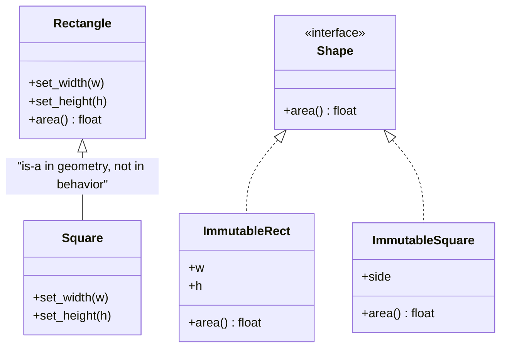

# Liskov Substitution Principle

## Introduction

You add a new class that implements an existing interface. The type checker is happy. The code compiles. Then production breaks, because the new class behaves *slightly* differently from what the callers expected. That is a **Liskov Substitution Principle (LSP)** violation, and it is one of the sneakiest bugs in object-oriented code.

The principle, informally:

> If code works with a base type, it must keep working when you hand it any subtype, without knowing which subtype it got.

It is named after **Barbara Liskov**, who described the idea in her 1987 keynote "Data Abstraction and Hierarchy". She and Jeannette Wing formalized it in 1994 as *behavioral subtyping*.

An analogy: a car rental company promises "a mid-size car with an automatic gearbox". If they give you a different brand, fine. If they give you a manual, they broke the contract, even though it's technically still a car. Callers rely on **behavior**, not just on method names.

LSP is what makes the other SOLID principles safe. [Open/Closed](./2-arch-open-closed.mdx) and [Dependency Inversion](./5-arch-dependency-inversion.mdx) let you plug in new implementations. LSP guarantees those plug-ins don't surprise anyone.

## The Contract Behind an Interface

Every interface has a contract, written down or not. Liskov and Wing's rules, building on Bertrand Meyer's *Design by Contract*, describe what a subtype may and may not change:

| Rule | Meaning | Example violation |
| --- | --- | --- |
| **Preconditions cannot be strengthened** | A subtype must accept everything the base accepts. | Base accepts any message; subtype rejects messages over 160 characters. |
| **Postconditions cannot be weakened** | A subtype must deliver at least what the base promises. | Base returns a sorted list; subtype returns it unsorted. |
| **Invariants must be preserved** | What is always true for the base stays true. | Base guarantees `balance >= 0`; subtype allows overdrafts. |
| **History constraint** | A subtype can't allow state changes the base forbids. | Base is immutable; subtype adds a setter. |
| **No new exceptions** | A subtype shouldn't throw errors callers were never told to expect. | Subtype raises `NotImplementedError` for a base method. |

There are also signature rules (parameter types may get wider, return types may get narrower), which type checkers enforce for you. The behavioral rules are the ones only tests and reviews can catch.

## The Problem: A Notifier That Isn't Quite a Notifier

An online bookstore sends order updates through a `Notifier`. Email worked for years. Then SMS was added:

```python
# notifier_before.py
from abc import ABC, abstractmethod


class Notifier(ABC):
    @abstractmethod
    def send(self, to: str, message: str) -> None:
        """Deliver message to the recipient."""


class EmailNotifier(Notifier):
    def send(self, to: str, message: str) -> None:
        print(f"[email to {to}] {message}")


class SmsNotifier(Notifier):
    def send(self, to: str, message: str) -> None:
        if len(message) > 160:                       # strengthened precondition!
            raise ValueError("SMS messages must be 160 characters or fewer")
        print(f"[sms to {to}] {message}")


def notify_shipped(notifier: Notifier, to: str, titles: list[str]) -> None:
    notifier.send(to, "Your order has shipped: " + ", ".join(titles))


if __name__ == "__main__":
    titles = ["The Left Hand of Darkness", "A Wizard of Earthsea", "The Dispossessed",
              "The Lathe of Heaven", "Always Coming Home", "The Word for World Is Forest",
              "The Farthest Shore"]
    notify_shipped(EmailNotifier(), "ana@example.com", titles)
    notify_shipped(SmsNotifier(), "+15550100", titles)
```

Example output:

```text
[email to ana@example.com] Your order has shipped: The Left Hand of Darkness, A Wizard of Earthsea, The Dispossessed, The Lathe of Heaven, Always Coming Home, The Word for World Is Forest, The Farthest Shore
Traceback (most recent call last):
  ...
ValueError: SMS messages must be 160 characters or fewer
```

`SmsNotifier` is a `Notifier` according to Python, and the type checker approves. But `notify_shipped` was written against the base contract ("deliver this message") and has no idea about the 160-character limit. Large orders now crash checkout for SMS customers.

The tempting "fix" makes things worse:

```python
def notify_shipped(notifier: Notifier, to: str, titles: list[str]) -> None:
    msg = "Your order has shipped: " + ", ".join(titles)
    if isinstance(notifier, SmsNotifier):      # the caller now knows about subtypes
        msg = msg[:157] + "..."
    notifier.send(to, msg)
```

Every caller now needs this check, and every future channel with its own quirk adds another `isinstance` branch. The abstraction has stopped abstracting. **An `isinstance` check on a subtype before calling a method is the classic LSP smell.**

## Fixing the Violation

There are three honest fixes, and the right one depends on the domain.

### Fix 1: Make the subtype honor the contract

If "deliver the message" is the real promise, the SMS notifier must find a way to keep it, for example by splitting the message into parts:

```python
# notifier_fix1.py
import textwrap
from abc import ABC, abstractmethod


class Notifier(ABC):
    @abstractmethod
    def send(self, to: str, message: str) -> None:
        """Deliver the full message to the recipient. Must accept any length."""


class SmsNotifier(Notifier):
    LIMIT = 153   # room for a "(1/3)"-style prefix

    def send(self, to: str, message: str) -> None:
        parts = textwrap.wrap(message, self.LIMIT)
        for i, part in enumerate(parts, start=1):
            print(f"[sms to {to}] ({i}/{len(parts)}) {part}")


SmsNotifier().send("+15550100", "Your order has shipped: " + ", ".join(["Book"] * 40))
```

Example output:

```text
[sms to +15550100] (1/2) Your order has shipped: Book, Book, Book, Book, Book, Book, Book, Book, Book, Book, Book, Book, Book, Book, Book, Book, Book, Book, Book, Book, Book,
[sms to +15550100] (2/2) Book, Book, Book, Book, Book, Book, Book, Book, Book, Book, Book, Book, Book, Book, Book, Book, Book, Book, Book
```

The caller is unchanged and the contract is kept. Notice that the docstring now **states** the contract ("must accept any length"). Writing it down is half the battle.

### Fix 2: Put the constraint into the contract

If channels genuinely differ, make the difference part of the interface so callers can handle it without knowing concrete types:

```python
# notifier_fix2.py
from typing import Protocol


class Notifier(Protocol):
    max_length: int | None          # None means unlimited

    def send(self, to: str, message: str) -> None: ...


class EmailNotifier:
    max_length = None

    def send(self, to: str, message: str) -> None:
        print(f"[email to {to}] {message}")


class SmsNotifier:
    max_length = 160

    def send(self, to: str, message: str) -> None:
        assert len(message) <= self.max_length
        print(f"[sms to {to}] {message}")


def fit(message: str, limit: int | None) -> str:
    if limit is None or len(message) <= limit:
        return message
    return message[: limit - 3] + "..."


def notify_shipped(notifier: Notifier, to: str, titles: list[str]) -> None:
    notifier.send(to, fit("Your order has shipped: " + ", ".join(titles), notifier.max_length))


notify_shipped(SmsNotifier(), "+15550100", ["Dune"] * 50)
```

Example output:

```text
[sms to +15550100] Your order has shipped: Dune, Dune, Dune, Dune, Dune, Dune, Dune, Dune, Dune, Dune, Dune, Dune, Dune, Dune, Dune, Dune, Dune, Dune, Dune, Dune, D...
```

Now the precondition is part of the base contract, so the subtype isn't strengthening anything.

### Fix 3: Admit they are different types

Sometimes the honest answer is that SMS is not a drop-in `Notifier` at all, and should be a separate abstraction (`ShortMessageSender`) used by callers that know how to write short messages. Stopping a forced inheritance relationship is often the cleanest fix. See [Composition over Inheritance](./7-arch-composition-over-inheritance.mdx).

## The Classic Trap: Square Extends Rectangle

Every LSP article mentions this one because it shows that "is-a" in the real world does not mean "is-a" in code:

```python
# shapes.py
class Rectangle:
    def __init__(self, w: float, h: float) -> None:
        self.w, self.h = w, h

    def set_width(self, w: float) -> None:
        self.w = w

    def set_height(self, h: float) -> None:
        self.h = h

    def area(self) -> float:
        return self.w * self.h


class Square(Rectangle):
    def __init__(self, side: float) -> None:
        super().__init__(side, side)

    def set_width(self, w: float) -> None:      # keeps the square invariant...
        self.w = self.h = w

    def set_height(self, h: float) -> None:     # ...but breaks Rectangle's behavior
        self.w = self.h = h


def stretch(r: Rectangle) -> float:
    r.set_width(5)
    r.set_height(4)
    return r.area()          # any caller of a Rectangle expects 20


print(stretch(Rectangle(1, 1)))
print(stretch(Square(1)))
```

Output:

```text
20
16
```

Geometrically a square is a rectangle. Behaviorally, a *mutable* square is not a *mutable* rectangle, because the rectangle's contract says width and height change independently. If both were immutable values with an `area()` method, there would be no problem. LSP is about behavior under the operations the base type allows.



## Where You Have Already Met LSP Violations

- **Java's `Collections.unmodifiableList`** returns a `List` whose `add` throws `UnsupportedOperationException`. The Java docs call these "optional operations", which is an explicit, documented weakening of the `List` contract. It is a deliberate trade-off, but code that accepts a `List` and calls `add` can still blow up.
- **Subclassing Python's `dict`.** Overriding `__setitem__` in a `dict` subclass does **not** change how the constructor or `update()` store keys, because the built-in C methods don't call your override. The subclass looks like a dict but behaves inconsistently:

```python
# dict_subclass.py
from collections import UserDict


class LowerKeys(dict):
    def __setitem__(self, key: str, value: int) -> None:
        super().__setitem__(key.lower(), value)


class LowerKeys2(UserDict):
    def __setitem__(self, key: str, value: int) -> None:
        super().__setitem__(key.lower(), value)


for cls in (LowerKeys, LowerKeys2):
    d = cls(ISBN=1)          # constructor
    d.update({"Title": 2})   # update()
    d["Author"] = 3          # direct assignment
    print(cls.__name__, sorted(d.keys()))
```

Output:

```text
LowerKeys ['ISBN', 'Title', 'author']
LowerKeys2 ['author', 'isbn', 'title']
```

`collections.UserDict` routes its other methods through the ones you override, which is why the standard library offers it for this kind of customization.

- **Type checkers enforce the signature part.** mypy reports a parameter type narrowed in an override and explicitly names the principle:

```text
error: Argument 1 of "area" is incompatible with supertype "Base"; supertype defines the argument type as "float"  [override]
note: This violates the Liskov substitution principle
```

## Catching Violations with Contract Tests

Behavioral rules can't be checked by a type checker, but a **contract test** can. Write the tests once against the abstraction and run them against every implementation:

```python
# test_notifier_contract.py
import pytest

from notifier_fix1 import SmsNotifier


class EmailNotifier:
    def send(self, to: str, message: str) -> None:
        print(f"[email to {to}] {message}")


@pytest.fixture(params=[EmailNotifier, SmsNotifier])
def notifier(request):
    return request.param()


def test_accepts_long_messages(notifier) -> None:
    notifier.send("someone", "x" * 1000)          # must not raise


def test_accepts_empty_message(notifier) -> None:
    notifier.send("someone", "")                  # must not raise
```

Example output:

```text
$ pytest -q test_notifier_contract.py
....                                                                     [100%]
4 passed in 0.01s
```

When someone adds `PushNotifier`, they add it to `params` and immediately learn whether it honors the contract. This is the single most practical LSP tool.

## Real-World Scenario

Your team builds a file-storage abstraction for a SaaS helpdesk. Attachments are stored through a `BlobStore` interface with `put(key, data)` and `get(key)`. There is a `LocalDiskStore` for development and an `S3Store` for production. A new `ArchiveStore` is proposed for old tickets. It is cheap but writes are rejected and reads take minutes.

**The analysis:** `ArchiveStore` would strengthen preconditions (`put` not allowed) and weaken postconditions (`get` is not interactive). Any code that takes a `BlobStore` and calls `put` would break. It is not a valid `BlobStore`.

**The solution:**

1. Keep `BlobStore` for read-write, interactive stores.
2. Create a separate `Archive` interface with `archive(key)` and `request_restore(key)`, which honestly models a slow, asynchronous restore.
3. A background job moves old attachments from `BlobStore` to `Archive`.
4. Add a parametrized contract test that every `BlobStore` must pass: round-trip `put` then `get`, overwriting, and missing-key behavior.

**Why this approach:** callers of `BlobStore` keep their assumptions, and the archive's real behavior is visible in its own API instead of being hidden behind exceptions.

**When to apply LSP strictly / when to relax:**

- **Strictly** for public interfaces, plug-in APIs, and anything with several implementations written by different people.
- **Relax** when a documented "optional capability" is a deliberate trade-off (as Java collections do) and callers can query it, or for test doubles that only implement what a specific test needs.

**Alternatives and trade-offs:**

| Approach | Pros | Cons | Best for |
| --- | --- | --- | --- |
| Make subtype honor the contract | Callers untouched | Subtype may be harder to implement | When it's feasible, which is most of the time |
| Expose capabilities in the contract (`max_length`, `supports_write`) | Honest, flexible | Callers must handle variation | Channels and drivers with real differences |
| Separate interfaces | Clean, no surprises | More types; may need adapters | Genuinely different behavior |
| Throw "not supported" | Quick | Runtime surprises, `isinstance` checks spread | Rarely; documented optional operations only |

## Common Mistakes

1. **Inheriting for code reuse.** Subclassing just to borrow methods (a `Stack` extending `list`) exposes base operations that break the subtype's rules. Use composition.
2. **`raise NotImplementedError` in a concrete subclass.** If a subclass can't do something the base promises, it isn't a valid subtype.
3. **Undocumented contracts.** If nobody wrote down that `send` accepts any length, nobody can tell whether `SmsNotifier` violated it. Docstrings and contract tests make the contract explicit.
4. **Changing return semantics.** Returning `None` instead of an empty list, or an unsorted result where the base sorts, breaks callers quietly.
5. **Assuming the type checker covers it.** It checks signatures, not behavior.

## Summary

- LSP: anything that works with a base type must keep working with every subtype.
- Subtypes must not strengthen preconditions, weaken postconditions, break invariants or add surprise exceptions.
- `isinstance` checks on subtypes and `NotImplementedError` in subclasses are the classic smells.
- Fix by honoring the contract, by putting the variation into the contract, or by splitting into separate types.
- Use mypy or pyright for signatures and **contract tests** for behavior.

## Exercises

1. Write a `PushNotifier` that silently drops messages when the user has the app uninstalled. Is that an LSP violation? Change the contract or the class so it isn't.
2. Rewrite `Rectangle` and `Square` as frozen dataclasses implementing a `Shape` protocol. Show that `stretch` no longer makes sense, and write an LSP-safe `scaled(factor)` instead.
3. Write a parametrized contract test for a `Cache` protocol with `get`, `set` and `delete`, then run it against a dict-based cache and an LRU cache.
4. Look for `isinstance` checks in your codebase that test for a subclass of a type the function already accepts. What contract was broken?

**Related pages:**

- Previous: [Open/Closed Principle](./2-arch-open-closed.mdx)
- Next: [Interface Segregation Principle](./4-arch-interface-segregation.mdx)
- [Composition over Inheritance](./7-arch-composition-over-inheritance.mdx), often the cure for LSP problems
- [Designing for Testability](../12-arch-quality-and-operations/5-arch-testability.mdx)
