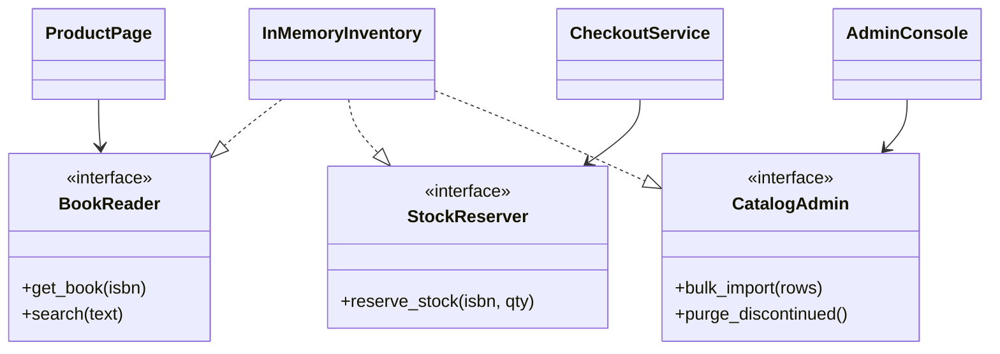
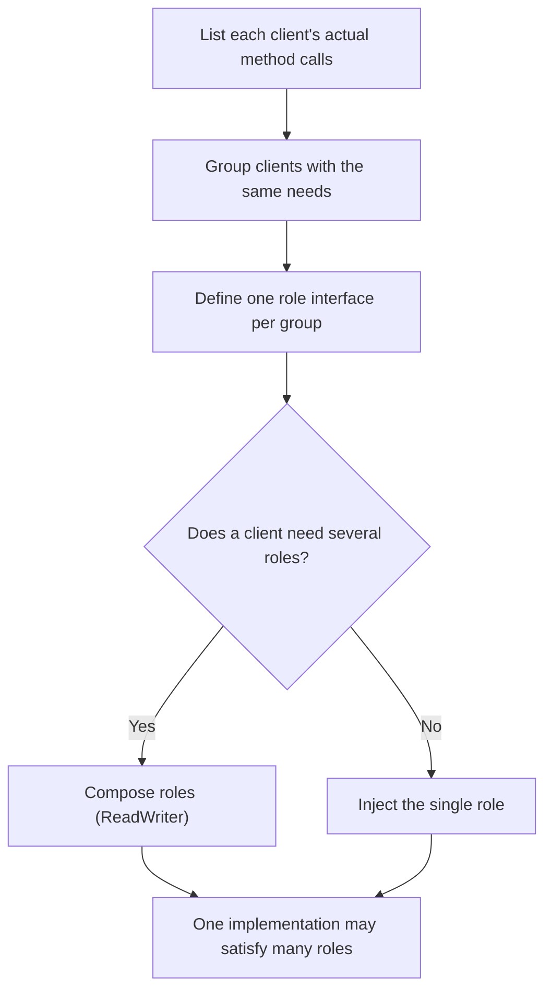

# Interface Segregation Principle

## Introduction

The **Interface Segregation Principle (ISP)** says:

> Clients should not be forced to depend on methods they do not use.

Picture a TV remote with 60 buttons when you only ever use power, volume and channel. That is annoying for a person. In code it is worse: every client that depends on a "60-button" interface is coupled to all 60 methods. When any of them changes, every client may need to be rebuilt, retested or updated, and every test fake must implement all 60.

ISP's fix is to give each client a small, focused interface that contains only what it needs. These are often called **role interfaces**, as opposed to **header interfaces** that simply mirror every public method of a class. Martin Fowler's short [RoleInterface](https://martinfowler.com/bliki/RoleInterface.html) article describes the distinction.

The usual origin story is that Robert C. Martin coined ISP while consulting for Xerox. A printer system had one large `Job` class used by every task (printing, stapling, faxing), so a change for one task forced rebuilds for all of them. Splitting it into task-specific interfaces fixed the problem. Treat the details of that story as folklore; the lesson is the useful part.

## The Problem: A Fat Interface

An online bookstore has an inventory backend. Over time the team gave it one interface that does everything:

```python
# inventory_before.py
from abc import ABC, abstractmethod
from dataclasses import dataclass


@dataclass
class Book:
    isbn: str
    title: str
    price: float
    stock: int


class InventoryBackend(ABC):
    @abstractmethod
    def get_book(self, isbn: str) -> Book | None: ...
    @abstractmethod
    def search(self, text: str) -> list[Book]: ...
    @abstractmethod
    def reserve_stock(self, isbn: str, qty: int) -> None: ...
    @abstractmethod
    def bulk_import(self, rows: list[dict]) -> int: ...
    @abstractmethod
    def sales_report(self, month: str) -> dict: ...
    @abstractmethod
    def purge_discontinued(self) -> int: ...


class ProductPage:
    """Only needs to read a book, but depends on all six methods."""

    def __init__(self, backend: InventoryBackend) -> None:
        self.backend = backend

    def render(self, isbn: str) -> str:
        book = self.backend.get_book(isbn)
        return f"{book.title}: ${book.price:.2f}" if book else "Not found"


# A test fake for ProductPage must implement everything:
class FakeBackend(InventoryBackend):
    def get_book(self, isbn: str) -> Book | None:
        return Book(isbn, "Dune", 9.99, 3)
    def search(self, text: str) -> list[Book]: raise NotImplementedError
    def reserve_stock(self, isbn: str, qty: int) -> None: raise NotImplementedError
    def bulk_import(self, rows: list[dict]) -> int: raise NotImplementedError
    def sales_report(self, month: str) -> dict: raise NotImplementedError
    def purge_discontinued(self) -> int: raise NotImplementedError


print(ProductPage(FakeBackend()).render("978-0441013593"))
```

Output:

```text
Dune: $9.99
```

The problems:

- **Test pain:** the fake has five methods that exist only to satisfy the ABC. Without them, Python raises `TypeError: Can't instantiate abstract class`.
- **False coupling:** `ProductPage` now "depends on" `purge_discontinued`. If that method's signature changes, the fake, and possibly the page's tests, must change too.
- **Unclear capability:** reading the constructor, you can't tell whether `ProductPage` only reads, or might also purge the catalog. A small interface documents intent and limits what a client *can* do.
- **Harder alternative implementations:** a read-only replica or a cache can serve `get_book` and `search` but cannot honestly implement `purge_discontinued`. With one fat interface it must fake it, which is an [LSP](./3-arch-liskov-substitution.mdx) violation waiting to happen.

## The Fix: Role Interfaces

Split the interface by **what each client needs**, not by what the implementation can do:

```python
# inventory_after.py
from dataclasses import dataclass
from typing import Protocol


@dataclass
class Book:
    isbn: str
    title: str
    price: float
    stock: int


class BookReader(Protocol):                 # storefront, product pages
    def get_book(self, isbn: str) -> Book | None: ...
    def search(self, text: str) -> list[Book]: ...


class StockReserver(Protocol):              # checkout
    def reserve_stock(self, isbn: str, qty: int) -> None: ...


class CatalogAdmin(Protocol):               # back-office tools
    def bulk_import(self, rows: list[dict]) -> int: ...
    def purge_discontinued(self) -> int: ...


class ProductPage:
    def __init__(self, books: BookReader) -> None:     # depends on the role only
        self.books = books

    def render(self, isbn: str) -> str:
        book = self.books.get_book(isbn)
        return f"{book.title}: ${book.price:.2f}" if book else "Not found"


class InMemoryInventory:
    """One concrete class can still implement every role."""

    def __init__(self) -> None:
        self._books: dict[str, Book] = {}

    def get_book(self, isbn: str) -> Book | None:
        return self._books.get(isbn)

    def search(self, text: str) -> list[Book]:
        return [b for b in self._books.values() if text.lower() in b.title.lower()]

    def reserve_stock(self, isbn: str, qty: int) -> None:
        book = self._books[isbn]
        if book.stock < qty:
            raise ValueError("Not enough stock")
        book.stock -= qty

    def bulk_import(self, rows: list[dict]) -> int:
        for r in rows:
            self._books[r["isbn"]] = Book(**r)
        return len(rows)

    def purge_discontinued(self) -> int:
        gone = [k for k, b in self._books.items() if b.stock == 0]
        for k in gone:
            del self._books[k]
        return len(gone)


# The test fake now needs exactly what the client uses:
class FakeReader:
    def get_book(self, isbn: str) -> Book | None:
        return Book(isbn, "Dune", 9.99, 3)

    def search(self, text: str) -> list[Book]:
        return []


if __name__ == "__main__":
    print(ProductPage(FakeReader()).render("978-0441013593"))

    inv = InMemoryInventory()
    inv.bulk_import([{"isbn": "1", "title": "Emma", "price": 7.5, "stock": 2}])
    inv.reserve_stock("1", 2)
    print(ProductPage(inv).render("1"), "| purged:", inv.purge_discontinued())
```

Output:

```text
Dune: $9.99
Emma: $7.50 | purged: 1
```

Note what did **not** change: there is still one implementation class. ISP is about the interfaces clients see, not about splitting implementations. With `typing.Protocol`, `InMemoryInventory` satisfies all three roles structurally, without inheriting from any of them.



## Composing Small Interfaces

When a client genuinely needs several roles, compose them instead of going back to one fat interface:

```python
# compose.py
import io
from typing import Protocol


class Reader(Protocol):
    def read(self, n: int = -1) -> bytes: ...


class Writer(Protocol):
    def write(self, data: bytes) -> int: ...


class ReadWriter(Reader, Writer, Protocol):   # combines both roles
    ...


def copy(src: Reader, dst: Writer) -> int:
    return dst.write(src.read())


src, dst = io.BytesIO(b"chapter one"), io.BytesIO()
print(copy(src, dst), dst.getvalue())
```

Output:

```text
11 b'chapter one'
```

`copy` asks for the least it needs: something readable and something writable. Any file, socket wrapper or `BytesIO` works.

## Where You Have Already Seen ISP

- **Go's `io` package** is the textbook case: `io.Reader` has one method (`Read`), `io.Writer` has one method (`Write`), and larger interfaces like `io.ReadWriter` and `io.ReadWriteCloser` are composed from them. Functions ask for the smallest one they need, which is why so many types plug into Go's standard library.
- **Python's `collections.abc`** defines tiny abstract base classes: `Sized` (`__len__`), `Iterable` (`__iter__`), `Container` (`__contains__`), `Hashable` (`__hash__`). Bigger ones such as `Sequence` and `Mapping` are built from them. Type hints like `Iterable[str]` are ISP in action: a function that takes `Iterable[str]` accepts a list, a tuple, a set, a generator or a file.
- **Java's collection interfaces** split `Iterable`, `Collection`, `List` and `RandomAccess`, although, as the [LSP page](./3-arch-liskov-substitution.mdx) shows, Java also kept "optional operations" on `List` rather than splitting mutable and read-only interfaces.
- **API design:** a mobile app that only needs three fields shouldn't have to fetch and parse a 200-field response. Backends for Frontends and GraphQL are partly ISP at the API level. See [API Gateway and Backend for Frontend](../10-arch-integration-and-apis/4-arch-api-gateway.mdx).

A practical tip from Python: prefer accepting the **most general type that works** in parameters, such as `Iterable[Book]` instead of `list[Book]`, and `Mapping[str, int]` instead of `dict[str, int]`. That is ISP applied to type hints.

```python
# hints.py
from collections.abc import Iterable, Mapping


def total_price(prices: Iterable[float]) -> float:       # list, tuple, generator all work
    return round(sum(prices), 2)


def lookup(stock: Mapping[str, int], isbn: str) -> int:  # read-only view of a mapping is enough
    return stock.get(isbn, 0)


print(total_price(p for p in [9.99, 12.5]))
print(lookup({"978-0441013593": 3}, "978-0441013593"))
```

Output:

```text
22.49
3
```

## How to Find the Right Roles

1. **Start from the clients, not the implementation.** For each caller, list the methods it actually calls. Those lists are your candidate interfaces.
2. **Group by client type, not one per client.** If the product page and the search page both need `get_book` and `search`, they share `BookReader`. One interface per caller is too fine.
3. **Name the role, not the implementation.** `BookReader` and `StockReserver` describe what the client needs; `IInventoryBackend` describes a class.
4. **Let the client's package own the interface.** This is where ISP meets [Dependency Inversion](./5-arch-dependency-inversion.mdx): the checkout module defines `StockReserver` and the inventory module implements it.



## Real-World Scenario

Your team runs a SaaS helpdesk with a `TicketRepository` interface of 22 methods, used by the web app, the email ingestion worker, the SLA monitor and the analytics exporter. The analytics team wants to run their exports against a read replica, and the SLA monitor team keeps breaking the email worker's tests whenever they add a method.

**The solution:**

1. Grep each client for the repository methods it calls. The email worker uses 3, the SLA monitor 4, analytics 2, and the web app 14.
2. Define role protocols in each client's package: `TicketIngest` (email worker), `SlaQueries` (SLA monitor), `TicketExportSource` (analytics). The web app keeps a larger `TicketStore`.
3. The existing `PostgresTicketRepository` satisfies all of them unchanged.
4. Add a `ReplicaTicketReader` that implements only `TicketExportSource` and wire it into the analytics exporter.

**Why this approach:** each client's tests now fake two to four methods instead of 22, adding a method for the SLA monitor no longer touches the email worker, and the read replica can be used without pretending to support writes.

**When to use ISP / when not to:**

- **Use it** when an interface has several kinds of clients, when test fakes are full of `NotImplementedError`, when you want a read-only or limited implementation, or when an interface crosses a team or package boundary.
- **Don't bother** when an interface has one client, or when it is already small and cohesive. Splitting a three-method interface into three one-method interfaces usually just adds names to learn.

**Alternatives and trade-offs:**

| Approach | Pros | Cons | Best for |
| --- | --- | --- | --- |
| One fat interface | One name to learn, easy to find | Coupling, heavy fakes, forces fake implementations | Small apps with one client |
| Role interfaces (ISP) | Minimal coupling, light fakes, clear intent | More types to name and maintain | Shared components with several client types |
| Pass the concrete class | No abstraction overhead | No substitution, harder tests | Internal code with one implementation |
| Pass functions (`Callable`) | Smallest possible interface | Loses grouping and names | One-method dependencies |
| `MagicMock` everything in tests | No fakes to write | Hides the fat-interface smell, tests are brittle | Rarely; quick spikes |

## Common Mistakes

1. **One interface per method.** That trades a fat interface for a confetti of tiny ones. Group methods that the same kind of client uses together.
2. **Splitting the implementation instead of the interface.** ISP doesn't require five repository classes. One class can implement several roles.
3. **Header interfaces.** Generating `IFoo` that mirrors every public method of `Foo` gives you an abstraction with all of `Foo`'s coupling.
4. **Interfaces owned by the implementer.** If the inventory team defines what checkout may use, the interface tends to grow toward the implementation. Let clients own their roles.
5. **Ignoring ISP at the API level.** A REST endpoint that returns everything to every client creates the same coupling across a network.

## Summary

- ISP: clients shouldn't depend on methods they don't use.
- Fat interfaces cause false coupling, heavy test fakes and dishonest partial implementations.
- Use small **role interfaces**, defined from each client's point of view, and compose them when needed.
- In Python, `typing.Protocol` lets one class satisfy many roles without inheritance, and `collections.abc` types like `Iterable` and `Mapping` let you ask for the least you need.
- Don't over-split. Group by kind of client.

## Exercises

1. Write a `CheckoutService` that depends only on `StockReserver`, and a test with a fake that records reservations.
2. Change `ProductPage.render` to accept `Mapping[str, Book]` instead of `BookReader`. What does that make easier and harder?
3. Take an interface or base class in your codebase with more than eight methods. List its clients and the methods each one calls. Propose role interfaces.
4. Implement a `CachedBookReader` that wraps any `BookReader` and caches `get_book`. Why is it easy to write now and awkward with the fat interface?

**Related pages:**

- Previous: [Liskov Substitution Principle](./3-arch-liskov-substitution.mdx)
- Next: [Dependency Inversion Principle](./5-arch-dependency-inversion.mdx)
- [Adapter Pattern](../3-arch-structural-patterns/0-arch-adapter.mdx), useful when a third-party class has the wrong interface for your role
- [Abstraction, Encapsulation and Modularity](../0-arch-fundamentals/6-arch-abstraction-and-modularity.mdx)
