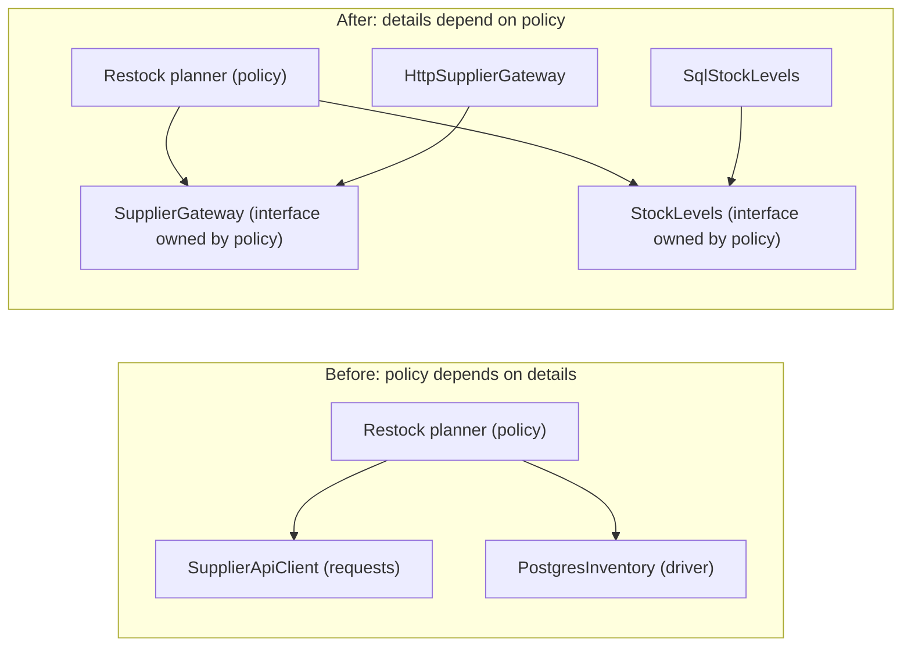
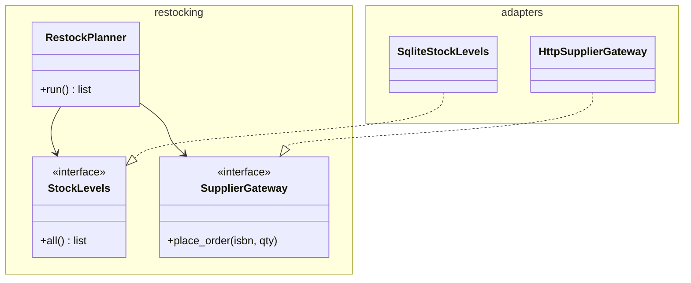

# Dependency Inversion Principle

## Introduction

In most beginner code, the important parts depend on the unimportant parts. The function that decides **when to reorder stock** (a business rule worth money) imports the HTTP library, the database driver and the email client directly. Change the database and you edit the business rule. Test the business rule and you need a database.

The **Dependency Inversion Principle (DIP)** flips that around. Robert C. Martin's two-part definition:

> 1. High-level modules should not depend on low-level modules. Both should depend on abstractions.
> 2. Abstractions should not depend on details. Details should depend on abstractions.

"High-level" means policy: the business rules and use cases that are the reason the software exists. "Low-level" means mechanism: databases, HTTP clients, file formats, frameworks. DIP says the arrows of **source-code dependency** should point from mechanism toward policy, even though at runtime the policy still calls the mechanism.

An analogy: a wall socket. The building's wiring (the high-level design) defines the socket standard. Appliance makers (the details) build plugs to fit it. The building doesn't get rewired for each new toaster. The standard belongs to the building, not to the toaster.

## What Exactly Gets "Inverted"?

The word confuses many people, so let's be precise. Two things change:

1. **Direction of the import.** Before, `restocking` imports `postgres_client`. After, `postgres_adapter` imports `restocking` (to implement its interface), and `restocking` imports nothing infrastructural.
2. **Ownership of the interface.** The abstraction lives **with the high-level module** and is shaped by its needs. It's not a generic wrapper published by the database layer.



At runtime the planner still calls the HTTP client. Only the **compile-time / import-time** dependency is reversed. That distinction is the whole trick.

:::note
**DIP, DI and IoC are different things.** DIP is a principle about the direction of dependencies. **Dependency Injection** is a technique for handing an object its dependencies from outside (usually through the constructor). **Inversion of Control** is the broader idea of a framework calling your code rather than you calling it. DI is the most common way to *implement* DIP. See [Dependency Injection](./10-arch-dependency-injection.mdx).
:::

## The Problem: Business Rules Welded to Infrastructure

An online bookstore reorders books automatically. Here is the first version:

```python
# restock_before.py
import json
import sqlite3
import urllib.request


class RestockPlanner:
    REORDER_POINT = 5
    TARGET_STOCK = 20

    def run(self) -> list[str]:
        conn = sqlite3.connect("/var/data/shop.db")                     # detail
        rows = conn.execute("SELECT isbn, stock FROM books").fetchall()  # detail

        ordered = []
        for isbn, stock in rows:
            if stock < self.REORDER_POINT:                               # the actual business rule
                qty = self.TARGET_STOCK - stock
                body = json.dumps({"isbn": isbn, "qty": qty}).encode()
                req = urllib.request.Request(                            # detail
                    "https://supplier.example.com/orders", data=body,
                    headers={"Content-Type": "application/json"}, method="POST")
                urllib.request.urlopen(req, timeout=5)
                ordered.append(isbn)
        return ordered
```

The reorder rule is three lines. Everything else is plumbing. Consequences:

- Testing "do we reorder when stock is 4?" needs a SQLite file at a fixed path and a live supplier API (or heavy monkeypatching).
- Moving to PostgreSQL or switching suppliers means editing the class that holds the business rule.
- The rule can't be reused, for example to show "will be reordered" in an admin screen, without also triggering HTTP calls.

## The Fix: Let the Policy Own the Abstractions

Step 1: the policy module declares what it needs, in its own terms.

```python
# bookstore/restocking/planner.py  (high-level policy: no I/O imports)
from dataclasses import dataclass
from typing import Protocol


@dataclass(frozen=True)
class StockLevel:
    isbn: str
    on_hand: int


class StockLevels(Protocol):                 # owned by the policy
    def all(self) -> list[StockLevel]: ...


class SupplierGateway(Protocol):             # owned by the policy
    def place_order(self, isbn: str, qty: int) -> None: ...


@dataclass(frozen=True)
class RestockRule:
    reorder_point: int = 5
    target: int = 20

    def quantity_for(self, level: StockLevel) -> int:
        return self.target - level.on_hand if level.on_hand < self.reorder_point else 0


class RestockPlanner:
    def __init__(self, stock: StockLevels, supplier: SupplierGateway,
                 rule: RestockRule = RestockRule()) -> None:
        self.stock = stock
        self.supplier = supplier
        self.rule = rule

    def run(self) -> list[str]:
        ordered = []
        for level in self.stock.all():
            qty = self.rule.quantity_for(level)
            if qty > 0:
                self.supplier.place_order(level.isbn, qty)
                ordered.append(level.isbn)
        return ordered
```

Step 2: the details implement those abstractions in a separate module that imports the policy, never the other way round.

```python
# bookstore/adapters/sql_and_http.py  (low-level details: depend on the policy's interfaces)
import json
import sqlite3
import urllib.request

from bookstore.restocking.planner import StockLevel


class SqliteStockLevels:
    def __init__(self, conn: sqlite3.Connection) -> None:
        self.conn = conn

    def all(self) -> list[StockLevel]:
        return [StockLevel(i, s) for i, s in self.conn.execute("SELECT isbn, stock FROM books")]


class HttpSupplierGateway:
    def __init__(self, base_url: str) -> None:
        self.base_url = base_url

    def place_order(self, isbn: str, qty: int) -> None:
        body = json.dumps({"isbn": isbn, "qty": qty}).encode()
        req = urllib.request.Request(f"{self.base_url}/orders", data=body,
                                     headers={"Content-Type": "application/json"}, method="POST")
        urllib.request.urlopen(req, timeout=5)
```

Step 3: one place at the edge of the program, the **composition root**, wires them together:

```python
# bookstore/main.py
import sqlite3

from bookstore.adapters.sql_and_http import HttpSupplierGateway, SqliteStockLevels
from bookstore.restocking.planner import RestockPlanner


def build_planner() -> RestockPlanner:
    conn = sqlite3.connect("shop.db")
    return RestockPlanner(SqliteStockLevels(conn), HttpSupplierGateway("https://supplier.example.com"))
```

Now the business rule can be tested with no I/O at all:

```python
# tests/test_restock.py
from bookstore.restocking.planner import RestockPlanner, StockLevel


class FakeStock:
    def all(self) -> list[StockLevel]:
        return [StockLevel("A", 4), StockLevel("B", 5), StockLevel("C", 0)]


class RecordingSupplier:
    def __init__(self) -> None:
        self.orders: list[tuple[str, int]] = []

    def place_order(self, isbn: str, qty: int) -> None:
        self.orders.append((isbn, qty))


def test_reorders_only_below_reorder_point() -> None:
    supplier = RecordingSupplier()
    assert RestockPlanner(FakeStock(), supplier).run() == ["A", "C"]
    assert supplier.orders == [("A", 16), ("C", 20)]
```

Example output:

```text
$ pytest -q tests/test_restock.py
.                                                                        [100%]
1 passed in 0.01s
```



## Enforcing the Direction

Good intentions erode. Six months later someone adds `import requests` to the planner "just for one call". You can make the rule executable with [import-linter](https://import-linter.readthedocs.io/), which checks import graphs in CI:

```ini
# .importlinter
[importlinter]
root_package = bookstore
include_external_packages = True

[importlinter:contract:domain-is-pure]
name = Restocking policy must not import adapters
type = forbidden
source_modules = bookstore.restocking
forbidden_modules =
    bookstore.adapters
    requests
    sqlalchemy
```

If someone breaks the rule, `lint-imports` fails the build:

```text
Restocking policy must not import adapters BROKEN

Contracts: 0 kept, 1 broken.
...
bookstore.restocking is not allowed to import bookstore.adapters:

-   bookstore.restocking.planner -> bookstore.adapters (l.1)
```

This is an example of an architecture **fitness function**, covered in [Fitness Functions and Evolutionary Architecture](../13-arch-documenting-and-evolving/3-arch-fitness-functions.mdx). Java teams use ArchUnit for the same purpose.

## Where You Have Already Seen DIP

- **Hexagonal, Onion and Clean Architecture** are DIP applied to a whole application: the domain core defines **ports** (interfaces) and the outer layers provide **adapters**. See [Hexagonal Architecture](../7-arch-clean-architecture/0-arch-hexagonal.mdx) and [Clean Architecture](../7-arch-clean-architecture/2-arch-clean-architecture.mdx).
- **The Repository pattern** puts a collection-like interface, owned by the domain, in front of persistence. See [Repository Pattern](../5-arch-modern-patterns/1-arch-repository-pattern.mdx).
- **Plug-in systems** such as pytest plugins or editor extensions: the host defines the hook interface and plug-ins depend on it.
- **JDBC and Python's DB-API (PEP 249)** are related but not quite the same thing. Your code depends on a standard abstraction instead of a specific driver, which gives you the substitution benefit. But the abstraction is owned by the platform, not by your business code. Strict DIP would add your own `StockLevels`-style interface on top.

## Which Dependencies Should You Invert?

Not every import needs an interface. Depending on concrete things is fine when they are **stable**:

| Dependency | Invert it? | Why |
| --- | --- | --- |
| `datetime`, `decimal`, `dataclasses`, `str` | No | Standard library, stable, no I/O |
| A pure in-house library (money, validation) | Usually no | Stable and side-effect free |
| Database, ORM session | Yes, at the use-case boundary | Volatile, slow in tests, likely to change |
| HTTP clients, third-party SDKs (payments, email, cloud storage) | Yes | Volatile, costly to call in tests, vendor may change |
| Clock and randomness | Often | Inject `now()` so time-based rules can be tested |
| Framework objects (`request`, `HttpResponse`) | Keep them out of the domain | Frameworks change; business rules shouldn't care |

The guiding question: **"If this detail changed, would I want my business rules to change too?"** If the answer is no, the business rules shouldn't import it.

## Real-World Scenario

Your team runs a food delivery startup. Dispatch logic (which courier gets which order) currently lives inside a Django view that queries the ORM, calls Google Maps for travel times and pushes Firebase notifications. The company is about to expand to a region where a different maps provider is required, and the dispatch rules need serious testing because mistakes cost real money.

**The solution:**

1. Create a `dispatch` package with no Django, maps or Firebase imports. Define `CourierLocator`, `TravelTimeEstimator` and `CourierNotifier` protocols there.
2. Move the assignment algorithm into `dispatch.assign_courier(order, locator, estimator)`, which is pure apart from those calls.
3. Implement `GoogleTravelTimes` and a second `RegionalTravelTimes` in an `adapters` package. Choose between them in the composition root based on region config.
4. Add an import-linter contract so `dispatch` can never import `django` or a vendor SDK.
5. Test the dispatch rules with a fake estimator that returns fixed travel times, including edge cases like zero available couriers.

**Why this approach:** the most valuable and most often changed code (dispatch rules) is now independent of the most volatile code (vendors and framework). Adding a maps provider is a new adapter, not a change to dispatch.

**When to use DIP / when not to:**

- **Use it** at boundaries with I/O, vendors and frameworks, especially around code with valuable business rules that needs fast tests.
- **Skip it** for simple CRUD where there's no real logic between the HTTP request and the database, for scripts and prototypes, and for stable dependencies like the standard library.

**Alternatives and trade-offs:**

| Approach | Pros | Cons | Best for |
| --- | --- | --- | --- |
| Direct imports of details | Least code, easy to follow | Business rules coupled to vendors; slow tests | Scripts, CRUD |
| Monkeypatching in tests (`unittest.mock.patch`) | No design change needed | Tests coupled to import paths; brittle | Legacy code before refactoring |
| DIP with protocols and constructor injection | Fast tests, swappable details, clear boundaries | More types and wiring | Business-critical logic |
| Full ports-and-adapters architecture | Consistent structure across the app | Ceremony for simple features | Larger domains with many integrations |
| Functional core, imperative shell | Pure core needs no interfaces at all | Requires restructuring logic into data-in, data-out | Rules that can be pure calculations |

## Common Mistakes

1. **Interfaces owned by the low-level module.** If the database package exports `IDatabase` and the business code imports it, the dependency still points at the database package. Put the interface next to its consumer.
2. **Leaky abstractions.** A `StockLevels` protocol whose method takes a SQL `WHERE` clause isn't an abstraction. Shape interfaces in domain terms.
3. **Abstracting everything.** Wrapping `datetime` or `json` behind interfaces "just in case" adds noise. Invert the volatile, not the stable.
4. **Creating dependencies inside the class.** `self.repo = SqlRepo()` in a constructor defeats DIP even if `SqlRepo` implements an interface. Accept the dependency as a parameter.
5. **Service locators everywhere.** Pulling dependencies from a global registry hides them. Prefer explicit constructor parameters. See [Dependency Injection](./10-arch-dependency-injection.mdx).

## Summary

- DIP: high-level policy and low-level details both depend on abstractions, and the abstractions belong to the policy.
- Only the **source-code** dependency is inverted. At runtime the policy still calls the details.
- Implement it with `Protocol` interfaces next to the business code, adapters in an outer package, and a composition root that wires them.
- Enforce the direction with tools such as import-linter (Python) or ArchUnit (Java).
- Invert volatile dependencies (I/O, vendors, frameworks, clock), not stable ones.
- DIP is the principle; Dependency Injection is the usual technique; Hexagonal and Clean Architecture apply it at system scale.

## Exercises

1. Add a `Clock` protocol to `RestockPlanner` so reorders are skipped on weekends, and test it without waiting for a weekend.
2. Write an `InMemoryStockLevels` adapter and a `LoggingSupplierGateway` that only prints orders. Wire them into a "dry run" mode in the composition root.
3. Set up import-linter on a small project of yours with one `forbidden` contract. Break it on purpose and read the report.
4. Find a function in your code that imports a vendor SDK and contains a business decision. Sketch the protocol the business decision would need.

**Related pages:**

- Previous: [Interface Segregation Principle](./4-arch-interface-segregation.mdx)
- Next: [DRY, KISS and YAGNI](./6-arch-dry-kiss-yagni.mdx)
- [Dependency Injection](./10-arch-dependency-injection.mdx), the technique that delivers DIP
- [Hexagonal Architecture (Ports and Adapters)](../7-arch-clean-architecture/0-arch-hexagonal.mdx)
