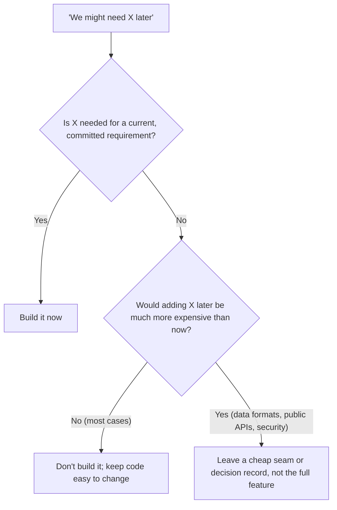

# DRY, KISS and YAGNI

## Introduction

The [SOLID principles](./0-arch-solid-overview.mdx) tell you how to arrange code so it can change. Three shorter principles tell you **how much** design to do in the first place:

- **DRY: Don't Repeat Yourself.** Each piece of knowledge should live in one place.
- **KISS: Keep It Simple, Stupid.** Prefer the simplest design that works.
- **YAGNI: You Aren't Gonna Need It.** Don't build features or flexibility until you actually need them.

They sound like slogans, and they are often used as slogans in code reviews ("this isn't DRY!"). Used that way, they cause as much damage as they prevent. Applied with care, they are your main defense against the most common design failure of all: **over-engineering**.

An analogy: packing for a trip. DRY is keeping one master packing list instead of three slightly different ones. KISS is bringing a simple bag rather than a modular luggage system with twelve attachments. YAGNI is not packing snow boots for a beach holiday "in case it snows".

## DRY: One Source of Truth for Each Piece of Knowledge

DRY comes from Andy Hunt and Dave Thomas's *The Pragmatic Programmer* (1999). Their definition is often misquoted, so here it is:

> Every piece of knowledge must have a single, unambiguous, authoritative representation within a system.

The key word is **knowledge**, not *code*. DRY is about business rules, data definitions, configuration and decisions, not about lines of text that happen to look the same.

### Real duplication: the same rule in several places

An online bookstore gives free shipping on orders of 35 or more. That rule appears in three places:

```python
# dry_before.py
def shipping_cost(subtotal: float) -> float:
    return 0.0 if subtotal >= 35 else 4.99


def cart_banner(subtotal: float) -> str:
    if subtotal >= 35:
        return "You get free shipping!"
    return f"Add ${35 - subtotal:.2f} more for free shipping"


def email_footer() -> str:
    return "Free shipping on orders over $35."   # "over" or "at least"? Already drifting.


print(shipping_cost(30), cart_banner(30), email_footer(), sep="\n")
```

Output:

```text
4.99
Add $5.00 more for free shipping
Free shipping on orders over $35.
```

When marketing changes the threshold to 40, someone updates two of the three places, and the cart promises free shipping that checkout doesn't give. The **knowledge** "free shipping starts at X" is duplicated. Fix it by giving it one home:

```python
# dry_after.py
from dataclasses import dataclass


@dataclass(frozen=True)
class FreeShippingPolicy:
    threshold: float = 35.0
    standard_rate: float = 4.99

    def qualifies(self, subtotal: float) -> bool:
        return subtotal >= self.threshold

    def cost(self, subtotal: float) -> float:
        return 0.0 if self.qualifies(subtotal) else self.standard_rate

    def remaining(self, subtotal: float) -> float:
        return max(self.threshold - subtotal, 0.0)


POLICY = FreeShippingPolicy(threshold=40.0)


def cart_banner(subtotal: float) -> str:
    if POLICY.qualifies(subtotal):
        return "You get free shipping!"
    return f"Add ${POLICY.remaining(subtotal):.2f} more for free shipping"


def email_footer() -> str:
    return f"Free shipping on orders of ${POLICY.threshold:.0f} or more."


print(POLICY.cost(30), cart_banner(30), email_footer(), sep="\n")
```

Output:

```text
4.99
Add $10.00 more for free shipping
Free shipping on orders of $40 or more.
```

DRY applies beyond code, too:

- **Schemas:** generate API clients and documentation from one OpenAPI or protobuf definition instead of hand-writing them.
- **Database structure:** keep the schema in migrations, not also in a wiki page that drifts.
- **Configuration:** one setting, read in one place, not the same URL hard-coded in five services.
- **Build and deploy steps:** one CI pipeline definition, not copy-pasted shell scripts.

### Accidental duplication: code that only *looks* the same

Now the other side. These two functions look identical:

```python
# accidental.py
def max_cart_items(items: list[str]) -> bool:
    return len(items) <= 50          # warehouse picking limit


def max_wishlist_items(items: list[str]) -> bool:
    return len(items) <= 50          # UI pagination choice
```

A DRY-minded reviewer might merge them into `within_limit(items)`. But they encode **different knowledge** owned by different people. The warehouse limit will change when the warehouse buys new equipment. The wishlist limit will change when the UI is redesigned. Merging them couples two unrelated decisions, exactly the problem the [Single Responsibility Principle](./1-arch-single-responsibility.mdx) warns about.

**Test for DRY:** "If one of these changes, must the other change too, for the same reason?" If yes, it is real duplication. If no, it is coincidence. Leave it alone.

### The wrong abstraction

Sandi Metz's 2016 essay [The Wrong Abstraction](https://sandimetz.com/blog/2016/1/20/the-wrong-abstraction) describes what happens when coincidental duplication gets merged: the shared function grows parameters and conditionals for each caller until nobody can change it safely. Her summary: **"duplication is far cheaper than the wrong abstraction."**

```python
# wrong_abstraction.py
def render_book(book: dict, *, for_email: bool = False, show_stock: bool = False,
                admin: bool = False, compact: bool = False, currency: str = "USD") -> str:
    parts = [book["title"]]
    if not compact:
        parts.append(f"by {book['author']}")
    if show_stock and not for_email:
        parts.append(f"({book['stock']} left)")
    if admin:
        parts.append(f"[cost {book['cost']}]")
    if for_email and not compact:
        parts.append("Buy now!")
    parts.append(f"{book['price']} {currency}")
    return " ".join(parts)
```

Five booleans means 32 combinations, most of them untested. Her recommended fix is counter-intuitive: **inline the abstraction back into each caller**, delete the parts each caller doesn't use, and only then look for the abstraction the current code actually wants. Often you end up with three short, obvious functions.

### The rule of three

A popular heuristic, credited to Don Roberts in Martin Fowler's *Refactoring*: the first time, just write it. The second time, wince but duplicate. The third time, refactor. By the third occurrence you have enough examples to see what really varies.

## KISS: The Simplest Thing That Could Possibly Work

KISS is usually traced to Lockheed's Skunk Works and its lead engineer Kelly Johnson, though the exact origin is debated. In software it means: **prefer designs that are easy to read, run and debug, even if they are less clever or less general.**

Here is a configuration loader written by someone who expected every possible future:

```python
# kiss_before.py
import json
import os
from abc import ABC, abstractmethod


class ConfigSource(ABC):
    @abstractmethod
    def load(self) -> dict: ...


class EnvSource(ConfigSource):
    def load(self) -> dict:
        return {k[5:].lower(): v for k, v in os.environ.items() if k.startswith("SHOP_")}


class JsonSource(ConfigSource):
    def __init__(self, path: str) -> None:
        self.path = path

    def load(self) -> dict:
        try:
            with open(self.path) as f:
                return json.load(f)
        except FileNotFoundError:
            return {}


class ConfigSourceFactory:
    @staticmethod
    def create(kind: str, **kwargs: str) -> ConfigSource:
        return {"env": EnvSource, "json": JsonSource}[kind](**kwargs)


class ConfigManager:
    def __init__(self, sources: list[ConfigSource]) -> None:
        self.sources = sources

    def get(self, key: str, default: str | None = None) -> str | None:
        merged: dict = {}
        for s in self.sources:
            merged.update(s.load())
        return merged.get(key, default)


cfg = ConfigManager([ConfigSourceFactory.create("json", path="cfg.json"), ConfigSourceFactory.create("env")])
print(cfg.get("db_url", "sqlite:///shop.db"))
```

Output (no `cfg.json`, no `SHOP_` variables set):

```text
sqlite:///shop.db
```

Five classes, a factory and a merge loop that re-reads every source on every `get`. The app has exactly one config file and two environment variables. Here is the KISS version:

```python
# kiss_after.py
import os
from dataclasses import dataclass


@dataclass(frozen=True)
class Settings:
    db_url: str = os.environ.get("SHOP_DB_URL", "sqlite:///shop.db")
    debug: bool = os.environ.get("SHOP_DEBUG", "0") == "1"


settings = Settings()
print(settings.db_url, settings.debug)
```

Output (with no environment variables set):

```text
sqlite:///shop.db False
```

Typed, readable, obvious, and trivial to change into the bigger version if real requirements appear. When they do, reach for a maintained library such as `pydantic-settings` instead of inventing a framework.

KISS checks you can use in review:

- Could a new team member explain this code after reading it once?
- Is there a standard library feature or well-known package that already does this?
- Does every layer of indirection pay for itself in a change you can name?
- Does the clever solution make a bug harder to find than the simple one?

:::caution
Simple is not the same as easy or short. A 300-line `if` chain is short to write but not simple to understand. Sometimes the simple design **is** a well-named class or a pattern. KISS argues against needless complexity, not against structure.
:::

## YAGNI: You Aren't Gonna Need It

YAGNI comes from Extreme Programming (XP). Martin Fowler's [Yagni](https://martinfowler.com/bliki/Yagni.html) article is the best short explanation. He lists four costs of building a "presumptive feature" before it's needed:

| Cost | What it means | Bookstore example |
| --- | --- | --- |
| **Cost of build** | Effort spent on something that may never be used | Two weeks on multi-currency support |
| **Cost of delay** | The valuable feature you didn't ship meanwhile | Gift cards, which customers asked for, ship two weeks later |
| **Cost of carry** | Extra complexity slowing every future change | Every price calculation now handles currency conversion |
| **Cost of repair** | When the feature is finally needed, it's built wrong | The real expansion is to a market that also needs VAT-inclusive pricing, which the design didn't anticipate |

Even if you *do* eventually need the feature, the costs of delay and carry are real. And the version you build later, with real requirements, is usually better.



### What YAGNI does **not** mean

- **It doesn't mean skipping good practice.** Fowler is explicit: YAGNI applies to features and speculative flexibility, not to refactoring, tests or clean code. Those make the code easier to change, which is what lets you safely wait.
- **It doesn't mean ignoring hard-to-reverse decisions.** Some choices are expensive to change later: public API shapes, data formats stored for years, security and privacy foundations, tenant isolation in a SaaS product. Thinking ahead about these is responsible, not speculative. Record those decisions with an [Architecture Decision Record](../13-arch-documenting-and-evolving/0-arch-decision-records.mdx).

## When the Principles Collide

These principles pull in different directions, which is why they need judgment:

| Tension | Example | How to resolve |
| --- | --- | --- |
| DRY vs KISS | Removing duplication requires a generic, parameterized helper | Prefer a little duplication if the abstraction is harder to read than the copies |
| DRY vs SRP | Two actors' look-alike code | Keep it separate; it is accidental duplication |
| YAGNI vs OCP | OCP wants extension points; YAGNI says not yet | Add the extension point when the second or third variant actually arrives |
| KISS vs performance | The simple loop is too slow | Measure first; optimize the hotspot with a comment explaining why |

## Quick Reference

| Principle | Question to ask | Warning sign it's being misused |
| --- | --- | --- |
| DRY | "If this changes, must that change too, for the same reason?" | Shared helpers with boolean flags and `if caller == ...` branches |
| KISS | "Could a newcomer understand and safely change this in an hour?" | Factories, registries and base classes with one implementation |
| YAGNI | "Which current requirement needs this?" | "We'll need it eventually", with no customer or date attached |

## Real-World Scenario

Your team is building the first version of a SaaS helpdesk. In the design meeting, people propose: a plugin system for ticket channels, support for five databases, a rules engine for automations, and multi-region deployment. You have three developers and need paying customers in four months.

**The solution:**

1. **YAGNI pass:** for each proposal, ask "which customer or committed requirement needs this in the next release?" Email and web form channels are needed. The plugin system, multiple databases and multi-region are not.
2. **Hard-to-reverse check:** tenant isolation in the data model is hard to add later, so design for it now with a `tenant_id` on every table and enforce it in one place. Write an ADR.
3. **KISS:** implement channels as two plain classes behind a small `Channel` protocol. No plugin discovery yet.
4. **DRY:** the ticket status list (`open`, `pending`, `solved`) lives in one `Enum` used by the API, the database and the UI build, generated into the frontend from the OpenAPI schema.
5. Revisit in six months with real usage data.

**Why this approach:** it puts the team's limited time into what customers pay for, while protecting the one decision that would be painful to retrofit.

**When to lean on these principles / when to be careful:**

- **Lean on them** in early products, internal tools and anywhere requirements are uncertain.
- **Be careful** with long-lived public APIs, data formats, security, compliance and anything where "add it later" means a migration across millions of records or many customers.

**Alternatives and trade-offs:**

| Approach | Pros | Cons | Best for |
| --- | --- | --- | --- |
| Build for today (YAGNI + KISS) | Fast delivery, less code to carry | Some rework later | Most product work |
| Design ahead for likely needs | Fewer migrations if guesses are right | Wrong guesses cost twice | Hard-to-reverse decisions only |
| Aggressive DRY | One place to change each rule | Risk of wrong abstractions | Business rules and shared data definitions |
| Tolerate duplication (rule of three) | Abstractions based on evidence | Temporary inconsistency risk | Code whose shape is still emerging |

## Common Mistakes

1. **DRY-ing coincidental code.** Merging look-alike code from different actors creates coupling and boolean-flag functions.
2. **Using YAGNI to skip tests and refactoring.** That makes future change expensive, which is the opposite of YAGNI's assumption.
3. **Confusing "simple" with "familiar".** A list comprehension can be simpler than a loop to a Python developer, even if it is unfamiliar to a beginner.
4. **Building frameworks inside applications.** An internal "generic engine" for one use case is usually KISS and YAGNI violated at once.
5. **Ignoring knowledge duplication outside code.** Constants copied into SQL, frontend code and documentation are the duplication that hurts most.

## Summary

- **DRY** is about knowledge, not text: one authoritative home for each rule, schema or setting.
- Look-alike code that changes for different reasons is **accidental duplication**. Leave it.
- "Duplication is far cheaper than the wrong abstraction." When an abstraction grows flags, inline it and start again.
- **KISS**: choose the most understandable design that meets today's needs; use standard tools before custom frameworks.
- **YAGNI**: presumptive features have costs of build, delay, carry and repair. Keep code easy to change instead.
- Hard-to-reverse decisions (data formats, public APIs, security, tenancy) deserve forethought.

## Exercises

1. Search a codebase you know for a magic number that appears in more than one file. Is it the same knowledge? If so, give it one home.
2. Refactor `render_book` above by inlining it into three hypothetical callers (storefront, email, admin) and simplifying each. Compare readability.
3. Pick a feature in your backlog that is "for the future". Estimate its four YAGNI costs.
4. Rewrite a small class hierarchy in your code as plain functions or a dataclass. Was the class hierarchy pulling its weight?

**Related pages:**

- Previous: [Dependency Inversion Principle](./5-arch-dependency-inversion.mdx)
- Next: [Composition over Inheritance](./7-arch-composition-over-inheritance.mdx)
- [Common Anti-Patterns](../5-arch-modern-patterns/7-arch-anti-patterns.mdx), including speculative generality
- [Technical Debt](../0-arch-fundamentals/8-arch-technical-debt.mdx)
