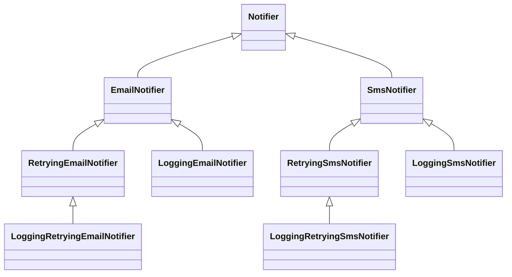
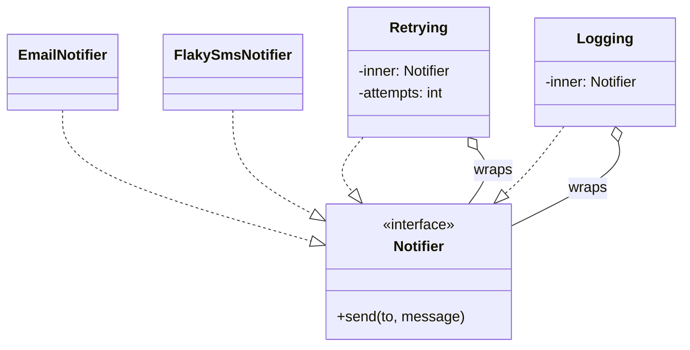

# Composition over Inheritance

## Introduction

Inheritance is usually the first reuse tool developers learn: put shared code in a base class, and subclasses get it for free. It works well for small, stable hierarchies. But as systems grow, deep inheritance trees become some of the hardest code to change. A tweak to a base class ripples into dozens of subclasses, and every new combination of features needs a new subclass.

The 1994 *Design Patterns* book by the "Gang of Four" (Gamma, Helm, Johnson and Vlissides) summed up the alternative in one line: **"Favor object composition over class inheritance."** Joshua Bloch's *Effective Java* repeats it as one of its best-known items.

- **Inheritance** ("is-a"): `class ExpressShipping(Shipping)`. The subclass *is* a kind of the parent and gets its code at class-definition time.
- **Composition** ("has-a"): `Order` *has* a `ShippingPolicy` and *delegates* to it at runtime.

An analogy: inheritance is like buying a phone with a built-in camera. If you want a better camera, you replace the whole phone. Composition is like a camera body with interchangeable lenses. You swap parts independently, and you can combine them in ways the manufacturer never planned.

Note the word **favor**. The advice is not "never inherit". It's "reach for composition first, and inherit when the relationship is genuinely is-a and stable".

## Problem 1: The Class Explosion

An online bookstore sends notifications. Some need retries, some need logging, some need both. With inheritance, each combination becomes a class:



Two channels and two features already need eight classes. Add a third channel (push) and a third feature (rate limiting) and the number of combinations explodes. Worse, the retry logic is copied into `RetryingEmailNotifier` and `RetryingSmsNotifier`, because they inherit from different parents.

### The fix: compose small pieces

Make each concern a separate object that wraps another object with the same interface:

```python
# notify_compose.py
import random
from typing import Protocol


class Notifier(Protocol):
    def send(self, to: str, message: str) -> None: ...


class EmailNotifier:
    def send(self, to: str, message: str) -> None:
        print(f"email -> {to}: {message}")


class FlakySmsNotifier:
    """Fails randomly, to show retries working."""

    def __init__(self, seed: int = 3) -> None:
        self.rng = random.Random(seed)

    def send(self, to: str, message: str) -> None:
        if self.rng.random() < 0.5:
            raise ConnectionError("SMS provider timeout")
        print(f"sms -> {to}: {message}")


class Retrying:
    def __init__(self, inner: Notifier, attempts: int = 3) -> None:
        self.inner, self.attempts = inner, attempts

    def send(self, to: str, message: str) -> None:
        for n in range(1, self.attempts + 1):
            try:
                return self.inner.send(to, message)
            except ConnectionError as e:
                print(f"  attempt {n} failed: {e}")
        raise ConnectionError(f"gave up after {self.attempts} attempts")


class Logging:
    def __init__(self, inner: Notifier) -> None:
        self.inner = inner

    def send(self, to: str, message: str) -> None:
        print(f"[log] sending to {to}")
        self.inner.send(to, message)


if __name__ == "__main__":
    # Any channel x any combination of features, chosen at runtime:
    sms = Logging(Retrying(FlakySmsNotifier()))
    email = Logging(EmailNotifier())
    sms.send("+15550100", "Your order shipped")
    email.send("ana@example.com", "Your order shipped")
```

Output:

```text
[log] sending to +15550100
  attempt 1 failed: SMS provider timeout
sms -> +15550100: Your order shipped
[log] sending to ana@example.com
email -> ana@example.com: Your order shipped
```

Now there are **two channels + two features = four classes**, not eight, and adding push notifications or rate limiting is one more class each. Retry logic exists once. This wrapping style is the [Decorator Pattern](../3-arch-structural-patterns/3-arch-decorator.mdx).



### The same idea in TypeScript

In a language with explicit interfaces, the shape of the composition is even easier to see. Every wrapper both **implements** `Notifier` and **holds** a `Notifier`:

```typescript
// notify.ts
interface Notifier {
  send(to: string, message: string): Promise<void>;
}

class EmailNotifier implements Notifier {
  async send(to: string, message: string): Promise<void> {
    console.log(`email -> ${to}: ${message}`);
  }
}

class Logging implements Notifier {
  constructor(private readonly inner: Notifier) {}

  async send(to: string, message: string): Promise<void> {
    console.log(`[log] sending to ${to}`);
    await this.inner.send(to, message);
  }
}

const notifier: Notifier = new Logging(new EmailNotifier());
notifier.send("ana@example.com", "Your order shipped");
```

Output:

```text
[log] sending to ana@example.com
email -> ana@example.com: Your order shipped
```

## Problem 2: The Fragile Base Class

Inheritance couples a subclass to its parent's **implementation**, not just its interface. When you override one method, you are relying on assumptions about which other methods call it. Those assumptions are invisible and can change.

*Effective Java* shows this with a `HashSet` subclass that counts additions and double-counts because `addAll` calls `add` internally. Python has the mirror-image surprise:

```python
# fragile.py
class CountingList(list):
    def __init__(self) -> None:
        super().__init__()
        self.added = 0

    def append(self, item: str) -> None:
        self.added += 1
        super().append(item)


cart = CountingList()
cart.append("Dune")
cart.extend(["Emma", "Ulysses"])    # does extend() call our append()?
cart += ["Beloved"]
print(len(cart), cart.added)
```

Output:

```text
4 1
```

Four items, but the counter says one, because the built-in `list.extend` and `+=` don't go through your `append`. To fix it by inheritance, you'd have to know and override every mutating method of `list` (`extend`, `insert`, `__iadd__`, `__setitem__` and more), and hope no future Python version adds another.

Composition avoids the problem by controlling the interface yourself:

```python
# robust.py
from collections.abc import Iterable, Iterator


class Cart:
    def __init__(self) -> None:
        self._items: list[str] = []      # has-a list, not is-a list
        self.added = 0

    def add(self, item: str) -> None:
        self._items.append(item)
        self.added += 1

    def add_many(self, items: Iterable[str]) -> None:
        for item in items:
            self.add(item)

    def __len__(self) -> int:
        return len(self._items)

    def __iter__(self) -> Iterator[str]:
        return iter(self._items)


cart = Cart()
cart.add("Dune")
cart.add_many(["Emma", "Ulysses", "Beloved"])
print(len(cart), cart.added, list(cart))
```

Output:

```text
4 4 ['Dune', 'Emma', 'Ulysses', 'Beloved']
```

`Cart` exposes only the operations a cart should have. Nobody can call `cart.sort()` or `cart.clear()` behind your back, and Python upgrades to `list` can't break it. This also fixes an [LSP](./3-arch-liskov-substitution.mdx) problem: a cart was never really a general-purpose list.

## Problem 3: Behavior Fixed at Class-Definition Time

With inheritance, an object's behavior is decided when you write `class X(Y)`. With composition, you can choose or change behavior at runtime. For example, a pricing strategy can be picked per customer:

```python
# runtime_choice.py
from collections.abc import Callable
from dataclasses import dataclass

PriceRule = Callable[[float], float]


def regular(p: float) -> float:
    return p


def member(p: float) -> float:
    return round(p * 0.9, 2)


@dataclass
class Customer:
    name: str
    pricing: PriceRule = regular      # composed, swappable

    def upgrade(self) -> None:
        self.pricing = member         # behavior changes without changing class


c = Customer("Ana")
print(c.pricing(20.0))
c.upgrade()
print(c.pricing(20.0))
```

Output:

```text
20.0
18.0
```

With inheritance, an upgrade would mean replacing a `RegularCustomer` object with a new `MemberCustomer` object and copying its state across.

## Where You Have Already Seen Composition Win

- **Go and Rust have no class inheritance.** Go uses interfaces and struct embedding; Rust uses traits. Large systems are built in both without inheritance hierarchies.
- **Java I/O streams** compose: `new BufferedReader(new InputStreamReader(new FileInputStream(path)))` stacks buffering and decoding onto a byte stream, instead of offering a `BufferedUtf8FileReader` class.
- **React** components are reused by composition (children, props and hooks) rather than component class hierarchies.
- **Python's `logging`**: a `Logger` *has* handlers, each handler *has* a formatter and filters. You compose behavior through configuration instead of subclassing `Logger`.
- **Strategy, Decorator, Composite and Bridge** are all patterns built on composition. See [Design Patterns Introduction](../2-arch-creational-patterns/0-arch-design-patterns-introduction.mdx).

## When Inheritance Is the Right Tool

Composition is the default, not a religion. Inheritance is a good fit when:

| Situation | Example | Why inheritance works |
| --- | --- | --- |
| A true, stable is-a relationship that obeys LSP | `class InsufficientStock(OrderError)` | Callers `except OrderError` and want all subtypes |
| Framework extension points designed for it | `unittest.TestCase`, Django class-based views, `BackgroundService` in .NET | The framework documents which methods to override |
| Implementing an abstract interface | `class SqlRepo(Repository)` with `abc.ABC` | Only the interface is inherited, no tangled implementation |
| Template Method with a small, controlled hook | Base class runs steps, subclasses fill one in | Base class designed for extension, see [Template Method](../4-arch-behavioral-patterns/4-arch-template-method.mdx) |
| Shallow hierarchies (one or two levels) you own | Domain events inheriting a `DomainEvent` base | Easy to understand, little fragility |

Warning signs that inheritance is the wrong tool:

- You inherit to **reuse code** rather than because the subclass is substitutable for the parent.
- The hierarchy is three or more levels deep.
- Subclasses override methods to raise `NotImplementedError` or to do nothing.
- You need combinations of features (the class explosion).
- You subclass a class you don't control, such as a built-in or third-party type not designed for it.

:::tip
**Mixins** sit in between. A mixin like `socketserver.ThreadingMixIn` adds one focused capability through multiple inheritance. They're handy in frameworks, but they share inheritance's fragility and make method resolution order (MRO) matter. In application code, prefer passing a collaborator in.
:::

## Real-World Scenario

Your team maintains a report generator for a SaaS helpdesk. It started as `Report`, then `CsvReport(Report)`, `PdfReport(Report)`, `ScheduledCsvReport(CsvReport)`, `EmailedScheduledPdfReport(ScheduledPdfReport)` and so on: 14 classes. A new requirement asks for reports uploaded to S3 as well as emailed, in Excel format, on a schedule.

**The solution:**

1. Identify the independent axes: **format** (CSV, PDF, Excel), **schedule** (on demand, cron), **delivery** (download, email, S3).
2. Turn each axis into a small protocol: `Formatter`, `Schedule`, `Delivery`.
3. A single `Report` class **has** a query, a formatter, a schedule and a list of deliveries. Each customer's report is configuration: `Report(query, ExcelFormatter(), Cron("0 6 * * 1"), [EmailDelivery(...), S3Delivery(...)])`.
4. Delete the 14 subclasses after migrating each one to a configuration.

**Why this approach:** the hierarchy mixed three independent dimensions, which inheritance can only express as a cross product. Composition expresses it as a sum: 3 + 2 + 3 small classes cover every combination, including ones nobody has asked for yet.

**When to use composition / when not to:**

- **Use it** when behavior varies along several independent axes, when you need runtime choice, when you'd otherwise subclass a type you don't own, or when tests need to swap parts.
- **Use inheritance** for genuine, shallow is-a hierarchies (exceptions, domain events) and framework hooks designed for subclassing.

**Alternatives and trade-offs:**

| Approach | Pros | Cons | Best for |
| --- | --- | --- | --- |
| Class inheritance | Little code, automatic reuse | Fragile base class, class explosion, fixed at definition time | Shallow, stable is-a hierarchies |
| Composition + delegation | Flexible, runtime choice, isolated parts | Forwarding boilerplate, more objects to wire | Most application code |
| Mixins | Reusable capabilities, little boilerplate | MRO complexity, still fragile | Framework-level helpers |
| Functions and closures | Lightest form of composition | No grouping of related behavior | Single-operation strategies |
| Protocols / traits / interfaces only | Reuse of contracts without implementation coupling | Each class implements its own code | Polymorphism without shared state |

## Common Mistakes

1. **Inheriting from built-ins** (`list`, `dict`, `str`) to add behavior. Use composition, or `collections.UserList` / `UserDict`, which are designed for it.
2. **Deep hierarchies for code reuse.** If `B` extends `A` just to borrow three methods, move those methods into a helper object both can use.
3. **Forwarding everything with `__getattr__`.** Blanket delegation hides the interface and brings back the coupling you wanted to avoid. Forward only what the wrapper should expose.
4. **"Composition" that is really a god object.** A class with fifteen injected collaborators has a [Single Responsibility](./1-arch-single-responsibility.mdx) problem, not a composition success.
5. **Banning inheritance outright.** Exception hierarchies and framework hooks are fine. Use the right tool.

## Summary

- "Favor object composition over class inheritance" comes from the 1994 *Design Patterns* book.
- Inheritance couples subclasses to the parent's implementation (the fragile base class problem) and causes class explosions when features combine.
- Composition builds behavior from small parts that share an interface, and lets you pick combinations at runtime.
- Decorator, Strategy, Composite and Bridge are composition patterns; Go and Rust show large systems need no class inheritance.
- Inheritance still fits shallow, stable is-a relationships, exception hierarchies and framework extension points.

## Exercises

1. Add a `RateLimited` wrapper to `notify_compose.py` that allows at most N sends per second. Combine it with `Retrying` and `Logging` in both orders. Does the order matter?
2. Find a class in your code that inherits from a built-in or third-party class. Rewrite it with composition and list the methods you chose to expose.
3. Model the helpdesk report scenario: write `Formatter`, `Delivery` protocols and a `Report` class, with two formatters and two deliveries.
4. Write an exception hierarchy for checkout errors and explain why inheritance is the right tool there.

**Related pages:**

- Previous: [DRY, KISS and YAGNI](./6-arch-dry-kiss-yagni.mdx)
- Next: [Law of Demeter and Tell, Don't Ask](./8-arch-law-of-demeter.mdx)
- [Decorator Pattern](../3-arch-structural-patterns/3-arch-decorator.mdx) and [Strategy Pattern](../4-arch-behavioral-patterns/0-arch-strategy.mdx)
- [Liskov Substitution Principle](./3-arch-liskov-substitution.mdx)
