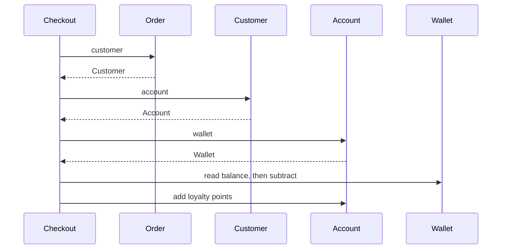
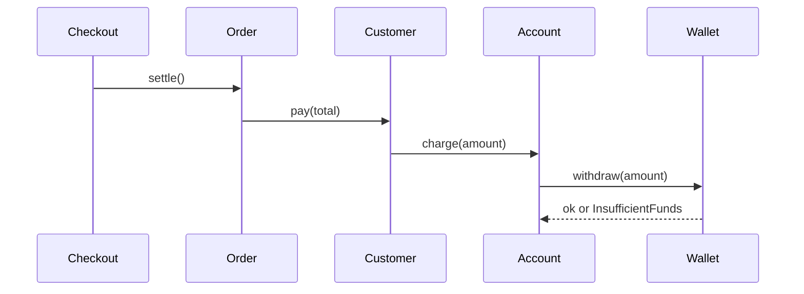

# Law of Demeter and Tell, Don't Ask

## Introduction

Look at this line:

```python
order.customer.account.wallet.balance -= order.total
```

It works. But the checkout code that contains it now knows that orders have customers, customers have accounts, accounts have wallets and wallets have a mutable balance. Change any link in that chain, for example by moving payment methods out of the account, and the checkout code breaks. It also means any code anywhere can change a balance without any rules being applied.

Two closely related principles address this:

- **The Law of Demeter (LoD)**, also called the *principle of least knowledge*: a method should only talk to its immediate collaborators, not to strangers it reaches through them. "Talk to your friends, not to your friends' friends."
- **Tell, Don't Ask**: instead of asking an object for its data and making decisions with it, tell the object what you want done and let it decide.

The classic analogy is David Bock's paperboy story. When the paperboy collects payment, he doesn't reach into your back pocket, take out your wallet and remove the money himself. He asks you to pay, and you decide how: from your wallet, from a jar by the door, or by asking your partner. The paperboy only knows **you**.

## The Law of Demeter

The law was proposed by Ian Holland at Northeastern University in 1987 and named after the *Demeter Project* in which it arose. Its formal version says a method `m` of an object `o` should only call methods on:

1. `o` itself
2. `m`'s parameters
3. objects that `m` creates
4. `o`'s own attributes (its direct components)
5. globals accessible in scope (in practice: modules and constants)

Calling a method on an object **returned by** one of those is talking to a stranger. That is where the popular shorthand "use only one dot" comes from.

### The problem: a chain of strangers

```python
# demeter_before.py
from dataclasses import dataclass


@dataclass
class Wallet:
    balance: float


@dataclass
class Account:
    wallet: Wallet
    loyalty_points: int = 0


@dataclass
class Customer:
    name: str
    account: Account


@dataclass
class Order:
    customer: Customer
    total: float
    paid: bool = False


class Checkout:
    def pay(self, order: Order) -> None:
        wallet = order.customer.account.wallet          # reaching through three objects
        if wallet.balance < order.total:                 # asking for data
            raise ValueError(f"{order.customer.name} cannot afford {order.total}")
        wallet.balance -= order.total                    # changing someone else's state
        order.customer.account.loyalty_points += int(order.total)
        order.paid = True


ana = Customer("Ana", Account(Wallet(50.0)))
order = Order(ana, 30.0)
Checkout().pay(order)
print(ana.account.wallet.balance, ana.account.loyalty_points, order.paid)
```

Output:

```text
20.0 30 True
```

What's wrong:

- **Structural coupling.** `Checkout` depends on the exact shape of four classes. If customers can have several payment methods, `Checkout` must change.
- **Rules live in the wrong place.** The rule "you can't spend more than your balance" and the loyalty rule live in `Checkout`. Any other code that charges a customer (subscriptions, gift cards) must remember to copy them.
- **Hard to test.** A test for `Checkout` must build a whole object graph.



### The fix: tell, and let each object handle its own part

```python
# demeter_after.py
from dataclasses import dataclass


class InsufficientFunds(Exception):
    pass


@dataclass
class Wallet:
    _balance: float

    def withdraw(self, amount: float) -> None:
        if amount > self._balance:
            raise InsufficientFunds(f"needs {amount}, has {self._balance}")
        self._balance -= amount

    @property
    def balance(self) -> float:
        return self._balance


@dataclass
class Account:
    wallet: Wallet
    loyalty_points: int = 0

    def charge(self, amount: float) -> None:
        self.wallet.withdraw(amount)           # talks to its own component
        self.loyalty_points += int(amount)     # loyalty rule lives with the account


@dataclass
class Customer:
    name: str
    account: Account

    def pay(self, amount: float) -> None:
        self.account.charge(amount)            # talks to its own component


@dataclass
class Order:
    customer: Customer
    total: float
    paid: bool = False

    def settle(self) -> None:
        self.customer.pay(self.total)
        self.paid = True


class Checkout:
    def pay(self, order: Order) -> None:
        order.settle()                         # talks only to its parameter


ana = Customer("Ana", Account(Wallet(50.0)))
order = Order(ana, 30.0)
Checkout().pay(order)
print(ana.account.wallet.balance, ana.account.loyalty_points, order.paid)

try:
    Checkout().pay(Order(ana, 99.0))
except InsufficientFunds as e:
    print("Declined:", e)
```

Output:

```text
20.0 30 True
Declined: needs 99.0, has 20.0
```

Each object talks only to its direct neighbor. The balance rule lives in `Wallet`, the loyalty rule in `Account`. If customers gain several payment methods, only `Customer.pay` changes.



## Tell, Don't Ask

**Tell, Don't Ask** is most associated with Andy Hunt and Dave Thomas (*The Pragmatic Programmer*). The idea: procedural code asks objects for data and then decides what to do. Object-oriented code tells objects what to do, so the decision lives with the data.

```python
# tell_dont_ask.py
from dataclasses import dataclass


# ASK: the caller pulls data out and makes the decision
@dataclass
class BookAsk:
    title: str
    stock: int


def reserve_ask(book: BookAsk, qty: int) -> bool:
    if book.stock >= qty:          # decision outside the object
        book.stock -= qty          # mutation outside the object
        return True
    return False


# TELL: the caller states its intent; the object enforces its own rules
@dataclass
class Book:
    title: str
    _stock: int
    _reserved: int = 0

    def reserve(self, qty: int) -> bool:
        if qty <= 0 or qty > self._stock - self._reserved:
            return False
        self._reserved += qty
        return True

    @property
    def available(self) -> int:
        return self._stock - self._reserved


b = Book("Dune", 3)
print(b.reserve(2), b.reserve(2), b.available)
```

Output:

```text
True False 1
```

When the business adds "reserved" stock, the TELL version changes in one place. In the ASK version, every caller that wrote `if book.stock >= qty` is now wrong, and you have to find them all.

### Martin Fowler's caution

Fowler's [TellDontAsk](https://martinfowler.com/bliki/TellDontAsk.html) article supports the core idea of keeping data and behavior together, but warns against turning it into a crusade against getters ("getter eradicators"). Some objects exist to provide information, and queries like `book.available` above are perfectly fine. The aim is that **decisions based on an object's data** live in that object, not that no data ever leaves it.

## When Chaining Is Fine

"One dot" is a rule of thumb, not a literal rule. These chains don't violate the spirit of LoD:

| Chain | Why it's fine |
| --- | --- |
| `" Dune ".strip().lower().replace(" ", "-")` | Every call returns the **same kind** of value; you're transforming data, not navigating a structure |
| `df.dropna().groupby("genre").sum()` (pandas) | Fluent interface on one type |
| `query.filter(...).order_by(...).limit(10)` | Builder or fluent API designed for chaining |
| `config["database"]["url"]` | Plain data structure (dict, JSON, DTO) with no behavior to hide |
| `Path(p).parent.name` | Value objects; navigating them is their purpose |

The real test: **are you reaching into an object's internal structure to manipulate it or make decisions for it?** If yes, tell it what you want. If you're transforming values or reading a data structure, chaining is normal.

Robert C. Martin makes a similar distinction in *Clean Code* between **objects** (hide data, expose behavior) and **data structures** (expose data, no behavior). LoD applies to objects. Forcing it on DTOs and JSON just adds wrapper methods.

## A Hidden Cost: Lazy Loading and N+1 Queries

With ORMs like Django's or SQLAlchemy, attribute chains can hide database queries. A template that renders `order.customer.address.city` for 100 orders may issue hundreds of queries, one per lazy-loaded relationship, unless you prefetch (`select_related` / `prefetch_related` in Django, `joinedload` / `selectinload` in SQLAlchemy). Deep chains in templates or serializers are often both a LoD smell and a performance bug. See [Designing for Performance](../12-arch-quality-and-operations/1-arch-performance.mdx).

## Where You Have Already Seen These Ideas

- **Rails' `delegate`** (`delegate :name, to: :customer`) and Python `@property` forwarding exist to let callers write `order.customer_name` instead of reaching through `order.customer.name`.
- **Facade pattern:** a simple front door to a group of collaborators, so callers don't have to navigate them. See [Facade Pattern](../3-arch-structural-patterns/4-arch-facade.mdx).
- **DDD aggregates:** outside code may only hold a reference to the aggregate root and must go through it to change anything inside. That is LoD as a consistency rule. See [Aggregates and Consistency Boundaries](../8-arch-domain-driven-design/4-arch-aggregates.mdx).
- **Microservices:** a service that calls service B to get an ID, then calls C with it, then D, is the distributed version of a Demeter chain, and it couples the caller to the whole topology.

## Real-World Scenario

Your team works on a food delivery app. The dispatch module contains code like:

```python
if order.restaurant.kitchen.queue.estimated_minutes() > 30 and order.courier.vehicle.kind == "bike":
    order.courier.vehicle.route.max_distance_km = 3
```

Each restaurant integration and courier type change ripples into dispatch, and tests need a ten-object graph.

**The solution:**

1. Ask what dispatch actually wants to know: "how long until this order is ready?" and "can this courier handle a long trip?"
2. Add `restaurant.ready_in_minutes(order)` and `courier.can_cover(distance_km)`. Each hides its internals and owns its rule.
3. Replace the direct mutation of `max_distance_km` with a command: `courier.limit_range(km=3)`.
4. Dispatch now reads: `if restaurant.ready_in_minutes(order) > 30 and not courier.can_cover(long_trip_km): ...`.
5. Tests use two tiny fakes instead of a full object graph.

**Why this approach:** the volatile details (kitchen queues, vehicle types) now change behind stable methods. Dispatch logic reads like the business rule it implements.

**When to apply LoD / Tell, Don't Ask:**

- **Apply them** to domain objects with rules and state, to code that crosses module or service boundaries, and anywhere a chain reaches in to mutate state.
- **Relax them** for data structures, DTOs, configuration, fluent APIs and value transformations. Wrapping every nested field in a forwarding method creates bloated "middleman" classes.

**Alternatives and trade-offs:**

| Approach | Pros | Cons | Best for |
| --- | --- | --- | --- |
| Reach through chains | No extra methods | Structural coupling, scattered rules | Data structures only |
| Tell, Don't Ask (behavior on the object) | Rules live with data, low coupling | Objects can grow large; may mix concerns | Rich domain models |
| Forwarding methods / delegation | Callers decoupled from structure | Wrapper method explosion ("middle man" smell) | A few frequently used paths |
| Pass the needed value as a parameter | Callee needs no navigation at all | Caller must assemble the value | Functions and services |
| Read models / DTOs shaped for the view | Views get flat data, no lazy loading | Extra mapping code | UI and API responses; see [CQRS](../9-arch-distributed-systems/3-arch-cqrs.mdx) |

## Common Mistakes

1. **Counting dots literally.** `text.strip().lower()` is fine. The question is whether you're navigating and manipulating another object's internals.
2. **Wrapper explosion.** Adding `order.get_customer_account_wallet_balance()` doesn't fix anything; it just hides the chain. Ask what decision the caller wants to make and move that decision.
3. **Eradicating all getters.** Queries are fine. Move **decisions** to the data, not all reads.
4. **Ignoring hidden I/O.** In ORM code, chains may trigger queries. Prefetch, or shape a read model.
5. **Pushing unrelated behavior into one object.** Tell, Don't Ask can create god objects. If the behavior belongs to a different concern (rendering, persistence), keep it outside and pass data in. See [Separation of Concerns](./9-arch-separation-of-concerns.mdx).

## Summary

- **Law of Demeter**: a method should talk only to itself, its parameters, objects it creates and its direct components, not to objects reached through them.
- **Tell, Don't Ask**: tell objects what you want; let them make decisions with their own data.
- Both reduce structural coupling and keep business rules next to the data they guard.
- Chaining is fine for fluent APIs, value transformations and plain data structures.
- Watch for wrapper explosion, getter crusades and ORM chains that hide N+1 queries.

## Exercises

1. In `demeter_after.py`, add support for gift-card balances: customers pay from a gift card first, then the wallet. Which classes changed? Would `Checkout` have changed in the "before" version?
2. Find three method chains in a codebase you know. Classify each as navigation of an object's internals, a fluent API, or a data structure.
3. Rewrite `reserve_ask` callers to use `Book.reserve`, then add a rule that rare books can only be reserved one at a time. How many places changed?
4. Using Django or SQLAlchemy docs, find how to prefetch a two-level relationship and explain how it relates to this page.

**Related pages:**

- Previous: [Composition over Inheritance](./7-arch-composition-over-inheritance.mdx)
- Next: [Separation of Concerns](./9-arch-separation-of-concerns.mdx)
- [Coupling and Cohesion](../0-arch-fundamentals/5-arch-coupling-and-cohesion.mdx)
- [Entities and Value Objects](../8-arch-domain-driven-design/3-arch-entities-and-value-objects.mdx)
