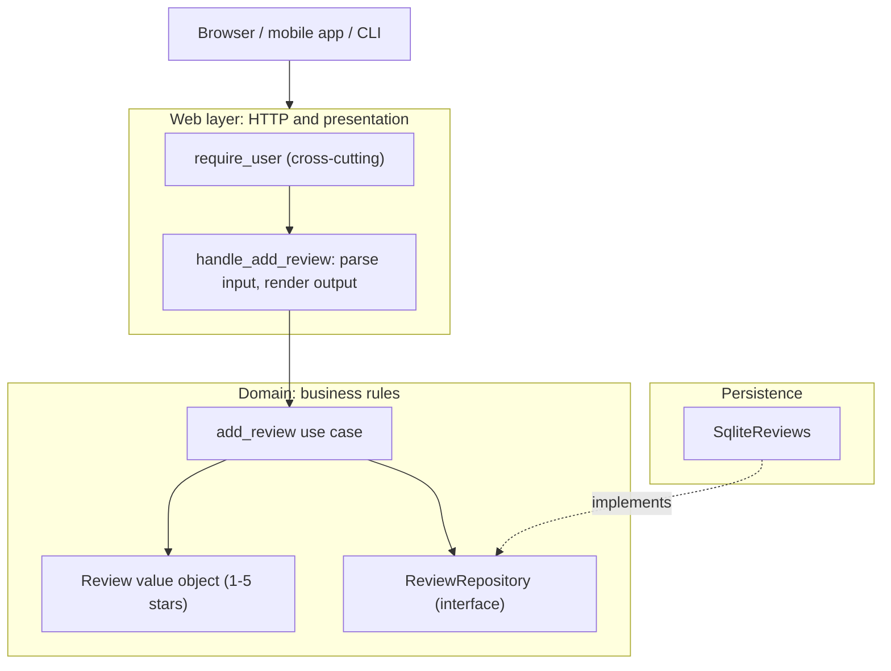

# Separation of Concerns

## Introduction

**Separation of Concerns (SoC)** is the oldest and broadest idea in this section. Most of the other principles, from the [Single Responsibility Principle](./1-arch-single-responsibility.mdx) to layered and hexagonal architectures, are specific ways of applying it.

The term is usually credited to Edsger W. Dijkstra, in his 1974 note *On the role of scientific thought* ([EWD447](https://www.cs.utexas.edu/~EWD/ewd04xx/EWD447.PDF)). His point was about thinking clearly: you study one aspect of a problem in isolation, such as whether a program is correct, while knowing that other aspects, such as whether it is efficient, exist and will get their turn. Trying to think about everything at once gets you nowhere.

In software design, SoC means: **divide a program into parts so that each part deals with one concern, and so that a change to one concern touches as few parts as possible.** A *concern* is any distinct area of interest: how data is shown, what the business rules are, how data is stored, how requests are authenticated, how errors are logged.

An analogy: a restaurant separates the dining room, the kitchen and the storeroom. Waiters don't cook, cooks don't take orders at tables, and the storeroom can be reorganized without retraining the waiters. Each area has clear handoffs: order tickets go in, plates come out.

## The Problem: Everything in One Function

Here is a request handler for an online bookstore's "add review" feature. It is written without any framework so you can run it anywhere, but the same shape appears in many Flask, Express or Django views:

```python
# review_before.py
import html
import sqlite3

conn = sqlite3.connect(":memory:")
conn.execute("CREATE TABLE reviews (isbn TEXT, user TEXT, stars INT, text TEXT)")


def handle_add_review(request: dict) -> tuple[int, str]:
    # authentication
    if request.get("headers", {}).get("X-User") is None:
        return 401, "<p>Please log in</p>"
    user = request["headers"]["X-User"]

    # input parsing and validation
    try:
        stars = int(request["form"]["stars"])
    except (KeyError, ValueError):
        return 400, "<p>Stars must be a number</p>"
    text = request["form"].get("text", "").strip()

    # business rules
    if not 1 <= stars <= 5:
        return 400, "<p>Stars must be 1-5</p>"
    count = conn.execute("SELECT COUNT(*) FROM reviews WHERE isbn=? AND user=?",
                         (request["isbn"], user)).fetchone()[0]
    if count > 0:
        return 409, "<p>You already reviewed this book</p>"

    # persistence
    conn.execute("INSERT INTO reviews VALUES (?, ?, ?, ?)", (request["isbn"], user, stars, text))

    # presentation
    return 201, f"<p>Thanks {html.escape(user)}! You gave {stars} stars.</p>"


req = {"isbn": "978-0441013593", "headers": {"X-User": "ana"}, "form": {"stars": "5", "text": "Great"}}
print(handle_add_review(req))
print(handle_add_review(req))
```

Output:

```text
(201, '<p>Thanks ana! You gave 5 stars.</p>')
(409, '<p>You already reviewed this book</p>')
```

Five concerns are tangled in 30 lines:

| Concern | Who changes it | Problem when mixed |
| --- | --- | --- |
| Authentication | Security team | Copy-pasted into every handler |
| Parsing / validation of input | API designers | Can't reuse for a JSON API or a CLI import |
| Business rules (1-5 stars, one review per user) | Product | Can't test without HTTP and SQL |
| Persistence | Platform / DBA | SQL scattered across views |
| Presentation (HTML) | Front-end | A mobile app needs JSON; the rule code must be duplicated |

## The Fix: One Part per Concern

Separate the concerns into units with clear handoffs. The business rule doesn't know about HTTP or SQL, and the HTTP handler doesn't know the rules.

```python
# review_after.py
import functools
import html
import sqlite3
from collections.abc import Callable
from dataclasses import dataclass
from typing import Protocol


# ---------- Domain: business rules only ----------
class ReviewError(Exception):
    pass


@dataclass(frozen=True)
class Review:
    isbn: str
    user: str
    stars: int
    text: str

    def __post_init__(self) -> None:
        if not 1 <= self.stars <= 5:
            raise ReviewError("Stars must be 1-5")


class ReviewRepository(Protocol):
    def exists(self, isbn: str, user: str) -> bool: ...
    def add(self, review: Review) -> None: ...


def add_review(repo: ReviewRepository, review: Review) -> None:       # the use case
    if repo.exists(review.isbn, review.user):
        raise ReviewError("You already reviewed this book")
    repo.add(review)


# ---------- Persistence: storage only ----------
class SqliteReviews:
    def __init__(self, conn: sqlite3.Connection) -> None:
        self.conn = conn
        conn.execute("CREATE TABLE IF NOT EXISTS reviews (isbn TEXT, user TEXT, stars INT, text TEXT)")

    def exists(self, isbn: str, user: str) -> bool:
        q = "SELECT 1 FROM reviews WHERE isbn=? AND user=?"
        return self.conn.execute(q, (isbn, user)).fetchone() is not None

    def add(self, review: Review) -> None:
        self.conn.execute("INSERT INTO reviews VALUES (?, ?, ?, ?)",
                          (review.isbn, review.user, review.stars, review.text))


# ---------- Cross-cutting: authentication as a decorator ----------
Handler = Callable[[dict], tuple[int, str]]


def require_user(handler: Handler) -> Handler:
    @functools.wraps(handler)
    def wrapper(request: dict) -> tuple[int, str]:
        if request.get("headers", {}).get("X-User") is None:
            return 401, "<p>Please log in</p>"
        return handler(request)
    return wrapper


# ---------- Web layer: HTTP parsing and presentation only ----------
repo = SqliteReviews(sqlite3.connect(":memory:"))


@require_user
def handle_add_review(request: dict) -> tuple[int, str]:
    try:
        review = Review(request["isbn"], request["headers"]["X-User"],
                        int(request["form"]["stars"]), request["form"].get("text", "").strip())
        add_review(repo, review)
    except (KeyError, ValueError):
        return 400, "<p>Stars must be a number</p>"
    except ReviewError as e:
        return 400, f"<p>{html.escape(str(e))}</p>"
    return 201, f"<p>Thanks {html.escape(review.user)}! You gave {review.stars} stars.</p>"


if __name__ == "__main__":
    req = {"isbn": "978-0441013593", "headers": {"X-User": "ana"}, "form": {"stars": "5", "text": "Great"}}
    print(handle_add_review(req))
    print(handle_add_review(req))
    print(handle_add_review({"isbn": "x", "form": {}}))
```

Output:

```text
(201, '<p>Thanks ana! You gave 5 stars.</p>')
(400, '<p>You already reviewed this book</p>')
(401, '<p>Please log in</p>')
```

Note that the duplicate review now returns 400 instead of 409. That is the kind of detail that's easy to fix in one place now: map a specific `DuplicateReview` exception to 409 in the web layer, without the domain knowing HTTP status codes exist.

Now each concern can change independently:

- A JSON API or a CLI importer calls `add_review(repo, Review(...))` and reuses all the rules.
- Moving from SQLite to PostgreSQL touches only `SqliteReviews`.
- Authentication is applied with one decorator line per handler (or once for the whole app as middleware).
- The business rules can be tested with a 5-line in-memory fake repository.



Because the domain concern is isolated, its tests need no HTTP request and no database:

```python
# test_reviews.py
import pytest

from review_after import Review, ReviewError, add_review


class InMemoryReviews:
    def __init__(self) -> None:
        self.items: list[Review] = []

    def exists(self, isbn: str, user: str) -> bool:
        return any(r.isbn == isbn and r.user == user for r in self.items)

    def add(self, review: Review) -> None:
        self.items.append(review)


def test_one_review_per_user_per_book() -> None:
    repo = InMemoryReviews()
    add_review(repo, Review("1", "ana", 4, ""))
    with pytest.raises(ReviewError):
        add_review(repo, Review("1", "ana", 5, ""))


def test_stars_out_of_range() -> None:
    with pytest.raises(ReviewError):
        Review("1", "bo", 6, "")
```

Example output:

```text
$ pytest -q test_reviews.py
..                                                                       [100%]
2 passed in 0.01s
```

## Kinds of Concerns

### Core concerns: horizontal layers

The most common split is by technical role:

- **Presentation**: HTML, JSON, CLI output, view models.
- **Application / use cases**: orchestrating a user action (add a review, place an order).
- **Domain**: business rules and data that exist regardless of technology.
- **Infrastructure / data access**: databases, queues, files, external APIs.

This is the basis of [Layered (N-Tier) Architecture](../6-arch-architectural-styles/1-arch-layered.mdx), and, with the dependency arrows reversed, of [Clean Architecture](../7-arch-clean-architecture/2-arch-clean-architecture.mdx).

### Feature concerns: vertical slices

You can also separate by **business capability**: reviews, orders, catalog, payments. Each feature folder contains its own handler, rules and data access. This keeps related code together and is the idea behind [Vertical Slice Architecture](../7-arch-clean-architecture/3-arch-vertical-slice.mdx) and modular monoliths. Most real systems combine both: features at the top level, layers inside each feature.

### Cross-cutting concerns

Some concerns apply everywhere: logging, authentication, authorization, caching, transactions, metrics, error handling, rate limiting. Scattering them through every function is the main way SoC breaks down in practice. Common tools to keep them separate:

| Tool | Example |
| --- | --- |
| Function decorators | `@require_user`, `@functools.lru_cache`, `@retry` |
| Middleware | Django / Express / ASP.NET Core middleware for auth, CORS, logging |
| Context managers | `with transaction():`, `with tracer.start_as_current_span(...)` |
| Dependency injection | FastAPI `Depends(get_current_user)` |
| Infrastructure | API gateway for auth and rate limits; service mesh sidecars for retries and mTLS |

Here is a small timing decorator, a typical cross-cutting concern kept out of business code:

```python
# timing.py
import functools
import time
from collections.abc import Callable
from typing import ParamSpec, TypeVar

P = ParamSpec("P")
R = TypeVar("R")


def timed(fn: Callable[P, R]) -> Callable[P, R]:
    @functools.wraps(fn)
    def wrapper(*args: P.args, **kwargs: P.kwargs) -> R:
        start = time.perf_counter()
        try:
            return fn(*args, **kwargs)
        finally:
            print(f"{fn.__name__} took {(time.perf_counter() - start) * 1000:.1f} ms")
    return wrapper


@timed
def recommend(isbn: str) -> list[str]:
    time.sleep(0.02)                       # pretend to compute recommendations
    return ["Children of Dune", "Hyperion"]


print(recommend("978-0441013593"))
```

Example output:

```text
recommend took 20.1 ms
['Children of Dune', 'Hyperion']
```

## Where You Have Already Seen SoC

- **HTML, CSS and JavaScript** separate structure, style and behavior on the web.
- **The network stack**: each layer of TCP/IP handles one concern (physical delivery, routing, reliable streams, application protocols) behind a defined interface. See the [networking tutorial](/docs/fundamental/network).
- **MVC and its relatives** separate model, view and controller. See [MVC, MVP and MVVM](../7-arch-clean-architecture/4-arch-mvc-mvp-mvvm.mdx).
- **Web framework middleware** pipelines separate cross-cutting concerns from views.
- **Kubernetes** separates what to run (Deployments), how to reach it (Services) and configuration (ConfigMaps and Secrets). See the [Kubernetes tutorial](/docs/devops/kubernetes).

:::info
**Separating technologies is not always separating concerns.** When React introduced JSX, its team argued that splitting markup and logic into different files separated *technologies*, while the real concern, a UI component, needed both. Component-based frameworks group HTML, logic and often styles per component. The lesson: choose the split that matches how things **change together**, not the split that matches file types.
:::

## Real-World Scenario

Your team builds a SaaS helpdesk. Ticket logic is spread across Django views, model `save()` overrides, signal handlers and Celery tasks. SLA rules are partly in views and partly in a nightly task. A new requirement says customers can create tickets by email and through a public API, not just the web form, and SLA rules must be identical across all three.

**The solution:**

1. Create a `tickets` application layer with a `create_ticket(command, repo, clock, notifier)` use case containing all creation and SLA rules.
2. Make the web view, the email ingestion worker and the API endpoint thin adapters: parse their input format, call `create_ticket`, and format their own output.
3. Move auth, tenant resolution and request logging into middleware.
4. Keep Django models for persistence, accessed through a repository, so domain rules no longer hide in `save()` overrides and signals.

**Why this approach:** three delivery channels with one set of rules is the textbook case for separating presentation from business logic. Each channel now handles only its own concern (email parsing, JSON, HTML).

**When to use SoC / when not to:**

- **Use it** when the same rules are reached from several entry points, when presentation and rules change for different reasons, or when you need to test rules without I/O.
- **Don't over-layer** small apps. A three-endpoint CRUD service with controllers, services, managers, repositories and DTO mappers for each entity spends most of its code copying data between layers. Frameworks like Django already give you a reasonable separation for simple cases.

**Alternatives and trade-offs:**

| Approach | Pros | Cons | Best for |
| --- | --- | --- | --- |
| Everything in the handler | Fastest to write, easy to trace | Rules not reusable, hard to test | Prototypes, tiny services |
| Framework conventions (fat models, thin views) | Familiar, little boilerplate | Rules tied to the ORM; hidden side effects in signals | CRUD-heavy apps |
| Horizontal layers | Clear technical roles | Each feature touches every layer | Medium apps with stable layers |
| Vertical slices with light layering inside | Features isolated, easy to change one feature | Some duplication across slices | Feature-rich products |
| Hexagonal / Clean | Domain fully independent of I/O | Most ceremony | Complex domains, many integrations |

## Common Mistakes

1. **Layers with no logic.** Pass-through services that only call a repository method of the same name add indirection without separating anything. Skip a layer when it has nothing to do.
2. **Leaking concerns across boundaries.** Domain functions that raise `HTTPException`, or repositories that return HTML, have mixed concerns again.
3. **Hiding business rules in framework hooks.** ORM `save()` overrides, signals and triggers execute rules invisibly. Keep important rules in explicit, testable functions.
4. **Splitting by file type instead of by change.** A `models/`, `views/`, `utils/` layout forces every feature change to touch every folder. Consider grouping by feature first.
5. **Copy-pasting cross-cutting code.** If every handler checks auth by hand, one will forget. Use decorators or middleware.

## Summary

- Separation of Concerns, from Dijkstra's 1974 note, means each part of a system addresses one concern, with clear handoffs between parts.
- Typical concerns: presentation, use cases, domain rules, persistence, and cross-cutting concerns like auth and logging.
- Separate horizontally (layers), vertically (features), and handle cross-cutting concerns with decorators, middleware and DI.
- Good separation lets one set of rules serve many entry points and makes rules testable without I/O.
- Avoid empty layers and file-type splits; separate along the lines where things change independently.

## Exercises

1. Add a JSON entry point for reviews to `review_after.py` that returns `{"ok": true}` or `{"error": "..."}`. Which parts did you reuse unchanged?
2. Add a `DuplicateReview(ReviewError)` exception and map it to HTTP 409 in the web layer only.
3. Write a `@log_calls` decorator and apply it to `add_review`. Then discuss: should it go on the use case or on the HTTP handler?
4. Draw the concerns in an app you know as a diagram like the one above. Mark each place where one concern leaks into another.

**Related pages:**

- Previous: [Law of Demeter and Tell, Don't Ask](./8-arch-law-of-demeter.mdx)
- Next: [Dependency Injection](./10-arch-dependency-injection.mdx)
- [Structuring a Codebase](../7-arch-clean-architecture/6-arch-structuring-a-codebase.mdx)
- [Managing Complexity](../0-arch-fundamentals/7-arch-complexity.mdx)
