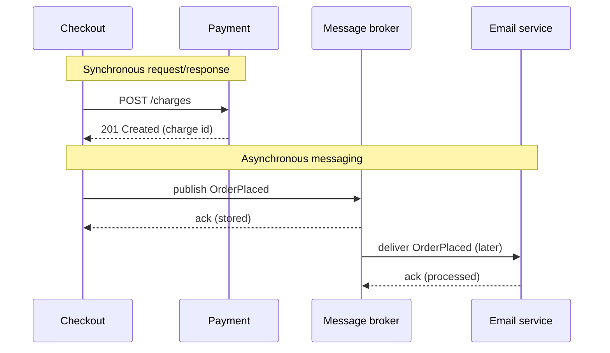
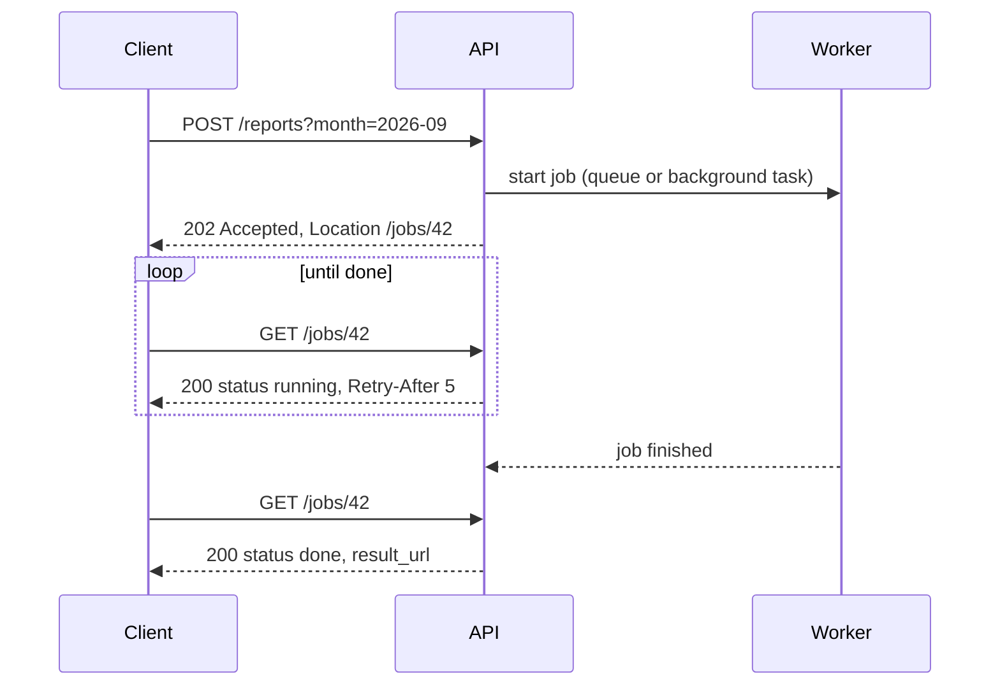
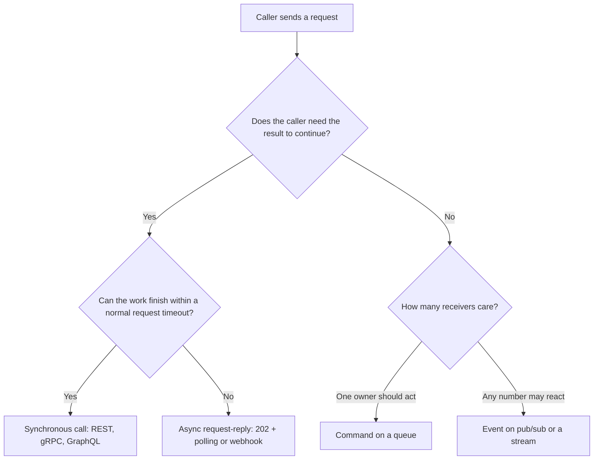
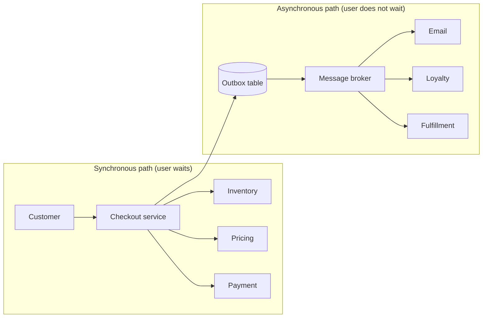

# Synchronous vs Asynchronous Communication

## Introduction

As soon as your system has more than one process, those processes have to talk to each other. A checkout service asks the payment service to charge a card. An order service tells the warehouse to pack a box. A reporting job asks a database for last month's sales.

There are two basic ways to have that conversation:

- **Synchronous**: the caller sends a request and **waits** for the answer before it continues. A phone call works this way. You dial, the other person picks up, and you talk until you get what you need. If nobody answers, you are stuck.
- **Asynchronous**: the caller sends a message and **moves on**. The receiver handles it later, maybe seconds or hours later. Email or a voicemail works this way. You do not need the other person to be available at the same moment as you.

This choice affects almost every quality attribute you care about: latency, availability, consistency, how easy the system is to debug, and how independently teams can work. It is one of the most important decisions in any distributed design, and most real systems use **both** styles in different places.

This page explains the two styles, shows what goes wrong with each, and gives you a way to decide. The rest of this section then goes deeper into specific technologies: [REST](./1-arch-rest-api-design.mdx), [GraphQL](./2-arch-graphql.mdx) and [gRPC](./3-arch-grpc.mdx) on the synchronous side, and [messaging](./5-arch-messaging-patterns.mdx) and [webhooks](./7-arch-webhooks.mdx) on the asynchronous side.

:::note async/await is not asynchronous communication
Python's `async def` and JavaScript's `await` are about how **one process** uses its threads while waiting. A service written with `await httpx.get(...)` is still communicating **synchronously**: the business operation cannot finish until the other service answers. Asynchronous *communication* means the sender does not need a response to complete its work.
:::

## The Two Styles Side by Side



In the synchronous half, Checkout cannot continue until Payment answers. In the asynchronous half, Checkout only needs the **broker** to accept the message. The email service might be down for an hour, and Checkout would never notice.

### Key terms

| Term | Meaning |
| --- | --- |
| Temporal coupling | Both sides must be up and responsive **at the same time** for the operation to succeed |
| Request/response | The caller sends a request and expects exactly one reply |
| Fire-and-forget | The sender emits a message and expects no reply |
| Command message | "Please do X" (for example `ChargeCard`), sent to one receiver that owns X |
| Event message | "X happened" (for example `OrderPlaced`), broadcast to anyone interested |
| Broker | Middleware that stores and routes messages (RabbitMQ, Kafka, Amazon SQS and so on) |

## Synchronous Communication

Synchronous calls are the default for good reasons. They are easy to write, easy to read, and easy to debug, because the whole operation happens in one call stack, one log trace, and one request. When the call returns, you know the result. When it fails, you get an error right away and can tell the user.

The costs show up when you **chain** synchronous calls.

### Problem 1: Latency adds up

If checkout calls inventory, then payment, then email one after another, the user waits for the sum of all three. Even if you call independent services in parallel, the user waits for the **slowest** one, and the slowest of several calls is usually slower than a typical single call.

### Problem 2: Availability multiplies

If every service in a synchronous chain must answer, the chain is only up when **all** of them are up. With three services that are each available 99.9% of the time, and failures that happen independently, the chain is available about 0.999 × 0.999 × 0.999 ≈ 99.7% of the time. Each extra synchronous dependency lowers the ceiling. That is simple multiplication, not a benchmark, but it explains why long call chains feel fragile.

### Problem 3: Failures cascade

A slow service is often worse than a dead one. Callers keep connections and threads open while they wait. Those resources fill up, and soon the caller is slow too, and then its callers. Timeouts, retries and circuit breakers help. They are covered in [Circuit Breaker, Retry and Timeout](../9-arch-distributed-systems/8-arch-circuit-breaker.mdx).

### Seeing it in code

This small simulation calls three services in sequence. The "email" service can be switched off. It uses only the standard library, so you can run it with Python 3.12 or later.

```python
import asyncio
import time


class ServiceDown(Exception):
    pass


async def call_service(name: str, latency_s: float, up: bool = True) -> str:
    """Pretend to make an HTTP call to another service."""
    await asyncio.sleep(latency_s)
    if not up:
        raise ServiceDown(f"{name} is unavailable")
    return f"{name}: ok"


async def place_order_sync(email_up: bool) -> str:
    """Checkout waits for every downstream call, one after another."""
    start = time.perf_counter()
    try:
        await call_service("inventory", 0.05)
        await call_service("payment", 0.10)
        await call_service("email", 0.08, up=email_up)
    except ServiceDown as exc:
        elapsed = time.perf_counter() - start
        return f"FAILED after {elapsed:.2f}s: {exc}"
    elapsed = time.perf_counter() - start
    return f"order placed in {elapsed:.2f}s"


async def main() -> None:
    print("email up:  ", await place_order_sync(email_up=True))
    print("email down:", await place_order_sync(email_up=False))


asyncio.run(main())
```

Output:

```text
email up:   order placed in 0.23s
email down: FAILED after 0.23s: email is unavailable
```

Two things hurt here. The user waits for the email to be sent, which has nothing to do with whether the order is valid. Worse, a broken **email** service makes the whole **checkout** fail, even though the card was already charged. That is a very bad place to fail: the customer paid, and the system reports an error.

## Asynchronous Communication

With asynchronous messaging, the sender puts a message on a queue or topic and continues. A broker stores the message until a consumer is ready. The sender and the receiver no longer need to be available at the same time.

Here is the same checkout, but the email is now triggered by an `OrderPlaced` event on a queue. Inventory and payment stay synchronous, because checkout really needs their answers before it can tell the user "your order is confirmed".

```python
import asyncio
import time
from dataclasses import dataclass


@dataclass
class OrderPlaced:
    order_id: str
    email: str


async def call_service(name: str, latency_s: float) -> None:
    await asyncio.sleep(latency_s)


async def place_order(queue: asyncio.Queue[OrderPlaced], order_id: str) -> str:
    start = time.perf_counter()
    await call_service("inventory", 0.05)  # still synchronous: we need the answer
    await call_service("payment", 0.10)    # still synchronous: we need the answer
    await queue.put(OrderPlaced(order_id, "ana@example.com"))  # fire the event
    return f"order {order_id} placed in {time.perf_counter() - start:.2f}s"


async def email_worker(queue: asyncio.Queue[OrderPlaced], email_up: asyncio.Event) -> None:
    while True:
        event = await queue.get()
        await email_up.wait()  # the worker is stuck while email is down...
        await asyncio.sleep(0.08)
        print(f"  [email-worker] confirmation sent for {event.order_id}")
        queue.task_done()


async def main() -> None:
    queue: asyncio.Queue[OrderPlaced] = asyncio.Queue()
    email_up = asyncio.Event()  # starts "down"
    worker = asyncio.create_task(email_worker(queue, email_up))

    print(await place_order(queue, "A-100"))
    print(await place_order(queue, "A-101"))
    print(f"still queued: {queue.qsize()} (the worker holds the other one)")

    print("email service recovers...")
    email_up.set()
    await queue.join()  # ...and the backlog drains
    worker.cancel()


asyncio.run(main())
```

Output:

```text
order A-100 placed in 0.15s
order A-101 placed in 0.15s
still queued: 1 (the worker holds the other one)
email service recovers...
  [email-worker] confirmation sent for A-100
  [email-worker] confirmation sent for A-101
```

Checkout is now faster, and it keeps working while email is down. The messages wait in the queue, and the backlog drains when the email service recovers. In production the in-memory `asyncio.Queue` would be a durable broker such as RabbitMQ, Kafka or Amazon SQS, so messages survive a crash. See [Messaging Patterns](./5-arch-messaging-patterns.mdx) for those.

### What asynchronous messaging costs you

Nothing is free. Asynchronous designs move complexity around rather than removing it:

- **Eventual consistency.** For a while, the order exists but the confirmation email has not been sent. Parts of the system disagree until the message is processed. See [Consistency Models](../9-arch-distributed-systems/2-arch-consistency-models.mdx).
- **No immediate answer.** If the receiver rejects the message (bad address, business rule failure), the sender has already moved on. You need another path to report failures, such as a dead-letter queue, a status field, or a compensating action (see [Saga Pattern](../9-arch-distributed-systems/5-arch-saga.mdx)).
- **Duplicates.** Most brokers deliver **at least once**, so consumers must be [idempotent](../9-arch-distributed-systems/7-arch-idempotency.mdx).
- **Harder debugging.** A single business operation is spread across processes and time. You need correlation IDs and distributed tracing to follow it.
- **A new piece of infrastructure.** The broker has to be run, monitored, secured and capacity-planned.
- **Publishing atomically.** Saving the order and publishing the event are two separate writes. If the process crashes between them, you lose the event. The [Transactional Outbox](../9-arch-distributed-systems/6-arch-outbox.mdx) pattern fixes this.

## A Middle Ground: Asynchronous Request-Reply over HTTP

Sometimes a client calls you over HTTP, but the work takes too long to finish within one request. Generating a large report, transcoding a video, or running a batch import are typical examples. Holding the HTTP connection open for minutes is fragile, because proxies and load balancers time out.

The **Asynchronous Request-Reply** pattern (described in the Azure Architecture Center) splits the work in two:

1. The client sends `POST /reports`. The server records a job, starts it in the background, and immediately returns **`202 Accepted`** with a `Location` header pointing to a status resource.
2. The client polls `GET /jobs/{id}` (respecting `Retry-After`) until the status is `done`, then fetches the result. Alternatively, the server notifies the client with a [webhook](./7-arch-webhooks.mdx).



A minimal FastAPI version (install with `pip install fastapi httpx2`; the `httpx2` package is what recent Starlette versions use for `TestClient`, while older ones use `httpx`):

```python
import uuid
from fastapi import BackgroundTasks, FastAPI, Response
from fastapi.testclient import TestClient

app = FastAPI()
jobs: dict[str, dict] = {}  # use a database or Redis in production


def build_sales_report(job_id: str, month: str) -> None:
    # Imagine several minutes of SQL here.
    jobs[job_id] = {"status": "done", "result_url": f"/reports/{month}.csv"}


@app.post("/reports", status_code=202)
def request_report(month: str, background: BackgroundTasks, response: Response) -> dict:
    job_id = str(uuid.uuid4())[:8]
    jobs[job_id] = {"status": "running"}
    background.add_task(build_sales_report, job_id, month)
    response.headers["Location"] = f"/jobs/{job_id}"
    return {"job_id": job_id, "status": "running"}


@app.get("/jobs/{job_id}")
def job_status(job_id: str, response: Response) -> dict:
    job = jobs[job_id]
    if job["status"] == "running":
        response.headers["Retry-After"] = "5"
    return job


client = TestClient(app)
r = client.post("/reports", params={"month": "2026-09"})
print(r.status_code, r.headers["location"])
print(client.get(r.headers["location"]).json())
```

Example output (the job id is random):

```text
202 /jobs/ab38b190
{'status': 'done', 'result_url': '/reports/2026-09.csv'}
```

`TestClient` runs background tasks before it returns, so the job is already done here. In a real deployment, the first poll would usually see `running`. FastAPI's `BackgroundTasks` runs in the same process, so a restart loses the job. For real work, put the job on a durable queue and let a separate worker pick it up.

## Comparing the Styles

| Aspect | Synchronous (HTTP, gRPC) | Asynchronous (queues, events) |
| --- | --- | --- |
| Caller gets | An answer now | An acknowledgement that the message was stored |
| Temporal coupling | High: both sides must be up | Low: the broker buffers |
| Latency seen by user | Sum or max of downstream calls | Only the work done before publishing |
| Consistency | Easier to keep immediate | Eventual, by design |
| Error handling | Exceptions and status codes, right away | Retries, dead-letter queues, compensations |
| Load spikes | Pass straight through to downstream | Absorbed by the queue (load leveling) |
| Debugging | One trace, one call stack | Needs correlation IDs and tracing across hops |
| Infrastructure | Just the services | Plus a broker to operate |
| Mental model | Familiar function call | Workflows and state machines |

## How to Decide

Ask one question first: **does the caller need the result to finish its own job right now?**



Some practical rules of thumb:

- **Reads that a user is waiting for** are usually synchronous. Users want to see the book page now.
- **Side effects that do not change the user's answer** (emails, analytics, search indexing, loyalty points) are good candidates for asynchronous events.
- **Long-running work** goes behind async request-reply.
- **Spiky load that downstream cannot absorb** (bulk imports, flash sales) benefits from a queue in between. Azure calls this Queue-Based Load Leveling.
- **Validation that must block bad input** stays synchronous, so you can reject it immediately.

## Real-World Scenario

Your team runs an online bookstore. Checkout is one service that calls five others synchronously: inventory, pricing, payment, email and loyalty points. During a holiday sale, the loyalty-points service slows down because of a database lock. Checkout threads pile up waiting for it, checkout stops responding, and the business loses sales because of a feature most customers never look at.

You review each dependency with the question from the flowchart:

| Dependency | Does checkout need the answer now? | Decision |
| --- | --- | --- |
| Inventory reservation | Yes, cannot sell what is not in stock | Synchronous, with a short timeout |
| Pricing | Yes, the total must be shown and charged | Synchronous, cached where possible |
| Payment authorization | Yes, the order is only valid if authorized | Synchronous, with an idempotency key |
| Confirmation email | No | `OrderPlaced` event, consumed by email service |
| Loyalty points | No | `OrderPlaced` event, consumed by loyalty service |
| Warehouse picking | No, it happens after the order is confirmed | `OrderPlaced` event, consumed by fulfillment |



Checkout writes the order and an `OrderPlaced` row to an outbox table in the same database transaction, and a relay publishes it to the broker. Now a slow loyalty service only delays points, not sales. Points show up a minute late during the sale, and nobody complains.

**Why this approach fits:** the synchronous path now contains only what defines a valid order. Everything else is a reaction to the order and can tolerate delay. You removed three dependencies from the critical path without making the user experience worse.

**When to use it / when not to:**

- Use it when side effects are slow, unreliable, or owned by other teams, and when a short delay is acceptable to the business.
- Do not use it when the user must see the outcome immediately, for example "was my payment approved?". Do not use it either when you have a single small service and no broker yet. A background thread or a cron job might be enough.

**Alternatives and trade-offs:**

| Approach | Pros | Cons | Best for |
| --- | --- | --- | --- |
| All synchronous | Simple, immediate consistency, one trace | Fragile chains, cascading failures | Small systems, few dependencies |
| Sync core + async side effects | Fast, resilient critical path | Broker to run, eventual consistency | Most business workflows |
| Fully event-driven (choreography) | Very loose coupling, easy to add consumers | Hard to see the whole flow, hard to debug | Many independent reactions to the same facts |
| Async request-reply (202 + poll) | Works over plain HTTP, no client broker | Polling overhead, job state to store | Long-running jobs started by external clients |
| In-process background tasks | No new infrastructure | Lost on restart, no retries across hosts | Prototypes and best-effort work |

## Common Mistakes

1. **Hiding synchronous calls behind a queue.** Sending a request on one queue and blocking on a reply queue gives you all the latency of a synchronous call plus the complexity of a broker. If you must wait, call synchronously, with a timeout.
2. **Making everything asynchronous.** Events are not automatically "better". A query such as "what is the price of this book?" belongs in a synchronous call. Overusing events leads to flows that nobody can follow.
3. **No timeouts on synchronous calls.** Most HTTP clients wait a long time, or forever, by default. Always set connect and read timeouts.
4. **Publishing events outside the transaction.** Saving the order and then publishing in a separate step loses events when the process crashes in between. Use an outbox.
5. **Assuming exactly-once delivery.** Design consumers to handle the same message twice without harm.
6. **Forgetting the failure path.** With asynchronous work, decide up front where failures go (a dead-letter queue, an alert, a status the user can see) and who looks at them.
7. **Building a distributed monolith.** If every service calls every other service synchronously for every request, you have the coupling of a monolith with the failure modes of a distributed system. See [Microservices Architecture](../6-arch-architectural-styles/4-arch-microservices.mdx).

## Summary

- **Synchronous** communication waits for an answer. It is simple and immediately consistent, but it creates temporal coupling: latency adds up, availability multiplies down, and failures cascade.
- **Asynchronous** communication hands a message to a broker and moves on. It decouples availability and absorbs load spikes, but it brings eventual consistency, duplicates and harder debugging.
- `async`/`await` in your code is about threads, not about the communication style.
- **Asynchronous request-reply** (202 Accepted plus a status resource) handles long-running work over HTTP.
- Most real systems keep a small **synchronous core** for what the user is waiting on, and handle side effects **asynchronously**.
- Decide per interaction, using one question: does the caller need the result right now?

## Exercises

1. Take the synchronous checkout simulation and add a 0.5 second timeout around each call using `asyncio.wait_for`. What should checkout do when the email call times out, and when the payment call times out?
2. Draw the dependencies of a system you know (a work project or a hobby app). Mark each one as "needs the answer now" or "can react later". How many could move off the critical path?
3. Extend the report API so the status resource returns `failed` with an error message when the job raises an exception. What HTTP status should `GET /jobs/{id}` return in that case, and why?
4. Explain to a teammate why the "request on one queue, block on a reply queue" design keeps temporal coupling.

### Related pages

- [Messaging Patterns: Queues, Pub/Sub and Streams](./5-arch-messaging-patterns.mdx)
- [Event-Driven Architecture](../6-arch-architectural-styles/5-arch-event-driven.mdx)
- [Transactional Outbox](../9-arch-distributed-systems/6-arch-outbox.mdx)
- [Circuit Breaker, Retry and Timeout](../9-arch-distributed-systems/8-arch-circuit-breaker.mdx)
- Microsoft Azure Architecture Center: Asynchronous Request-Reply and Queue-Based Load Leveling patterns at [learn.microsoft.com/azure/architecture/patterns](https://learn.microsoft.com/azure/architecture/patterns/)
- The site's [RabbitMQ tutorial](/docs/middleware/rabbitmq) for hands-on messaging
